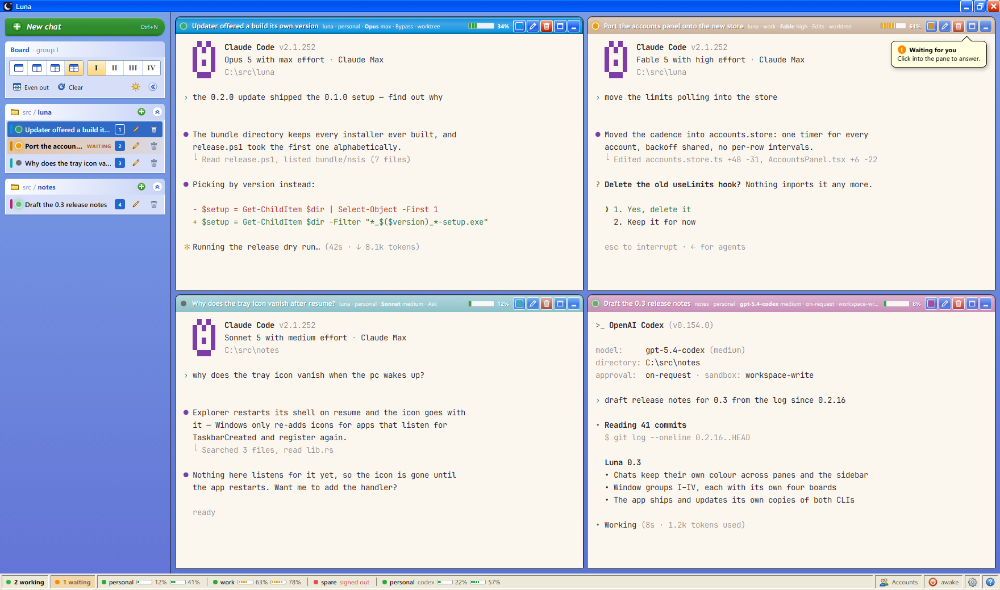
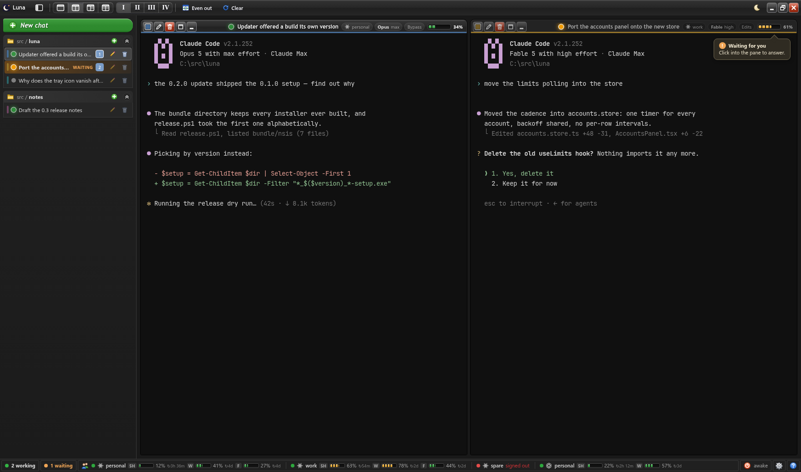

# Luna

[](https://github.com/nrubinmosin/luna/actions/workflows/ci.yml)
[](#license)

Luna is a desktop app (Rust + Tauri 2) that runs Claude Code and Codex CLI
sessions side by side in panes, each on an account with its own isolated config,
so an Anthropic subscription and a ChatGPT one share one window. Sessions can
orchestrate other sessions through Luna's MCP tools, and Luna keeps its own
copies of both CLIs current.



## Features

- **Panes and groups:** 1–4 panes with draggable splits, a peek sheet, up to ten
  window groups, everything reachable from the keyboard.
- **Two CLIs, each in its own words:** Claude Code's model, effort and
  permission mode; Codex's model catalog, reasoning effort, approval and sandbox.
- **Accounts as folders:** per-account logins, settings and history
  (`CLAUDE_CONFIG_DIR`, `CODEX_HOME`), with live usage limits that cost no
  tokens.
- **Status from the CLI itself:** working / waiting / resting, titles and
  context use read from the CLIs' own registries and transcripts.
- **Git worktrees:** each CLI's own `--worktree`, with cleanup that never loses
  uncommitted work.
- **Agents:** sessions spawn helpers on any account or CLI, send them work,
  answer their prompts and get notified when they finish, within a
  least-privilege contract.
- **Background helpers** that need no window and survive a restart of Luna's core.
- **Skills and instructions library:** your own skills and `CLAUDE.md` /
  `AGENTS.md`, laid out into accounts and per-project folders without touching
  the repository.
- **Power:** keeps the PC awake while sessions work; shut down, restart or sleep
  when everything is done.
- **Resilient by design:** sessions run in a core process that outlives the
  window; updates that do not touch Rust restart only the window.
- **Recommendations:** one-click fixes for account settings Luna's features rely
  on.



## Install

Download the setup (`Luna_<version>_x64-setup.exe`) from
[GitHub Releases](https://github.com/nrubinmosin/luna/releases/latest) and install
it into any folder, on any drive: Luna keeps its data there and updates itself.

**Supported OS:** Windows x64 is the released and tested platform. The
code builds and its unit tests run on Linux, and nothing assumes Windows, but no
Linux or macOS packages are published.

## Requirements

- The Microsoft Edge WebView2 Runtime (part of current Windows).
- An Anthropic account for Claude Code and/or a ChatGPT account for Codex.
- Git, for worktrees.
- No global `claude` or `codex` install is needed: Luna downloads its own.

## Quick start

1. Open **Accounts** from the status bar, **Add account**, choose Claude Code or
   Codex, and sign in from the account's row.
2. **New chat** (Ctrl+N): pick a project folder and the account; keep **Git
   worktree** ticked to work on an isolated branch.
3. Add more chats; with auto-tile on, each new one gets its own pane.
4. Tick **Luna tools** on a chat to let it spawn and drive helper sessions.
5. Press **F1** for every shortcut.

The [user guide](docs/README.md#user-guide) covers each part in detail.

## Development

Everything builds in Docker on pinned toolchains; the scripts need PowerShell 7.4+.

```powershell
git config core.hooksPath .githooks
./scripts/gate.ps1                      # formatting, lints, types, tests, build
./scripts/test-build.ps1 -Run -Background   # the isolated test build
```

See [docs/development.md](docs/development.md) and
[CONTRIBUTING.md](CONTRIBUTING.md).

## Documentation

- [Documentation index](docs/README.md)
- [Architecture overview](docs/architecture/overview.md) and
  [decision records](docs/README.md#decisions-adrs)
- [CLI compatibility notes](docs/cli-compatibility.md)
- [Security policy](SECURITY.md) and [threat model](docs/security/threat-model.md)
- [Changelog](CHANGELOG.md)

## License

Licensed under either of [Apache License, Version 2.0](LICENSE-APACHE) or
[MIT license](LICENSE-MIT) at your option. Unless you explicitly state
otherwise, any contribution intentionally submitted for inclusion in Luna by you,
as defined in the Apache-2.0 license, shall be dual licensed as above, without
any additional terms or conditions.
