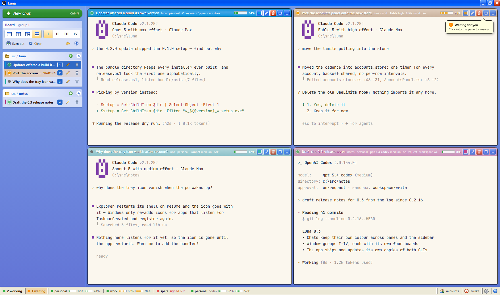
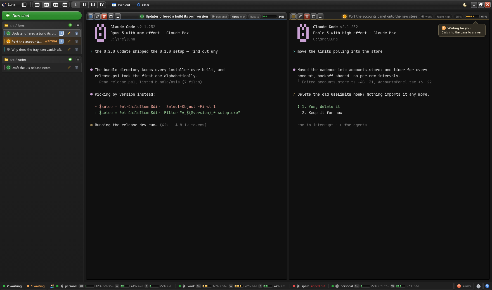
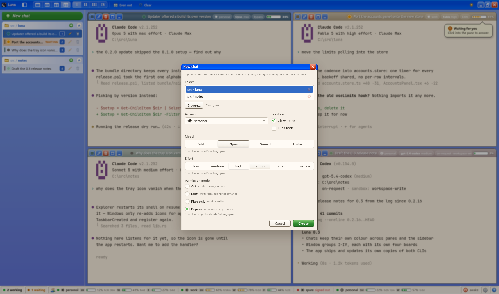

# Luna

*[English version](README.md)*

Тонкая desktop-обёртка (Rust + Tauri) над Claude Code CLI и Codex CLI: несколько сессий в
панелях, папки-проекты, аккаунты с изолированными конфигами — подписка Anthropic и
подписка ChatGPT в одном окне. Носит с собой собственные копии бинарников `claude` и
`codex` и сама их обновляет — глобальная установка CLI не нужна.

Два CLI — два отдельных слоя. Codex-чат описан словами самого Codex (model, reasoning
effort, approval policy, sandbox mode), читает его собственный `config.toml` и показывает
его собственные окна лимитов; ничего с Claude-стороны на него не натягивается.



Подробности по устройству — в [ARCHITECTURE.md](ARCHITECTURE.md).

## Окно

- Оболочка под Windows XP (xp.css, Luna): вместо системной рамки — своя, с
  титлбаром и кнопками свернуть/развернуть/закрыть; шрифт интерфейса Segoe UI. Сайдбар —
  это task pane Проводника, все кнопки во всех титлбарах нарисованы одним набором глифов,
  а все остальные кнопки, включая значки провайдеров, — одним семейством иконок в стиле
  XP. Чекбоксы, радио, поля и скроллбары — XP-шные, скруглённые и в цветах темы. Масштаб
  всего интерфейса задаётся одной переменной `--ui` в `src/app/theme.css`, а поверх него
  действует системный «Размер текста» Windows.
- В титлбаре окна — управление доской: кнопка сайдбара, четыре раскладки, группы
  окон, Even out, Clear и тема. Скрытый сайдбар не занимает места вовсе: если подвести
  курсор к левому краю окна, сайдбар выезжает поверх доски и уезжает, когда курсор уйдёт,
  а кнопка в титлбаре закрепляет его обратно.
- Полный цвет носит только панель, в которой работаешь; остальные бледнеют, как неактивные
  окна в XP. Чат, который ждёт тебя, мигает титлбаром оранжевым, как кнопка на панели задач
  XP, а над панелью, в которой тебя нет, всплывает балун.
- Сетка 1/2/3/4 панелей с перетаскиваемыми сплиттерами (раскладка — Ctrl+Shift+1..4).
  **Один клик** по строке в сайдбаре показывает чат: при одной панели он просто становится
  тем, что она показывает — тащить строку через пустую доску в единственное возможное
  место было церемонией, — а при нескольких панелях чат, которого на доске нет, поднимается
  на лист peek, так что клик никогда не переписывает расстановку. Перетаскивание — это то,
  чем чат сажают в конкретную панель; панели меняются местами перетаскиванием титлбаров.
- **Автоплитка** (включена по умолчанию, Settings → Board): новый чат, которому нет
  свободной панели, добавляет доске ещё одну панель (до четырёх) и садится в неё — всё, что
  уже было на доске, остаётся на местах. Снятие чата с доски или его удаление убирает одну
  панель. Если выключить, новый чат без места поднимается на лист, а доска остаётся как была.
- **Peek** — временный вид, и выглядит именно так: панель поднята на листе, а доска
  осталась за ним, притемнённая. Ctrl+1..4 переводит клавиатуру в эту панель, Alt+1..4
  поднимает её на лист, повторно — опускает обратно; Ctrl+Shift+W ведёт к следующему
  чату, который ждёт тебя, Ctrl+Shift+B закрепляет или прячет сайдбар; нумерованные
  чипы в шапке листа переносят между панелями, а возврат — клик
  где угодно вне листа, повторный клик по строке того же чата или по чипу поднятой панели,
  кнопка «Назад» мыши, кнопка Return или Ctrl+0. Alt, зажатый над чатом в списке, — это
  взгляд: чат поднимается на лист, а отпущенный Alt возвращает, что было (клик оставляет).
  Взгляд начинается через мгновение после нажатия Alt, поэтому сочетания с Alt (Alt+цифра,
  Alt+V, Alt+Shift) лист не трогают.
  Escape намеренно не трогаем: им прерывают CLI.
- F1 или **?** в статус-баре — список всех шорткатов и жестов мышью; на самих кнопках их
  нет. За двойным кликом
  ничего не спрятано: переименовать, удалить, выровнять сплиты — всё это кнопки. Текст
  интерфейса не выделяется, так что протянутая по сайдбару мышь ничего не красит синим.
- Свои сочетания Luna забирает в capture-фазе, поэтому они работают и когда фокус в
  терминале; всё, что она не забрала, доходит до CLI нетронутым.
- Терминалы переживают свои панели: три последних отложенных ждут за экраном со всеми
  подписками, поэтому возврат к чату — это refit, а не заново сессионный хендшейк с
  перезаливкой двухмегабайтного скроллбэка.
- Группы окон — рядом с селектором раскладки в титлбаре: сначала одна, всего до десяти
  (I–X). **+** или Ctrl+Shift+T добавляет группу (Ctrl+T остаётся CLI), **Remove**
  удаляет текущую, когда в ней не осталось чатов. Ctrl+Tab переключает их по кругу (Ctrl+Shift+Tab остаётся CLI). Каждая группа помнит свои четыре
  доски (по одной на раскладку) и их сплиты; **Clear** чистит панели группы, чаты остаются
  на месте, **Even out** возвращает сплиты пополам.
- Статус-бар идёт во всю ширину окна: сколько чатов работает, сколько ждёт (клик ведёт к
  следующему) и каждый аккаунт со всеми его окнами лимитов — насколько заполнено и через
  сколько сброс (клик открывает окно Accounts), — затем питание, настройки и справка. Когда
  места не хватает, у аккаунта остаются имя и самое заполненное окно. Часов нет — они есть
  на панели задач.
- Темы light/dark/system, подобранные под чтение целый день: ни чистого чёрного, ни
  чистого белого, ни синевы в поверхностях; слои различаются светлотой, терминал — самый
  глубокий из них, ANSI-цвета приглушены, но держат контраст не ниже 4.5:1. Светлая — это
  собственный тёплый беж XP под синими титлбарами, на тёплой бумаге; тёмная — нейтральный
  графит.



## Чаты

- Новый чат (Ctrl+N): папка, аккаунт и чекбоксы **Git worktree** и **Luna tools**. Они
  стоят как в Settings (worktree вкл, tools выкл) или как сохранено для папки: переключение
  действует только на этот чат, а «keep for this folder» под ними делает его стартом папки.
  Изоляция — собственный `--worktree` каждого CLI. Перед тем как его сделает Claude Code,
  Luna делает fetch дефолтной ветки origin (не дольше 10 с, без запроса пароля;
  выключается в Settings): Claude Code ответвляет worktree от неё, а сам перефетчивает её
  только раз в сутки.
  Аккаунт определяет, какой CLI запускается, дальше диалог подстраивается:
  - **Claude Code**: модель (выпадающий список), effort
    (`low/medium/high/xhigh/max/ultracode`) и permission mode. Изоляция запускает сессию
    как `claude --worktree` в `<папка>/.claude/worktrees/<имя>`, на ветке `worktree-<имя>`.
  - **Codex**: модель — выпадающий список из каталога самого Codex, в его порядке: из
    списка, который он кэширует в аккаунте (`models_cache.json`), из кэша другого аккаунта,
    если этот ещё не запускался, или прямо из `codex debug models`, — вводить slug руками
    не нужно. Модель, на которой чат стартует без изменений, названа по имени и помечена
    «· default»: `model` из `config.toml` аккаунта, а если его нет — первая модель в списке
    Codex, то есть та, которую он выбрал бы сам; она всегда передаётся как `--model`.
    Reasoning effort — те уровни, что берёт эта модель (`low … ultra`, с описанием каждого
    уровня в подсказке); открывается на уровне модели по умолчанию и следует за моделью
    при её смене — если уровень не задан в файле настроек и не выбран руками. Approval
    policy (`on-request/never`) и sandbox mode (`read-only/workspace-write/danger-full-access`)
    выбираются отдельно; `never` + `danger-full-access` передаётся как
    `--dangerously-bypass-approvals-and-sandbox`, как это называет сам Codex. Изоляция
    запускает `codex --worktree`: Codex выкладывает текущий коммит в
    `<аккаунт>/worktrees/<4 hex>/<репо>` с detached HEAD, а Luna узнаёт путь из rollout
    сессии. Возобновлённый чат возвращается в этот checkout.
- Эти контролы открываются на том, что говорят собственные настройки CLI для этого аккаунта
  в этой папке. Claude Code: `settings.json` аккаунта, затем `.claude/settings.json` и
  `.claude/settings.local.json` проекта, затем машинный managed-файл. Codex: `config.toml`
  аккаунта, затем `.codex/config.toml` проекта (который Codex, а значит и Luna, читает
  только для доверенной папки). Под каждым контролом подписано, из какого файла значение;
  если его поменять, там же скажут об этом и предложат вернуться — правка живёт в одном
  этом чате и никогда не запоминается как новый дефолт.
- Ctrl+Shift+N создаёт чат вообще без диалога: та же папка и аккаунт, что у чата на экране,
  остальное — как в настройках, чекбоксы — как стартует папка. В любом случае новый чат оказывается в панели, которую
  видно: в свободной, а если доска занята — в той, где работали последней.
- Титлбар панели начинается с кнопок — сменить цвет, переименовать, удалить, поднять на
  лист и снять с доски — слева, куда рука тянется первой; дальше имя и отдельными чипами
  папка, аккаунт, модель и effort, permission mode (Claude Code) или approval и sandbox
  (Codex), признак worktree и сколько контекстного окна уже съедено (индикатором и числом).
  Узкая панель прячет чипы по одному, а имя и кнопки оставляет.
- Цвета: каждому новому чату достаётся один из десяти пресетов — его носит титлбар панели
  и полоска на строке в сайдбаре, так что связь видна без чтения названий.
- Статус чата — работает / ждёт тебя / отдыхает — читается из собственного реестра сессий
  CLI, поэтому верен независимо от того, открыт чат в панели или нет. Переход в ожидание
  поднимает системное уведомление: окно вполне может быть свёрнуто в трей. Оно звучит
  системным звуком уведомлений, если это не выключено в Settings → Notifications, а клик по
  нему поднимает окно с этим чатом на peek-листе, не трогая доску.
- Расход контекста считается прямо по транскрипту сессии относительно реального окна
  модели (берётся из Models API) — бесплатно и без вранья.
- Заголовок — от самого CLI: Claude Code называет сессию по началу разговора (то же имя, что
  он ставит на вкладку терминала) и пишет его в транскрипт, откуда Luna его бесплатно читает;
  `/rename` важнее. У Codex — имя треда из `session_index.jsonl`. Первая реплика стоит в
  заголовке только пока названия ещё нет. Переименование — карандаш на строке или в титлбаре;
  заданное руками имя никогда не перетирается.
- Первые 8 символов ID сессии — в том виде, в каком их пишут клеймы в issues и логи, — видны в
  титлбаре панели (клик копирует), полный ID — в подсказке строки чата.
- Номер на строке — это то, до чего достаёт Ctrl+&lt;цифра&gt;: панель, в которой чат показан,
  либо его место в списке, когда панель одна. Пока чат на доске, номер залит цветом.
- Ctrl+V со скриншотом в буфере нажимает собственную клавишу вставки картинки у CLI (Alt+V
  у Claude Code, Ctrl+V у Codex), и CLI прикрепляет её так же, как в любом терминале.
  Файлы, вставленные или перетащенные в панель, копируются в собственное хранилище
  приложения, а в промпт подставляется абсолютный путь — единственное, что webview оставляет
  пригодным.
- Ctrl+C при выделении в панели копирует его; без выделения, как и прежде, прерывает CLI.
  Само выделение ничего не копирует.



## Аккаунты

- Аккаунт — это папка под одним корнем, по умолчанию `Documents/luna-accounts`, разложенная
  по вендорам: `anthropic/<имя>` для Claude Code, `openai/<имя>` для Codex. Всё про аккаунты
  живёт в окне **Accounts**, которое открывается из статус-бара: «Add account» спрашивает,
  какой CLI, и создаёт папку, корзина удаляет её после подтверждения, а Settings переносит
  корень куда угодно. Сессия Claude Code стартует с `CLAUDE_CONFIG_DIR=<папка аккаунта>`,
  сессия Codex — с `CODEX_HOME=<папка аккаунта>`, так что логин, настройки и история у
  каждого аккаунта свои. Свежий Codex-аккаунт получает `config.toml` с
  `check_for_update_on_startup = false` — этот CLI обновляет сама Luna.
- Живые лимиты не стоят ни одного токена. Claude Code: 5h / week / каждый недельный лимит
  по модели, у каждого свой сброс (через сколько, а в окне Accounts — точная дата и время),
  из OAuth-эндпоинта usage — того же, что и `/usage` внутри CLI, — большинство кругов
  отвечает кэш самого CLI. Codex: окна лимитов плана ChatGPT (обычно 5 часов и неделя, плюс
  per-model лимиты, если есть) из того же эндпоинта, который читает `/status` в Codex, с
  токеном из `auth.json` аккаунта; если он недоступен, те же цифры на момент последнего хода
  лежат в последней строке `token_count` rollout-файла. В обоих случаях при 429 пауза каждый
  раз удваивается, а не долбит эндпоинт с прежней частотой; кнопка обновления на строке
  аккаунта спрашивает сразу.
- Access-токен Claude Code живёт около восьми часов; аккаунту, который с тех пор не открывали,
  Luna продлевает токен сама, так же, как это делает CLI, — под его же локом, так что сессия,
  работающая рядом, подхватывает новый токен, а не спорит за него.
- Вход в свежий аккаунт — кнопка на его строке: `claude` или `codex login` запускается в
  модалке, выходить из приложения не нужно.
- Luna сама проставляет CLI-шный признак доверия к папке, когда это нужно: под `--worktree`
  Claude Code не показывает свой trust-промпт, из-за чего каждую новую папку раньше
  приходилось один раз открывать без изоляции; Codex после своего trust-экрана задаёт ещё
  вопрос про Windows-песочницу. Luna пишет `hasTrustDialogAccepted` в `.claude.json` или
  запись `[projects.'<путь>'] trust_level = "trusted"` в `config.toml` до старта сессии.
- **Рекомендуемые настройки** — для каждого аккаунта в окне Accounts; кнопка показывает,
  сколько из них уже есть в файле аккаунта (`5/12`): что хорошо работает с CLI внутри
  Luna — текущее значение в файле, рекомендуемое и объяснение — `tui: fullscreen`, без
  подсказок в спиннере и фидбек-опросов, без recap после отлучки, без повторного
  подтверждения Bypass, PowerShell для `!`-команд только на Windows (Claude Code); без
  проверки обновлений, подсказок, системных уведомлений, аналитики и фидбека, с живым
  веб-поиском (Codex); и как дело вкуса — attribution, effort по умолчанию, Bypass по
  умолчанию. Ничего не пишется, пока не попросишь. Галочка — то, что будет в файле: уже
  записанные ключи открываются отмеченными, снятая галочка убирает ключ (только пока в нём
  то самое рекомендуемое значение); «Tick recommended» отмечает повседневный набор, а
  Apply показывает, сколько ключей добавится и уберётся. Остальной файл, с комментариями,
  остаётся как был.
- Аккаунт можно переименовать прямо в Luna (карандаш рядом с именем): переименовывается
  папка, а за ней — все чаты на нём, список агентов и родитель синхронизации; пока на нём
  идёт хоть один чат, нельзя. Файл настроек аккаунта открывается в редакторе
  (`settings.json` у Claude Code, `config.toml` у Codex; также из рекомендуемых настроек)
  с подсветкой синтаксиса и номерами строк. Он проверяется по мере набора — строка, где
  файл ломается, отмечена, — записывается, только если разбирается, и при сохранении
  раскладывается так, как его пишет сам CLI (JSON с отступом в два пробела, TOML по
  правилам taplo), с комментариями и порядком ключей; Ctrl+S сохраняет.
- **Общие настройки**: выбери для каждого CLI родительский аккаунт — его файл настроек
  копируется на остальные: сразу по Sync now или при каждом запуске, если стоит галочка.
  Остальные получают точную копию: ключ, убранный у родителя, уходит и у них, а то, что
  было задано только у ребёнка, заменяется; логины и доверенные папки Codex у каждого
  аккаунта свои.
- Codex на Windows: без настроенной Windows-песочницы (`[windows] sandbox` в `config.toml`,
  дело самого Codex) режим `workspace-write` ведёт себя как `read-only`, и Codex спрашивает
  перед каждой записью. Luna эту настройку не трогает.

## Сессии и уборка

- Закрытие окна прячет приложение в трей, сессии продолжают работать. Quit в меню трея
  закрывает всю Luna: каждую сессию просят выйти, как при удалении чата, после чего уходят
  ядро и окно. Ядро, которое не ушло за 30 секунд, убивается вместе со всем, что оно запустило.
- **Restart window** в меню трея перезапускает только окно — на случай, когда сломалась
  страница (например, терминалы рисуют мусор): ядро и его сессии работают дальше, вместе
  с идущими ходами, а новое окно их подхватывает.
- Сессии, до которых больше не достучаться (чат случайно заархивировали или потеряли при
  недописанном восстановлении состояния), собираются наверху сайдбара — с тем, чем они
  заняты, — и их можно вернуть себе или убить.
- Папке с worktree-каталогами от удалённых чатов предлагается уборка; ничего, в чём сидит
  живая сессия, не сметается — у Claude Code они в папке проекта, у Codex в аккаунтах.
  При удалении чата вместе с ним по умолчанию уходят его worktree и ветка, которую завёл
  Claude Code; галочку можно снять для отдельного чата, а её
  начальное положение задаётся в настройках.
- Предупреждения и ошибки обеих половин приложения пишутся в `luna.log`: рядом с exe в
  портативной сборке и в `%LOCALAPPDATA%\luna` иначе. INFO туда не попадает, поэтому всё,
  что в файле есть, стоит читать. В каждой строке — версия, которая её написала, а каждый
  запуск начинается строкой `START` с версией и сборкой.
- Сессии живут в ядре Luna — втором процессе из того же exe (`luna-core.exe`; на Windows
  запускается из копии в папке данных, чтобы обновление могло заменить exe), а не в окне.
  Упавшее, зависшее или убитое окно ничего с собой не уносит: CLI продолжают работать вместе с
  фоновыми задачами, а следующее окно к ним подключается. Там же работают слушатель хуков,
  MCP-сервер агентов, activity и питание, так что `luna_wait` агента работает и без окна.
  Настройки → Versions показывают ядро и умеют его перезапустить; само оно уходит, когда
  десять минут нет ни окна, ни сессий. Если остановится само ядро, сессии в нём закончатся:
  баннер над доской скажет об этом, а «Restart the core» вернёт чаты из транскриптов. Само по
  себе ядро не перезапускается.
- В лог попадает и то, чем закончился каждый запуск. Свои причины выхода Luna называет
  сама: Quit в трее, обновление, выход из Windows или её выключение. Если процесс завершил
  кто-то другой, маленький процесс-сторож пишет код выхода. По нему видно, убили ли Luna
  снаружи (Диспетчер задач, `taskkill`, `Stop-Process`) или она упала, и был ли открыт
  Диспетчер задач. Если не стало и сторожа, следующий запуск сообщит, когда прошлый
  последний раз подавал признаки жизни, зависало ли перед этим окно и перезагружался ли ПК.

## Агенты: сессии, которые запускают сессии

Чат, созданный с галочкой **Luna tools** (по умолчанию снята), получает Luna как MCP-сервер,
а с ним одиннадцать инструментов: `luna_list`, `luna_sessions`, `luna_spawn`, `luna_send`, `luna_answer`,
`luna_read`, `luna_wait`, `luna_kill`, `luna_delete`, `luna_guide`, `luna_notify`. Модель может поднять помощника — другую модель, другой аккаунт,
Codex вместо Claude — с открывающим промптом, дождаться ответа, дописать, ответить на его
вопросы, и удалить, когда закончит, вместе с worktree и веткой, если просила их. `luna_notify` даёт ей поднять
системное уведомление посреди хода — с именем её чата в заголовке, клик открывает этот чат,
не чаще раза в 10 секунд. Инструменты и короткая инструкция
стоят около 2k токенов контекста один раз на сессию; полное описание сессий, аккаунтов, моделей
и инструментов отдаёт `luna_guide`, и модель читает его, только когда сама попросит. Чат без
галочки о Luna не знает вовсе, как и фоновый помощник, запущенный без инструментов.

- Помощник работает **в фоне**, если агент не попросил `visible: true`: ни строки, ни
  панели, ни терминала — каждый ход это один запуск CLI в безоконном режиме (`claude -p`,
  `codex exec`), а следующий продолжает тот же разговор. Открытое окно ему не нужно, и он
  удаляется сам, когда его ответ дошёл до агента и он 30 минут простоял без дела, а агент его
  не читал и ничего ему не писал (см. `autoDelete` ниже). На
  строке родителя видно, сколько их, и счётчик несколько секунд светится, когда запущен новый;
  по клику — список с тем, что каждый делает и сколько, его моделью, effort, аккаунтом и
  worktree, и кнопки открыть как обычный чат (между ходами), остановить и удалить.
- Видимый помощник — обычная строка чата, вложенная под ту, что её создала, и по
  умолчанию свёрнутая; счётчик на строке родителя раскрывает список. В панель она не
  садится, пока вы её не откроете. Статус, контекст и тайтл работают как у любого чата.
- Что сессия ждёт, приходит вместе с ней: `state` — `working`, `waiting` (разрешение),
  `question`, `idle` и так далее, а `ask` — сам вопрос с вариантами или команда, на которую
  просят разрешения: `AskUserQuestion` и запросы разрешений Claude Code, вопросы и approval
  Codex. `luna_answer` отвечает: номер или текст варианта, свои слова, `allow` true/false
  или сырые клавиши для любого другого диалога. Фоновый Claude Code задаёт вопросы и
  просит разрешения через Luna, а не на экране (`--permission-prompt-tool`), так что агент
  отвечает ему так же; фоновому Codex спрашивать некого, и что спросил бы, он пишет в ответе.
- Промпт или сообщение длиннее 8000 символов видимая сессия получает файлом, который ей
  велено прочитать; фоновая получает любой длины через stdin.
- Codex в `read-only` и `workspace-write` выполняет команды в своей песочнице Windows
  (unelevated: без прав администратора и без отдельных пользователей), и без алиасов
  приложений из Store в PATH — песочница не может их запустить.
- Убивать и удалять агент может только сессии, которые породил сам (и их потомков). Видеть он
  может и все остальные, ваши тоже, через `luna_sessions` — имя, группа окна, аккаунт и его
  папка, папка проекта, cwd, id сессии CLI и путь к транскрипту, — написать в любую из них
  через `luna_send` и прочитать или дождаться ответа, так что чату можно сказать «передай
  другому». `luna_sessions` сужается до одной группы (`group: "mine"` — группа самого
  агента) и до строк с нужным текстом (`q`), так что чатам одной группы можно поручить
  договориться между собой — например, кто следующим занимает машину.
  В чат, где вы печатаете или оставили неотправленный черновик, `luna_send` не пишет, а
  просит агента попробовать позже. Не больше восьми помощников под одним чатом, и
  помощники помощников инструментов не получают.
- Любой аккаунт доступен агентам, пока вы не выключите его кнопкой с роботом в его строке
  окна Accounts.
  `luna_list` показывает разрешённые, так что чату можно сказать, какой брать, и у каждого —
  его модели, настройки, с которыми там поднимется помощник (модель, effort, режим разрешений — из
  настроек аккаунта и проекта, как их читает диалог нового чата), и расход, как его
  показывает окно Accounts: процент по каждому окну лимита и время сброса.
- `luna_spawn` сообщает то, чего по настройкам не видно: предупреждения CLI с экрана (модель,
  запрещённую организацией, заменили другой) и другие живые сессии в той же папке
  (`sameFolder`) — у них общие файлы и git; `worktree: true` разводит их, и тогда spawn
  называет worktree, который сделал CLI, и его ветку (`luna_list` показывает их у каждого
  помощника). Неизвестная slash-команда возвращается сразу как «не начато», вместе с экраном,
  где это написано.
- `autoDelete`: Luna сама удалит помощника, когда его ответ дошёл до агента и он 30 минут
  простоял без дела; если агент его читает или пишет ему, отсчёт начинается заново, а
  `luna_list` показывает, сколько минут осталось (`deletesInMin`). У фоновых помощников он
  включён, если spawn не сказал `autoDelete: false`, у видимых выключен, если не сказал `true`.
  Помощник, остановленный через `luna_kill`, сам не удаляется никогда: разговор остаётся, и
  `luna_send` его продолжит. Помощник, в которого вы что-то печатали, ваш и остаётся; его
  worktree тоже остаётся, с работой.
- `luna_send` с `interrupt: true` обрывает ход, на котором сессия сейчас, и промпт, на котором
  она стоит, — Esc в терминале, остановка процесса у фонового помощника, — и текст становится
  её следующим ходом, а не ждёт за текущим.
- Каждый spawn записывается в `agents.jsonl` в папке данных Luna — когда, кем, где, аккаунт,
  настройки, начало промпта — и чем закончился, так что `luna_sessions` с `history: true`
  показывает, что запускали раньше, удалённых помощников тоже, и запуск можно повторить как был.
  Удалённый помощник оставляет путь к своему транскрипту (там весь промпт), свой worktree и
  последнее сообщение.
- Удаление родителя руками оставляет помощников сиротами с меткой ↳ на верхнем уровне, если
  не поставить галочку «забрать с собой». Помощники, удалённые своим агентом, исчезают
  насовсем, кроме транскрипта.
- `luna_read` читает транскрипт, не экран; `luna_wait` возвращает сам ответ — для агента,
  которому он нужен в том же ходе. Иначе агент делает spawn и заканчивает ход, а ответ
  приходит к нему сам:
- Агент, который что-то поручил и закончил ход, не дождавшись, не останется висеть: как только
  ответ придёт — или помощник что-то спросит, встанет на промпт разрешения или выйдет, — Luna напечатает в его
  чат одну строку `[Luna notice, not typed by the user]`, как только тот между ходами, вы
  20 секунд ничего в него не печатали и в нём не лежит ваш неотправленный черновик (если
  черновик держит уведомление минуту, Luna скажет об этом системным уведомлением). Если за
  этим ответом ещё стоит `luna_wait` — Claude Code уводит вызов длиннее двух минут в фон, —
  ответ отдаёт он, а уведомление приходит, только если wait не справился за 10 секунд.
- Уведомление цитирует всё, что помощник сказал с момента вопроса, а не только последнее
  сообщение, так что завершающее «это был старый wakeup, ничего не изменилось» не прячет отчёт
  перед ним. Если больше 3000 символов, в нём остаются отчёт (самое длинное сообщение) и
  последнее слово, а весь ответ лежит в файле, путь к которому назван. `luna_read`, пока
  помощник ещё работает, не считается полученным ответом: уведомление всё равно придёт, когда
  он закончит.

## Питание

Поле питания в статус-баре открывает два правила, по которым живёт машина.

- **Не давать ПК уснуть, пока сессии работают** (включено по умолчанию). Luna держит
  power request Windows — `powercfg /requests` показывает его как запрос Luna — пока хоть
  одна сессия занята, и отпускает через минуту после того, как последняя затихла. Сессия,
  ждущая вашего ответа, машину не держит, как и сессия, чей ход закончился два часа назад, что
  бы она ни оставила работать под собой (`tail -f` от монитора на растущий лог).
- **Когда все сессии закончили: выключить, гибернация или сон.** Взводится на этот запуск,
  не сохраняется. Чип показывает, чего правило ждёт; когда всё было тихо выбранное окно,
  идёт минутный отсчёт с уведомлением, клик по чипу его отменяет. Любая активность во время
  отсчёта тоже отменяет его и оставляет правило взведённым. Выключение сначала просит каждый
  CLI выйти; сон и гибернация оставляют сессии как есть, и после пробуждения правило
  действует снова. Пока правило взведено и что-то его держит, `luna.log` называет какая
  сессия и почему, так что утро с невыключенным ПК можно прочитать.

«Занята» измеряется, а не угадывается, по трём признакам на сессию: ход (hooks и registry
Claude Code, rollout Codex), процессы под CLI (при запуске он кладётся в Job Object, так что
сборка, тесты или `sleep`, оставленные в фоне, считаются, пока шевелятся или пока живы после
начала хода) и свежий вывод. «Закончили» значит: ни одна не занята *и* не ждёт разрешения.
Сессия, чей ход оборвался на лимите (или другой ошибке API: слетевший логин, биллинг) и
стоит на оставленном им диалоге, считается закончившей — до сброса там ничего не сдвинется, —
а уведомление об отсчёте говорит, сколько таких было. Если взвести правило, пока сессия ждёт
вашего ответа, придёт уведомление с её именем, а чип покажет `· N waiting for you`, пока это
держит правило. Чтобы слышать границы ходов, Luna запускает каждую сессию Claude Code с файлом `--settings`,
добавляющим несколько hooks, которые постят в loopback-слушатель; они ничего не печатают, и
в контекст модели ничего не попадает.

## Разработка

```sh
pnpm install
pnpm dev          # только фронт в браузере (tauri-команды — no-op)
pnpm tauri dev    # полное приложение (нужен Rust-тулчейн)
```

## Скриншоты

```powershell
./screenshots.ps1
```

Перезаписывает `docs/screenshots/*.png` в Docker: поднимается только фронт на выдуманных
чатах и аккаунтах из `src/dev/demo.ts` (`pnpm dev` + `?demo`), снимает headless Chromium.
Снимать живую Luna — значит снимать всё, что в ней открыто; к тому же только фикстура даёт
переснять все три кадра из одного и того же состояния.

## Проверка Rust-части без локального тулчейна (Docker)

```powershell
docker run --rm -v "${PWD}:/app" -w /app/src-tauri rust:1-bookworm bash -c `
  "apt-get update -qq && apt-get install -y -qq libwebkit2gtk-4.1-dev libgtk-3-dev libayatana-appindicator3-dev librsvg2-dev libssl-dev pkg-config build-essential libxdo-dev >/dev/null && cargo check"
```

## Windows-сборка через Docker

```powershell
./build-windows.ps1
```

Собирает toolchain-образ (rust + cargo-xwin + NSIS + node) и кросс-компилирует под
`x86_64-pc-windows-msvc`:

- портативный exe — `src-tauri\target\x86_64-pc-windows-msvc\release\luna.exe`
  (самодостаточен, нужен только системный WebView2);
- NSIS-инсталлятор — `...\release\bundle\nsis\Luna_*_x64-setup.exe`.

Кэши (node_modules, Windows SDK, cargo registry) живут в named volumes — повторные
сборки быстрые.

## Релизы

```powershell
./release.ps1              # выпустить версию из tauri.conf.json
./release.ps1 -Notes "..." # со своим текстом релиза
./release.ps1 -DryRun      # собрать и составить манифест, ничего не заливая
```

Версия поднимается правкой `src-tauri/tauri.conf.json` и `package.json` вместе; скрипт
откажется работать, если они расходятся, если дерево грязное, если HEAD впереди
`origin/master` или если тег уже есть — релиз обязан воспроизводиться из запушенного
коммита, иначе штамп билда внутри бинаря ничего не стоит.

Скрипт собирает подписанный инсталлятор, пишет `latest.json` для автообновления и
заливает портативный exe, setup, его `.sig` и манифест в релиз `v<версия>`.

## Автообновление и подпись

- Приложение при старте проверяет `latest.json` из GitHub Releases (эндпоинт в
  `src-tauri/tauri.conf.json` → `plugins.updater.endpoints`). Найденный релиз зажигает
  чип в статус-баре и ждёт клика, а не выкидывает модалку поверх того, что идёт в панелях.
  Без этого клика ничего не ставится. Релиз, у которого Rust-часть та же, что у работающего
  ядра (`core_fingerprint` в `latest.json` — хеш `src-tauri`, его считает `build.rs`),
  перезапускает только окно: сессии продолжают работать в ядре, и новое окно их подхватывает.
  Любой другой релиз их останавливает: диалог их перечисляет, и когда инсталлятор скачан,
  каждую просят выйти (со своими exit-хуками), а чаты потом поднимаются из транскриптов.
- CLI обновляются отдельно и по тому же принципу: `cli.rs` раз в шесть часов проверяет канал
  релизов каждого и раскладывает версию в `<data>/claude-cli/versions/<ver>/` или
  `<data>/codex-cli/versions/<ver>/`. Claude Code приезжает голым exe из официального
  release-бакета со сверкой sha256 из манифеста. Codex — из GitHub Releases (`openai/codex`,
  тег `rust-v<ver>`) в виде package-тарбола: только у него есть строка в `SHA256SUMS`
  релиза, и в нём рядом с `bin/codex.exe` лежат хелперы Windows-песочницы. Claude-сессии
  запускаются с `DISABLE_AUTOUPDATER=1`, Codex-аккаунты создаются с
  `check_for_update_on_startup = false`, так что оба бинарника двигает только Luna.
- Все три версии живут в настройках (шестерёнка в статус-баре): там «checked … ago» и
  кнопка проверить сейчас. Статус-бар подаёт голос, только когда есть новость — доступен
  релиз, идёт загрузка или проверка упала и стоит повторить.
- Ключ подписи апдейтов — `C:\Users\Nikita\.ssh\luna-updater.key`: приватный, без пароля,
  береги его; `.pub` уже вшит в конфиг. Для подписанной сборки задай в окружении сборки
  `TAURI_SIGNING_PRIVATE_KEY_PATH` (это и делает `build-windows.ps1`) — тогда рядом с
  бандлом появятся `.sig`-файлы, их и `latest.json` заливаешь в Release.
- Authenticode-подпись exe (чтобы SmartScreen не ругался) требует сертификат: когда будет,
  добавь в `tauri.conf.json` → `bundle.windows.signCommand`.
