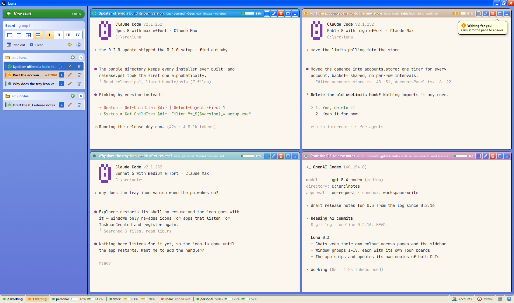
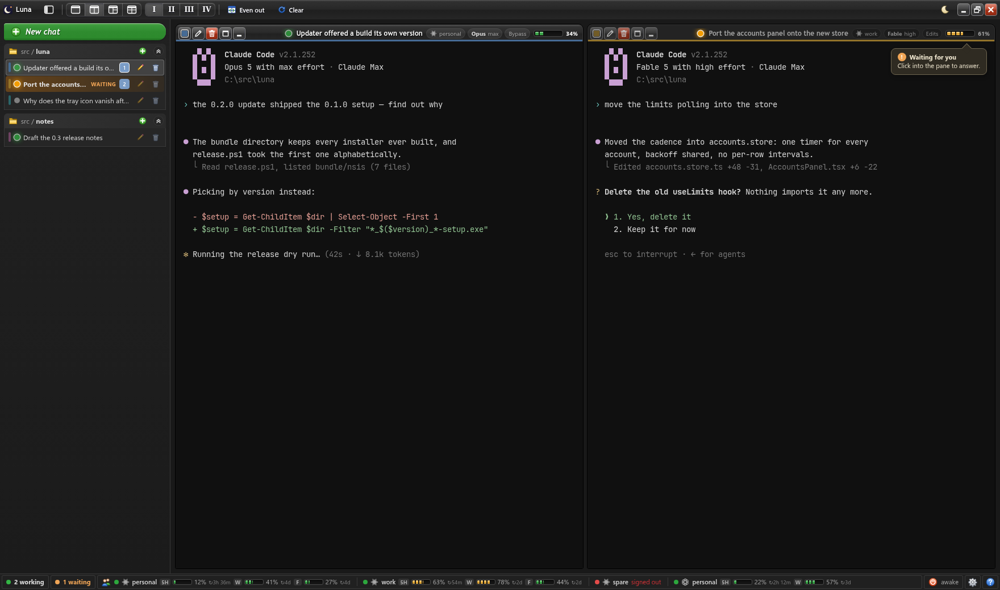
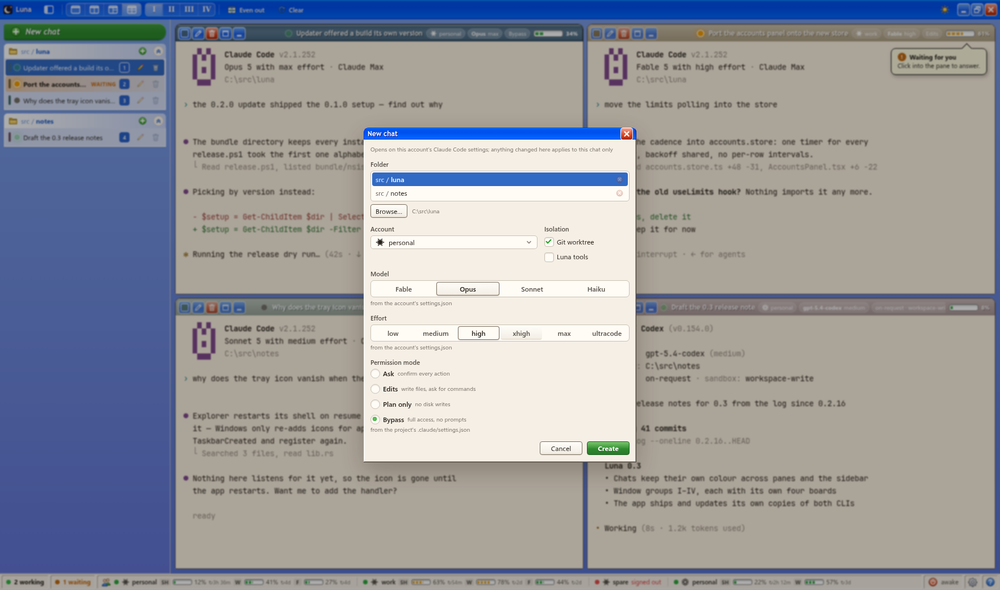

# Luna

*[English version](README.md)*

Тонкая desktop-обёртка (Rust + Tauri) над Claude Code CLI и Codex CLI: несколько сессий в
панелях, папки-проекты, аккаунты с изолированными конфигами — подписка Anthropic и
подписка ChatGPT в одном окне. Носит с собой собственные копии бинарников `claude` и
`codex` и сама их обновляет — глобальная установка CLI не нужна.

Два CLI — два отдельных слоя. Codex-чат описан словами самого Codex (model, reasoning
effort, approval policy, sandbox mode), читает его собственный `config.toml` и показывает
его собственные окна лимитов; ничего с Claude-стороны на него не натягивается.



Подробности по устройству — в [ARCHITECTURE.md](ARCHITECTURE.md).

## Окно

- Оболочка под Windows XP (xp.css, Luna): вместо системной рамки — своя, с
  титлбаром и кнопками свернуть/развернуть/закрыть; шрифт интерфейса Segoe UI. Сайдбар —
  это task pane Проводника, все кнопки во всех титлбарах нарисованы одним набором глифов,
  а все остальные кнопки, включая значки провайдеров, — одним семейством иконок в стиле
  XP. Чекбоксы, радио, поля и скроллбары — XP-шные, скруглённые и в цветах темы. Масштаб
  всего интерфейса задаётся одной переменной `--ui` в `src/app/theme.css`, а поверх него
  действует системный «Размер текста» Windows.
- В титлбаре окна — управление доской: кнопка сайдбара, четыре раскладки, группы
  окон, Even out, Clear и тема. Скрытый сайдбар не занимает места вовсе: если подвести
  курсор к левому краю окна, сайдбар выезжает поверх доски и уезжает, когда курсор уйдёт,
  а кнопка в титлбаре закрепляет его обратно.
- Полный цвет носит только панель, в которой работаешь; остальные бледнеют, как неактивные
  окна в XP. Чат, который ждёт тебя, мигает титлбаром оранжевым, как кнопка на панели задач
  XP, а над панелью, в которой тебя нет, всплывает балун.
- Сетка 1/2/3/4 панелей с перетаскиваемыми сплиттерами (раскладка — Ctrl+Shift+1..4).
  **Один клик** по строке в сайдбаре показывает чат: при одной панели он просто становится
  тем, что она показывает — тащить строку через пустую доску в единственное возможное
  место было церемонией, — а при нескольких панелях чат, которого на доске нет, поднимается
  на лист peek, так что клик никогда не переписывает расстановку. Перетаскивание — это то,
  чем чат сажают в конкретную панель; панели меняются местами перетаскиванием титлбаров.
- **Автоплитка** (включена по умолчанию, Settings → Board): новый чат, которому нет
  свободной панели, добавляет доске ещё одну панель (до четырёх) и садится в неё — всё, что
  уже было на доске, остаётся на местах. Снятие чата с доски или его удаление убирает одну
  панель. Если выключить, новый чат без места поднимается на лист, а доска остаётся как была.
- **Peek** — временный вид, и выглядит именно так: панель поднята на листе, а доска
  осталась за ним, притемнённая. Ctrl+1..4 переводит клавиатуру в эту панель, Alt+1..4
  поднимает её на лист, повторно — опускает обратно; Ctrl+Shift+W ведёт к следующему
  чату, который ждёт тебя, Ctrl+Shift+B закрепляет или прячет сайдбар; нумерованные
  чипы в шапке листа переносят между панелями, а возврат — клик
  где угодно вне листа, повторный клик по строке того же чата или по чипу поднятой панели,
  кнопка «Назад» мыши, кнопка Return или Ctrl+0. Alt, зажатый над чатом в списке, — это
  взгляд: чат поднимается на лист, а отпущенный Alt возвращает, что было (клик оставляет).
  Взгляд начинается через мгновение после нажатия Alt, поэтому сочетания с Alt (Alt+цифра,
  Alt+V, Alt+Shift) лист не трогают.
  Escape намеренно не трогаем: им прерывают CLI.
- F1 или **?** в статус-баре — список всех шорткатов и жестов мышью; на самих кнопках их
  нет. За двойным кликом
  ничего не спрятано: переименовать, удалить, выровнять сплиты — всё это кнопки. Текст
  интерфейса не выделяется, так что протянутая по сайдбару мышь ничего не красит синим.
- Свои сочетания Luna забирает в capture-фазе, поэтому они работают и когда фокус в
  терминале; всё, что она не забрала, доходит до CLI нетронутым.
- Терминалы переживают свои панели: три последних отложенных ждут за экраном со всеми
  подписками, поэтому возврат к чату — это refit, а не заново сессионный хендшейк с
  перезаливкой двухмегабайтного скроллбэка.
- Группы окон — рядом с селектором раскладки в титлбаре: сначала одна, всего до десяти
  (I–X). **+** или Ctrl+Shift+T добавляет группу (Ctrl+T остаётся CLI), **Remove**
  удаляет текущую, когда в ней не осталось чатов. Ctrl+Tab переключает их по кругу (Ctrl+Shift+Tab остаётся CLI). Каждая группа помнит свои четыре
  доски (по одной на раскладку) и их сплиты; **Clear** чистит панели группы, чаты остаются
  на месте, **Even out** возвращает сплиты пополам.
- Статус-бар идёт во всю ширину окна: сколько чатов работает, сколько ждёт (клик ведёт к
  следующему) и каждый аккаунт со всеми его окнами лимитов — насколько заполнено и через
  сколько сброс (клик открывает окно Accounts), — затем питание, настройки и справка. Когда
  места не хватает, у аккаунта остаются имя и самое заполненное окно. Часов нет — они есть
  на панели задач.
- Темы light/dark/system, подобранные под чтение целый день: ни чистого чёрного, ни
  чистого белого, ни синевы в поверхностях; слои различаются светлотой, терминал — самый
  глубокий из них, ANSI-цвета приглушены, но держат контраст не ниже 4.5:1. Светлая — это
  собственный тёплый беж XP под синими титлбарами, на тёплой бумаге; тёмная — нейтральный
  графит.



## Чаты

- Новый чат (Ctrl+N): папка, аккаунт и чекбоксы **Git worktree** и **Luna tools**. Они
  стоят как в Settings (worktree вкл, tools выкл) или как сохранено для папки: переключение
  действует только на этот чат, а «keep for this folder» под ними делает его стартом папки.
  Изоляция — собственный `--worktree` каждого CLI. Перед тем как его сделает Claude Code,
  Luna делает fetch дефолтной ветки origin (не дольше 10 с, без запроса пароля;
  выключается в Settings): Claude Code ответвляет worktree от неё, а сам перефетчивает её
  только раз в сутки.
  У аккаунта Codex добавляется **Hooks unasked**, который стартует и сохраняется так же
  (в Settings выключен): хуки проекта запускаются без вопроса Codex «Hooks need review»
  (`--dangerously-bypass-hook-trust`). Codex спрашивает заново для каждого нового
  worktree, аккаунта или изменённого хука, а фоновый помощник спросить не может и
  работает без них. Помощник, которого запускает агент, получает чекбокс таким, каким с
  ним стартовала бы его папка; агент это не выбирает.
  Аккаунт определяет, какой CLI запускается, дальше диалог подстраивается:
  - **Claude Code**: модель (выпадающий список), effort
    (`low/medium/high/xhigh/max/ultracode`) и permission mode. Изоляция запускает сессию
    как `claude --worktree` в `<папка>/.claude/worktrees/<имя>`, на ветке `worktree-<имя>`.
  - **Codex**: модель — выпадающий список из каталога самого Codex, в его порядке: из
    списка, который он кэширует в аккаунте (`models_cache.json`), из кэша другого аккаунта,
    если этот ещё не запускался, или прямо из `codex debug models`, — вводить slug руками
    не нужно. Модель, на которой чат стартует без изменений, названа по имени и помечена
    «· default»: `model` из `config.toml` аккаунта, а если его нет — первая модель в списке
    Codex, то есть та, которую он выбрал бы сам; она всегда передаётся как `--model`.
    Reasoning effort — те уровни, что берёт эта модель (`low … ultra`, с описанием каждого
    уровня в подсказке); открывается на уровне модели по умолчанию и следует за моделью
    при её смене — если уровень не задан в файле настроек и не выбран руками. Approval
    policy (`on-request/never/auto-review`) и sandbox mode (`read-only/read-only-net/workspace-write/danger-full-access`)
    выбираются отдельно; `never` + `danger-full-access` передаётся как
    `--dangerously-bypass-approvals-and-sandbox`, как это называет сам Codex. `auto-review` —
    это `--approve-for-me` Codex: что Codex спросил бы у вас, решает модель-ревьюер, одобряя
    или отклоняя, и ход идёт дальше; песочница всегда `workspace-write`. Изоляция
    запускает `codex --worktree`: Codex выкладывает текущий коммит в
    `<аккаунт>/worktrees/<4 hex>/<репо>` с detached HEAD, а Luna узнаёт путь из rollout
    сессии. Возобновлённый чат возвращается в этот checkout.
- Эти контролы открываются на том, что говорят собственные настройки CLI для этого аккаунта
  в этой папке. Claude Code: `settings.json` аккаунта, затем `.claude/settings.json` и
  `.claude/settings.local.json` проекта, затем машинный managed-файл. Codex: `config.toml`
  аккаунта, затем `.codex/config.toml` проекта (который Codex, а значит и Luna, читает
  только для доверенной папки). Под каждым контролом подписано, из какого файла значение;
  если его поменять, там же скажут об этом и предложат вернуться — правка живёт в одном
  этом чате и никогда не запоминается как новый дефолт.
- Ctrl+Shift+N создаёт чат вообще без диалога: та же папка и аккаунт, что у чата на экране,
  остальное — как в настройках, чекбоксы — как стартует папка. В любом случае новый чат оказывается в панели, которую
  видно: в свободной, а если доска занята — в той, где работали последней.
- Титлбар панели начинается с кнопок — сменить цвет, переименовать, удалить, поднять на
  лист и снять с доски — слева, куда рука тянется первой; дальше имя и отдельными чипами
  папка, аккаунт, модель и effort, permission mode (Claude Code) или approval и sandbox
  (Codex), признак worktree и сколько контекстного окна уже съедено (индикатором и числом).
  Узкая панель прячет чипы по одному, а имя и кнопки оставляет.
- Цвета: каждому новому чату достаётся один из десяти пресетов — его носит титлбар панели
  и полоска на строке в сайдбаре, так что связь видна без чтения названий.
- Статус чата — работает / ждёт тебя / отдыхает — читается из собственного реестра сессий
  CLI, поэтому верен независимо от того, открыт чат в панели или нет. Переход в ожидание
  поднимает системное уведомление: окно вполне может быть свёрнуто в трей. Оно звучит
  системным звуком уведомлений, если это не выключено в Settings → Notifications, а клик по
  нему поднимает окно с этим чатом на peek-листе, не трогая доску.
  Ход, который кончился вопросом тебе простыми словами, тоже ждёт, когда его последнее
  сообщение кончается строкой с текстом из Settings → Waiting for you (по умолчанию
  `AWAITING OPERATOR`). Чат ждёт, пока ты ему не напишешь или не снимешь ожидание вручную
  галочкой на титлбаре его панели или на его строке; взведённое выключение «когда всё
  закончится» его не ждёт.
- Расход контекста считается прямо по транскрипту сессии относительно реального окна
  модели (берётся из Models API) — бесплатно и без вранья.
- Заголовок — от самого CLI: Claude Code называет сессию по началу разговора (то же имя, что
  он ставит на вкладку терминала) и пишет его в транскрипт, откуда Luna его бесплатно читает;
  `/rename` важнее. У Codex — имя треда из `session_index.jsonl`. Первая реплика стоит в
  заголовке только пока названия ещё нет. Переименование — карандаш на строке или в титлбаре;
  заданное руками имя никогда не перетирается.
- Первые 8 символов ID сессии — в том виде, в каком их пишут клеймы в issues и логи, — видны в
  титлбаре панели (клик копирует), полный ID — в подсказке строки чата.
- Номер на строке — это то, до чего достаёт Ctrl+&lt;цифра&gt;: панель, в которой чат показан,
  либо его место в списке, когда панель одна. Пока чат на доске, номер залит цветом.
- Ctrl+V вставляет, как в любом терминале. Со скриншотом в буфере он нажимает собственную
  клавишу вставки картинки у CLI (Alt+V у Claude Code, Ctrl+V у Codex), и CLI прикрепляет
  её так же, как где угодно.
  Файлы, вставленные или перетащенные в панель, копируются в собственное хранилище
  приложения, а в промпт подставляется абсолютный путь — единственное, что webview оставляет
  пригодным.
- Ctrl+C при выделении в панели копирует его; без выделения, как и прежде, прерывает CLI.
  Само выделение ничего не копирует.
- Ссылка в панели открывается в вашем браузере, а не в окне Luna. В каком — задаётся в
  Settings → Links: браузер по умолчанию и отдельный для аккаунта или папки проекта. Shift+клик
  по ссылке показывает все браузеры, в которых её открыть, может запомнить выбор для этого
  чата и копирует ссылку. Сначала берётся выбор самого чата, потом аккаунта, папки, потом
  браузер по умолчанию. Браузер — это командная строка с `%1` на месте ссылки, так что
  профиль браузера задаётся флагом (`--profile-directory="Profile 1"` у Chrome, Edge и Brave,
  `-P имя` у Firefox). На Windows установленные браузеры и их профили находятся сами, вместе с
  системным обработчиком и его флагами; на других системах — системный обработчик и ваши.



## Аккаунты

- Аккаунт — это папка под одним корнем, по умолчанию `Documents/luna-accounts`, разложенная
  по вендорам: `anthropic/<имя>` для Claude Code, `openai/<имя>` для Codex. Всё про аккаунты
  живёт в окне **Accounts**, которое открывается из статус-бара: «Add account» спрашивает,
  какой CLI, и создаёт папку, корзина удаляет её после подтверждения, а Settings переносит
  корень куда угодно. Сессия Claude Code стартует с `CLAUDE_CONFIG_DIR=<папка аккаунта>`,
  сессия Codex — с `CODEX_HOME=<папка аккаунта>`, так что логин, настройки и история у
  каждого аккаунта свои. Свежий Codex-аккаунт получает `config.toml` с
  `check_for_update_on_startup = false` — этот CLI обновляет сама Luna.
- Живые лимиты не стоят ни одного токена. Claude Code: 5h / week / каждый недельный лимит
  по модели, у каждого свой сброс (через сколько, а в окне Accounts — точная дата и время),
  из OAuth-эндпоинта usage — того же, что и `/usage` внутри CLI, — большинство кругов
  отвечает кэш самого CLI. Codex: окна лимитов плана ChatGPT (обычно 5 часов и неделя, плюс
  per-model лимиты, если есть) из того же эндпоинта, который читает `/status` в Codex, с
  токеном из `auth.json` аккаунта; если он недоступен, те же цифры на момент последнего хода
  лежат в последней строке `token_count` rollout-файла. В обоих случаях при 429 пауза каждый
  раз удваивается, а не долбит эндпоинт с прежней частотой; кнопка обновления на строке
  аккаунта спрашивает сразу.
- Access-токен Claude Code живёт около восьми часов; аккаунту, который с тех пор не открывали,
  Luna продлевает токен сама, так же, как это делает CLI, — под его же локом, так что сессия,
  работающая рядом, подхватывает новый токен, а не спорит за него.
- Вход в свежий аккаунт — кнопка на его строке: `claude` или `codex login` запускается в
  модалке, выходить из приложения не нужно.
- Luna сама проставляет CLI-шный признак доверия к папке, когда это нужно: под `--worktree`
  Claude Code не показывает свой trust-промпт, из-за чего каждую новую папку раньше
  приходилось один раз открывать без изоляции; Codex после своего trust-экрана задаёт ещё
  вопрос про Windows-песочницу. Luna пишет `hasTrustDialogAccepted` в `.claude.json` или
  запись `[projects.'<путь>'] trust_level = "trusted"` в `config.toml` до старта сессии.
  Codex можно доверить папку и на один запуск (`-c projects=…`), ничего не записывая: так
  доверяется фоновый Codex-помощник — сам спросить он не может и иначе работает без
  проектного `.codex/` с его настройками и хуками, — куда бы его ни отправили, и любая
  сессия Codex в проекте внутри папки из Settings → «Codex trusts on this computer».
  Сам Codex сверяет доверие по точному пути проекта, так что родительская папка в его
  конфиге не сработала бы.
- **Рекомендуемые настройки** — для каждого аккаунта в окне Accounts; кнопка показывает,
  сколько из них уже есть в файле аккаунта (`5/12`): что хорошо работает с CLI внутри
  Luna — текущее значение в файле, рекомендуемое и объяснение — `tui: fullscreen`, без
  подсказок в спиннере и фидбек-опросов, без сжатия контекста в простое, без повторного подтверждения Bypass,
  PowerShell для `!`-команд только на Windows, без копирования по выделению
  (Claude Code, у которого этот ключ в `.claude.json`); без проверки обновлений,
  подсказок, системных уведомлений, копирования по выделению, аналитики и фидбека, с живым
  веб-поиском (Codex); и как дело вкуса — attribution и Bypass по умолчанию. Ничего не пишется, пока не попросишь. Галочка — то, что будет в файле: уже
  записанные ключи открываются отмеченными, снятая галочка убирает ключ (только пока в нём
  то самое рекомендуемое значение); «Tick recommended» отмечает повседневный набор, а
  Apply показывает, сколько ключей добавится и уберётся. Остальной файл, с комментариями,
  остаётся как был.
- Аккаунт можно переименовать прямо в Luna (карандаш рядом с именем): переименовывается
  папка, а за ней — все чаты на нём, список агентов и родитель синхронизации; пока на нём
  идёт хоть один чат или фоновый помощник, нельзя. Файл настроек аккаунта открывается в редакторе
  (`settings.json` у Claude Code, `config.toml` у Codex; также из рекомендуемых настроек)
  с подсветкой синтаксиса и номерами строк. Он проверяется по мере набора — строка, где
  файл ломается, отмечена, — записывается, только если разбирается, и при сохранении
  раскладывается так, как его пишет сам CLI (JSON с отступом в два пробела, TOML по
  правилам taplo), с комментариями и порядком ключей; Ctrl+S сохраняет.
- **Общие настройки**: выбери для каждого CLI родительский аккаунт — его файл настроек
  копируется на остальные: сразу по Sync now или при каждом запуске, если стоит галочка.
  Остальные получают точную копию: ключ, убранный у родителя, уходит и у них, а то, что
  было задано только у ребёнка, заменяется; логины и доверенные папки Codex у каждого
  аккаунта свои.

## Скиллы и инструкции

- Luna держит твою собственную библиотеку: файлы инструкций, у каждого своё имя, и сколько
  угодно скиллов — в своей папке (`library` в папке данных Luna) или в той, что выберешь,
  например в репозитории с dotfiles. Окно **Skills & instructions** (из окна аккаунтов) их
  создаёт, переименовывает и правит и показывает, куда что уходит. Инструкции там видны по
  их первому заголовку; у каждого имени есть кнопка копирования — чтобы назвать скилл или
  инструкции в чате.
- Каждый скилл и каждый файл инструкций уходит в те аккаунты, что ты для него выберешь: во
  все, во все аккаунты одного CLI или в аккаунты по имени — а переименованный аккаунт
  сохраняет то, что для него выбрано.
- Инструкции уходят в свои аккаунты: `CLAUDE.md` в папку аккаунта Claude Code, `AGENTS.md`
  в папку аккаунта Codex — эти файлы CLI читает в начале каждой сессии, в любом проекте.
  Один файл на оба CLI, и у аккаунта их не больше одного: окно показывает инструкции против
  аккаунтов, по радиокнопке на аккаунт — какие он получает, или никаких. Если аккаунт
  попадает в несколько, побеждают те, что называют его по имени, затем те, что для всех
  аккаунтов его CLI, затем те, что для всех, — так что `main` для всех и `work` для рабочего
  аккаунта работают сами собой. Отдать одним инструкциям все аккаунты, аккаунты CLI или
  аккаунт по имени — значит забрать это у тех, у кого оно было. Аккаунт, у которого уже есть
  свой файл, сохраняет его, пока ты не заберёшь его в библиотеку или не заменишь; если
  аккаунт не получает инструкций из библиотеки, его файл можно забрать как новые инструкции —
  с именем аккаунта и только для него. Единственный `instructions.md` прежних версий
  становится `instructions/main.md` — для тех же аккаунтов.
- Скилл — это папка с `SKILL.md` (front matter с `name` и `description`, дальше сами
  инструкции) и любыми нужными ему файлами рядом. В каждом выбранном для него аккаунте он
  уходит в `skills/` аккаунта — для всех сессий во всех проектах.
- Добавленная папка (например, репозиторий) — для того, что относится к одному проекту, но
  не ко всем, кто в нём работает. Скилл с галочкой у неё получают сессии, которые Luna
  запускает в ней и в её worktree (хелперы, resume и сабагенты самих CLI тоже), — при старте
  каждой: в саму папку ничего не пишется, поэтому ничего не появляется в `git status` и
  ничего не теряется в свежем worktree. Claude Code получает скиллы через `--add-dir` папки в
  данных Luna и показывает их под своими именами; скилл, чьё имя уже есть у репозитория или
  аккаунта, идёт там как `luna-<имя>`. Codex получает их плагином в аккаунте, включённым для
  сессии, и показывает как `<папка>:<имя>`. Сессии, запущенные не через Luna, их не видят.
- Аккаунты и папки скилла сочетаются одним из двух способов. **or**, по умолчанию: выбранные
  аккаунты получают его везде, а в папках с галочкой — сессии любого аккаунта. **and**: только
  выбранные аккаунты и только в этих папках — например, скилл для одного репозитория на всех
  аккаунтах, кроме одного.
- Папка может и не давать скилл своим сессиям — например, у репозитория есть свой скилл для
  той же работы. Бледная галочка — скилл, который сессии папки получают и так: от аккаунтов,
  для которых он предназначен, или от папки, в которой лежит эта; щелчок выключает его здесь
  (красный крестик), следующий возвращает. Luna скрывает скилл от сессии
  при её старте (`skillOverrides` в `--settings` Claude Code, `skills.config` в `-c` Codex);
  копия в аккаунте остаётся, поэтому CLI, запущенный в этой папке не через Luna, её видит.
  Оба CLI скрывают скилл по имени, так что одноимённый скилл репозитория тоже пропадёт. Когда
  одна папка лежит в другой, решает внутренняя: выключить в родительской, а в одном
  репозитории включить снова.
- «Add a folder…» предлагает папки из диалога новой сессии, а любую другую — через выбор
  папки: папка с несколькими репозиториями даёт свои скиллы каждому.
- Библиотека — оригинал, в каждом месте лежит копия. Luna помнит, что и куда записала, и
  трогает только свои копии: всё остальное в аккаунте или папке остаётся, а ненужная больше
  копия удаляется, только пока она в точности такая, какой Luna её записала. Копию, изменённую
  или удалённую там, где она лежит, — руками или моделью, которая улучшила скилл на месте, —
  Luna молча не заменяет: она появляется в «Needs a look» и чипом в статус-баре, с отличиями от
  того, что записала Luna. Можно забрать её в библиотеку — тогда она станет копией везде;
  вернуть библиотечную; или исключить это место. Заменённая сторона 30 дней хранится в
  бэкапах Luna.
- Библиотека раскладывается при запуске Luna, перед каждой сессией, которую запускает Luna
  (чат, resume, каждый ход helper'а), при каждом изменении в окне и по Sync now: файл,
  изменённый в библиотеке другой программой — скажем, моделью, которая дорабатывает там
  скилл, — доходит до аккаунтов к следующей сессии. Заново библиотека просматривается, когда
  окно Luna снова выходит на передний план, — так замечается копия, отредактированная в
  другой программе. Скилл, чей `SKILL.md` не годится (нет front
  matter, имя не совпадает с папкой), никуда не раскладывается, пока его не исправят, а его
  копии остаются как были; как и копии библиотеки, которая на миг не читается (файл держат
  открытым посреди сохранения). Пути сравниваются так, как их сравнивает система, — на
  Windows без учёта регистра, — так что аккаунт, переименованный только сменой регистра,
  сохраняет свои копии. Аккаунт Codex с `AGENTS.override.md` читает его вместо
  `AGENTS.md`; окно об этом предупреждает.

## Сессии и уборка

- Закрытие окна прячет приложение в трей, сессии продолжают работать. Quit в меню трея
  закрывает всю Luna: каждую сессию просят выйти, как при удалении чата, ход фонового
  помощника останавливают, после чего уходят ядро и окно. Ядро, которое не ушло за 30 секунд, убивается вместе со всем, что оно запустило.
- **Restart window** в меню трея перезапускает только окно — на случай, когда сломалась
  страница (например, терминалы рисуют мусор): ядро и его сессии работают дальше, вместе
  с идущими ходами, а новое окно их подхватывает.
- Сессии, до которых больше не достучаться (чат случайно заархивировали или потеряли при
  недописанном восстановлении состояния), собираются наверху сайдбара — с тем, чем они
  заняты, — и их можно вернуть себе или убить.
- **Worktrees** в заголовке окна показывает worktree, которые Claude Code и Codex оставили
  без чата, — по папкам и по CLI, а на кнопке их число, когда они есть. В каждый сначала
  заглядывают: чистые отмечены сразу, а те, где есть незакоммиченные файлы или коммиты,
  которые удаление потеряет (их нет ни в одной остающейся ветке и ни на одном remote), так и подписаны. Удалять можно по одному или все
  отмеченные разом; то, в чём сидит живая сессия или фоновый помощник, не удаляется никогда.
- При удалении чата вместе с ним по умолчанию уходят его worktree и ветка, которую завёл
  Claude Code, если в этом worktree не работает другой чат или помощник; галочку можно снять для отдельного чата, а её
  начальное положение задаётся в настройках.
- Обе половины приложения пишут в `luna.log`: рядом с exe или, если туда писать нельзя, в
  `%LOCALAPPDATA%\luna`. Туда идут предупреждения и ошибки и события, по которым потом
  разбирают проблему: запуск, выход и удаление каждой сессии, каждый ход помощника, каждый
  вызов MCP (кто, какой инструмент, на какой сессии, чем кончился и сколько шёл), каждое
  уведомление, взятие и снятие запрета на сон. Сессии названы по id и имени чата, так что и
  удалённую можно узнать; то, что сказано в чате — промпты, отправленный текст, ответы, —
  туда не попадает никогда. В каждой строке — версия, которая её написала, а каждый запуск
  начинается строкой `START` с версией и сборкой.
- Сессии живут в ядре Luna — втором процессе из того же exe (`luna-core.exe`; на Windows
  запускается из копии в папке данных, чтобы обновление могло заменить exe), а не в окне.
  Упавшее, зависшее или убитое окно ничего с собой не уносит: CLI продолжают работать вместе с
  фоновыми задачами, а следующее окно к ним подключается. Окно, отставшее от вывода сессий,
  ядро отпускает, и оно сразу подключается обратно, а терминалы перерисовываются из
  буфера прокрутки. Там же работают слушатель хуков,
  MCP-сервер агентов, activity и питание, так что `luna_wait` агента работает и без окна.
  Настройки → Versions показывают ядро и умеют его перезапустить; само оно уходит, когда
  десять минут нет ни окна, ни сессий (фоновый помощник посреди хода считается сессией, как и
  тот, чьи ходы оставили работу, пока она держит ПК бодрствующим). Если остановится само ядро, сессии в нём закончатся:
  баннер над доской скажет об этом, а «Restart the core» вернёт чаты из транскриптов. Само по
  себе ядро не перезапускается. Фоновые помощники тоже переживают ядро: каждый хранится в
  `helpers.json` в папке данных (его настройки, id его разговора, чей он — но не то, что в
  нём сказано), и следующее ядро подхватывает их после обновления, перезапуска или
  перезагрузки. Ход, посреди которого было ядро, останавливается вместе с ним; агенту, который
  ждёт ответа, об этом сообщают, как только вернётся его собственный чат, и отдают сообщения,
  стоявшие в очереди за этим ходом, дословно, чтобы отправить их снова, а `luna_send` даёт
  помощнику продолжить. Помощник, запущенный с `resumeOnRestart: true`, продолжает сам, вместе
  с этими сообщениями, если Luna знает, что старый ход закончился (обычная остановка или любая
  смерть ядра). Об остановленном раньше, чем его первый ход к чему-то пришёл, сообщают,
  что он так и не начал, и отдают его промпт, а с `resumeOnRestart` он начинает на нём заново.
  Видимый помощник с этим флагом тоже продолжает: Luna запускает его CLI, в панели он или нет,
  и вводит те же слова, как только тот вернётся к своему приглашению, если только вы не начали
  в нём печатать и агент не написал ему раньше. О видимом помощнике без этого флага, которому не
  к чему вернуться, сообщают так же: он так и не начал, а промпт и сообщения этого агента,
  которые придерживала Luna, лежат в файле, чтобы отправить их снова. Worktree помощника Claude
  Code Luna называет сама, так что новый запуск возвращается в него и ни в какой другой, и только
  если его никто не трогал с тех пор, как его создал Claude Code. Всё остальное, и то, что начал
  помощник Codex (Codex не принимает имени, так что неизвестно, чей это worktree), остаётся на
  месте, а агент узнаёт об этом как о `worktreeLeft`. То, что агенты
  держат о видимых вам чатах, — кто
  их породил, какой worktree им передали, какие ответы они должны, какие сообщения Luna
  придерживала из-за вашего черновика, — так же хранится в `chat-ties.json` и подхватывается,
  когда чат запускается снова. Как и `luna_spawn`, посреди которого остановилось ядро: агенту
  сообщают, что помощника из этого не вышло, отдают промпт в файле и называют worktree, если тот
  уже начат и оставлен на месте, а с `resumeOnRestart` Luna запускает его заново и говорит об этом.
- В лог попадает и то, чем закончился каждый запуск. Свои причины выхода Luna называет
  сама: Quit в трее, обновление, выход из Windows или её выключение. Если процесс завершил
  кто-то другой, маленький процесс-сторож пишет код выхода. По нему видно, убили ли Luna
  снаружи (Диспетчер задач, `taskkill`, `Stop-Process`) или она упала, и был ли открыт
  Диспетчер задач. Если не стало и сторожа, следующий запуск сообщит, когда прошлый
  последний раз подавал признаки жизни, зависало ли перед этим окно и перезагружался ли ПК.

## Агенты: сессии, которые запускают сессии

Чат, созданный с галочкой **Luna tools** (по умолчанию снята), получает Luna как MCP-сервер,
а с ним двенадцать инструментов: `luna_list`, `luna_sessions`, `luna_spawn`, `luna_send`, `luna_answer`,
`luna_read`, `luna_wait`, `luna_kill`, `luna_delete`, `luna_guide`, `luna_notify`, `luna_power`. Модель может поднять помощника — другую модель, другой аккаунт,
Codex вместо Claude — с открывающим промптом, дождаться ответа, дописать, ответить на его
вопросы, и удалить, когда закончит, вместе с worktree и его веткой `worktree-*`, если просила их. `luna_notify` даёт ей поднять
системное уведомление посреди хода — с именем её чата в заголовке, клик открывает этот чат,
не чаще раза в 10 секунд. В запуске можно задать `budgetTokens`: когда контекст такого помощника превысит его, родитель
узнает об этом один раз, и ничего не остановится. `luna_power`, когда об этом просит пользователь, взводит то же
выключение, перезагрузку, гибернацию или сон «когда все закончат», что и чип питания, который это показывает
и отменяет. Инструменты и короткая инструкция
стоят около 2k токенов контекста один раз на сессию; полное описание сессий, аккаунтов, моделей
и инструментов отдаёт `luna_guide`, и модель читает его, только когда сама попросит. Чат без
галочки о Luna не знает вовсе, как и фоновый помощник, запущенный без инструментов.

У чата с галочкой и у каждого помощника Luna ещё и смотрит shell-команды перед запуском:
команда, которая следит за файлом (`tail -f`, `tail -F`, `Get-Content -Wait` — в Bash,
PowerShell или Monitor) без `timeout N` перед ней, отклоняется, и модель получает подсказку,
как сделать иначе. Такое ожидание переживает инструмент, который его запустил, и держит ПК
включённым всю ночь. Сессиям Codex это достаётся, только если хуки Codex идут без вопросов
(Settings): иначе Codex хук от Luna не выполнит.

- Помощник работает **в фоне**, если агент не попросил `visible: true`: ни строки, ни
  панели, ни терминала — каждый ход это один запуск CLI в безоконном режиме (`claude -p`,
  `codex exec`), а следующий продолжает тот же разговор. Открытое окно ему не нужно, и он
  удаляется сам, когда его ответ дошёл до агента и он 30 минут простоял без дела, а агент его
  не читал и ничего ему не писал (см. `autoDelete` ниже). На
  строке родителя видно, сколько их, и счётчик несколько секунд светится, когда запущен новый;
  по клику — список с тем, что каждый делает и сколько, его моделью, effort, аккаунтом и
  worktree, и кнопки открыть как обычный чат (между ходами, когда ничего оставленного ими
  уже не работает), остановить и удалить.
- Видимый помощник — обычная строка чата, вложенная под ту, что её создала, и по
  умолчанию свёрнутая; счётчик на строке родителя раскрывает список. В панель она не
  садится, пока вы её не откроете. Статус, контекст и тайтл работают как у любого чата.
- Что сессия ждёт, приходит вместе с ней: `state` — `working`, `waiting` (разрешение),
  `question`, `idle` и так далее, а `ask` — сам вопрос с вариантами или команда, на которую
  просят разрешения: `AskUserQuestion` и запросы разрешений Claude Code, вопросы и approval
  Codex. `luna_answer` отвечает: номер или текст варианта, свои слова, `allow` true/false
  или сырые клавиши для любого другого диалога. Фоновый Claude Code задаёт вопросы и
  просит разрешения через Luna, а не на экране (`--permission-prompt-tool`), так что агент
  отвечает ему так же; фоновому Codex спрашивать некого, и что спросил бы, он пишет в ответе,
  — если только он не запущен с `approval: auto-review`: тогда отвечает модель-ревьюер.
- Промпт или сообщение длиннее 8000 символов видимая сессия получает файлом, который ей
  велено прочитать; фоновая получает любой длины через stdin.
- Codex в `read-only`, `read-only-net` и `workspace-write` (а значит и в `auto-review`) выполняет команды в своей песочнице Windows
  (unelevated: без прав администратора и без отдельных пользователей), и без алиасов
  приложений из Store в PATH — песочница не может их запустить.
- Сеть есть в `read-only-net` и `danger-full-access`. В `read-only` и `workspace-write` по
  умолчанию её нет, но на Windows Codex только направляет переменные прокси на мёртвый порт,
  так что всё, что их не читает (ssh, обычные сокеты), всё равно подключается: это убережёт от
  случайного выхода в сеть, но не удержит данные внутри. `read-only-net` — значение самой Luna:
  read-only от Codex с включённой сетью, в виде профиля разрешений, который передаётся на запуск
  и никогда не пишется в `config.toml` аккаунта; имя профиля новое при каждом запуске, так что
  заранее задать для него правила ни один конфиг не может. `auto-review` его не принимает, он
  работает только в `workspace-write`. На Windows TLS через schannel (встроенный `curl`,
  `Invoke-WebRequest`) под токеном песочницы не работает, как и ssh из состава Git; `gh`, Python
  и обычный http работают. Работает и git по https: Luna добавляет там `http.sslBackend=openssl`
  в `GIT_CONFIG_*`, после ваших записей и если вы не выбрали бэкенд сами, поэтому он доверяет
  набору сертификатов Git, а не хранилищу Windows. Для git по ssh задайте в `GIT_SSH` `ssh.exe`
  самой Windows.
- `luna_spawn` умеет делать проверяющего: `readOnly: true` забирает у Claude Code Edit, Write
  и NotebookEdit (его Bash писать всё ещё может), а Codex ставит в `read-only` или, если
  попросить, в `read-only-net`. `agent: "<имя>"` запускает Claude Code как агента, заданного в
  проекте или аккаунте (`--agent`); у Codex такого для целой сессии нет, и он это отклоняет.
- `account` в `luna_spawn` может быть списком аккаунтов одного провайдера: берётся первый, где
  выполнен вход и все окна использования ниже 95%, а иначе тот, где запас больше. `accountChoice`
  в результате говорит, какой взят и почему, и почему пропущены другие.
- Каждая сессия получает свой id в `LUNA_SESSION_ID`, а помощник ещё и id родителя в
  `LUNA_PARENT_ID`. В системном промпте помощника Claude Code тоже сказано, кто он и что он
  пишет на языке своей задачи (`--append-system-prompt`). Codex умеет только заменить `developer_instructions`, и то, что
  задано в его конфиге, пропало бы, поэтому каждый промпт фонового помощника Codex (у видимого —
  первый) заканчивается заметкой от Luna: промпт, начинающийся со слэш-команды, идёт без неё, а
  у видимого при компактизации она может потеряться.
- Убивать и удалять агент может только сессии, которые породил сам (и их потомков). Видеть он
  может и все остальные, ваши тоже, через `luna_sessions` — имя, группа окна, аккаунт и его
  папка, папка проекта, cwd, id сессии CLI и путь к транскрипту, — написать в любую из них
  через `luna_send` и прочитать или дождаться ответа, так что чату можно сказать «передай
  другому». `luna_sessions` сужается до одной группы (`group: "mine"` — группа самого
  агента) и до строк с нужным текстом (`q`), так что чатам одной группы можно поручить
  договориться между собой — например, кто следующим занимает машину.
  В чат, где вы сейчас печатаете, `luna_send` не пишет: Luna придерживает текст и вводит его,
  когда вы остановитесь. Если в чате Claude Code лежит неотправленный черновик, Luna убирает
  его в отложку (Ctrl+S, собственный stash CLI), отправляет текст, и CLI возвращает черновик
  на место вместе со вставками и картинками. Исключение — когда в отложке уже лежит черновик:
  второй Ctrl+S его бы затёр. У Codex отложки нет, поэтому там текст ждёт, пока черновик
  отправят или сотрут. Чат с неотправленным черновиком помечен тегом **draft** в строке и в
  заголовке панели вместе с числом сообщений, которые Luna для него держит, а подсказка над
  панелью говорит, сколько их ждёт; если ожидание длится минуту, Luna скажет об этом
  системным уведомлением. Не больше восьми помощников под одним чатом, и
  помощники помощников инструментов не получают.
- Любой аккаунт доступен агентам, пока вы не выключите его кнопкой с роботом в его строке
  окна Accounts.
  `luna_list` показывает разрешённые, так что чату можно сказать, какой брать (хватит одного
  аккаунта: он сам приводит свой CLI), и у каждого —
  его модели, настройки, с которыми там поднимется помощник (модель, effort, режим разрешений — из
  настроек аккаунта и проекта, как их читает диалог нового чата), и расход, как его
  показывает окно Accounts: процент по каждому окну лимита и время сброса.
  Агент, которому нужно меньше, просит меньше, ведь каждый результат оседает в его контексте:
  `luna_list` с `ids` даёт только строки этих сессий, любых, а с `accounts: false` полный список
  идёт без аккаунтов; `luna_wait` со `screen: false` обходится без терминала.
- `luna_spawn` сообщает то, чего по настройкам не видно: предупреждения CLI с экрана (модель,
  запрещённую организацией, заменили другой) и другие живые сессии в той же папке
  (`sameFolder`) — у них общие файлы и git; `worktree: true` разводит их, и тогда spawn
  называет worktree, который сделал CLI, и его ветку (`luna_list` показывает их у каждого
  помощника). Неизвестная slash-команда возвращается сразу как «не начато», вместе с экраном,
  где это написано.
- `autoDelete`: Luna сама удалит помощника, когда его ответ дошёл до агента и он 30 минут
  простоял без дела; если агент его читает или пишет ему, отсчёт начинается заново, а
  `luna_list` показывает, сколько минут осталось (`deletesInMin`). Он ждёт задачу, которую
  помощник оставил работать, и его собственных помощников; оставленные им процессы, которые
  2 часа подряд ничего не делали, не в счёт: они удаляются вместе с ним, и агенту об этом
  сообщается одной строкой. У фоновых помощников он
  включён, если spawn не сказал `autoDelete: false`, у видимых выключен, если не сказал `true`.
  Помощник, остановленный через `luna_kill`, сам не удаляется никогда: разговор фонового
  остаётся, и `luna_send` его продолжит, а видимый не работает, пока вы его не возобновите. Помощник, в которого вы что-то печатали, ваш и остаётся; его
  worktree тоже остаётся, с работой.
- `luna_send` фоновому помощнику Claude Code посреди хода входит в этот ход: stdin остаётся
  открытым до первого результата хода, и помощник принимает текст на следующей границе
  инструмента, так что долгий инструмент или субагент его задержит. Доставленным Luna считает
  текст, когда об этом сказал CLI, а не канал. Если CLI ушёл раньше, текст начинает следующий
  ход; если не вышло и там, он возвращается отправителю. После падения ядра Luna ищет его в
  транскрипте, а не шлёт второй раз, и говорит об этом, если определить нельзя. `exec` у Codex
  читает stdin один раз, поэтому текст фоновому помощнику Codex ждёт следующего хода.
- `luna_send` с `interrupt: true` обрывает ход, на котором сессия сейчас, и промпт, на котором
  она стоит, — Esc в терминале, остановка процесса у фонового помощника, — и текст становится
  её следующим ходом, а не ждёт за текущим.
- Каждый spawn записывается в `agents.jsonl` в папке данных Luna — когда, кем, где, аккаунт,
  настройки, начало промпта — и чем закончился, так что `luna_sessions` с `history: true`
  показывает, что запускали раньше, удалённых помощников тоже, и запуск можно повторить как был.
  Удалённый помощник оставляет путь к своему транскрипту (там весь промпт), свой worktree и
  последнее сообщение, из которого `history` отдаёт первые 400 символов.
- `luna_delete` с `dropWorktree` забирает worktree, который сделал CLI, и его ветку `worktree-*`;
  ветка, которую помощник назвал сам, остаётся. Он отказывается, если при этом пропали бы
  незакоммиченные изменения, неотслеживаемые файлы или коммиты, которых нет ни в другой ветке,
  ни на удалённом репозитории, и называет их, если агент не добавит `force: true`. Worktree,
  который не удалось убрать, возвращается агенту как `worktreeLeft`. Ваш собственный Delete,
  как и раньше, спрашивает вас.
- Удаление родителя руками оставляет помощников сиротами с меткой ↳ на верхнем уровне, если
  не поставить галочку «забрать с собой». Помощники, удалённые своим агентом, исчезают
  насовсем, кроме транскрипта; те, кого они запустили, переходят к этому агенту. Фоновый
  помощник, у которого родителей не осталось, виден в «Helpers with no chat» в конце списка
  чатов, его можно остановить, открыть или удалить, а сам он уходит через полчаса после того,
  как закончил.
- `luna_read` читает транскрипт, не экран; `luna_wait` возвращает сам ответ — всё, что
  помощник сказал с момента вопроса, сначала отчёт, — для агента, которому он нужен в том же
  ходе (больше 60 000 символов оба обрезают: `luna_read` говорит, сколько сообщений не вошло,
  `leftOut`; при одном `since` следующее чтение продолжает с его курсора, с `last` остаются
  самые новые сообщения; `luna_wait` называет файл с ответом целиком). Иначе агент делает spawn и заканчивает ход, а ответ
  приходит к нему сам:
- Агент, который что-то поручил и закончил ход, не дождавшись, не останется висеть: как только
  ответ придёт — или помощник что-то спросит, встанет на промпт разрешения или выйдет, — Luna напечатает в его
  чат одну строку `[Luna notice, not typed by the user]`, как только тот между ходами, вы
  20 секунд ничего в него не печатали; субагент, которого чат оставил работать в фоне,
  уведомление не задерживает. Оставленный там черновик Luna так же убирает в
  отложку на время уведомления (Claude Code) или ждёт его (Codex; если ожидание длится
  минуту, Luna скажет об этом системным уведомлением). Если за
  этим ответом ещё стоит `luna_wait` — Claude Code уводит вызов длиннее двух минут в фон, —
  ответ отдаёт он, а уведомление приходит, только если wait не справился за 10 секунд.
  Wait, который CLI агента отменил или прервал, ничего не отдаёт, и уведомление приходит как
  обычно. Текст, отправленный видимой сессии посреди хода, может войти в этот ход или начать
  следующий, поэтому после конца хода Luna даёт CLI 8 секунд начать новый, прежде чем считать
  ответом этот.
- Уведомление — одна короткая строка: что случилось, сколько сообщений помощник написал с
  момента вопроса, первая строка его отчёта и файл со всеми ними — сначала отчёт (самое
  длинное сообщение, а если все короткие, то последнее), потом
  последнее, потом остальные, — так что завершающее «это был старый wakeup, ничего не
  изменилось» не прячет отчёт перед ним, а дюжина строк «ещё выполняется» не прячет «ГОТОВО»
  после них. `luna_read` забирает ответ, только если вернул его
  весь, без обрезки, и помощник закончил: чтение, пока он ещё работает, или только последнее
  сообщение из нескольких не считается, и уведомление всё равно придёт.
- Конец задачи, о котором помощнику нечего сказать, или задача, застывшая без дела, агента сами
  по себе не будят: строка приходит вместе со следующим уведомлением, а отдельно только если
  ничего другого агенту не должны, в Luna никто не работает или прошло 10 минут.
- Ход, оборвавшийся на ошибке (лимит, ошибка API, падение, kill), так и называется, с причиной,
  а не «закончил»; в `luna_wait` это поле `failed`. То, что помощник успел сказать до этого,
  приходит вместе с ним, как и для хода, который оборвал перезапуск ядра Luna. Помощник, чей CLI
  вышел раньше, чем модель что-то сделала (неизвестный `agent`, несуществующая модель), стоит
  в `idle`, а не занят тем, что успел запустить этот CLI, и удаляется, как любой другой.
- Помощник, закончивший ход, пока работает его задача или его собственные помощники ещё не
  ответили, объявляется незавершённым один раз. Следующее уведомление приходит, когда это
  кончится или закончится его собственный ход: ход только на уведомление Luna не считается,
  кроме случая, когда уведомление от его помощника и это был последний ответ, которого он ждал.
  Так два чата с забытым процессом в каждом не будят друг друга без конца. Пока его помощники
  ещё не все ответили, то, что помощник делает из их ответов, доходит до его собственного
  родителя, если это больше пары строк (сообщение от 400 символов), один раз: это идёт только
  вверх, от помощника к родителю, и никогда обратно. Собственная фоновая задача фонового
  помощника Claude Code (`run_in_background`) продлевает его ход: `claude -p` ждёт задачу и сам
  подхватывает её конец, так что помощник до тех пор в `working`, и уведомление одно, со всем,
  что он сказал.
- То, что ходы сессии оставили работать после себя — сервер, наблюдатель за файлами,
  `tail -F`, забытый инструментом, — названо: в её уведомлении и в `luna_list` как
  `leftRunning`, каждый процесс с pid, временем запуска и тем, тратил ли он CPU или I/O за
  последние 10 минут. У фонового помощника `luna_kill` или Stop в списке помощников на строке
  его чата завершает это, когда ход окончен. Если всё это 30 минут ничего не делало, агент,
  которому сессия должна ответ, получает одно уведомление об этом — оно может зависнуть или
  чего-то ждать — и о том, как это завершить; уведомление о его конце всё равно придёт, ведь
  бездействие — не доказательство конца.
- Ход, который 30 минут ничего не пишет — ни вывода у фонового помощника, ни строки в
  транскрипте у чата, — даёт агенту, которому сессия должна ответ, одно уведомление за ход:
  команда в нём может висеть или просто идти долго. Если ход ждёт команду со своим таймаутом
  (тестовый прогон на 50 минут), уведомление ждёт и его, плюс 5 минут. Обычное уведомление всё
  равно придёт, когда ход кончится.
- Если чат всё же получает больше 12 уведомлений о концах ходов одной сессии за 15 минут, Luna
  перестаёт сообщать ему о её ходах и задачах, пишет об этом в лог и один раз системным
  уведомлением и продолжает, когда вы что-то напечатаете в любом из этих двух чатов. Её промпты
  и вопросы приходят по-прежнему: помощник никогда не застрянет на промпте до таймаута.
- Luna печатает в терминал по одному: уведомления, отправленный текст и ответы, так что ничего
  не попадает внутрь вставки и не мешает черновику вернуться. Текст, которому очередь не дошла
  вовремя, ждёт так же, как ждёт текст за чужим черновиком.
- У каждого промпта фонового помощника есть `id` в `ask`, а `luna_answer` принимает его как
  `askId`: ответ, написанный на один промпт, не попадёт на следующий, а id, которого у
  помощника не было, отклоняется как неизвестный. Без него ответ примут, только если промпт один.
- `luna_wait` принимает и несколько сессий (`ids`, `mode: "any"` или `"all"`) и говорит, какие
  закончили. `luna_list` показывает у каждого помощника первую строку его задачи, ветку и коммит
  в его папке или worktree, когда начался его ход, когда он в
  последний раз что-то делал, полный id модели (пока модель не ответила, его нет) и насколько
  заполнено его окно контекста после последнего хода (пока ни одного хода не было, этого нет),
  как это показывает индикатор чата. Агент также получает уведомление, когда аккаунт, на
  котором работают его помощники, доходит до 90%, а потом до 95% окна лимита, по одному разу,
  пока это окно не сбросится.

## Питание

Поле питания в статус-баре открывает два правила, по которым живёт машина.

- **Не давать ПК уснуть, пока сессии работают** (включено по умолчанию). Luna держит
  power request Windows — `powercfg /requests` показывает его как запрос Luna — пока хоть
  одна сессия занята, и отпускает через минуту после того, как последняя затихла. Сессия,
  ждущая ответа — вашего или агента на вопрос либо разрешение фонового помощника, — машину
  не держит. То, что сессия — чат или помощник — запустила в
  ходе, держит машину после хода, пока 2 часа подряд ничего не делает — меньше 1% ядра и 1 КиБ
  I/O в секунду: клиент, ждущий работы где-то ещё, тоже тих, а забытый `tail -F` или сервер,
  которым никто не пользуется, тогда отпускается и больше не задерживает правило «когда все
  закончили» ниже; лог это пишет, а в `luna_list` оно всё равно видно. Таймер сна
  Windows из-за запроса заново не начинается: если ПК никто не трогал дольше этого таймера, он
  засыпает в ту же секунду, как запрос отпущен. `luna.log` пишет, когда запрос взят и отпущен
  и какая сессия держала его последней, а каждый час, пока он держится, — какой процесс его держит.
- **Когда все сессии закончили: выключить, перезагрузить, гибернация или сон.** Взводится на этот запуск,
  не сохраняется. Чип показывает, чего правило ждёт; когда всё было тихо выбранное окно,
  идёт минутный отсчёт с уведомлением, клик по чипу его отменяет. Любая активность во время
  отсчёта тоже отменяет его и оставляет правило взведённым. Выключение сначала просит каждый
  CLI выйти; сон и гибернация оставляют сессии как есть, и после пробуждения правило
  действует снова. Перезагрузка (Windows) закрывает сессии так же и просит Windows один раз
  запустить Luna при следующем входе, так что войти кто-то должен; если это не удалось, журнал
  скажет, и ПК всё равно перезагрузится. **Не начинать нового** включает слив: пока правило
  не сработало и не снято, `luna_spawn` и `luna_send` агентов отклоняются, а `luna_answer`
  принимает только структурированный ответ на ожидающий вопрос или разрешение, и правило доходит до конца; ваши собственные
  действия не отклоняются никогда. Пока правило взведено и что-то его держит, `luna.log` называет какая
  сессия и почему, так что утро с невыключенным ПК можно прочитать. Агент, которого попросили
  выключить ПК по окончании, взводит это же правило через `luna_power`.

«Занята» измеряется, а не угадывается, по трём признакам на сессию: ход (hooks и registry
Claude Code, rollout Codex), процессы под CLI (при запуске он кладётся в Job Object, так что
сборка, тесты или `sleep`, оставленные в фоне, считаются, пока шевелятся или пока живы после
начала хода; то, что CLI поднимает вместе с собой, — MCP-серверы, свой шелл, — только пока
шевелится, а программа со своим окном, например браузер, открытый для входа, — никогда) и
свежий вывод. То, что фоновый помощник оставил между ходами, считается так же. Удаление чата
или помощника и выход из Luna завершают всё, что он оставил работать, кроме программ с окном; вне Windows, где окно от задания не отличить, оно работает дальше. Упавшее ядро уносит с собой всё задание помощника, вместе с CLI посреди хода, так что ничего не работает без хозяина; окна ОС здесь не щадит. «Закончили» значит: ни одна не занята *и* не ждёт разрешения.
Сессия, чей ход оборвался на лимите (или другой ошибке API: слетевший логин, биллинг) и
стоит на оставленном им диалоге, считается закончившей — до сброса там ничего не сдвинется, —
а уведомление об отсчёте говорит, сколько таких было. Если взвести правило, пока сессия ждёт
вашего ответа, придёт уведомление с её именем, а чип покажет `· N waiting for you`, пока это
держит правило. Чтобы слышать границы ходов, Luna запускает каждую сессию Claude Code с файлом `--settings`,
добавляющим несколько hooks, которые постят в loopback-слушатель; они ничего не печатают, и
в контекст модели ничего не попадает.

## Разработка

```sh
pnpm install
pnpm dev          # только фронт в браузере (tauri-команды — no-op)
pnpm tauri dev    # полное приложение (нужен Rust-тулчейн)
```

## Скриншоты

```powershell
./screenshots.ps1
```

Перезаписывает `docs/screenshots/*.png` в Docker: поднимается только фронт на выдуманных
чатах и аккаунтах из `src/dev/demo.ts` (`pnpm dev` + `?demo`), снимает headless Chromium.
Снимать живую Luna — значит снимать всё, что в ней открыто; к тому же только фикстура даёт
переснять все три кадра из одного и того же состояния.

## Проверка Rust-части без локального тулчейна (Docker)

```powershell
./linux-check.ps1
```

Собирает крейт под Linux и прогоняет там все его юнит-тесты: Unix-код (`keeper.rs`, части
`procs.rs` и `pty.rs`), который `./test-build.ps1 -Test` с его Windows-бинарниками вообще не
компилирует. Рабочая копия подключается только для чтения, а кэши (cargo registry, Linux-таргет)
живут в собственных named volumes. Работает под `pwsh` на любом хосте с Docker.

## Windows-сборка через Docker

```powershell
./build-windows.ps1
```

Собирает toolchain-образ (rust + cargo-xwin + NSIS + node) и кросс-компилирует под
`x86_64-pc-windows-msvc`:

- exe — `src-tauri\target\x86_64-pc-windows-msvc\release\luna.exe`
  (самодостаточен, нужен только системный WebView2), чтобы попробовать сборку на месте;
- NSIS-инсталлятор — `...\release\bundle\nsis\Luna_*_x64-setup.exe`, единственный способ
  поставки Luna. Ставится в любую папку на любом диске: данные Luna хранит там же.

Кэши (node_modules, Windows SDK, cargo registry) живут в named volumes — повторные
сборки быстрые.

## Релизы

```powershell
./release.ps1              # выпустить версию из tauri.conf.json
./release.ps1 -Notes "..." # со своим текстом релиза
./release.ps1 -DryRun      # собрать и составить манифест, ничего не заливая
```

Версия поднимается правкой `src-tauri/tauri.conf.json` и `package.json` вместе; скрипт
откажется работать, если они расходятся, если дерево грязное, если HEAD впереди
`origin/master` или если тег уже есть — релиз обязан воспроизводиться из запушенного
коммита, иначе штамп билда внутри бинаря ничего не стоит.

Скрипт собирает подписанный инсталлятор, пишет `latest.json` для автообновления и
заливает setup, его `.sig` и манифест в релиз `v<версия>`. Голый exe туда не идёт:
автообновление ставит релиз в папку, куда Luna была установлена, и копия, запущенная из
другого места, обновилась бы во вторую Luna без своих данных.

## Автообновление и подпись

- Приложение при старте проверяет `latest.json` из GitHub Releases (эндпоинт в
  `src-tauri/tauri.conf.json` → `plugins.updater.endpoints`). Найденный релиз зажигает
  чип в статус-баре и ждёт клика, а не выкидывает модалку поверх того, что идёт в панелях.
  Без этого клика ничего не ставится. Релиз, у которого Rust-часть та же, что у работающего
  ядра (`core_fingerprint` в `latest.json` — хеш `src-tauri`, его считает `build.rs`),
  перезапускает только окно: сессии продолжают работать в ядре, и новое окно их подхватывает.
  Любой другой релиз их останавливает: диалог их перечисляет, и когда инсталлятор скачан,
  каждую просят выйти (со своими exit-хуками), а чаты потом поднимаются из транскриптов.
- CLI обновляются отдельно и по тому же принципу: `cli.rs` раз в шесть часов проверяет канал
  релизов каждого и раскладывает версию в `<data>/claude-cli/versions/<ver>/` или
  `<data>/codex-cli/versions/<ver>/`. Claude Code приезжает голым exe из официального
  release-бакета со сверкой sha256 из манифеста. Codex — из GitHub Releases (`openai/codex`,
  тег `rust-v<ver>`) в виде package-тарбола: только у него есть строка в `SHA256SUMS`
  релиза, и в нём рядом с `bin/codex.exe` лежат хелперы Windows-песочницы. Claude-сессии
  запускаются с `DISABLE_AUTOUPDATER=1`, Codex-аккаунты создаются с
  `check_for_update_on_startup = false`, так что оба бинарника двигает только Luna.
- Все три версии живут в настройках (шестерёнка в статус-баре): там «checked … ago» и
  кнопка проверить сейчас. Статус-бар подаёт голос, только когда есть новость — доступен
  релиз, идёт загрузка или проверка упала и стоит повторить.
- Ключ подписи апдейтов — `C:\Users\Nikita\.ssh\luna-updater.key`: приватный, без пароля,
  береги его; `.pub` уже вшит в конфиг. Для подписанной сборки задай в окружении сборки
  `TAURI_SIGNING_PRIVATE_KEY_PATH` (это и делает `build-windows.ps1`) — тогда рядом с
  бандлом появятся `.sig`-файлы, их и `latest.json` заливаешь в Release.
- Authenticode-подпись exe (чтобы SmartScreen не ругался) требует сертификат: когда будет,
  добавь в `tauri.conf.json` → `bundle.windows.signCommand`.
