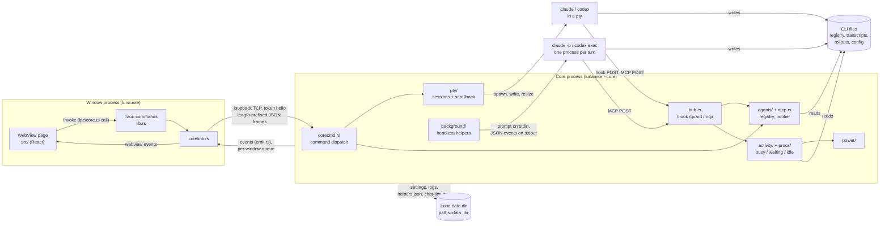
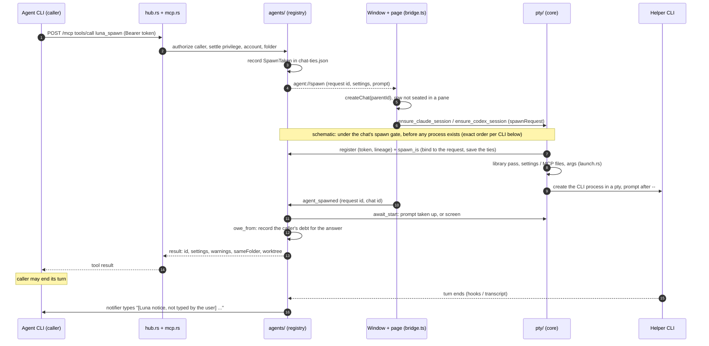

# Architecture overview

Luna is a desktop shell (Tauri 2, Rust + React) around the Claude Code and Codex
CLIs. It runs many CLI sessions side by side, each on an account folder of its
own, and lets sessions orchestrate other sessions through an MCP server.

Two principles shape everything else:

- **Session state lives in the CLI.** Luna multiplexes terminals, folders and
  accounts; transcripts, titles, status and worktrees are the CLIs' own and are
  read from their files ([ADR-0001](../adr/0001-session-state-lives-in-the-cli.md)).
- **Two providers, two layers.** `claude/` and `codex/` each describe their CLI
  in its own words; only mechanics are shared
  ([ADR-0005](../adr/0005-two-providers-as-independent-layers.md),
  [providers](providers.md)).

## Stack

| Layer | Choice |
| --- | --- |
| Shell | Tauri 2: Rust core + system WebView (WebView2 on Windows) |
| UI | React 19, TypeScript, Vite; Zustand (+ `persist` in localStorage) for UI state |
| Terminals | xterm.js + FitAddon (+ WebGL addon) |
| Editor | CodeMirror 6, for account settings files and the library |
| pty | `portable-pty`: ConPTY on Windows, openpty on Unix |
| Look | xp.css, redrawn from theme tokens |

## Process model

| Process | What it is | Lives in |
| --- | --- | --- |
| **Window** | `luna.exe`: the Tauri app with the WebView, tray, title bar handling, updater | `lib.rs`, `corelink.rs`, `watchdog.rs`, `sysmenu.rs`, `lifecycle.rs` |
| **Core** | the same exe with `--core`, no window; on Windows started from a copy under `<data>/core/<fingerprint>/` | `coreproc.rs`, `corecmd.rs`, everything that runs sessions |
| **CLI children** | `claude` / `codex` in a pty, or `claude -p` / `codex exec` per turn for background helpers | `pty/`, `background/` |
| **Exit watcher** | `--watch-exit <pid>`: logs how the previous process ended | `lifecycle.rs` |
| **Keeper** (off Windows) | `--keep-ties`: ends a dead core's helper jobs | `keeper/` |

The core owns the pty manager, the **hub** (loopback HTTP for hooks, the guard
and MCP), the agents registry and notifier, activity sampling, power, and
background helpers. One core per data dir (`core.lock`); it listens on
`127.0.0.1` with a token from `<data>/core/core.json` and leaves by itself after
10 minutes with no window and no session
([ADR-0002](../adr/0002-core-process-outlives-the-window.md)).

## Data flow

- **Commands.** The page calls `call()` in `src/ipc/core.ts`, which invokes a
  Tauri command. Commands that belong to the core are forwarded by the window
  (`core_call`, `core_send` for terminal input) and mapped by name onto the
  same functions in `corecmd.rs`. The page never talks to the core directly.
- **Events.** Code that emits does not hold an `AppHandle`: everything goes
  through `emit.rs`. In the core each window has its own queue; a window that
  falls behind is disconnected rather than allowed to stall a pty, and goes
  straight back (`corelink.rs` `rejoin`), its panes redrawn from the scrollback.
  Main event families: `pty://output`, `pty://exit`, `power://state`,
  `agent://spawn`, `agent://deleted`, `agent://reparent`, `agent://background`.
- **Status.** Every 5 s `activity/` combines the CLI's turn state (hooks,
  registry, rollout), the processes under the CLI, and recent output into
  busy / waiting / idle per session; `power/` follows that summary
  ([power and lifecycle](power-and-lifecycle.md)).
- **Agents.** A session with Luna's tools calls `POST /mcp` on the hub with its
  bearer token. The core does not know chats, so a visible spawn is a round
  trip to the page, which owns the chat list ([agents](agents.md)).

### An agent spawns a visible helper

The preparation boxes are schematic; `pty/start.rs` does them in this order:

- **Claude Code:** worktree fetch (if any) → library pass and `session_args` →
  settings file (`claude_settings_file`) → `register` → `spawn_is` → MCP file
  (`claude_mcp_file`) → instructions folder → `claude::launch::chat_args`.
- **Codex:** guard arguments → `register` → `spawn_is` → library pass and
  `session_args` → `codex::launch::chat_args` (Luna's MCP server goes by `-c`
  arguments, no file).

Registration and `spawn_is` happen inside the start, before the process is
created, so a session can never run unknown to the registry and a core that dies
mid-start leaves a record to settle. The caller's debt is a separate step,
recorded once the spawn call has its answer (or, for a session that came up
after the call timed out, when `agent_spawned` arrives).

A background helper (the default) skips the window entirely: `agents/spawn`
hands the request to `background/`, which runs each turn as one headless CLI
process ([background helpers](background-helpers.md)).

## Where state lives

| State | Owner | File |
| --- | --- | --- |
| Conversations, titles, models, context | the CLI | transcripts, rollouts, registries |
| Chat list, board, folders, UI prefs | page | localStorage (`persist`) |
| Luna settings (accounts root, defaults, library reaches) | core and window | `<data>/settings.json`, written under `settings.json.lock` |
| Helpers, their queues and ties | core | `<data>/helpers.json` |
| Visible sessions' agent ties, held sends, spawns under way | core | `<data>/chat-ties.json` |
| Spawn history | core | `<data>/agents.jsonl` |
| Library ledger | core and window | `<data>/library-state.json`, `library-blobs/` |
| Log | both | `<data>/luna.log` |

A settings file that will not read or parse is an error, never the defaults:
the cache keeps what it read last and a write refuses (`settings.rs`).

## Module map

| Area | Doc | Main paths |
| --- | --- | --- |
| Agents and MCP tools | [agents.md](agents.md) | `agents/`, `mcp.rs`, `hub.rs`, `agentlog.rs` |
| Background helpers | [background-helpers.md](background-helpers.md) | `background/`, `agents/persist.rs`, `agents/resume.rs` |
| pty and launch | [pty-and-launch.md](pty-and-launch.md) | `pty/`, `claude/launch.rs`, `codex/launch.rs`, `guard.rs`, `golden.rs` |
| Providers | [providers.md](providers.md) | `claude/`, `codex/`, `cli.rs`, `provider.rs` |
| Accounts and account files | [accounts.md](accounts.md) | `accounts.rs`, `account_settings/`, `checks.rs`, `account_use.rs` |
| Library | [library.md](library.md) | `library/` |
| Worktrees | [worktrees.md](worktrees.md) | `worktree/` |
| Power and lifecycle | [power-and-lifecycle.md](power-and-lifecycle.md) | `activity/`, `procs/`, `keeper/`, `power/`, `asking.rs`, `coreproc.rs`, `lifecycle.rs` |
| Frontend | [frontend.md](frontend.md) | `src/` |

Smaller modules:

| Path | What it does |
| --- | --- |
| `paths.rs` | `data_dir()`: next to the exe when writable, else `%LOCALAPPDATA%\luna`; settings, log, attachments, CLIs and (Windows) the WebView profile; `protect_data_dir` ([ADR-0011](../adr/0011-private-data-dir-beside-the-exe.md)) |
| `settings.rs` | `<data>/settings.json`, written under its lock re-reading the file; the cache checked against mtime, as more than one process writes it |
| `emit.rs` | the one door for events; `pty::manager()` is likewise the process's only `PtyManager`, no Tauri state |
| `secret.rs`, `admit.rs` | minted secrets and constant-time checks; what the loopback listeners let in before authentication |
| `browsers.rs` | which browser a link opens in: a command line with `%1` per browser, found on Windows (StartMenuInternet, each Chromium browser's Local State profiles, Firefox's `profiles.ini`, the https UserChoice handler) plus the user's own; chosen chat → account → folder → default; run by `open_link` (`lib.rs`) with the link as its own argument and no shell |
| `media.rs` | files pasted or dropped into a pane, copied into the data folder |
| `throttle.rs` | the cool-off after a 429 from the usage endpoints, shared by both providers |
| `log.rs`, `agentlog.rs` | `luna.log`; `agents.jsonl` |
| `sysmenu.rs` | Windows' own window menu and frame messages for the undecorated window |
| `watchdog.rs` | rebuilds a window whose WebView died |

Rust paths are relative to `src-tauri/src/`. Security boundaries are in the
[threat model](../security/threat-model.md).
