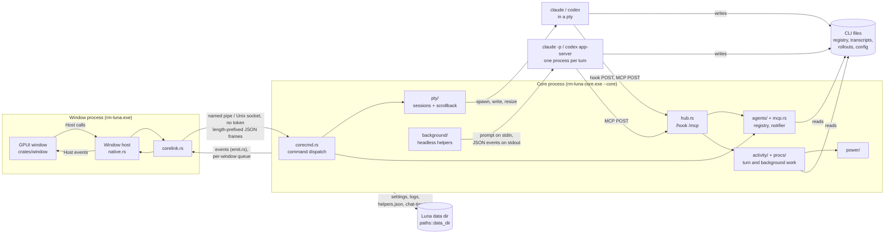
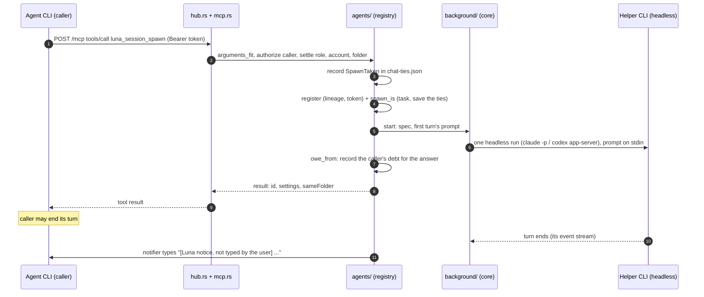
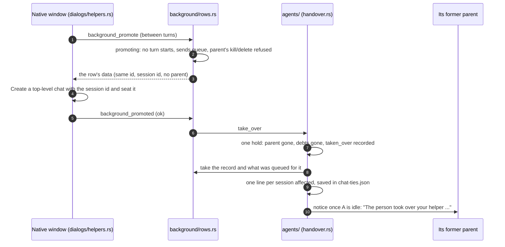

# Architecture overview

Luna is a Rust desktop app with a native GPUI window for the Claude Code and
Codex CLIs. It runs many CLI sessions side by side, each on an account folder of its
own, and lets sessions orchestrate other sessions through an MCP server.

Two principles shape everything else:

- **Session state lives in the CLI.** Luna multiplexes terminals, folders and
  accounts; transcripts, titles, status and worktrees are the CLIs' own (Luna makes,
  inspects and removes no worktree) and are read from their files ([ADR-0001](../adr/0001-session-state-lives-in-the-cli.md)).
- **Two providers, two layers.** `claude/` and `codex/` each describe their CLI
  in its own words; only mechanics are shared
  ([ADR-0005](../adr/0005-two-providers-as-independent-layers.md),
  [providers](providers.md)).

## Stack

| Layer | Choice |
| --- | --- |
| UI | GPUI (`gpui-pre`) with gpui-component, in the `luna-window` crate ([native window](native-window.md)) |
| Async runtime | tokio, owned by Luna (`runtime.rs`) |
| Terminals | Luna's terminal panes over `alacritty_terminal` |
| Editor | gpui-component's editor for the library's files |
| pty | `portable-pty`: ConPTY on Windows, openpty on Unix |
| Look | `theme.rs` and the bundled Cascadia Mono font |

## Process model

| Process | What it is | Lives in |
| --- | --- | --- |
| **Window** | `rm-luna.exe` (cargo's `luna`): the native GPUI window, its tray, desktop services and updater | `native.rs` and `crates/window/`; `lib.rs`, `corelink.rs`, `desktop/`, `sysmenu.rs`, `lifecycle.rs` |
| **Core** | the same exe with `--core`, no window; on Windows started from a copy under `<data>/core/<fingerprint>/` | `coreproc.rs`, `corecmd.rs`, everything that runs sessions |
| **CLI children** | `claude` / `codex` in a pty, or `claude -p` / `codex app-server` per turn for background helpers | `pty/`, `background/` |
| **Exit watcher** | `--watch-exit <pid>`: logs how the previous process ended | `lifecycle.rs` |
| **Keeper** (off Windows) | `--keep-ties`: ends a dead core's helper jobs | `keeper/` |

The core owns the pty manager, the **hub** (loopback HTTP for hooks
and MCP), the agents registry and notifier, session lifecycle records, power, and
background helpers. One core per data dir (`core.lock`); it listens on an
endpoint of its own, a named pipe on Windows and a socket in `<data>/core/`
elsewhere (`endpoint/`), named in `<data>/core/core.json`, and lets in only this
user's processes the OS marks unconfined, with no token
([ADR-0021](../adr/0021-core-endpoint-by-os-identity.md), `peer/`). It leaves by
itself after 10 minutes with no window and no session
([ADR-0002](../adr/0002-core-process-outlives-the-window.md)).

## Data flow

- **Commands.** The window asks its host (`native.rs`) by name. Commands that
  belong to the core are forwarded (`corelink::request`, `core_send` for
  terminal input) and mapped by name onto the functions in `corecmd.rs`, only
  those in `corecmd::COMMANDS` and each on its lane; the window's own are
  answered in its process, each path argument typed as it is read
  (boundary.rs).
- **Events.** Events go through `emit.rs`. In the core each window has its own queue, of 8,192
  frames and 64 MB at most; a window that
  falls behind is disconnected rather than allowed to stall a pty, and goes
  straight back (`corelink.rs` `rejoin`), its panes redrawn from the scrollback.
  Main event families: `pty://output`, `pty://exit`, `power://state`,
  `agent://background`.
- **Status.** `activity/` keeps one lifecycle record per session from CLI
  signals for its turn and background work. Hooks, session files, rollouts
  and tracked shell processes supply those signals. `power/` uses the records
  to decide which sessions keep the PC awake ([power and lifecycle](power-and-lifecycle.md)).
- **Agents.** A session with Luna's tools calls `POST /mcp` on the hub with its
  bearer token. Every helper it spawns runs in the core, in the background, with
  no part for the window, which only lists them, shows one read-only, and opens
  one as the person's own chat when asked ([agents](agents.md)).

### An agent spawns a helper

Registration and `spawn_is` happen before the process is created, so a helper
can never run unknown to the registry, and a core that dies mid-start leaves a
record to settle ([background helpers](background-helpers.md#a-spawn-under-way)).

### The person opens a helper as a chat

A row the window could not make answers `background_promoted` with the error,
and the helper goes on as its parent's.

## Where state lives

| State | Owner | File |
| --- | --- | --- |
| Conversations, titles, models, context | the CLI | transcripts, rollouts, registries |
| Chat list, boards, folders, chat defaults | window | `<data>/window/chats.json` |
| Window size and position | window | `<data>/window-state.json` |
| Luna settings (accounts root, defaults, library reaches) | core and window | `<data>/settings.json`, written under `settings.json.lock` |
| Helpers, their queues and ties | core | `<data>/helpers.json` |
| What agents are owed by the person's chats, held sends, spawns under way, untold lines | core | `<data>/chat-ties.json` |
| Spawn history | core | `<data>/agents.jsonl` |
| Library ledger | core and window | `<data>/library-state.json` |
| Log | both | `<data>/luna.log` |

A settings file that will not read or parse is an error, never the defaults:
the cache keeps what it read last and a write refuses (`settings.rs`).

## Module map

| Area | Doc | Main paths |
| --- | --- | --- |
| Agents and MCP tools | [agents.md](agents.md) | `agents/`, `mcp.rs`, `hub.rs`, `agentlog.rs` |
| Background helpers | [background-helpers.md](background-helpers.md) | `background/`, `agents/persist.rs`, `agents/resume.rs` |
| pty and launch | [pty-and-launch.md](pty-and-launch.md) | `pty/`, `claude/launch.rs`, `codex/launch.rs`, `golden.rs` |
| Providers | [providers.md](providers.md) | `claude/`, `codex/`, `cli.rs`, `provider.rs` |
| Accounts and account files | [accounts.md](accounts.md) | `accounts.rs`, `account_settings/`, `checks.rs`, `account_use.rs` |
| Library | [library.md](library.md) | `library/` |
| Power and lifecycle | [power-and-lifecycle.md](power-and-lifecycle.md) | `activity/`, `procs/`, `keeper/`, `power/`, `coreproc.rs`, `lifecycle.rs` |
| Desktop services | [desktop-services.md](desktop-services.md) | `desktop/`, `windows/installer.nsi`, `scripts/macos-app.sh` |
| Native window | [native-window.md](native-window.md) | `src-tauri/crates/window/`, `native.rs`, `native/` |

Smaller modules:

| Path | What it does |
| --- | --- |
| `paths.rs` | `data_dir()`: next to the exe when writable, else `%LOCALAPPDATA%\rm-luna`; settings, log, CLIs and (Windows) 0.19's WebView profile, read once for the chat list's import; `protect_data_dir` ([ADR-0011](../adr/0011-private-data-dir-beside-the-exe.md)) |
| `settings.rs` | `<data>/settings.json`, written under its lock re-reading the file; the cache checked against mtime, as more than one process writes it |
| `emit.rs` | the one door for events; `pty::manager()` is likewise the process's only `PtyManager` |
| `secret.rs`, `admit.rs` | minted secrets and constant-time checks; what the loopback listeners let in before authentication |
| `throttle.rs` | the cool-off after a 429 from the usage endpoints, shared by both providers |
| `starts.rs` | the start gate: whether a helper's turn, Luna's write into a pane or a pane's launch may start now, closed while a power-off is decided or fired and while the sessions are stopped for an update ([power and lifecycle](power-and-lifecycle.md#updates)) |
| `http.rs` | Luna's own requests (CLI downloads, usage and model lookups, the OAuth refresh): a blocking face over reqwest, rustls on ring against the OS's trust store, no proxy, each call's timeouts its own. Its clients live until exit; on Linux they read the trust roots when made, so a CA added to or removed from the system's store takes effect at Luna's next start (Windows and macOS ask the OS on each handshake) |
| `runtime.rs` | Luna's own tokio runtime, started on first use and kept until exit, two workers for reqwest's connections and the timers: `spawn_blocking` for the sync work an async command hands off, `block_on` for the futures sync code waits on (reqwest's, http.rs), from a thread of its own or a `spawn_blocking` one; inside a runtime it panics |
| `log.rs`, `agentlog.rs` | `luna.log`; `agents.jsonl` |
| `sysmenu.rs` | the end of the Windows session (WM_ENDSESSION): the window's writers drained, the reason logged, the message passed on to gpui |
| `identity.rs` | the names each flavor goes by (identifier, product, publisher), shared with build.rs |

Rust paths are relative to `src-tauri/src/`. Security boundaries are in the
[threat model](../security/threat-model.md).
