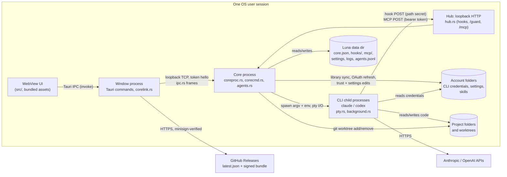

# Luna threat model

Scope: the Luna desktop app as built from this repository (Tauri 2; Rust core
in `src-tauri/src`, React UI in `src/`). Line references are to the tree this
document is committed with. Method: data-flow diagram, trust boundaries, STRIDE
per boundary, then what is mitigated, what is planned and what is accepted.

## 1. System overview

Luna is a single-user desktop app that runs Claude Code and Codex CLI sessions
on the user's behalf. Two OS processes of the same executable cooperate:

- the **window process** hosts the WebView and relays the page's commands;
- the **core process** owns every running session, the hook/MCP listener and
  the state that must outlive a window (`coreproc.rs`).

## 2. Assets

| Asset | Where | Why it matters |
| --- | --- | --- |
| CLI credentials (OAuth access/refresh tokens, API keys) | account folders, e.g. `.credentials.json` (`claude/oauth.rs`) | account takeover, spend |
| Core token | `core.json` in the data dir (`coreproc.rs:186`) | full control of the core: spawn any session with any permission mode |
| Hub secret | every Claude session's `--settings` file under `hooks/` (`pty.rs:563`), Codex `-c` hook override (`pty.rs:693`) | forge hook events and guard posts |
| Per-session MCP bearer tokens | `mcp/<chat>.json` (`pty.rs:942`); `LUNA_MCP_TOKEN` env for Codex (`pty.rs:1698`) | act as that session through Luna's MCP tools |
| Source code and git state of the user's projects | project folders, worktrees | integrity, confidentiality |
| Prompts, transcripts, agent history | CLI transcript dirs; `agents.jsonl` (`agentlog.rs:23`) | may hold pasted secrets |
| Integrity of the Luna binary | install dir, updater | code execution as the user |
| Availability of the PC and sessions | `power.rs`, `agents.rs` kill/delete | lost work, forced shutdown |

## 3. Actors

| Actor | Capability assumed | Trusted? |
| --- | --- | --- |
| Local user | drives the UI, owns the OS account | yes |
| Agent session (CLI child) | runs as the user; may be prompt-injected by repository content, web pages, tool output or another session's text | partially: bounded by its CLI's permission mode / sandbox and by Luna's MCP authorization |
| Other process of the same OS user | can read the user's files and connect to loopback | no defense intended: same-uid is the OS trust boundary |
| Other local OS user (multi-user Unix, shared Windows host) | can connect to 127.0.0.1, can read world-readable files | no |
| Web page in a browser on the same machine | can send simple cross-origin requests to 127.0.0.1 | no |
| Network attacker | on-path for HTTPS to GitHub; can host content agents fetch | no |
| Release-signing key holder | signs updates | yes (single maintainer key) |

## 4. Trust boundaries and STRIDE

### B1. WebView page to window process (Tauri IPC)

| STRIDE | Threat | Status |
| --- | --- | --- |
| E, T | Script injected into the page (rendered terminal or transcript text) calls any of the ~99 app commands, which take raw `account_path` / `folder` strings and can write account config (`account_settings.rs:736`) | mitigated in part: no HTML sinks in `src/` (no `innerHTML` / `dangerouslySetInnerHTML`); terminal output is drawn by xterm.js as text. **CSP is `null`** (`tauri.conf.json:29`); strict CSP is **planned (phase 1)** |
| E | Plugin permissions broader than needed | `capabilities/default.json` grants only `core:default`, five window actions, `dialog:allow-open`, `notification:default`, `updater:default`; no `remote` origins, no shell/fs plugin |
| S | A link clicked in a terminal opens a non-web scheme (`file:`, custom protocol handlers) | mitigated: `open_link` allows `http`, `https`, `mailto` only and does not log the URL (`lib.rs:69-78`) |

### B2. Window process to core process (loopback TCP, `ipc.rs`)

| STRIDE | Threat | Status |
| --- | --- | --- |
| S, E | Any local process connects to the core port and drives it | mitigated: listener bound to `127.0.0.1` (`coreproc.rs:135`); first frame must be `hello` with the token from `core.json`, otherwise the connection is dropped without a reason (`coreproc.rs:296-302`); the dispatch table is an explicit allowlist (`corecmd.rs:44`) |
| S | Token guessable: `mint_token` hashes `RandomState` keys, time and pid (`ipc.rs:167-180`) | partly mitigated (`RandomState` is OS-seeded). OS-random token + constant-time compare **planned (phase 1)**; the compare is `==` today (`coreproc.rs:299`) |
| I | `core.json` readable by another OS user on Unix (written with default mode, `coreproc.rs:189`) | open, see finding F4 |
| D | Unbounded connections, slow-loris hello, 8 MiB frame allocated per connection (`ipc.rs:21`, `ipc.rs:130`) | frame size capped; connection count / hello timeout **planned (phase 1)** |

### B3. Agent sessions to the hub (`hub.rs`, `mcp.rs`)

| STRIDE | Threat | Status |
| --- | --- | --- |
| S | A local process or web page posts forged hook events or MCP calls | mitigated: loopback only (`hub.rs:27`); hooks carry the run's secret in the path (`hub.rs:128`, `hub.rs:154`); MCP requires a per-session bearer token mapped to its caller (`hub.rs:110`); a browser cannot set `Authorization` cross-origin without a preflight the hub never answers |
| S | Weak secrets: `mint_secret` and `agents::mint` hash pid, time and a stack address (`hub.rs:173`, `agents.rs:1280`) | OS-random tokens + constant-time compare **planned (phase 1)** |
| S | The hook secret is shared by all chats; any session that knows it can post events for another `chat_id` | open, finding F7 |
| E | Session A acts on session B through MCP | see the authorization matrix (section 5) |
| D | One thread per request, no connection cap, 4 MiB body reads (`hub.rs:48`, `hub.rs:114`, `hub.rs:159`) | body sizes capped; connection / time limits **planned (phase 1)**; spawns capped per caller (`agents.rs:514`) |
| R | Who did what through MCP | every tool call is logged with caller, target and steering arguments, never prompt text (`mcp.rs:372-445`); spawns and exits go to `agents.jsonl` |

### B4. Core to CLI child processes (`pty.rs`, `background.rs`)

| STRIDE | Threat | Status |
| --- | --- | --- |
| T, E | Shell or argument injection through spawn parameters (model, effort, agent name, folder) | mitigated: children are started with an argv vector, never a shell (`pty.rs:242-244`); Claude modes, efforts and models, Codex sandboxes are checked against fixed lists (`agents.rs:3125-3210`); agent names are filtered (`agents.rs:2832`). The hook command strings embed only Luna-built URLs and a curl path that rejects quotes and spaces (`pty.rs:693-715`) |
| E | A session spawns a helper with more privilege than itself (`bypassPermissions`, `danger-full-access`) | open, finding F1 |
| I | Session inherits Luna's or a parent session's identity variables | mitigated: inherited CLI session variables are removed (`pty.rs:251-256`, `pty.rs:720`) |

### B5. Core to account folders and project folders

| STRIDE | Threat | Status |
| --- | --- | --- |
| T | Library sync follows a planted symlink or junction out of the account folder | mitigated: links are refused on read and write (`library.rs:542`, `library.rs:601-607`, `library.rs:955`); account names reject separators, `.` and `..` (`accounts.rs:42-53`); skill names are `[a-z0-9-]` (`library.rs:290`). Check-then-use remains (TOCTOU, accepted, R6) |
| T | Worktree removal deletes outside the intended root | mitigated: `is_worktree_of` requires a Claude worktree path under the folder or a Codex-shaped path whose `.git` points back at the folder (`worktree.rs:73-76`); `remove_dir_all` does not follow links. Residual: Codex shape is not anchored to Codex's own root, finding F6 |
| I | OAuth refresh exposes tokens | mostly mitigated: credentials written through a temp file and renamed, `0600` on Unix (`claude/oauth.rs:185-201`); errors logged without token values (`claude/oauth.rs:239-246`). See finding F5 for the window before `chmod` |

### B6. Window process to update server

| STRIDE | Threat | Status |
| --- | --- | --- |
| T, S | On-path attacker or compromised release host serves a malicious build | mitigated: HTTPS endpoint on GitHub Releases and a minisign public key pinned in the app (`tauri.conf.json:46-51`); Tauri refuses unsigned bundles |
| T | Signing key theft | accepted: single maintainer key; see R7 |

## 5. MCP authorization matrix

Callers are sessions holding a Luna MCP token. A session without Luna's tools
can call `luna_permission` only, and only if it is a background helper
(`mcp.rs:454-462`). Helpers of helpers never get tools (`agents.rs:37`).

| Tool | May target | Check | Tested |
| --- | --- | --- | --- |
| `luna_kill`, `luna_delete` | own descendants only | `authorize` (`agents.rs:2061`) | yes (`agents.rs:8260-8264`, `agents.rs:9454-9490`, `mcp.rs:720`) |
| `luna_send`, `luna_answer` (incl. `allow`, raw `keys`) | **any** session but itself, the user's chats included | `authorize_send` (`agents.rs:2083`, call sites `agents.rs:3757`, `agents.rs:4617`) | the check yes (`agents.rs:8265-8268`); that `answer` uses it, no |
| `luna_read`, `luna_wait` | **any** session but itself | `authorize_view` (`agents.rs:2072`) | yes (`agents.rs:8269-8270`, `agents.rs:9490`) |
| `luna_spawn` | new helper, any folder, any agent-allowed account, any mode | account allowlist (`agents.rs:2191`), spawn cap (`agents.rs:514`) | partly |
| `luna_power` | the whole PC (shutdown, restart, sleep; or disarm the user's) | tools only (`power.rs:715`) | no authorization test |
| `luna_sessions`, `luna_list`, `luna_notify`, `luna_guide` | read-only / notify the user | tools only | yes |

## 6. Residual and accepted risks

- **R1. Broad agent read/send access (by design).** Any tooled session may read
  and wait on every session, and type into or answer any session other than its
  own, the user's chats included (`agents.rs:2066-2104`). This is how sessions
  hand work to one another. Consequence: a prompt-injected session can inject
  text into, and approve permission prompts of, a session that runs with more
  privilege (finding F2). Accepted for now; the tools are opt-in per session.
- **R2. Cross-project prompt injection.** Text a session reads (repository
  files, web pages, a helper's answer, `luna_read` of another project's
  session) is model input. Luna relays it verbatim and cannot tell data from
  instructions; the receiving CLI's permission mode is the control. Accepted.
- **R3. Same-user processes are trusted.** Tokens live in files of the user's
  data dir and in child environments; anything running as the user, an agent
  with a shell included, can read them and act as the UI (core token) or as
  another session (MCP token). The CLIs' own sandboxes are the only barrier
  (finding F3). Accepted on Windows and single-user systems.
- **R4. Agents may arm a PC shutdown** (`luna_power`), bounded by the quiet
  window and drain logic in `power.rs`. Accepted as an orchestration feature.
- **R5. Agent history keeps prompt prefixes and last answers in plain text**
  (`agentlog.rs:15-19`, 300 and 3000 characters) in the data dir. Accepted;
  same exposure as the CLIs' own transcripts.
- **R6. Link checks are check-then-use** (`library.rs:601`, `worktree.rs:73`): a
  same-user process racing the check could redirect a write. Covered by R3.
- **R7. Single signing key** for updates, no rollback-index beyond Tauri's
  version comparison. Accepted for a single-maintainer project.
- **Planned (phase 1):** OS-random tokens with constant-time comparison (hub
  secret, MCP tokens, core token); connection, size and time limits on the hub
  and core listeners; a strict CSP replacing `csp: null`.

## 7. Open findings

Ranked; each was verified in code unless marked inferred.

| ID | Severity | Finding | Proposed fix |
| --- | --- | --- | --- |
| F1 | High | `luna_spawn` lets a session start a helper in `bypassPermissions` or `danger-full-access` whatever its own mode (background: `agents.rs:3161-3165`, `agents.rs:3201-3208`; visible: `src/features/agents/bridge.ts:86-88`); `settle_role` (`agents.rs:2837`) caps nothing | cap a helper's mode at its caller's; an explicit setting to allow escalation |
| F2 | High | `luna_answer` with `allow: true` or `keys` reaches any session (`agents.rs:4617`), so a session can approve another chat's permission prompt | restrict `allow` and `keys` to descendants (`authorize`), or ask the user for chats outside the caller's tree |
| F3 | Medium | Claude sessions' MCP bearer tokens are written in plain text to `mcp/<chat>.json` (`pty.rs:942-967`) and the core token to `core.json`; a sandboxed session that can read the data dir can act as another session or as the UI | pass the token by environment (`${LUNA_MCP_TOKEN}` header expansion, as Codex already does via `bearer_token_env_var`), keep `core.json` outside session-readable roots, and add the data dir to the CLIs' read deny lists |
| F4 | Medium (Unix, multi-user) | `core.json`, `hooks/*.json` and `mcp/*.json` are created with the default mode (`coreproc.rs:189`, `pty.rs:580`, `pty.rs:965`); with umask 022 another OS user can read the core token and drive the core over loopback | create the data dir `0700` and token files `0600` (`OpenOptions::mode`) |
| F5 | Low (Unix) | OAuth temp file is written before `chmod 0600` and the fallback `fs::write` keeps old permissions (`claude/oauth.rs:189-201`) | create with `mode(0o600)` atomically |
| F6 | Low (inferred) | `codex_shaped` accepts `…/worktrees/<4 hex>/<name>` anywhere on disk (`worktree.rs:44-52`); with a spoofed `.git` file such a folder passes `is_worktree_of` and reaches `remove_dir_all` (`worktree.rs:442`) | anchor to `$CODEX_HOME/worktrees` of a known account |
| F7 | Low | Hook secret is global, not bound to `chat_id` (`hub.rs:124-137`); a session can forge another chat's turn state | per-chat secret, e.g. HMAC(run key, chat id) |
| F8 | Low | Data dir falls back to `temp_dir()/luna` (`paths.rs:52`), a shared predictable path on Unix | fail closed, or create it `0700` and verify ownership |
| F9 | Low | Tauri app commands are not scoped (no `AppManifest` in `build.rs`) and take raw paths; impact needs a page compromise, which CSP should then stop | scope commands per capability; validate `account_path` against the accounts root |
