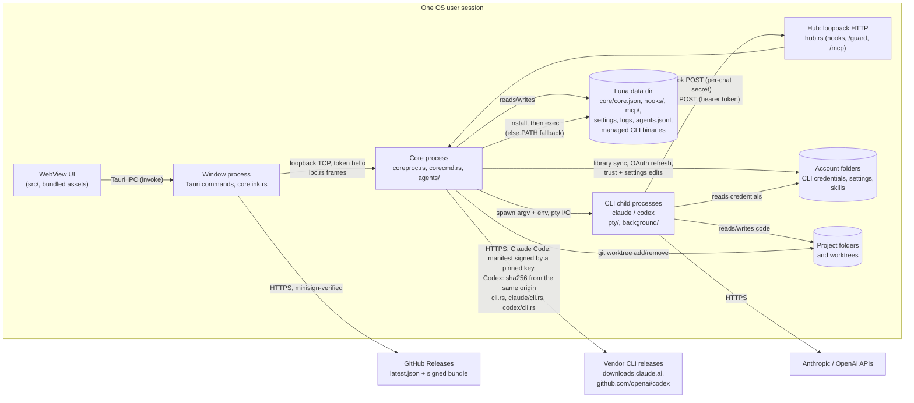

# Luna threat model

Scope: the Luna desktop app as built from this repository (Tauri 2; Rust core
in `src-tauri/src`, React UI in `src/`). Line references are to the tree this
document is committed with; commits are those of the phase 1 security work on
`refactor/phase-1`. Method: data-flow diagram, trust boundaries, STRIDE per
boundary, then the status of every finding and what is accepted.

## 1. System overview

Luna is a single-user desktop app that runs Claude Code and Codex CLI sessions
on the user's behalf. Two OS processes of the same executable cooperate:

- the **window process** hosts the WebView and relays the page's commands;
- the **core process** owns every running session, the hook/MCP listener and
  the state that must outlive a window (`coreproc.rs`).

## 2. Assets

| Asset | Where | Why it matters |
| --- | --- | --- |
| CLI credentials (OAuth tokens, API keys) | account folders, e.g. `.credentials.json` (`claude/oauth.rs`) | account takeover, spend |
| Core token (256 bits, `ipc.rs:171`) | `core/core.json` in the data dir (`coreproc.rs:210`) | full control of the core: spawn any session in any mode |
| Hub run key (256 bits, `hub.rs:380`) and the per-chat secrets derived from it (`hub.rs:115`) | key in core memory only; a chat's secret in its Claude `--settings` file under `hooks/` (`pty/start.rs:34`) or its Codex `-c` hook arguments | forge that chat's hook and guard events |
| Per-session MCP bearer tokens (160 bits, `agents/registry.rs:334`) | the `LUNA_MCP_TOKEN` environment of each tooled session (`codex/launch.rs:269`, `pty/start.rs:87`, `claude/launch.rs:103`); never on disk | act as that session through Luna's tools |
| Source code and git state of the user's projects | project folders, worktrees | integrity, confidentiality |
| Prompts, transcripts, agent history | CLI transcript dirs; `agents.jsonl` (`agentlog.rs`) | may hold pasted secrets |
| Integrity of the Luna binary | install dir, updater | code execution as the user |
| Availability of the PC and sessions | `power/`, `agents/` kill/delete | lost work, forced shutdown |

## 3. Actors

| Actor | Capability assumed | Trusted? |
| --- | --- | --- |
| Local user | drives the UI, owns the OS account | yes |
| Agent session (CLI child) | runs as the user; may be prompt-injected by repository content, web pages, tool output or another session's text | partially: bounded by its CLI's permission mode or sandbox, and with Luna's tools by the trust contract below |
| Other process of the same OS user | can read the user's files and process environments, connect to loopback | no defense intended: same-uid is the OS trust boundary (R3) |
| Other local OS user (multi-user Unix, shared Windows host) | can connect to 127.0.0.1, can read what file modes or ACLs let them | no |
| Web page in a browser on the same machine | can send simple cross-origin requests to 127.0.0.1 | no |
| Network attacker | on-path for HTTPS; can host content agents fetch | no |
| Release-signing key holder | signs updates | yes (single maintainer key, R7) |
| CLI vendors' release infrastructure | publishes the Claude Code and Codex binaries Luna downloads | Claude Code: its release key, pinned in Luna, not the bucket that serves it. Codex: yes, without independent verification (F10) |

### Trust contract for Luna's tools

Enabling Luna's tools for a session grants it **orchestration authority
bounded by its own privilege**. Escalation happens only through an explicit
user setting. The code meets this contract (F1, F2 fixed), within the limits
in section 6.

- A helper it spawns runs at no more privilege than the caller (Claude Code
  permission mode; Codex sandbox, approval and network) unless the user turns
  on Settings → Agents & trust → `helpersAboveCaller` (off by default).
- `luna_answer` with `allow`, raw `keys`, or an answer to a list the CLI holds
  its own screen on works only on the caller's own helpers, and only at the
  privilege it would itself need to run the tool unasked.
- Text a CLI reads as a command (`/` slash command, `!` shell mode) goes only
  from a caller at full access into its own helper.
- Reading, waiting on and sending plain text to other sessions stays open
  (R1): that is how sessions hand work to one another.

## 4. Trust boundaries and STRIDE

### B1. WebView page to window process (Tauri IPC)

| STRIDE | Threat | Status |
| --- | --- | --- |
| E, T | Script injected into the page (rendered terminal or transcript text) calls any app command; they take raw `account_path` / `folder` strings and can write account config | mitigated: no HTML sinks in `src/` (no `innerHTML` / `dangerouslySetInnerHTML`); xterm.js draws terminal output as text; strict CSP (H3). A script that runs anyway gets only what the page calls (F9, [ADR-0015](../adr/0015-the-page-gets-only-what-it-calls.md)): build.rs puts every command of `app_handler!` (`lib.rs`) in the application manifest, and `capabilities/default.json` grants each to the `main` window by name, none to another window or a remote origin; account paths of the commands that write account config, use credentials, set trust or may run the Codex CLI on the account (`codex_models`, `codex_defaults`) are `AccountPath` (`boundary.rs`): a folder directly in a provider's folder under the accounts root, a valid account name, no trailing separator, neither it nor the provider's folder a link, junction or mount point, and resolving (`canonicalize`, handle-based on Windows) to that folder under the resolved root by the very name given, so `name.`, `name `, 8.3 and case spellings are refused. Tests: `lib.rs` `acl` (mock app, Linux check), `boundary.rs`. Residual: what the page does stays open to it, below |
| E | Plugin permissions broader than needed | mitigated: `capabilities/default.json` grants seventeen plugin calls, those the page makes: `core:app:allow-version`, event listen and unlisten, seven window actions (drag, the title-bar double-click, minimize, toggle maximize, is maximized, scale factor, close), `dialog:allow-open`, three notification and three updater calls (`check`, `download`, `install`); no menus, trays, new windows or webviews, paths, no `remote` origins, no shell or fs plugin. Tested: `lib.rs` `acl` |
| E | Script lifts the helpers' privilege cap (`helpersAboveCaller`, section 3) | mitigated against the page's own calls: turning it on asks a native dialog from the window process (`set_helpers_above_caller`, `agents/privilege.rs`), which the page cannot answer; turning it off asks nothing. One dialog at a time; a yes is written only if no change was written while it was open, and a request that finds the cap lifted already writes nothing, so a turn-off in between is never undone (`AboveGate`). Residual: a script that has started a full-access session (below) can edit the settings file or drive the dialog from there. Tested: `lifting_the_cap_takes_a_persons_yes`, `a_yes_never_lands_on_a_state_it_was_not_asked_about` |
| E | What an injected script can still do | **residual**: everything the page itself does, among it: start a session in any folder with any permission mode or sandbox and type into it, which is code execution as the user; delete chats and their worktrees; arm a PC shutdown; edit an account's settings file; change the accounts root, the denylist of helper accounts and the Codex trusted roots. Read-only commands whose callers may send an empty path and that run nothing (Claude defaults, saved titles, hooks state, worktree inspection) keep plain strings. The controls against getting a script in stay those above |
| S | A link clicked in a terminal opens a non-web scheme | mitigated: `open_link` allows `http`, `https`, `mailto` only and does not log the URL (`lib.rs:128`) |

### B2. Window process to core process (loopback TCP, `ipc.rs`)

| STRIDE | Threat | Status |
| --- | --- | --- |
| S, E | Any local process connects to the core port and drives it | mitigated: bound to `127.0.0.1` (`coreproc.rs:155`); the first frame must be `hello` with the OS-random token, compared in constant time, else the connection is dropped without a reason (`coreproc.rs:320-329`, H1); dispatch is an explicit allowlist (`corecmd::COMMANDS`, `corecmd.rs:31`) |
| E, T | The page has the window pass on a command it does not use (the protocol's `shutdown`, a keystroke command as an answered call) or a path of its own making | mitigated: `core_call` and `core_send` pass on only the 35 commands of `corecmd::COMMANDS`, each on its lane (`corelink.rs` `passes`), and `dispatch` refuses the rest again; every account path argument is an `AccountPath` and every folder, worktree and removal path an `AbsPath` (`boundary.rs`: absolute, no `.` or `..` part, no device or verbatim prefix, no stream suffix), checked as the arguments are read. Tests: `corelink.rs`, `corecmd.rs` `bad_paths_are_refused_before_anything_runs`, `the_page_and_the_core_list_the_same_commands` |
| I | `core.json` readable by another OS user | fixed (F4) |
| I, E | A CLI session confined by its sandbox reads `core.json` and drives the core | mitigated (F3): the token is denied to Claude Code's file tools and to Codex's read-only sandboxes off Windows; on Windows the core refuses the connection itself before the hello, by the owning process's token (`coreproc.rs` `serve`, `peer.rs`). Residual: Codex `workspace-write` off Windows ([ADR-0014](../adr/0014-core-credential-behind-a-read-deny.md)) |
| S, E | A sandboxed CLI connects to the core port with the token it read | fixed on Windows for the direct-client path (F3): the connection's owning process is found (`GetExtendedTcpTable`) and refused before the hello when its token is restricted, an AppContainer or of a lower integrity than the core's, or when the owner or its facts cannot be read — fail closed (`peer.rs` `verdict`, `coreproc.rs` `serve`). A window and the test build run with a plain token of the core's integrity and are let through. One exception, for F11: a core run as administrator, which does no work, lets a plain lower-integrity client (not restricted, not an AppContainer) in to send `shutdown` and nothing else (`peer.rs` `verdict_for`, `coreproc.rs` `turned_away`), so an ordinary window can stop it; a sandboxed client is refused there too. Residual: a broker path (an unrestricted helper connecting for the sandbox) is untested |
| D | Connection floods, slow-loris hello, large first frame | fixed (H2): 32 unauthenticated connections at once, hello within 5 s and 4 KiB against one deadline (`coreproc.rs:37-42`); the rest are closed unread |

### B3. Agent sessions to the hub (`hub.rs`, `mcp.rs`)

| STRIDE | Threat | Status |
| --- | --- | --- |
| S | A local process or web page posts forged hook events or MCP calls | mitigated: loopback only (`hub.rs:80`); hook and guard URLs carry their chat's secret (`hub.rs:238`, F7); MCP needs a per-session bearer token, looked up by its SHA-256 (`agents/registry.rs:341`, H1); a browser cannot set `Authorization` cross-origin without a preflight the hub never answers |
| S | One session posts hook or guard events as another chat | fixed (F7) |
| E | Session A acts on session B through MCP | see the authorization matrix (section 5) |
| T | Request smuggling or parser confusion | mitigated (H2): head parsed by `httparse` in its strict default; body framed by `Content-Length` only, digits only, repeats equal; any `Transfer-Encoding` is answered 400 and closed (`hub.rs:297-312`) |
| D | Thread or memory exhaustion | fixed (H2): 64 connections still sending their head (16 KiB, 5 s), then separate lanes of 32 for hooks and the guard and 128 for MCP; bodies 64 KiB (hooks) or 4 MiB within 30 s; 503 past a cap, 413 past a body cap (`hub.rs:42-75`, `admit.rs`). Spawns capped per caller (`agents/spawn/mod.rs:241`) |
| R | Who did what through MCP | every tool call is logged with caller, target and steering arguments, never prompt text (`mcp.rs:419-443`); spawns and exits go to `agents.jsonl` |

### B4. Core to CLI child processes (`pty/`, `background/`)

| STRIDE | Threat | Status |
| --- | --- | --- |
| T, E | Shell or argument injection through spawn parameters | mitigated: children start from an argv vector, never a shell (`pty/spawn.rs:196`); modes, efforts, models and sandboxes are checked against fixed lists, spelled exactly (`agents/privilege.rs:264`); text Luna types is refused if it holds control characters (`agents/privilege.rs:493`) |
| E | A tooled session spawns a helper with more privilege than itself | fixed (F1) |
| E | A config's `auto_review` answers for a person | mitigated: Codex sessions Luna starts without auto-review pin `approvals_reviewer="user"` (`codex/launch.rs:155`, `codex/launch.rs:90`, `background/command.rs:123`) |
| I | A session inherits Luna's or a parent session's identity variables | mitigated: inherited CLI session variables are removed (`pty/spawn.rs:206`, `pty/spawn.rs:506`) |
| E | Luna started as administrator (or root) hands its elevated token to the core and so to every CLI | fixed (F11): see below |

### B5. Core to account folders and project folders

| STRIDE | Threat | Status |
| --- | --- | --- |
| T | Library sync follows a planted symlink or junction out of the account folder | mitigated: links are refused on read and write (`library/files.rs:28`, `library/files.rs:101-106`, `library/folders.rs:251`); account names reject `.` and `..` (`accounts.rs:49`). Check-then-use remains (R6) |
| T | Worktree removal deletes outside the intended root | fixed (F6) |
| I | OAuth refresh exposes tokens | fixed (F5); errors are logged without token values |

### B6. Window process to update server

| STRIDE | Threat | Status |
| --- | --- | --- |
| T, S | On-path attacker or compromised release host serves a malicious build | mitigated: HTTPS endpoint on GitHub Releases and a minisign public key pinned in the app (`tauri.conf.json:70-76`); Tauri refuses unsigned bundles |
| T | Signing key theft | reduced: the key is a secret of the `release` environment, handed only to the release workflow's sign job on a `v*` tag after a reviewer approves ([releasing.md](../releasing.md)); a leak is still accepted (R7) |
| T, E | A dependency's build code (build script, proc-macro, frontend tooling) reads the signing key during `tauri build` | mitigated (audit finding, High): the build job holds no secret and signs nothing (`build-windows.ps1`); the sign job, on a fresh runner with only the signing files checked out, checks the build's files against its checksums and signs with the Tauri CLI's `signer sign` held to the integrity `pnpm-lock.yaml` pins, in the pinned Node image with no network (`release-sign.ps1`), and checks the signature against the pinned public key before `latest.json` takes it. `release.ps1 -Local` builds an export of the commit, never the checkout that signs, runs nothing the build made on the host (the core fingerprint is the file build.rs writes; artifacts reached through a link are refused) and mounts the key only into the signer's container. Residual: the same build code can still alter this release's installer, which is then signed and attested (one bad release, not a stolen key); locally, the Docker cache volumes every build shares carry what one build plants into the next build, again into an installer, not to the key |
| S, T | A key rotation's bridge release is checked against the wrong public key | mitigated: the signature is checked against the public key the release embeds unless the releaser gives the old one (`UPDATER_TRUSTED_PUBKEY` in the `release` environment, `-TrustedPubkey` locally), never one taken from the build. The environment always defines the variable (`embedded` otherwise), so its value outranks a repository variable a collaborator could create; an empty value stops the sign step. Residual: with the environment's variable deleted, a repository one is used; a wrong key fails closed, stopping the release |

### B7. Core to vendor CLI releases (managed CLI downloads)

Luna downloads and runs its own copy of each CLI (`cli.rs`): Claude Code from
`downloads.claude.ai` (`claude/cli.rs`), Codex from `github.com/openai/codex`
releases (`codex/cli.rs`), both over HTTPS.

**What is verified.**

- Claude Code: `manifest.json` against its detached OpenPGP signature
  (`manifest.json.sig`), checked against Anthropic's release key pinned in
  the app (`claude/manifest_sig.rs`: RSA 4096, fingerprint
  `31DD DE24 DDFA B679 F42D 7BD2 BAA9 29FF 1A7E CACE`, as the
  [setup docs](https://code.claude.com/docs/en/setup#verify-the-manifest-signature)
  give it; a test derives the fingerprint from the pinned modulus). Only a v4
  RSA/SHA-512 document signature, one packet, armored as served or binary, is
  accepted. Its hashed subpackets are held to: a creation time is required,
  not before the key's and not ahead of the clock by more than a day; a
  signature or key expiration it gives is honored; an unknown critical one is
  refused. Unhashed subpackets and the digest's two-byte prefix are unsigned
  and skipped unread. The manifest must name the version it was fetched for,
  and that version must not be below the floor (`claude/cli.rs`: the highest
  signed version accepted, kept in `signed-floor`, or `MIN_VERSION` on a fresh
  tree). Then the exe's sha256 and size from that manifest.
- Codex: the package tarball's sha256 from the release's
  `codex-package_SHA256SUMS`, the same origin as the tarball. Then two passes
  over it through a cap on the decompressed stream (`codex/cli.rs`,
  `unpack_capped`): the first reads the headers raw and refuses a metadata
  record (PAX, GNU long name) past 64 KiB before the tar reader would take it
  into memory, a PAX `size` override, a link, device, pipe or sparse entry,
  and more than `MAX_ENTRIES` entries or `MAX_BYTES` bytes; the second
  unpacks, budgeting each entry's size as the reader writes it, paths that
  climb out refused by `unpack_in`. Each unpacked file is then held to its
  size.

**The installation protocol** (`cli.rs`, `install_in`; detail in
[providers.md](../architecture/providers.md#cli-binaries)): fetched into
`<root>/staging/`, held to what the source vouched for (`validate`), every
file and the completion record `luna-install.json` flushed to disk, renamed
into `versions/` under a name no folder has, `current` flushed and renamed
into place last. A version runs only with its record intact; once `recorded`
is at the root, one without its record never runs. Cleanup and the sweep
check every component below the CLI root for a link before deleting
(`link_free_below`).

**What an origin compromise gets.** The bucket or its CDN alone: no new code
runs. A replaced exe fails the signed checksum, a replaced manifest the
signature, a signed manifest of another release served under this one's URLs
its version check, and an older signed release pointed to by the unsigned
`latest` the floor. It can withhold updates, or hold a fresh install at any
signed release from `MIN_VERSION` up to the newest. Anthropic's
release key: everything, as for any user of the official installer. The
`openai/codex` releases (a maintainer account or the release workflow):
binary and checksum replaced together, installed and run (F10).

| STRIDE | Threat | Status |
| --- | --- | --- |
| T, S | Claude Code's bucket or CDN serves a forged exe or manifest | mitigated: the manifest is verified against the pinned release key before its checksum is used (`claude/manifest_sig.rs`), must name the requested version, and must not be below the floor (`claude/cli.rs`) |
| T, D | Codex's tarball, matching its checksum, unpacks without bound (a gzip bomb, a PAX size override, a huge metadata record) | mitigated: the stream, each metadata record, the entries and their bytes are capped, a PAX size override refused (`codex/cli.rs`, `unpack_capped`) |
| T, S | Codex release origin compromised: binary and checksum replaced together | open (F10) |
| T | Local replacement of the managed binary or its `current` version file | same user: accepted (R3); another OS user: the data dir's mode on Unix, its protected DACL on Windows (F4) |
| T, E | Archive extraction writes outside the version folder, or fills the disk | mitigated: Codex entries go through `unpack_in`, which refuses paths that climb out, links are refused, entries and bytes are capped (`codex/cli.rs`, `unpack_capped`); Claude Code is a single file renamed after the hash check |
| T, D | A crash or power cut mid-install leaves a version that runs incomplete | mitigated: only a recorded version runs; files and record are flushed before the rename that publishes them (`cli.rs`, `persist`) |
| T, E | A link or junction planted below the CLI root turns a cleanup into a delete outside it | mitigated: `link_free_below` on every path deleted, `remove_tree` removes a link as itself (`cli.rs`). Check-then-use remains (R6) |
| T, E | Before the first download completes, a session runs the bare name from `PATH` (`cli.rs`, `binary`) | accepted: whatever the user installed. Unverified: on Windows the lookup may consider the session's working directory first; needs a test with a planted `claude.exe` |

## 5. MCP authorization matrix

Callers are sessions holding a Luna MCP token. A session without Luna's tools
can call `luna_permission` only, and only as a background helper
(`mcp.rs:454-462`). A helper's helper never gets tools (`agents/spawn/mod.rs:34`); a
caller has at most 8 descendants (`agents/spawn/mod.rs:31`).

| Tool | May target | Check | Tested |
| --- | --- | --- | --- |
| `luna_kill`, `luna_delete` | own descendants | `authorize` (`agents/registry.rs:440`) | yes |
| `luna_send`; `luna_answer` to a question a model asked | any session but itself, the user's chats included; `/`- or `!`-led text only from full access into its own helper, checked again where queued or kept text is typed (`agents/privilege.rs:467`, `agents/privilege.rs:482`, `background/queue.rs:84`) | `authorize_send` (`agents/registry.rs:462`), `command_reach` | yes |
| `luna_answer` with `allow`, `keys`, or on a CLI's own list | own descendants; `allow` only where the caller would run the tool unasked and never from read-only or asking modes; `keys` and CLI lists only from full access (`agents/answer.rs:204`, call sites `agents/answer.rs:306-343`) | `answer_reach` | yes |
| `luna_read`, `luna_wait` | any session but itself | `authorize_view` (`agents/registry.rs:451`) | yes |
| `luna_spawn` | a new helper in any account not on the denylist `agent_blocked_accounts` (empty by default, `agents/spawn/account.rs:12`), in any folder except Luna's data dir and what holds it (`agents/privilege.rs:305`, `agents/spawn/mod.rs:385`), at no more privilege than the caller (`agents/privilege.rs:227`, `agents/spawn/mod.rs:447`) | `cap`, `reaches_luna`, spawn cap | yes |
| `luna_power` | the whole PC (shutdown, restart, sleep; or cancel the user's) | tools only (`power/commands.rs:90`) | no authorization test (R4) |
| `luna_sessions`, `luna_list`, `luna_notify`, `luna_guide` | read-only, or notify the user | tools only | yes |

## 6. Limits of the least-privilege layer

The privilege cap is a policy inside Luna, not an OS boundary. What it does
not cover:

| Limit | Consequence |
| --- | --- |
| Recorded modes approximate effective authority | Luna compares the mode, sandbox, approval and network flag it started a session with (`Privilege`, `agents/privilege.rs:75-147`). It does not evaluate allow rules, skills, hooks, extra writable roots or a Codex config's network settings, so two sessions on the same rung can differ in what they may actually do |
| Helpers may be rooted in any folder except Luna's data dir | a helper is refused only in, inside or above the data dir (`reaches_luna`); the cap limits its mode, not what that folder lets the mode reach (another project, an account folder) |
| Same-user processes can read files and impersonate tokens | anything running as the user, an agent with a shell included, can read `core.json` or another process's environment and act as the UI or as that session. The layer is no OS isolation (R3, F3). A process whose token marks it confined (a CLI sandbox) is refused at the core port on Windows (`peer.rs`), but an unconfined same-user process is not |
| A weaker session can still ask a stronger one in plain words | plain text to any session stays open (R1); the stronger session's own mode, and its person, decide what it does with it |
| Screen detection depends on CLI versions | permission dialogs and the lists a CLI holds its screen on are recognized from the terminal (`agents/ask.rs:195`, `agents/ask.rs:204`) as Claude Code 2.1.318+ and Codex 0.167.0 draw them. The answer checks apply to what Luna recognized. A dialog another version draws differently is not recognized: `allow` and answers to it are refused, and only raw `keys` reach it, which need full access whatever is detected |
| Two explicit relaxations | `helpersAboveCaller` (`settings.rs:26`) lifts the cap for spawns, answers and command text, and is turned on only through a native dialog the page cannot answer; the dev caller (`LUNA_DEV_TOKEN`, `agents/registry.rs:288`, test builds) stands in for the user and is exempt |

## 7. Findings and phase 1 status

Each finding was verified in code. "Fixed" names the mechanism and the commits
on `refactor/phase-1`; "residual" names what is left and why.

| ID | Severity | Finding | Status |
| --- | --- | --- | --- |
| F1 | High | `luna_spawn` let a tooled session start a helper in `bypassPermissions` or `danger-full-access` whatever its own mode | **fixed** (7c2203e, cb5d05a): one privilege scale for both CLIs (`Reach` × network, `agents/privilege.rs:75`); the spawn's mode, the account's default when left out, is resolved, checked for its exact spelling and capped at the caller's on every path before the helper is made, then pinned (`cap`, `settle_mode`, `agents/privilege.rs:227`, `agents/privilege.rs:264`); unknown modes are refused; no helper in or above Luna's data dir, where it could edit the setting that lifts the cap. Residual: section 6 |
| F2 | High | `luna_answer` with `allow` or `keys` reached any session, so a tooled session could approve another chat's permission prompt | **fixed** (7c2203e, cb5d05a, a6fc733, 5f4fef7): `answer_reach` (`agents/answer.rs:204`) limits `allow`, `keys` and CLI lists to the caller's descendants and to what the caller could run unasked; a background helper is checked against the very ask an answer lands on. Related: `/`- and `!`-led text is held to the same reach, also for background helpers and queued text (a489ea4, e379b77, b8ec193) |
| F3 | Medium; High where a sandboxed session can read `core.json` | Claude sessions' MCP tokens were in plain text in `mcp/<chat>.json`, and the core token is in `core.json` | **MCP part fixed** (3d65909): the file holds `Bearer ${LUNA_MCP_TOKEN}`, which Claude Code expands from its environment (verified live on 2.1.319); the token goes in the session's environment, as Codex's `bearer_token_env_var` already did (`codex/launch.rs:269`, `pty/start.rs:87`), and is removed from what nested sessions inherit. **`core.json` part mitigated in part** ([ADR-0014](../adr/0014-core-credential-behind-a-read-deny.md)): every Claude Code settings file denies `Read(//<core>/**)` to its file tools (`claude/launch.rs:134`, `claude/launch.rs:176`); Codex's `read-only` and `read-only-net` run off Windows under a fresh-named profile of Luna's that denies `core/`, interactive and `codex exec` alike (`codex/launch.rs:177`, `codex/launch.rs:201`, `pty/start.rs:166`), checked on Linux with Codex 0.167.0's own runner (`codex sandbox`): `core/` refused, the rest readable. Residuals, measured on 0.167.0: Codex `workspace-write` and `auto-review` get no deny, as `:workspace` drops an account's `[sandbox_workspace_write]`; on Windows no Codex sandbox gets one, as the unelevated sandbox refuses every command under a deny, and its write-restricted token read `core.json` through the private DACL and reached loopback from `read-only` (`live.rs` `codex_sandboxes_reach_the_core_folder_as_the_threat_model_says` asserts this state, to show when it changes). **Windows closed by a peer check** (`coreproc.rs` `serve`, `peer.rs`): the core finds the process owning each loopback connection (`GetExtendedTcpTable`, the client endpoint matched exactly, IPv4 and IPv6) and refuses it before the hello when its token is restricted (the unelevated sandbox's is, for `read-only` and `workspace-write` alike — the write access is an ACL grant, not a looser token), an AppContainer, or of a lower integrity than the core's, and when the owner cannot be found (fail closed); the lookup holds no lock and returns at once; the refusal is logged with the pid, image and reason, never the token (`live.rs` `the_windows_peer_check_refuses_a_sandboxed_codex` proves a sandboxed Codex refused, a plain process let in). It relies on Luna never running Codex elevated, so a sandboxed peer is never of higher integrity than the core and a window is never below it (0.10.2 enforces no elevated run). This closes the direct-client path, proven live (`live.rs` `serve_welcomes_a_plain_client_and_refuses_a_sandboxed_one` drives the real `serve`). Residuals: a Windows broker path (an unrestricted helper — WMI, COM, `schtasks` — connecting for the sandbox) is untested; Codex `workspace-write` and `auto-review` off Windows get no deny, as `:workspace` drops an account's `[sandbox_workspace_write]`, and an equivalent peer check is not cheap there (Codex's Linux sandbox is Landlock, same uid and namespaces as the core, so a connecting process is indistinguishable from the window; macOS not tried); Claude Code has no OS sandbox under Luna, and its Bash, where it runs unasked, reads anything; any unconfined same-user process still reads it (R3). Protocol v2 (ADR-0014) stays the next step |
| F4 | High where the prerequisites hold | Token files were created with the default mode; on Windows the data dir (often the install folder) inherited its parent's ACL, e.g. Authenticated Users Modify on a second drive, down to `core.json`, `agents.jsonl` and `luna.exe` | **fixed** (983e250, 5872a6b, cf4886a, f1b3f60, b2384b3, 233990a, 6a740b5). Unix: `core/`, `hooks/`, `mcp/` are `0700` (a link or another user's folder is refused), token files `0600` from creation, `O_EXCL` under a random temp name, renamed into place (`secret.rs:48`, `secret.rs:689-709`, `secret.rs:913-938`). Windows: those folders get a protected DACL (user, SYSTEM, Administrators; `secret.rs:157`); the installer protects the install folder before any file goes in (section 7.1); the core verifies the data dir at every start (`coreproc.rs:123`, `paths.rs:213`): the whole folder where it is Luna's alone, else Luna's own entries only (`paths.rs:154`); everything below is reset to inherit, untrusted owners are taken over, links are refused, and the root's DACL is set last; the full walk runs every start, a marker only spares the changing pass, and the installer deletes any marker. A failing walk keeps the Settings check `data-folder-private` red (`checks.rs:639`). Residuals: files written while the folder was open cannot be checked for integrity (no reference; the next update reinstalls Luna's binaries); a copy run from a shared folder keeps that folder open: Luna's files written there after the start are private from creation (a protected DACL given by `CreateFileW`, `secret::create_private`; settings, logs, `agents.jsonl`, `helpers.json`, `chat-ties.json`, notes, attachments, the library with its blobs and backups, the managed CLI's `current`), each replaced through a random temp name, and one written in place (logs, locks) is used only if its handle shows a plain file of one name, owned by the user, Administrators, SYSTEM or TrustedInstaller, that nobody else may open (`secret::open_private`; Unix: `O_NOFOLLOW`, owner and mode by `fstat`); one the user owns but others may open (as an older Luna left it) is made private through the same handle and kept, a handle someone opened before that staying theirs; anything else is moved aside to `<name>.untrusted-<random>` and a new one made; what still takes that folder's ACL until the next start is a folder of Luna's first made after the start and the managed CLI binaries it downloads; ancestor checks catch links, not renames under an ancestor writable by others; the DACL keeps other users out, not Codex's Windows sandbox, whose write-restricted token reads what the user can (0.167.0); reading `core.json` no longer drives the core, which refuses the sandbox's connection by its token (F3) |
| F5 | Low-Medium (Unix) | The OAuth temp file was written before `chmod 0600`, and the fallback kept the old file's permissions | **fixed** (64c06aa): temp file created `0600` (`secret::create_private`, random name, `O_EXCL`); the in-place fallback tightens the open file first or fails (`claude/oauth.rs:194`) |
| F6 | Low (hardening; no exploit chain found) | A folder shaped like a Codex worktree anywhere on disk, with a forged `.git`, could reach `remove_dir_all` | **fixed** (9f04457, 6a94c62): a Codex worktree is removed only under `<accounts root>/openai/<account>/worktrees/<4 hex>/<name>` (`worktree/paths.rs:44`) and only if `git worktree list --porcelain -z` of the folder has it, parsed on NUL (`worktree/paths.rs:65-74`). Residuals: ancestry is checked on the path's text (`remove_dir_all` does not follow links, R6); git's record proves a worktree of the repository, not that Codex made it; worktrees under a moved accounts root are no longer removed |
| F7 | Low-Medium | The hook secret was global, so any session could forge another chat's turn and permission events | **fixed** (4540647, b21dadf): each chat's secret is the first 128 bits of HMAC-SHA256(run key, chat id), checked against the path's chat id in constant time (`hub.rs:115`, `hub.rs:238`). Residual: the Codex guard URL rides in a `-c` argument, visible to other OS users in the Unix process list; it opens only that chat's door |
| F8 | Low; Medium in the fallback deployment | The data dir fell back to a shared, predictable `temp_dir()/luna` | **fixed** (4336990): on Unix the fallback is `temp_dir()/luna-<euid>`, `0700`, used only if a real folder of this uid's, else Luna stops (`paths.rs:66`). Windows keeps `temp_dir()/luna`: its temp folder is the user's own |
| F9 | Hardening gap | Tauri app commands are not scoped (no `AppManifest` in `build.rs`) and take raw paths, which sets the impact of any script in the page | **fixed** ([ADR-0015](../adr/0015-the-page-gets-only-what-it-calls.md)): the application manifest and a capability that grants each command and plugin call the page makes to the `main` window only; the core bridge passes on only `corecmd::COMMANDS`, each on its lane; account and folder paths typed at the boundary (`boundary.rs`); turning on `helpersAboveCaller` takes a native dialog. Residual: what the page does stays open to a script in it (B1), code execution through a session among it |
| F10 | Medium | Managed CLI binaries are checked only against a sha256 from the same origin (B7) | **Claude Code part fixed** (3b603be): its manifest is verified against Anthropic's release key pinned in the app (`claude/manifest_sig.rs`), so the exe's checksum is the key holder's. **Residual**: Codex is still checked only against `codex-package_SHA256SUMS` from the same release; it publishes Sigstore bundles for its Linux packages only (`*.tar.gz.sigstore`, seen on rust-v0.167.0), none for Windows or macOS, and verifying them would take a Sigstore client and a pinned workflow identity. Claude Code's `latest` pointer is unsigned: an older signed release is refused below the floor (616d138), but a fresh install can still be held anywhere from `MIN_VERSION` up, and a release Anthropic pulls back is refused until a newer one comes. A new Anthropic key stops Claude Code updates until a Luna release pins it |
| F11 | High | Started as administrator ("Run as administrator", an elevated terminal), the window started the core with its elevated token, and the core every CLI and helper: an agent's tool commands with the whole machine in reach. Root likewise off Windows | **fixed** (`fix/never-elevated`): the privilege boundary is the user's ordinary token, and no CLI crosses above it. An elevated window (`TokenIsElevated`, or integrity High or above) starts the core with the desktop shell's token: this user's and not elevated, checked on the token actually duplicated, then `CreateProcessWithTokenW` suspended until the new process's token reads ordinary (`elevation.rs` `plan`, `spawn_as_shell`); no shell, another user's shell (over-the-shoulder credentials: never started as either user) or an elevated one (no limited token) starts no core. The core and the window check their own token: elevated, the core starts no hub, helper or session and answers only `info` and `shutdown` (`coreproc.rs` `requests`), and `elevation::guard` refuses at every CLI start (`pty/spawn.rs` `spawn`, `background/run.rs` `spawn_turn`, `codex/models.rs` `from_cli`), whatever asked. A running core whose token reads elevated, or cannot be read at all (fail closed; off Windows its effective uid), is never attached (`corelink.rs` `verdict`, `counts_as_elevated`). The de-elevated core's environment is the user's profile's (`CreateEnvironmentBlock`) plus the window's `LUNA_*` alone. The tests read the OS's answer too: the live suite, run from an elevated terminal, is refused (`live.rs`, `scripts/live-tests.ps1`); a test may add a refusal, never lift one. Unix: euid 0 refused the same way. Residuals: the window itself stays elevated (its WebView, the links and folders it opens, dialogs); de-elevation needs the Secondary Logon service, so where hardening disables it Luna refuses rather than falls back; `CreateProcessWithTokenW` from an elevated window was not exercised live (no elevation without a UAC click), only the decision with a stand-in OS and the token, profile-environment and job reads on a medium-integrity token, so whether the core lands outside the window's job is logged at each such start rather than known; an elevated core of this build lets an ordinary window in below its integrity to stop it and nothing else (B2's peer check, `StopOnly`); one that still cannot be reached (another user's) ends only by an elevated `luna --stop-core`, signing out, or its idle exit ten minutes after its last window |
| H1 | — | Tokens and secrets were hashed from time, pid and addresses; compares used `==` | **fixed** (d502edf, d09261c): every token, key and secret from the OS CSPRNG (`secret.rs:15`); hub secret and core token compared with `subtle` (`secret.rs:25`); MCP tokens keyed by SHA-256 |
| H2 | — | Listeners read unauthenticated input with no deadline or cap (`tiny_http`, a thread per connection) | **fixed** (6b8fecc, d09261c): see B2 and B3 |
| H3 | — | `csp: null` | **fixed** (1cb24c4, 3d787a6): see section 7.2 |

### 7.1 Installer (`src-tauri/windows/hooks.nsh`)

The directory page refuses a drive root or a path through a link or junction
(`.onVerifyInstDir`) before the template's `SetOutPath` creates the folder.
The pre-install hook, which the template runs after `SetOutPath` and before any
file is copied or anything installed runs, checks that again, refuses a
non-empty folder that is not a Luna install (`luna.exe` and `uninstall.exe`),
reads the user's SID (`whoami /user`), deletes any `core/private-verified`
marker, and with icacls by SID gives the folder a protected DACL (user,
`S-1-5-18`, `S-1-5-32-544`), makes the user owner, and resets everything in it
to inherit. Any icacls failure stops the installation.

Residuals:

- **Silent mode creates an empty folder through a rejected junction.** A
  silent install never calls `.onVerifyInstDir`; the hook refuses the path, but
  only after `SetOutPath` has made the empty folder at the junction's target.
- **A legacy reinstall runs old code first.** An ordinary reinstall the user
  asks to uninstall first runs the old install's `uninstall.exe`, whose
  pre-uninstall step runs the old `luna.exe --stop-core`, before any hook of
  Luna's sees the folder: Tauri's template has no hook before its reinstall
  page. **Recovery** for an old install folder that may have been open to
  others: delete the folder without running anything in it (not through its
  `uninstall.exe`), then install with a trusted installer.

### 7.2 Content Security Policy (`tauri.conf.json:28-54`)

`default-src 'self'`; `script-src 'self'` (no inline script, no `eval`);
`connect-src ipc: http://ipc.localhost` (the updater is fetched by the Rust
plugin, not the page); `img-src 'self' data:`; `font-src 'self'`;
`object-src 'none'`; `base-uri 'self'`; `form-action 'none'`;
`frame-ancestors 'none'`. Refused loads are logged as `[csp]` warnings
(`src/shared/lib/log.ts`).

Residuals:

- `style-src` allows `'unsafe-inline'`: the pinned xterm.js 5.5.0 has no nonce
  option and its DOM renderer creates `<style>` elements; Tauri's style nonce is
  off (`dangerousDisableAssetCspModification`), since a nonce makes the browser
  ignore `'unsafe-inline'`. Injected CSS can restyle the page but runs no
  script.
- `devCsp` (only for `pnpm tauri dev`) adds `'unsafe-inline'` to `script-src`
  for the Vite React preamble and `ws://localhost:1420` for HMR.
- On Windows the policy is a response header; on Linux (and per source,
  macOS) Tauri injects a `<meta>` tag, where `frame-ancestors` is ignored. Only
  Windows was tested live.

## 8. Accepted risks

- **R1. Broad agent read/send access (by design).** Any tooled session may read
  and wait on every session and send plain text to any other, the user's chats
  included (`agents/registry.rs:451-477`). A prompt-injected session can put text in
  front of a more privileged one; what that session does stays within its own
  mode, and its permission prompts are answered by a person or its own caller
  (F2).
- **R2. Cross-project prompt injection.** Text a session reads is model input;
  Luna relays it verbatim. The receiving CLI's mode is the control, which the
  trust contract keeps a helper from widening.
- **R3. Same-user processes are trusted.** See section 6; for a session
  confined by its CLI sandbox, reaching `core.json` is F3's residual, not
  accepted: denied where the CLI can enforce it, open where it cannot.
- **R4. Agents may arm a PC shutdown** (`luna_power`), bounded by the quiet
  window and drain logic in `power/`. The firing turns on the user's own
  `SeShutdownPrivilege` in the core's token and asks for a forced shutdown
  (`SHUTDOWN_FORCE_SELF`, `power/machine.rs`), so a program that will not close
  cannot hold the PC up overnight: unsaved work in the user's other programs goes
  with it, which arming the rule accepts. No more authority than `shutdown /f`
  run by the user, and never another user's session (`SHUTDOWN_FORCE_OTHERS` is
  not asked for). An orchestration feature.
- **R5. Agent history keeps prompt prefixes and last answers in plain text**
  (`agentlog.rs:17-19`: 300 and 3,000 characters) in the data dir; the same
  exposure as the CLIs' own transcripts.
- **R6. Link checks are check-then-use** (`library/files.rs:101`, `worktree/`): a
  same-user process racing the check could redirect a write. Covered by R3.
- **R7. Single signing key** for updates, no rollback index beyond Tauri's
  version comparison. Accepted for a single-maintainer project.

## 9. Supply chain

What Luna is built from: the crates in `src-tauri/Cargo.lock`, the npm
packages in `pnpm-lock.yaml`, the toolchain images in `docker/`, the GitHub
Actions in `.github/workflows/`, and the commits themselves. A malicious or
vulnerable one reaches users through the release (B6). The checks below run in
`.github/workflows/security.yml` on every pull request, every push to master and
weekly, and locally through `scripts/supply-chain.ps1`; they need the network,
so the gate (`scripts/gate.ps1`) does not run them.

| Threat | Control | Residual |
| --- | --- | --- |
| A dependency with a published vulnerability | cargo-deny's advisories check against the RustSec database (`src-tauri/deny.toml`); `pnpm audit`, production and dev packages, failing on high and critical; Dependabot alerts and security updates. An ignore names its reason and an expiry date, past which the check fails | moderate and low npm advisories are reported, not refused; a vulnerability not yet in a database is not seen; between weekly runs, a new advisory surfaces on the next PR or Dependabot alert |
| An abandoned or unsound crate | cargo-deny fails on RustSec's unmaintained and unsound advisories anywhere in the tree, not only in direct dependencies | the ones ignored in `deny.toml` (Linux-only, through zbus 5 and gtk-rs 0.18, glib's unsound iterator among them) until their upstreams move; each ignore's reason and expiry are checked |
| A license the project cannot distribute under, or whose terms a release breaks | cargo-deny's license allowlist, derived from the tree, each unusual entry justified in `deny.toml`; the installer and the release carry `THIRD-PARTY-NOTICES.txt` (`scripts/third-party-notices.ps1`) with every shipped crate's and npm package's license texts and source, the standard library's inventory, and what the build tools and the installer add (`third-party-licenses/components.json`); the script fails on a shipped package without its text, the gate on a listed component the tree has moved past | npm licenses are listed, not checked against an allowlist; the shipped set is cargo metadata's and pnpm's view of the tree, which may include a little that the linker or bundler drops |
| A crate from an unexpected registry or a git repository | cargo-deny's sources check: crates.io only; wildcard requirements refused | the npm registry is trusted as configured; lockfile integrity hashes (both trees, `--locked`, `--frozen-lockfile`) hold each version to the bytes first resolved |
| A malicious version of a known package (account takeover, typosquat) | lockfiles pinned, Dependabot moves them weekly through the whole gate; versions a few months old preferred for tools; the release's SBOMs record what shipped | not detected by any check here until an advisory names it; build scripts, proc macros and npm install scripts run in the build containers, where the release build also holds the updater key (B6) |
| A credential committed to the repository | gitleaks over each pull request's commits and weekly over master's whole history, a finding printed as its rule, file, line and commit only, never the text around it; GitHub secret scanning with push protection | gitleaks' default rules only; a secret already pushed must be rotated, not just removed |
| A flaw in Luna's own code or workflows of a kind CodeQL knows | CodeQL code scanning of the TypeScript, the Rust and the workflows (default query suites), results in the repository's Security tab | build-mode none on a Linux runner: what macros and build scripts generate is seen only as far as extraction resolves it, and the Windows-only modules get no semantic analysis; queries cover known patterns, not Luna's own authorization logic (sections 4-6) |
| A compromised Action or tool | every Action pinned by commit SHA, images by digest, cargo-deny's binary by SHA-256, gitleaks' image by digest; Dependabot moves the Actions and images | the tools themselves are trusted at the pinned version; `apt-get` in the Dockerfiles installs moving distro packages |
| Dependency code reaching a CI credential | the supply-chain jobs hold only `contents: read`, checkouts keep no credentials; CodeQL's analysis, whose Rust extraction can run the tree's build scripts, holds no write permission, and its results are uploaded by a separate job that runs no project code | the release build still runs dependency code with the updater key present (B6) |

