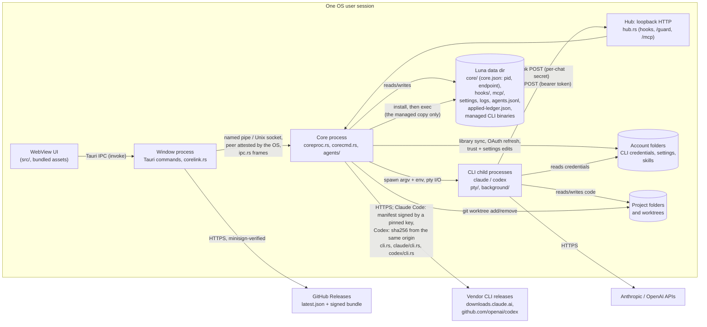

# Luna threat model

Scope: the Luna desktop app as built from this repository (Tauri 2; Rust core
in `src-tauri/src`, React UI in `src/`). Line references are to the tree this
document is committed with; commits are those of the phase 1 security work on
`refactor/phase-1`. Method: data-flow diagram, trust boundaries, STRIDE per
boundary, then the status of every finding and what is accepted.

## 1. System overview

Luna is a single-user desktop app that runs Claude Code and Codex CLI sessions
on the user's behalf. Two OS processes of the same executable cooperate:

- the **window process** hosts the WebView and relays the page's commands;
- the **core process** owns every running session, the hook/MCP listener and
  the state that must outlive a window (`coreproc.rs`).

## 2. Assets

| Asset | Where | Why it matters |
| --- | --- | --- |
| CLI credentials (OAuth tokens, API keys) | account folders, e.g. `.credentials.json` (`claude/oauth.rs`) | account takeover, spend |
| Access to the core's endpoint | a named pipe on Windows, a socket in `core/` elsewhere (`endpoint/`), named in `core/core.json`; no credential anywhere, the OS's word on the connecting process is the key ([ADR-0021](../adr/0021-core-endpoint-by-os-identity.md)) | full control of the core: spawn any session in any mode |
| Hub run key (256 bits, `hub.rs:380`) and the per-chat secrets derived from it (`hub.rs:115`) | key in core memory only; a chat's secret in its Claude `--settings` file under `hooks/` (`pty/start.rs:34`) or its Codex `-c` hook arguments | forge that chat's hook and guard events |
| Per-session MCP bearer tokens (160 bits, `agents/registry.rs:334`) | the `LUNA_MCP_TOKEN` environment of each tooled session (`codex/launch.rs:269`, `pty/start.rs:87`, `claude/launch.rs:103`); never on disk | act as that session through Luna's tools |
| Source code and git state of the user's projects | project folders, worktrees | integrity, confidentiality |
| Prompts, transcripts, agent history | CLI transcript dirs; `agents.jsonl` (`agentlog.rs`) | may hold pasted secrets |
| Integrity of the Luna binary | install dir, updater | code execution as the user |
| Availability of the PC and sessions | `power/`, `agents/` kill/delete | lost work, forced shutdown |

## 3. Actors

| Actor | Capability assumed | Trusted? |
| --- | --- | --- |
| Local user | drives the UI, owns the OS account | yes |
| Agent session (CLI child) | runs as the user; may be prompt-injected by repository content, web pages, tool output or another session's text | partially: bounded by its CLI's permission mode or sandbox, and with Luna's tools by the trust contract below |
| Other process of the same OS user | can read the user's files and process environments, connect to loopback | no defense intended: same-uid is the OS trust boundary (R3) |
| Other local OS user (multi-user Unix, shared Windows host) | can connect to 127.0.0.1, can read what file modes or ACLs let them | no |
| Web page in a browser on the same machine | can send simple cross-origin requests to 127.0.0.1 | no |
| Network attacker | on-path for HTTPS; can host content agents fetch | no |
| Release-signing key holder | signs updates | yes (single maintainer key, R7) |
| CLI vendors' release infrastructure | publishes the Claude Code and Codex binaries Luna downloads | Claude Code: its release key, pinned in Luna, not the bucket that serves it. Codex: yes, without independent verification (F10) |

### Trust contract for Luna's tools

Enabling Luna's tools for a session grants it **orchestration authority
bounded by its own privilege**. Escalation happens only through an explicit
user setting. The code meets this contract (F1, F2 fixed), within the limits
in section 6.

- A helper it spawns runs at no more privilege than the caller (Claude Code
  permission mode; Codex sandbox, approval and network) unless the user turns
  on Settings → Agents & trust → `helpersAboveCaller` (off by default).
- Every helper runs in the background, in the core. A chat the window runs is
  the person's own and never anyone's descendant (`ensure_*_session` registers
  it with no parent), so no agent interrupts, stops, deletes or approves for
  it, and nothing presses keys in a terminal for an agent.
- A helper the person opens as a chat is handed over to them for good
  (`agents/handover.rs`): from one registry hold on, its former parent can no
  longer send to, read or wait on it as its own, stop or delete it, and is owed
  nothing by it; while it is being opened its parent can neither stop nor
  delete it. With `scope: "all"` it reaches it as any of the person's chats.
  A delete and an opening exclude each other per helper (`background::claim_delete`,
  `promoting`), and no turn starts under either, so a delete that checked
  ownership, idleness and the worktree removes what it checked, and a removal
  that finds a taken-over chat refuses. A send whose text went in just before a
  handover registers no debt on the person's chat (`owe_from_at`, the handover
  count), and a notice's delivery and the handover of a session it tells of
  exclude each other (notifier `hand_off`), so a notice is either in before
  anything changes hands or not typed. A confirmation said twice hands over
  once. Waits re-check
  their `scope` on every look and before handing anything over, a `wait_many`
  returning a revoked session as `refused` with nothing of it; history stops at
  a link's current owner and at a run the log records as taken over. An opening
  survives a core restart held (`helpers.json`), the window settles it with
  retries, and one never settled goes back to the parent after 15 minutes with
  a notice; until then a pane cannot start a helper's id.
- `luna_session_answer` with `allow`, or an answer to a list the CLI holds its own
  screen on, works only on the caller's own helpers, and only at the privilege
  it would itself need to run the tool unasked.
- Text a CLI reads as a command (`/` slash command, `!` shell mode) goes only
  from a caller at full access into its own helper.
- Stopping a turn (`luna_session_send` with `interrupt`) works only on the caller's own
  helpers and theirs, of either provider, as kill and delete do (F12).
- Reading, waiting on, sending plain text to and answering a model's question
  in other sessions stays open (R1), as that is how sessions hand work to one
  another, but only when the call says `scope: "all"`; text sent so, an answer
  typed in as a message included, arrives opened `[From session <id> via
  Luna]`, not as the user's own words.
- A helper reaches out of Luna only as far as its spawn asked: it starts with
  Luna's MCP server alone, without its account's MCP servers and connectors,
  and a Claude Code helper without auto-memory, unless spawned with
  `connectors: true` (F13; a Codex helper's project and plugin servers are
  section 6's, listed in its spawn's result).
- Every argument a tool is called with is checked against its schema before
  it runs: what it does not know or cannot take is refused, never passed over
  (F14).
- `luna_session_handoff` acts on the caller's own chat and no other: it has no
  target argument, the chat is the one its token is, and only a person's chat
  with Luna tools and auto-handoff on is offered it or may call it
  ([ADR-0020](../adr/0020-session-self-handoff.md)). What Luna types into that
  chat for it is fixed text (`/clear`, `/new`) and its own prompt; the
  session's file is data the next conversation reads, copied and hashed, never
  run, and never taken from Luna's data folder or through a link. Called
  without `file` it answers with the instructions Luna serves for the handoff,
  its own or the person's override in the library
  ([ADR-0022](../adr/0022-content-luna-serves-at-its-own-trigger.md)). No other
  session is told of it: the guide has no topic of it, the chat's settings as
  another session reads them (`luna_session_get`, a listing) lack it, and a
  call from one it is not offered to is refused as for a tool there is not. A
  session that reads this chat's transcript (`luna_message_list` with
  `scope: "all"`) sees the notices and prompts in it, as it sees everything
  there (R1). The next conversation
  is told that approvals the handoff quotes hold as far as the user's quoted
  words go and no further; names and tasks of sessions in Luna's facts are
  quoted as data.

## 4. Trust boundaries and STRIDE

### B1. WebView page to window process (Tauri IPC)

| STRIDE | Threat | Status |
| --- | --- | --- |
| E, T | Script injected into the page (rendered terminal or transcript text) calls any app command; they take raw `account_path` / `folder` strings and can write account config | mitigated: no HTML sinks in `src/` (no `innerHTML` / `dangerouslySetInnerHTML`); xterm.js draws terminal output as text; strict CSP (H3). A script that runs anyway gets only what the page calls (F9, [ADR-0015](../adr/0015-the-page-gets-only-what-it-calls.md)): build.rs puts every command of `app_handler!` (`lib.rs`) in the application manifest, and `capabilities/default.json` grants each to the `main` window by name, none to another window or a remote origin; account paths of the commands that write account config, use credentials, set trust or may run the Codex CLI on the account (`codex_models`, `codex_defaults`) are `AccountPath` (`boundary.rs`): a folder directly in a provider's folder under the accounts root, a valid account name, no trailing separator, neither it nor the provider's folder a link, junction or mount point, and resolving (`canonicalize`, handle-based on Windows) to that folder under the resolved root by the very name given, so `name.`, `name `, 8.3 and case spellings are refused. Tests: `lib.rs` `acl` (mock app, Linux check), `boundary.rs`. Residual: what the page does stays open to it, below |
| E | Plugin permissions broader than needed | mitigated: `capabilities/default.json` grants seventeen plugin calls, those the page makes: `core:app:allow-version`, event listen and unlisten, seven window actions (drag, the title-bar double-click, minimize, toggle maximize, is maximized, scale factor, close), `dialog:allow-open`, three notification and three updater calls (`check`, `download`, `install`); no menus, trays, new windows or webviews, paths, no `remote` origins, no shell or fs plugin. Tested: `lib.rs` `acl` |
| E | Script lifts the helpers' privilege cap (`helpersAboveCaller`, section 3) | mitigated against the page's own calls: turning it on asks a native dialog from the window process (`set_helpers_above_caller`, `agents/privilege.rs`), which the page cannot answer; turning it off asks nothing. One dialog at a time; a yes is written only if no change was written while it was open, and a request that finds the cap lifted already writes nothing, so a turn-off in between is never undone (`AboveGate`). Residual: a script that has started a full-access session (below) can edit the settings file or drive the dialog from there. Tested: `lifting_the_cap_takes_a_persons_yes`, `a_yes_never_lands_on_a_state_it_was_not_asked_about` |
| E | What an injected script can still do | **residual**: everything the page itself does, among it: start a session in any folder with any permission mode or sandbox and type into it, which is code execution as the user; delete chats and their worktrees; arm a PC shutdown; edit an account's settings file; change the accounts root, the denylist of helper accounts and the Codex trusted roots; write the library, the handoff's override included (what opted-in chats are served to write their handoff by), which the page's System skills section edits, compares, moves into the backups or makes from a library skill of its name. Those commands (`library_check_system`, `library_system_compare`, `library_system_reset`, `library_system_adopt`, and `library_read`/`library_write` with `{"system": name}`) take only a system skill's name (`library/system.rs` `luna_text`), reach only `<library>/system/<name>` and Luna's backups, refuse a link or junction anywhere below the library's folder on the way (`skills/`, `system/`, the override's folder, anything in it, the skill to adopt) or at `library-backups/` (checked a private folder of this user's, `boundary::private_chain`, before anything moves), check that what is there resolves inside the library (`inside`, on `boundary::walk_down`), refuse anything but plain files and folders in a folder they move (a FIFO there would hold the library's lock) and a save over 64 KB; Back to Luna's moves the folder whole into the backups by a rename (across volumes: renamed aside within its own volume, copied, removed only once the copy has the same files and hashes, else kept aside and named in the window), and an adoption stages its move before it changes what is served, swaps under a lock the resolver shares and undoes a failed swap. The library's folder itself may be a link of the person's choosing. Tested by `no_name_but_a_system_skill_s_reaches_anywhere`, `a_link_on_the_way_is_neither_read_nor_written_through_nor_taken_out`, `a_link_above_what_is_changed_is_refused`, `a_fifo_in_the_way_is_refused_without_waiting` (Unix), `an_oversized_override_is_not_saved_and_one_too_large_to_edit_not_opened`, `back_to_luna_s_keeps_all_of_the_folder`, `a_reset_across_volumes_loses_no_save_made_while_it_copies`, `an_adoption_that_fails_changes_nothing`, `an_adoption_of_a_folder_held_open_changes_nothing` (Windows), `what_is_served_waits_for_an_adoption_s_swap`. Residual: across volumes, a write through a handle already open on a file of the override's folder that lands after its copy is checked is lost when the folder is taken out (a same-user program's, as in R6). Read-only commands whose callers may send an empty path and that run nothing (Claude defaults, saved titles, hooks state, worktree inspection) keep plain strings. The controls against getting a script in stay those above |
| S | A link clicked in a terminal opens a non-web scheme | mitigated: `open_link` allows `http`, `https`, `mailto` only and does not log the URL (`lib.rs:128`) |
| I, D | A page command reads files a project controls: `chat_folder_check` (the new-chat dialog's look at a folder, `pty/folder.rs`) reads the account's `settings.json` and the project's `.claude/settings.json` and `settings.local.json`, and looks (no read) for Claude Code's managed settings and a `.git` above the folder; `luna_session_spawn` and every chat start run the same check | mitigated: the account must be one Luna lists and the folder an absolute plain path (`AccountPath`, `AbsPath`, boundary.rs) before anything is looked at; only a regular file of at most 1 MiB is read, a link followed only to one, opened without waiting on a FIFO (`read_settings`); the dialog's look runs off the window's thread; what goes back is a refusal or a warning, no file content. Tests: `a_settings_file_too_big_to_be_one_is_not_read`, `a_settings_name_that_is_no_file_is_not_waited_on_or_read` (a FIFO with no writer, a link to `/dev/zero`, Unix); a file there but not read (too big, not regular, an error) and a registry look that fails other than "not found" are no proof of no hook, and only warn (`a_settings_file_luna_could_not_read_warns_rather_than_refuses`, `a_registry_look_that_fails_is_no_proof_of_no_policy`). **Residual**: a folder or settings file on a network share that does not answer holds the look with no deadline; off the window's thread, it holds only that dialog's answer (Create waits), that start or that spawn |

### B2. Window process to core process (the core's endpoint, `endpoint/`, `ipc.rs`)

| STRIDE | Threat | Status |
| --- | --- | --- |
| S, E | Any local process opens the core's endpoint and drives it | mitigated ([ADR-0021](../adr/0021-core-endpoint-by-os-identity.md)): no secret; the endpoint lets in only this user's unconfined processes. Windows: a named pipe whose protected DACL names the user and SYSTEM (and Administrators, below), with a medium no-read-up, no-write-up label, remote clients rejected (`endpoint/win.rs` `pipe_sddl`, `Listener::instance`). Unix: a socket in `core/` (`0700`), itself `0600` (`endpoint/unix.rs`). Before anything is read the core reads who connected (`peer/`, `coreproc.rs` `serve`) and refuses, fail closed, another user, and on Windows a token below the core's integrity; the refusal says nothing back and is logged with the pid, image and reason. Dispatch is an explicit allowlist (`corecmd::COMMANDS`). Tests: `peer/mod.rs` `another_user_is_refused_and_an_administrator_may_only_stop_it`, `peer/win.rs` `a_low_integrity_client_cannot_open_the_pipe`, `an_anonymous_client_is_refused` |
| S | A process takes the endpoint's name first, or serves it as well, and a window talks to it | mitigated: a fresh random name per core; on Windows the first instance is made with `FILE_FLAG_FIRST_PIPE_INSTANCE`, so a name already held is refused, and every later instance must read back the first one's DACL and label, so the core never joins a pipe of someone else's (`endpoint/win.rs` `Listener`); on Unix `bind` refuses a name with anything at it. The window checks that the endpoint's server is the pid `core.json` names before it sends a byte (`corelink.rs` `hello`), and opens the pipe at identification level, so a server that is not the core can act as nobody. Codex's Windows sandbox could not make an instance of the name (0.167.0, measured). Tests: `a_squatted_name_is_refused` (both), `an_endpoint_served_by_another_process_hears_nothing`, `names_are_fresh_and_nothing_else_is_opened` (a remote pipe or a path out of `core/` is never opened) |
| E, T | The page has the window pass on a command it does not use (the protocol's `shutdown`, a keystroke command as an answered call) or a path of its own making | mitigated: `core_call` and `core_send` pass on only the 39 commands of `corecmd::COMMANDS`, each on its lane (`corelink.rs` `passes`), and `dispatch` refuses the rest again; every account path argument is an `AccountPath` and every folder, worktree and removal path an `AbsPath` (`boundary.rs`: absolute, no `.` or `..` part, no device or verbatim prefix, no stream suffix), checked as the arguments are read. Tests: `corelink.rs`, `corecmd.rs` `bad_paths_are_refused_before_anything_runs`, `the_page_and_the_core_list_the_same_commands` |
| I, T | The page's read-only view of a helper (`background_transcript`) names a file to read, or reads without bound | mitigated: the page names only the helper's id; the file is the one the helper's own record leads to (`background/rows.rs:281`, `background::transcript`), and a `file` the page passes back only says whether its cursor still applies. A look returns at most the newest 200 messages, each cut at 20,000 characters (`VIEW_MESSAGES`); the text goes to the page as text, never HTML (`HelperView.tsx`). The person's helper delete is held in the core too: a helper at work, or a worktree with unsaved work, goes only with a yes of its own (`delete_by_user`, `agents/teardown.rs:93`). Tests: `the_view_of_a_helper_tails_its_conversation_read_only`, `the_persons_delete_spares_a_working_helper_unless_told` |
| I, T | The page has a handoff's copy or the conversation it left read (`handoff_file`, `handoff_transcript`), or sets auto-handoff (`set_auto_handoff`) | mitigated: the page names a chat id and a handoff number; the files are those the chat's own record holds (`agents/handoff/mod.rs` `past_of`), the copy read to at most 128 KB and the conversation through the same bounded reader as a helper's (`background::view_of`). Setting auto-handoff takes a threshold of 1 to 90 and changes nothing but the chat's own registry settings; the tool still needs Luna tools and a person's chat. What a script could do with it the page could do already (B1's residual: it starts sessions). Tests: `agents/handoff/tests.rs` |
| I | `core.json` readable by another OS user | fixed (F4); it holds no credential anyway (pid, creation time, protocol, endpoint name; `ipc.rs` `Discovery`, test `discovery_carries_no_credential`) |
| S, E | A CLI session confined by its sandbox opens the core's endpoint and drives it | fixed (F3, ADR-0021). Windows: Codex's unelevated sandbox (0.167.0, `read-only` and `workspace-write`) is refused the pipe's open by its DACL, measured live; were a sandbox's token let through, the core reads the token the pipe was opened with (`ImpersonateNamedPipeClient`, identification level, reverted at once) and refuses it when it is restricted or an AppContainer (`peer/win.rs`; test `a_restricted_client_that_passes_the_dacl_is_refused_by_its_token`). Linux: the core refuses a peer in another user namespace than its own (bubblewrap, Codex's sandbox), with `no_new_privs` set where the core's is not (its seccomp filter, Landlock), or under a stricter seccomp state than the core's (a higher mode, or more filters: a lineage heuristic that catches filters added on top of the core's own chain, as a sandbox Luna launches has, and proves nothing between launch contexts), read from `SO_PEERCRED` and `/proc/<pid>`, with a pidfd (`SO_PEERPIDFD`) holding the pid, any failure to get one refusing but `ENOPROTOOPT` from a kernel before 6.5, where the pid alone is checked and a recycled pid is a residual (`peer/unix.rs`; tests `only_a_kernel_without_the_option_goes_on_without_a_pidfd`, `a_peer_reaped_before_it_is_read_is_refused`, `a_client_with_no_new_privs_is_refused`, `a_client_under_a_stricter_seccomp_than_the_cores_is_refused`, `a_client_in_another_user_namespace_is_refused`). A core started with `no_new_privs` (Flatpak, systemd's NoNewPrivileges, a container) cannot refuse for the bit, which a window started in the same context carries too: it still refuses another namespace or an added seccomp filter, but a client confined by Landlock alone in its own namespace under its seccomp state is let in, since the kernel shows no Landlock domain to procfs or any other process; the core says so once at its start (`peer::note_launch`; test `under_a_core_with_no_new_privs_a_namespace_or_seccomp_still_refuses_and_landlock_alone_does_not`). Live: `live.rs` `the_core_endpoint_refuses_a_sandboxed_codex_and_welcomes_a_plain_process`, `the_core_socket_refuses_a_sandboxed_codex_and_lets_a_plain_process_in`. One exception, for F11: a core run as administrator, which does no work, lets a plain lower-integrity client (not restricted, not an AppContainer) in to send `shutdown` and nothing else, so an ordinary window can stop it; an elevated administrator of another account may do the same (through 0.11 Administrators could read the token and do anything); a sandboxed client is refused there too (`peer/mod.rs` `verdict`, `coreproc.rs` `turned_away`). Residuals: a deputy, below; macOS Seatbelt is not seen at the socket (macOS not tried); on Linux, a client from another launch context with as many seccomp filters as the core or fewer is let in whatever its policy, if its user, user namespace and `no_new_privs` match the core's, and a window from a context with more filters than the core's (an allow-all filter included) is refused (ADR-0021; accepted while Linux is not a released platform) |
| S, E | A deputy: a plain process connects for a confined one | mitigated in part: the endpoint is no TCP port, so a loopback proxy or forwarder that happens to run reaches nothing. Against 0.11.0, measured on Windows with Codex 0.167.0: a client in `codex sandbox` (`read-only`, `workspace-write`) read the token and, through a plain loopback TCP forwarder, was welcomed and answered `info`, while its direct connection was refused. Residual: a relay written to open the pipe or the socket for someone else, run unconfined; COM, WMI and the task scheduler as brokers are untried |
| D | Connection floods, slow-loris hello, large first frame | fixed (H2): 32 connections at once before their hello, hello within 5 s and 4 KiB against one deadline, on the endpoint's own overlapped deadlines on Windows (`coreproc.rs` `STRANGERS`, `HELLO_DEADLINE`, `HELLO_MAX`; `admit.rs` `Deadline`); the rest are closed unread. Tests: `coreproc.rs` `a_silent_or_trickling_stranger_is_let_go_at_the_deadline`, `an_oversized_or_truncated_hello_is_refused`, `admit.rs` `a_trickling_peer_on_the_endpoint_is_cut_off_at_the_deadline` |
| T | A window of Luna 0.11 (protocol 1) meets a 0.12 core, or the reverse | the 0.12 window reads a `core.json` with a token as a protocol-1 core's and uses the token for a hello and, when the core has no session, a shutdown, nothing else; with sessions it shows the mismatch banner (`corelink/v1.rs`; test `a_protocol_1_core_hears_a_hello_and_a_shutdown_and_nothing_else`). A 0.11 window cannot read the new `core.json` and shows the core down until the newer core is stopped |

### B3. Agent sessions to the hub (`hub.rs`, `mcp.rs`)

| STRIDE | Threat | Status |
| --- | --- | --- |
| S | A local process or web page posts forged hook events or MCP calls | mitigated: loopback only (`hub.rs:80`); hook and guard URLs carry their chat's secret (`hub.rs:238`, F7); MCP needs a per-session bearer token, looked up by its SHA-256 (`agents/registry.rs:341`, H1); a browser cannot set `Authorization` cross-origin without a preflight the hub never answers |
| S | One session posts hook or guard events as another chat | fixed (F7) |
| E | Session A acts on session B through MCP | see the authorization matrix (section 5) |
| T, E | A misspelled or mistyped tool argument is passed over and the tool runs on a default that widens it (`read_only` for `readOnly`: a helper that writes) | fixed (F14): `arguments_fit` holds each call to its tool's schema before it runs (`mcp.rs:629`) |
| I, E | A session has Luna copy for it a file its own rules keep it from reading (`core.json`, another chat's handoff), through `luna_session_handoff` | mitigated: the file must be absolute, `.md`, `.markdown` or `.txt`, at most 128 KB of UTF-8 text with no NUL; it is opened without following a link at its name (`FILE_FLAG_OPEN_REPARSE_POINT`, `O_NOFOLLOW`; `O_NONBLOCK` too, so a FIFO swapped in for it does not hang the open) and refused if the handle is a link, a junction or not a file; the path is resolved (`canonicalize`) and refused inside Luna's data folder, wherever links on the way lead, but for a file right in the calling chat's own drafts folder (`<data>/handoffs/<chat>/drafts/`), and only where that folder resolves to where its own names say, no link at `handoffs`, the chat's folder or `drafts` (`file.rs` `own_draft`): another chat's drafts, its folder of copies, a folder below its drafts are Luna's folder to it, and a path named inside Luna's folder that a link takes out of it is held to the same rule, not taken as a file outside. `handoffs`, the chat's folder and its drafts are each checked top down before anything is made or read below them, or a folder given to a CLI: a folder, no link or junction, this user's, private (`boundary::private_chain`, `secret::private_dir` at each level; `handoffs` is one of the data folder's own names, `paths.rs` `OWN_NAMES`, for the shared-folder privacy pass); a chain that fails names no drafts folder, gives the CLI none, and loads or saves no record. What lies in them is held to the same at its own name: `handoffs.json` and a copy are read only as private files of this user's, by their handle, opened without following a link (`secret::read_private`; a link, a folder, a junction or a file others may write there is not read, and the log says so), a draft only as one of this user's making (`secret::own_file`), and a save renames a new private file into place, which takes the place of a link at the name rather than writing through it (`secret::write_private_synced`). The draft named to a chat is a file of its own made new, empty and private there (`served.rs` `new_draft`), so no link at a name used before is handed over. A switch, fresh or taken up again after a core stopped, resets and prompts only once its copy holds (`copy_holds`): right in the chat's checked folder of copies, a private file of this user's opened as itself, its SHA-256 the one on record; otherwise nothing is typed, and the chat and the person hear why with no prompt pointing at the copy. The facts file goes only into that checked folder, and old copies are removed only from it. Residual: a same-user process swapping a folder between the check and its use (R6). All of it runs on a thread of its own given 10 s, outside any lock others wait on (the chat's number is reserved first), so a share that does not answer holds up that call alone; a reader given up on keeps its place until its thread ends, one per chat and four in all, so stalled reads cannot pile up threads. Auto-handoff turned off during the copy clears the reservation under the record's lock, and the switch is recorded only while the reservation stands and the opt-in is still there. The copy is made new and private (`secret::create_private`) under `<data>/handoffs/<chat>/`, flushed, past any copy already there (`agents/handoff/file.rs`). Residual: a same-user process swapping a folder on the way between the check and the open (R6); and Luna does not apply the CLI's own read rules, so a Claude Code session whose permission rules deny it a Markdown or text file outside Luna's folder can have it copied where it reads it. Its tools that run unasked read anywhere already in most modes; accepted with R2. Tests: `what_is_not_a_handoff_file_is_refused_and_nothing_copied`, `a_fifo_at_the_name_does_not_block_the_open`, `a_read_that_does_not_answer_in_time_is_refused`, `the_file_is_read_outside_the_records_lock_one_call_at_a_time`, `readers_that_never_come_back_hold_their_place_and_no_more_are_started`, `turning_it_off_while_the_file_is_read_leaves_nothing_to_switch`, `of_luna_s_folder_only_the_calling_chat_s_drafts_are_taken`, `the_chats_own_drafts_folder_is_where_it_writes_and_what_is_taken`, `a_link_or_a_strangers_folder_on_the_way_to_the_drafts_is_refused` (a junction on Windows; another user's folder on Unix), `a_store_planted_as_a_link_is_neither_read_nor_written_through`, `a_copy_that_is_not_the_one_luna_made_is_never_switched_on` |
| I | A session not opted in to auto-handoff (a helper, a chat without the tick, one without Luna tools) learns of it or reads its instructions | mitigated ([ADR-0022](../adr/0022-content-luna-serves-at-its-own-trigger.md)): `tools/list` offers `luna_session_handoff` only where `offers_tool` holds; any other caller's call of it is refused as for a tool there is not, before its arguments are looked at (`mcp/dispatch.rs` `run`), so the refusal names no argument or setting; the guide, `initialize`'s instructions and the other tools' descriptions say nothing of it (no topic, no section); a chat's settings as another session reads them (`luna_session_get`, `luna_session_list`: every row goes through `agents/list.rs`) lack its `handoff`, which only the chat itself reads (`handoff::settings_shown`); the instructions are served only as that tool's answer and go into no launch, account or folder (the library's pass never reads `system/`); a library skill named `session-handoff` is laid out nowhere and hidden from no start, so its name reaches none either, and a copy an earlier Luna laid out goes unless changed there (`library/system.rs` `reserved`). Residual, accepted with R1: a session that reads the chat's transcript (`luna_message_list` with `scope: "all"`) sees the notices and the continuation prompt in it, as it sees everything there. Tests: `nobody_but_a_chat_with_auto_handoff_on_hears_of_it` (the tool, `initialize`, the guide, `luna_session_get` and `luna_session_list` from a helper and from another chat), `what_every_tooled_session_reads_says_nothing_of_auto_handoff`, `a_helper_is_started_with_nothing_of_the_handoff`, `auto_handoff_is_a_chats_with_luna_tools_and_says_where_its_copies_are`, `the_override_reaches_no_account`, `a_skill_of_the_reserved_name_is_laid_out_nowhere_and_its_old_copies_go` |
| T, D | The handoff's instructions are steered, or their read held up: a planted override, a same-named skill the chat's CLI lists, a large file or a FIFO in the override's folder | mitigated: the override is the person's own file in their library (`<library>/system/session-handoff/SKILL.md`), its front matter checked as a library skill's (name, description), served only to the person's own opted-in chats; one that will not do is not served, and the chat and the panel say why. SKILL.md alone is read (it alone is served): `system/` and its folder no link, SKILL.md itself opened without following a link and without waiting on a FIFO (`boundary::open_no_follow`), a regular file of one name of this user's making by its handle (`secret::own_file`: not another file's hard link, not another user's; not `read_private`, as a library the person chose keeps its folder's access), read no further than 64 KB and one byte; nothing beside it is read, so nothing there holds up the handoff's beat, which resolves the instructions for each firm notice (`library/system.rs` `read_override`). A same-user process that can write the library can write the account's instructions too (R3); a library on a share that does not answer still holds the read up, as it holds the library's pass. A `session-handoff` skill in a project's or an account's skills is never served; the panel warns of one (`served.rs` `same_named`). Tests: `a_broken_override_falls_back_to_luna_s_and_says_why`, `an_override_that_will_do_is_served_over_luna_s`, `without_an_override_luna_s_own_is_served`, `only_skill_md_is_read_and_no_further_than_the_cap`, `an_override_not_of_the_person_s_own_making_is_not_served`, `a_fifo_in_the_override_s_folder_holds_nothing_up` (Unix), `the_panel_names_the_instructions_and_skills_of_the_same_name` |
| T | Text a session wrote (a helper's name or task) reads as instructions in the next conversation's prompt | mitigated: Luna's facts quote names and tasks on one line in double quotes, a quote or backslash in them escaped, and say they are data (`facts.rs` `quoted`); approvals the handoff quotes are said to hold no further than the user's quoted words. Residual: the handoff itself is the previous conversation's text (R2). Tests: `the_prompt_points_at_the_copy_and_states_the_facts` |
| T | Request smuggling or parser confusion | mitigated (H2): head parsed by `httparse` in its strict default; body framed by `Content-Length` only, digits only, repeats equal; any `Transfer-Encoding` is answered 400 and closed (`hub.rs:297-312`) |
| D | Thread or memory exhaustion | fixed (H2): 64 connections still sending their head (16 KiB, 5 s), then separate lanes of 32 for hooks and the guard and 128 for MCP; bodies 64 KiB (hooks) or 4 MiB within 30 s; 503 past a cap, 413 past a body cap (`hub.rs:42-75`, `admit.rs`). Spawns capped per caller (`agents/spawn/mod.rs:241`) |
| R | Who did what through MCP | every tool call is logged with caller, target and steering arguments, never prompt text (`mcp.rs:419-443`); spawns and exits go to `agents.jsonl` |

### B4. Core to CLI child processes (`pty/`, `background/`)

| STRIDE | Threat | Status |
| --- | --- | --- |
| T, E | Shell or argument injection through spawn parameters | mitigated: children start from an argv vector, never a shell (`pty/spawn.rs:196`); modes, efforts, models and sandboxes are checked against fixed lists, spelled exactly (`agents/privilege.rs:264`); text Luna types is refused if it holds control characters (`agents/privilege.rs:493`); a handoff types only its fixed reset (`/clear`, `/new`: `agents/handoff/phase.rs` `reset_command`) and its own prompt, the names and tasks in it put on one line without control characters (`facts.rs` `plain`), outside `luna_session_send`'s command check, which governs what agents send; each only into an empty composer looked at with the person's keys held, under a phase saved for that very handoff, and never while a notice or send is going into the chat (the notifier's exclusion), so neither is appended to what a person writes nor lands in a conversation about to be cleared. Tests: `after_the_reset_a_person_writing_holds_the_prompt_back`, `nothing_is_typed_under_a_phase_that_could_not_be_taken`, `a_handoff_given_up_between_the_look_and_the_reset_types_nothing`, `a_schedule_waits_for_what_is_going_into_the_chat_and_then_nothing_goes` |
| E | A Codex chat's sandbox is given a folder of Luna's to write in (auto-handoff's drafts) | mitigated: only a person's chat with Luna tools and auto-handoff on, and only under a sandbox that writes at all (`workspace-write`, `danger-full-access`: `codex/launch.rs` `writes_files`), gets one `--add-dir`, its own `<data>/handoffs/<chat>/drafts/`, and only once that folder, the chat's and `handoffs` are each made a private folder of this user's with no link or junction at every start of the chat's CLI, before it runs (`drafts_at_start`, `boundary::private_chain`; a first start, a resume, a restart, the quick resume for auto-handoff turned on while it runs), so a link another user planted on the way (the shared data folder) never takes the grant to a folder they hold, and an ACE added while the folder was open is gone. On Windows Codex 0.167.0's unelevated sandbox then grants itself an inheritable Modify ACE on that folder; later looks (`drafts_of`, the call without `file`) hold the folder to no link, a real folder, owned by this user, and leave its DACL as it is (`secret::own_dir`), so that grant stays. Luna does not identify the sandbox's SID: Codex takes it from its account's `cap_sid` unchecked, and an account folder others can write is outside what Luna defends (B5's precondition). A start that cannot make the drafts folder private (a DACL that denies this user WRITE_DAC, a file at its name) gives the CLI no `--add-dir` (Claude Code not the chat's folder of copies either), names the chat no drafts folder (the call without `file` sends it to write outside Luna's folder) and takes no file from there, until a start can; the log and What Luna applied say why (`drafts_at_start`, `drafts_refused`). No one else can add an ACE after the start: that takes WRITE_DAC, which the private DACL gives only this user, SYSTEM and Administrators; an ACE this user's own processes add is theirs to add (R3). The data folder's privacy check takes a drafts folder's ACEs as they are, as that folder is made private at its CLI's every start, whether it checks the data folder whole or, in a data folder others share, only Luna's own things in it, `handoffs` among them (`secret.rs` `handoff_drafts`). Residual, accepted: the privacy pass in its resetting mode (`acl::protect_tree`, a first or changed protection) resets the folder to inherit, taking Codex's grant away until its next start on that chat; a drafts folder made anew by a look while the CLI runs (one deleted meanwhile) has no grant until then either. The draft is named, not made (`new_draft`: a random name in that folder, nothing there yet), so the sandbox makes the file, of this user's owning (`secret::own_file` takes it); nothing else in the data folder, `core/` least of all, is made writable, and a handoff file is taken from Luna's folder only right in the calling chat's own drafts folder (B3). A read-only sandbox gets none, and the tool's answer says the chat can write no file. Tests: `auto_handoff_is_a_chats_with_luna_tools_and_says_where_its_copies_are`, `a_helper_is_started_with_nothing_of_the_handoff`, `a_link_or_a_strangers_folder_on_the_way_to_the_drafts_is_refused`, `a_folder_given_to_a_sandbox_keeps_its_grant_and_the_sandbox_writes_new_files_there` (Windows), `the_drafts_folder_is_made_private_at_the_start_and_keeps_what_its_cli_adds_after` (Windows), `a_drafts_folder_its_start_could_not_make_private_is_neither_named_nor_taken_from` |
| E | A tooled session spawns a helper with more privilege than itself | fixed (F1) |
| E | A config's `auto_review` answers for a person | mitigated for helpers: a helper's Codex asks nobody, its approval `never` or `auto-review` (`agents/privilege.rs`), and without `auto-review` it pins `approvals_reviewer="user"`, so no config's reviewer model answers for it (`codex/launch.rs` `CODEX_PERSON_REVIEWS`, `background/command.rs` `command_for`). A person's own chat follows its account's and project's `approvals_reviewer` since 0.11.0 ([ADR-0016](../adr/0016-luna-is-a-runtime.md), decision 2): Codex reads a project's `.codex/config.toml` only in a trusted folder, and the reviewer it names is shown in the chat's settings as Codex's own. Accepted as the person's configuration |
| E, I | A helper inherits its account's MCP servers and connectors (claude.ai's Gmail, Slack, CRM tools that send and write; Codex's apps), so a brief or an injected prompt acts in the person's name outside Luna; a Claude Code helper writes the account's auto-memory, which every later session reads | fixed (F13) for Claude Code: `--strict-mcp-config`, `disableClaudeAiConnectors` and `autoMemoryEnabled: false` in its settings file, `CLAUDE_CODE_DISABLE_AUTO_MEMORY=1` in its environment and that file's `env` (`claude/launch.rs:119`, `background/command.rs:52`; every helper starts there); Codex: apps and the account's `config.toml` servers off for the run (`codex/launch.rs:251` `connectors_off`), and no start at all when one of them has a name `-c` cannot spell, so cannot be turned off (fail closed; `codex/launch.rs` and `background/command.rs` tests); a project's `.codex/` and plugins' servers stay (section 6), listed in the spawn's `mcpLeftOn` and as `helper.mcp-left-on` (`codex/config.rs` `servers_left_on`). `connectors: true` keeps them. Each is shown in "What Luna applied" as a Boundary item (`helper.luna-mcp-alone`, `helper.no-auto-memory`) |
| I | "What Luna applied" (`applied_by_luna`, a core command) shows a session's token or the hub's secret | mitigated: an item's value names a token by its variable and a hub URL by its purpose, never the value (`applied.rs`, `codex/launch.rs` `LUNA_TOOLS_VALUE`, `claude/launch.rs` `luna_tools_value`); every launch golden checks that no item holds the session's token or a hub URL (`golden.rs` `Redact::applied`). The ledger of account writes (`<data>/applied-ledger.json`) holds paths only, written private (`secret::write_private`) under the account settings' lock; one that will not read is not written over, and a write it missed is said in `applied-ledger.incomplete`, so the panel says "Accounting incomplete" rather than a whole inventory (`applied.rs` tests) |
| I | A session inherits Luna's or a parent session's identity variables | mitigated: inherited CLI session variables are removed (`pty/spawn.rs:206`, `pty/spawn.rs:506`) |
| E | Luna started as administrator (or root) hands its elevated token to the core and so to every CLI | fixed (F11): see below |

### B5. Core to account folders and project folders

| STRIDE | Threat | Status |
| --- | --- | --- |
| T | Library sync follows a planted symlink or junction out of the account folder | mitigated: links are refused on read and write at a copy and below it (`library/files.rs` `read_at`, `read_dir_files`; `library/folders.rs:251`), and above it: every folder between the account's folder (for a Claude Code folder copy, `library-folders/`) and the copy is looked at before the pass writes it, before `put_back` writes over it (a resolve, Put all back, Sync all) and before `library_kept` backs it up and takes it out, a link or junction there refused and named in `unsettled` (`library/files.rs` `no_link_between`; test `library::commands::tests::a_linked_folder_above_a_copy_is_neither_written_nor_emptied`). The account folder itself may be the person's link. The pass's removal of a copy no longer wanted, still hashing to what Luna wrote, is not checked above the copy. Account names reject `.` and `..` (`accounts.rs:49`). Check-then-use remains (R6) |
| T | Worktree removal deletes outside the intended root | fixed (F6) |
| I | OAuth refresh exposes tokens | fixed (F5); errors are logged without token values |
| T, E | Another OS user who can write an account folder steers its CLI: its config (`settings.json`, `config.toml`), its credentials, its hooks and skills, or Codex's `cap_sid`, which names the capability SIDs its Windows sandbox grants itself on each writable folder and is reused unchecked (0.167.0, [cli-compatibility](../cli-compatibility.md)), so a SID of theirs written there is granted Modify on the chat's handoff drafts folder after Luna's start-time reset (B4) | **precondition, not mitigated by Luna**: the account folders, and the accounts root above them, must be writable by this user alone. They are the CLIs' own, not Luna's data folder: Luna neither makes them private nor checks their ACL, and reads no `cap_sid`. Where another user can write them, they hold that CLI whatever Luna does |

### B6. Window process to update server

| STRIDE | Threat | Status |
| --- | --- | --- |
| T, S | On-path attacker or compromised release host serves a malicious build | mitigated: HTTPS endpoint on GitHub Releases and a minisign public key pinned in the app (`tauri.conf.json:70-76`); Tauri refuses unsigned bundles |
| T | Signing key theft | reduced: the key is a secret of the `release` environment, handed only to the release workflow's sign job on a `v*` tag after a reviewer approves ([releasing.md](../releasing.md)); a leak is still accepted (R7) |
| T, E | A dependency's build code (build script, proc-macro, frontend tooling) reads the signing key during `tauri build` | mitigated (audit finding, High): the build job holds no secret and signs nothing (`build-windows.ps1`); the sign job, on a fresh runner with only the signing files checked out, checks the build's files against its checksums and signs with the Tauri CLI's `signer sign` held to the integrity `pnpm-lock.yaml` pins, in the pinned Node image with no network (`release-sign.ps1`), and checks the signature against the pinned public key before `latest.json` takes it. `release.ps1 -Local` builds an export of the commit, never the checkout that signs, runs nothing the build made on the host (the core fingerprint is the file build.rs writes; artifacts reached through a link are refused) and mounts the key only into the signer's container. Residual: the same build code can still alter this release's installer, which is then signed and attested (one bad release, not a stolen key); locally, the Docker cache volumes every build shares carry what one build plants into the next build, again into an installer, not to the key |
| S, T | A key rotation's bridge release is checked against the wrong public key | mitigated: the signature is checked against the public key the release embeds unless the releaser gives the old one (`UPDATER_TRUSTED_PUBKEY` in the `release` environment, `-TrustedPubkey` locally), never one taken from the build. The environment always defines the variable (`embedded` otherwise), so its value outranks a repository variable a collaborator could create; an empty value stops the sign step. Residual: with the environment's variable deleted, a repository one is used; a wrong key fails closed, stopping the release |

### B7. Core to vendor CLI releases (managed CLI downloads)

Luna downloads and runs its own copy of each CLI (`cli.rs`): Claude Code from
`downloads.claude.ai` (`claude/cli.rs`), Codex from `github.com/openai/codex`
releases (`codex/cli.rs`), both over HTTPS.

**What is verified.**

- Claude Code: `manifest.json` against its detached OpenPGP signature
  (`manifest.json.sig`), checked against Anthropic's release key pinned in
  the app (`claude/manifest_sig.rs`: RSA 4096, fingerprint
  `31DD DE24 DDFA B679 F42D 7BD2 BAA9 29FF 1A7E CACE`, as the
  [setup docs](https://code.claude.com/docs/en/setup#verify-the-manifest-signature)
  give it; a test derives the fingerprint from the pinned modulus). Only a v4
  RSA/SHA-512 document signature, one packet, armored as served or binary, is
  accepted. Its hashed subpackets are held to: a creation time is required,
  not before the key's and not ahead of the clock by more than a day; a
  signature or key expiration it gives is honored; an unknown critical one is
  refused. Unhashed subpackets and the digest's two-byte prefix are unsigned
  and skipped unread. The manifest must name the version it was fetched for,
  and that version must not be below the floor (`cli.rs` `floor_in`: the
  highest version that has been current, kept in `floor`, the older
  `signed-floor` still counted, or the shipped list's `minSafe` on a fresh
  tree). Then the exe's sha256 and size from that manifest.
- Codex: the package tarball's sha256 from the release's
  `codex-package_SHA256SUMS`, the same origin as the tarball. Then two passes
  over it through a cap on the decompressed stream (`codex/cli.rs`,
  `unpack_capped`): the first reads the headers raw and refuses a metadata
  record (PAX, GNU long name) past 64 KiB before the tar reader would take it
  into memory, a PAX `size` override, a link, device, pipe or sparse entry,
  and more than `MAX_ENTRIES` entries or `MAX_BYTES` bytes; the second
  unpacks, budgeting each entry's size as the reader writes it, paths that
  climb out refused by `unpack_in`. Each unpacked file is then held to its
  size, and its sha256 as unpacked goes into the install record.
- Both: which version is taken is the provider's channel
  ([ADR-0019](../adr/0019-cli-channels-and-rollback.md)). On `known-good`, the
  default, it is the newest version on the list compiled into the Luna
  release (`src-tauri/cli-known-good.json`); on `latest`, what the unsigned
  pointer names, never below the floor (`cli.rs` `update_in`). Nothing below
  `minSafe` is installed, made current, gone back to or started: a launch
  refuses a current version below it, with no fall back to PATH, and the
  pass lets no hold by hand keep it (`launch_in`, `choice::plan`). Before a
  version becomes current, the offline probe runs it (`cli/probe.rs`:
  `--version`, each command's `--help`, Codex's `features list` with Luna's
  overrides) in a scratch home under `staging/`, with the CLI's own variables
  pointed there and the session variables stripped (`pty::clean_env`), never
  in an elevated process (the pass runs in the window, which may be: there
  it holds off, F11), each run bounded to 30 s and 1 MiB of output per
  stream, everything it started ended after (on Windows a kill-on-close Job
  Object of the probe's own, the CLI created suspended and never run outside
  it, every member terminated, windowed ones included; on Unix its own
  process group); one that fails is
  marked bad and swept. Going back to an installed version ("Use",
  `cli_use_version`) holds every file to its recorded sha256 again; below the
  floor every file must have one.

**The installation protocol** (`cli.rs`, `install_in`; detail in
[providers.md](../architecture/providers.md#cli-binaries)): fetched into
`<root>/staging/`, held to what the source vouched for (`validate`), every
file and the completion record `luna-install.json` flushed to disk, renamed
into `versions/` under a name no folder has, probed, `previous` written, the
floor raised and the canary reset, and `current` flushed and renamed into
place last; each pass first raises the floor to what is current. A
version runs only with its record intact; once `recorded` is at the root, one
without its record never runs. Cleanup and the sweep check every component
below the CLI root for a link before deleting (`link_free_below`), and the
sweep takes no folder a process of Luna's still holds (`cli/in_use.rs`: a
shared lock per running process on `in-use/<dir>`, made private and never
through a link, and never removed, so a start waiting through a sweep holds
the same file every later sweep locks). The state at the root (`channel`, `bad.json`, `pinned`,
`canary.json`, `floor`) is written private like `current`; a `bad.json` that
does not parse marks nothing bad, which only lets the channel choose again.

**What an origin compromise gets.** The bucket or its CDN alone: no new code
runs. A replaced exe fails the signed checksum, a replaced manifest the
signature, a signed manifest of another release served under this one's URLs
its version check, and an older signed release pointed to by the unsigned
`latest` the floor. It can withhold updates; on the `latest` channel it can
hold a fresh install at any signed release from `minSafe` up to the newest,
while on `known-good` the version is the shipped list's and the bucket can
only withhold it. Anthropic's
release key: everything, as for any user of the official installer. The
`openai/codex` releases (a maintainer account or the release workflow):
binary and checksum replaced together, installed and run (F10).

| STRIDE | Threat | Status |
| --- | --- | --- |
| T, S | Claude Code's bucket or CDN serves a forged exe or manifest | mitigated: the manifest is verified against the pinned release key before its checksum is used (`claude/manifest_sig.rs`), must name the requested version, and must not be below the floor (`cli.rs` `floor_in`, raised when a version becomes current) |
| T | A release pointer names an older version, or one Luna has not been checked with | mitigated: the known-good channel, the default, takes only versions on the list compiled into the release; a pointer's version below the floor is refused, installed or not; nothing below `minSafe` runs (`cli.rs` `update_in`, `cli/choice.rs`, `cli/known_good.rs`) |
| T, E | A version gone back to by hand was altered on disk since it ran | mitigated: "Use" holds every file to its recorded sha256 first; below the floor a record without one per file is refused (`cli.rs` `reverify`) |
| D | A new version breaks every session started on it | mitigated: an offline probe before it becomes current (`cli/probe.rs`), a canary over its first sessions that warns (`cli/canary.rs`), the previous version always kept and "Use" to go back; no automatic rollback (ADR-0019) |
| D, E | The sweep deletes a version folder under a running session (Unix: a Codex session's helpers) | mitigated: a shared lock per running process, the sweep only under the exclusive one (`cli/in_use.rs`); a launch whose lock cannot be had is refused, never started unheld (`cli.rs` `launch_in`) |
| E | The update pass, in a window started as administrator, runs a new CLI for its probe elevated | mitigated: `probe` refuses through `elevation::guard`, and an elevated window's pass fetches, probes and marks nothing (`cli.rs` `held_for_elevation`) |
| D | A probed CLI hangs, writes without end, or leaves a process holding its output | mitigated: one deadline over the run and its output, 1 MiB kept per stream, its whole tree ended (`cli/probe.rs` `run_within`; on Windows a mandatory `procs::KillJob`, terminated whole) |
| T | A Luna release raises `minSafe`, and the version current (or held by hand) is below it | mitigated: no launch of it, no PATH stand-in, the hold dropped and the shipped list's version taken (`cli.rs` `launch_in`, `update_inner`, `cli/choice.rs`) |
| T, D | Codex's tarball, matching its checksum, unpacks without bound (a gzip bomb, a PAX size override, a huge metadata record) | mitigated: the stream, each metadata record, the entries and their bytes are capped, a PAX size override refused (`codex/cli.rs`, `unpack_capped`) |
| T, S | Codex release origin compromised: binary and checksum replaced together | open (F10) |
| T | Local replacement of the managed binary or its `current` version file | same user: accepted (R3); another OS user: the data dir's mode on Unix, its protected DACL on Windows (F4) |
| T, E | Archive extraction writes outside the version folder, or fills the disk | mitigated: Codex entries go through `unpack_in`, which refuses paths that climb out, links are refused, entries and bytes are capped (`codex/cli.rs`, `unpack_capped`); Claude Code is a single file renamed after the hash check |
| T, D | A crash or power cut mid-install leaves a version that runs incomplete | mitigated: only a recorded version runs; files and record are flushed before the rename that publishes them (`cli.rs`, `persist`) |
| T, E | A link or junction planted below the CLI root turns a cleanup into a delete outside it | mitigated: `link_free_below` on every path deleted, `remove_tree` removes a link as itself (`cli.rs`). Check-then-use remains (R6) |
| T, E | Before the first download completes, or with its managed copy damaged, a session runs the bare name from `PATH`, which no signature, checksum, probe or `minSafe` has checked, and which a lookup may find in the session's working directory | fixed (0.11.0): only the managed copy `current` names is started (`cli.rs` `launch_in`); nothing installed yet and a damaged copy (`current` unreadable or naming no version directory, files missing from its record, no record in a tree Luna installed) are each refused with what they are, never replaced by the CLI on `PATH`. Tested: `cli.rs` `nothing_installed_or_a_damaged_copy_starts_nothing`. The live suite's test executables take the CLI its script resolves, by its full path (`live_cli`, `#[cfg(test)]` only) |
| T, E | A release that changes only the CLI policy (`cli-known-good.json`, its `minSafe`) keeps the core's fingerprint, so its window attaches to the old core still running (`corelink.rs` `verdict`), which goes on allowing the old minimum | fixed (0.11.0): the fingerprint hashes every file compiled into the core, the policy included (`fingerprint.rs` `INPUTS`, run by `build.rs`, which reruns on each). Tested: `fingerprint.rs` `a_policy_only_change_is_a_new_core`, and `every_file_the_core_compiles_in_is_fingerprinted` holds each `include_str!`/`include_bytes!` outside a test to `INPUTS` |

## 5. MCP authorization matrix

Callers are sessions holding a Luna MCP token. A session without Luna's tools
holds one only as a background Claude Code helper, for `luna_permission`
alone (below). Every other call's arguments are held to its tool's schema
first (`arguments_fit`, `mcp.rs:629`). A helper's helper never gets tools (`agents/spawn/mod.rs:34`); a
caller has at most 8 descendants (`agents/spawn/mod.rs:31`).

| Tool | May target | Check | Tested |
| --- | --- | --- | --- |
| `luna_session_stop`, `luna_session_delete` | own descendants, every one a background helper; never one the person is opening as a chat (`promoting`); a helper the person took over refuses its former parent (`taken_over`); a delete holds the helper from its first check to its removal and asks whose it is again under that hold (`background::claim_delete`) | `authorize` (`agents/registry.rs:399`) | yes |
| `luna_session_send` | own descendants; with `scope: "all"` any session but itself, the user's chats included, the text opened `[From session <id> via Luna]` (`agents/delivery.rs:286`); `interrupt` only own descendants, both providers, and never a chat's terminal (`agents/delivery.rs:300`); `/`- or `!`-led text only from full access into its own helper, checked again where queued or kept text is typed (`agents/privilege.rs:476`, `agents/privilege.rs:491`, `background/queue.rs:84`) | `in_scope` (`agents/registry.rs:448`), `authorize_send` (`agents/registry.rs:466`), `is_mine`, `command_reach` | yes |
| `luna_session_answer` to a question a model asked | own descendants; with `scope: "all"` any session but itself, the user's chats included; an answer typed in as a message (a question with no dialog) opened `[From session <id> via Luna]` (`agents/answer.rs`, `answer_message`) | `in_scope` (`agents/registry.rs:448`), `authorize_send` | yes |
| `luna_session_answer` with `allow`, or on a CLI's own list | own descendants; `allow` only where the caller would run the tool unasked and never from read-only or asking modes; CLI lists only from full access (`agents/answer.rs:138`, call sites in `answer`, `agents/answer.rs:221`). A permission in a chat's terminal is never pressed for (`presses_for`) | `answer_reach` | yes |
| `luna_message_list`, `luna_report_get`, `luna_session_wait` | own descendants; with `scope: "all"` any session but itself; a `wait` holds to its `scope` on every look and before it hands anything over, so one any ancestor has out on a helper the person takes over ends with nothing of it (`wait.rs`, `in_scope`) | `in_scope` (`agents/registry.rs:448`), `authorize_view` (`agents/registry.rs:416`) | yes |
| `luna_session_spawn` | a new background helper in any account not on the denylist `agent_blocked_accounts` (empty by default, `agents/spawn/account.rs:12`), in any folder except Luna's data dir and what holds it (`agents/privilege.rs:316`, `agents/spawn/mod.rs:284`), at no more privilege than the caller (`agents/privilege.rs:238`, `agents/spawn/mod.rs:348`); a Codex one never with an approval that asks a person (`agents/privilege.rs:215`) | `cap`, `reaches_luna`, `canonical_mode`, spawn cap | yes |
| `luna_power_set` | the whole PC (shutdown, restart, sleep; or cancel the user's) | tools only (`power/commands.rs:90`) | no authorization test (R4) |
| `luna_session_list`, `luna_session_get`, `luna_run_list`, `luna_account_list`, `luna_account_get` | every session's metadata (state, folders, settings, transcript path); another's `ask` and `task`, and others' past spawns with their prompts and last replies (`luna_run_list`), only with `scope: "all"` (`agents/list.rs`, `mcp.rs` `runs_in_scope`: a run's lineage goes by each link's owner now while it is known, and stops at a run the log records as taken over by the person) | `scope_all`, `own_or_self` | yes |
| `luna_notification_send`, `luna_guide_get` | notify the user, or read the guide | tools only | yes |
| `luna_session_handoff` | the caller's own chat only: no argument names another (`arguments_fit` refuses one), and the switch is kept under the caller's id. Listed and accepted only for a person's chat (no parent, not a helper or orphan, not the dev caller) with Luna tools and auto-handoff on (`agents/handoff/mod.rs` `offers_tool`); to any other caller a tool there is not, refused before its arguments (`mcp/dispatch.rs` `run`). Without `file` it only reads: the instructions served, and which on the caller's own record. With it, refused while the CLI's own jobs or subagents run, naming them; one at a time per chat | `offers_tool`, `arguments_fit`, `own_jobs` | yes (`agents/handoff/tests.rs`) |
| `luna_permission` | the caller's own held call only (no argument names a session): its CLI's ask before a tool runs, or its `AskUserQuestion`, held for its parent's `luna_session_answer`. Listed and accepted only for a background Claude Code helper, whose CLI calls it (`--permission-prompt-tool`) and hides it from its model (`--disallowedTools`, `background/command.rs`); a Codex helper, a chat and the dev caller are neither offered it nor let call it, which is refused as an unknown tool (`mcp/tools.rs` `tools_for`, `mcp/dispatch.rs` `run`) | `background::asks_through_luna` | yes (`mcp/mod.rs` `only_a_background_claude_code_helper_is_offered_the_permission_handler`) |

## 6. Limits of the least-privilege layer

The privilege cap is a policy inside Luna, not an OS boundary. What it does
not cover:

| Limit | Consequence |
| --- | --- |
| Recorded modes approximate effective authority | Luna compares the mode, sandbox, approval and network flag it started a session with (`Privilege`, `agents/privilege.rs:75-147`). It does not evaluate allow rules, skills, hooks, extra writable roots or a Codex config's network settings, so two sessions on the same rung can differ in what they may actually do |
| Helpers may be rooted in any folder except Luna's data dir | a helper is refused only in, inside or above the data dir (`reaches_luna`); the cap limits its mode, not what that folder lets the mode reach (another project, an account folder) |
| Same-user processes can open the core's endpoint and read environments | anything running as the user unconfined, an agent with a shell included (Claude Code's Bash where it runs unasked), can open the core's endpoint as the window does, or read another process's environment and act as that session. The layer is no OS isolation (R3). A process the OS marks confined (a restricted or AppContainer token, a lower integrity, another user namespace, `no_new_privs`) is refused at the endpoint (`peer/`, F3) |
| A weaker session can still ask a stronger one in plain words | plain text to any session stays open with `scope: "all"` (R1), marked as the caller's; the stronger session's own mode, and its person, decide what it does with it |
| A Codex helper keeps some MCP servers | Codex 0.167.0 has no switch for every server: a helper's run turns off its apps and each server its account's `config.toml` names, and is not started when one has a name `-c` cannot spell (a dot), as an override for a server no config layer defines, or a dotted name, fails the run. Servers from the project's `.codex/config.toml` files (trusted for the run) and from the plugins on in the config Codex merges for the run (the account's, then each project layer, a later layer's `enabled` over an earlier one's, `[plugins._default]` for one that says nothing) stay on, and are listed in the spawn's result (`mcpLeftOn`) and in "What Luna applied" (`helper.mcp-left-on`; `codex/config.rs` `servers_left_on`, `plugins_on`); a plugin's servers only as the plugin, which Luna does not open. Not listed: plugins a ChatGPT login installs remotely, which no config file names, and the system and managed config layers. Not applied: Codex's marketplace allowlist (`marketplace_policy.rs` `policy_filtered_plugin_config`), so a plugin Codex blocks for its marketplace may still be listed: the list can say more than the helper has, never less of what the layers name (F13) |
| A library entry's audience and the helper note are instructions, not containment | an entry for the person's chats only is kept out of a helper's context (Claude Code `claudeMdExcludes` and `skillOverrides`, Codex `-c skills.config`; `library/audience.rs`) or, on Codex, says whose it is; the helper can still read the file with its own tools wherever its mode reaches the account folder. "Send, push or post nothing outward unless asked" in its note (`pty/start.rs` `helper_line`) is a request to the model: what stops it is its mode, sandbox and the CLIs' own prompts |
| A helper the person opened as a chat | it is the person's chat from then on, started as any of theirs, with its account's servers and connectors; its own helpers stay its, under the person's chat |
| Screen detection depends on CLI versions | only the person's chats have a screen. Their dialogs and the lists a CLI holds its screen on are recognized from the terminal (`agents/ask.rs:195`, `agents/ask.rs:204`) as Claude Code 2.1.318+ and Codex 0.167.0 draw them, for `state` and for an agent's answer to a question a model asked; a permission there is never an agent's. A dialog another version draws differently is not recognized, and waits for the person |
| Two explicit relaxations | `helpersAboveCaller` (`settings.rs:26`) lifts the cap for spawns, answers and command text, and is turned on only through a native dialog the page cannot answer; the dev caller (`LUNA_DEV_TOKEN`, `agents/registry.rs:288`, test builds) stands in for the user and is exempt |

## 7. Findings and phase 1 status

Each finding was verified in code. "Fixed" names the mechanism and the commits
on `refactor/phase-1`; "residual" names what is left and why.

| ID | Severity | Finding | Status |
| --- | --- | --- | --- |
| F1 | High | `luna_session_spawn` let a tooled session start a helper in `bypassPermissions` or `danger-full-access` whatever its own mode | **fixed** (7c2203e, cb5d05a): one privilege scale for both CLIs (`Reach` × network, `agents/privilege.rs:75`); the spawn's mode, the account's default when left out, is resolved, checked for its exact spelling and capped at the caller's on every path before the helper is made, then pinned (`cap`, `settle_mode`, `agents/privilege.rs:227`, `agents/privilege.rs:264`); unknown modes are refused; no helper in or above Luna's data dir, where it could edit the setting that lifts the cap. Residual: section 6 |
| F2 | High | `luna_session_answer` with `allow` or `keys` reached any session, so a tooled session could approve another chat's permission prompt | **fixed** (7c2203e, cb5d05a, a6fc733, 5f4fef7): `answer_reach` (`agents/answer.rs:138`) limits `allow` and CLI lists (and `keys`, removed with visible helpers) to the caller's descendants and to what the caller could run unasked; a background helper is checked against the very ask an answer lands on. Related: `/`- and `!`-led text is held to the same reach, also for background helpers and queued text (a489ea4, e379b77, b8ec193) |
| F3 | Medium; High where a sandboxed session could read `core.json` | Claude sessions' MCP tokens were in plain text in `mcp/<chat>.json`, and the core token was in `core.json` | **MCP part fixed** (3d65909): the file holds `Bearer ${LUNA_MCP_TOKEN}`, which Claude Code expands from its environment (verified live on 2.1.319); the token goes in the session's environment, as Codex's `bearer_token_env_var` already did (`codex/launch.rs:269`, `pty/start.rs:87`), and is removed from what nested sessions inherit. **Core part fixed** ([ADR-0021](../adr/0021-core-endpoint-by-os-identity.md), superseding [ADR-0014](../adr/0014-core-credential-behind-a-read-deny.md)): there is no core token. `core.json` names the core's pid and endpoint and nothing that lets anyone in; the endpoint (a named pipe on Windows, a socket in `core/` elsewhere) admits this user's processes that the OS marks unconfined, judged before anything is read (B2): on Windows by the token the pipe was opened with (restricted, AppContainer, lower integrity, another user refused) behind a DACL and label that already keep Codex's unelevated sandbox from opening it (measured, 0.167.0, `read-only` and `workspace-write`); on Linux by `SO_PEERCRED` and `/proc` (another user namespace, `no_new_privs` where the core has none). What ADR-0014 rested on, corrected: Codex 0.167.0's Linux sandbox is bubblewrap, its commands in a user namespace of their own with `no_new_privs` set, so a sandboxed peer can be told apart there; ADR-0014 took it for Landlock in the core's namespaces. And the 0.11 Windows peer check, which judged whoever owned the TCP socket, fell to a plain loopback forwarder (measured on 0.11.0: a sandboxed client read the token and was answered through one). The read denies stay as a second wall: Claude Code's file tools and Codex's read-only profiles off Windows are kept out of `core/`, where the socket is off Windows (`claude/launch.rs` `claude_settings`, `codex/launch.rs` `denies_core`; `live.rs` `codex_sandboxes_reach_the_core_folder_as_the_threat_model_says` still asserts each sandbox's reach of the folder). A Claude Code login session (its folder the account folder) carries the same deny inline, as `--settings {"permissions":{"deny":[…]}}` (`pty/start.rs` `claude_login_settings`), not in a private settings file: it writes no file of Luna's, its id (`login:claude:<name>`) being no name Windows takes; the value is the core folder's path, no secret. A core of 0.11 (protocol 1) is asked through its token for its session count and, idle, to stop, nothing else (`corelink/v1.rs`). Residuals: any unconfined same-user process, Claude Code's Bash among them (R3); a relay written to open the endpoint for a confined process; a sandbox the OS does not mark (macOS Seatbelt, not tried; on Linux, Landlock alone under a core that itself runs with `no_new_privs`, see B2); a 0.11 core until it is replaced. Next step if one of the middle two is found reachable: core-created windows with inherited channels, reusing this admission for their rendezvous |
| F4 | High where the prerequisites hold | Token files were created with the default mode; on Windows the data dir (often the install folder) inherited its parent's ACL, e.g. Authenticated Users Modify on a second drive, down to `core.json`, `agents.jsonl` and `luna.exe` | **fixed** (983e250, 5872a6b, cf4886a, f1b3f60, b2384b3, 233990a, 6a740b5). Unix: `core/`, `hooks/`, `mcp/` are `0700` (a link or another user's folder is refused), token files `0600` from creation, `O_EXCL` under a random temp name, renamed into place (`secret.rs:48`, `secret.rs:689-709`, `secret.rs:913-938`). Windows: those folders get a protected DACL (user, SYSTEM, Administrators; `secret.rs:157`); the installer protects the install folder before any file goes in (section 7.1); the core verifies the data dir at every start (`coreproc.rs:123`, `paths.rs:213`): the whole folder where it is Luna's alone, else Luna's own entries only (`paths.rs:154`); everything below is reset to inherit, untrusted owners are taken over, links are refused, and the root's DACL is set last; the full walk runs every start, a marker only spares the changing pass, and the installer deletes any marker. A failing walk keeps the Settings check `data-folder-private` red (`checks.rs:639`). Residuals: files written while the folder was open cannot be checked for integrity (no reference; the next update reinstalls Luna's binaries); a copy run from a shared folder keeps that folder open: Luna's files written there after the start are private from creation (a protected DACL given by `CreateFileW`, `secret::create_private`; settings, logs, `agents.jsonl`, `helpers.json`, `chat-ties.json`, notes, attachments, the library with its blobs and backups, the managed CLI's `current`), each replaced through a random temp name, and one written in place (logs, locks) is used only if its handle shows a plain file of one name, owned by the user, Administrators, SYSTEM or TrustedInstaller, that nobody else may open (`secret::open_private`; Unix: `O_NOFOLLOW`, owner and mode by `fstat`); one the user owns but others may open (as an older Luna left it) is made private through the same handle and kept, a handle someone opened before that staying theirs; anything else is moved aside to `<name>.untrusted-<random>` and a new one made; what still takes that folder's ACL until the next start is a folder of Luna's first made after the start and the managed CLI binaries it downloads; ancestor checks catch links, not renames under an ancestor writable by others; the DACL keeps other users out, not Codex's Windows sandbox, whose write-restricted token reads what the user can (0.167.0); `core.json` holds no credential since protocol 2 (F3) |
| F5 | Low-Medium (Unix) | The OAuth temp file was written before `chmod 0600`, and the fallback kept the old file's permissions | **fixed** (64c06aa): temp file created `0600` (`secret::create_private`, random name, `O_EXCL`); the in-place fallback tightens the open file first or fails (`claude/oauth.rs:194`) |
| F6 | Low (hardening; no exploit chain found) | A folder shaped like a Codex worktree anywhere on disk, with a forged `.git`, could reach `remove_dir_all` | **fixed** (9f04457, 6a94c62): a Codex worktree is removed only under `<accounts root>/openai/<account>/worktrees/<4 hex>/<name>` (`worktree/paths.rs:44`) and only if `git worktree list --porcelain -z` of the folder has it, parsed on NUL (`worktree/paths.rs:65-74`). Residuals: ancestry is checked on the path's text (`remove_dir_all` does not follow links, R6); git's record proves a worktree of the repository, not that Codex made it; worktrees under a moved accounts root are no longer removed |
| F7 | Low-Medium | The hook secret was global, so any session could forge another chat's turn and permission events | **fixed** (4540647, b21dadf): each chat's secret is the first 128 bits of HMAC-SHA256(run key, chat id), checked against the path's chat id in constant time (`hub.rs:115`, `hub.rs:238`). Residual: the Codex guard URL rides in a `-c` argument, visible to other OS users in the Unix process list; it opens only that chat's door |
| F8 | Low; Medium in the fallback deployment | The data dir fell back to a shared, predictable `temp_dir()/luna` | **fixed** (4336990): on Unix the fallback is `temp_dir()/luna-<euid>`, `0700`, used only if a real folder of this uid's, else Luna stops (`paths.rs:66`). Windows keeps `temp_dir()/luna`: its temp folder is the user's own |
| F9 | Hardening gap | Tauri app commands are not scoped (no `AppManifest` in `build.rs`) and take raw paths, which sets the impact of any script in the page | **fixed** ([ADR-0015](../adr/0015-the-page-gets-only-what-it-calls.md)): the application manifest and a capability that grants each command and plugin call the page makes to the `main` window only; the core bridge passes on only `corecmd::COMMANDS`, each on its lane; account and folder paths typed at the boundary (`boundary.rs`); turning on `helpersAboveCaller` takes a native dialog. Residual: what the page does stays open to a script in it (B1), code execution through a session among it |
| F10 | Medium | Managed CLI binaries are checked only against a sha256 from the same origin (B7) | **Claude Code part fixed** (3b603be): its manifest is verified against Anthropic's release key pinned in the app (`claude/manifest_sig.rs`), so the exe's checksum is the key holder's. **Residual**: Codex is still checked only against `codex-package_SHA256SUMS` from the same release; it publishes Sigstore bundles for its Linux packages only (`*.tar.gz.sigstore`, seen on rust-v0.167.0), none for Windows or macOS, and verifying them would take a Sigstore client and a pinned workflow identity. Claude Code's `latest` pointer is unsigned: an older signed release is refused below the floor (616d138), but on the `latest` channel a fresh install can still be held anywhere from `minSafe` up (on `known-good`, the default, the version is the shipped list's), and a release Anthropic pulls back is refused until a newer one comes. A new Anthropic key stops Claude Code updates until a Luna release pins it |
| F11 | High | Started as administrator ("Run as administrator", an elevated terminal), the window started the core with its elevated token, and the core every CLI and helper: an agent's tool commands with the whole machine in reach. Root likewise off Windows | **fixed** (`fix/never-elevated`): the privilege boundary is the user's ordinary token, and no CLI crosses above it. An elevated window (`TokenIsElevated`, or integrity High or above) starts the core with the desktop shell's token: this user's and not elevated, checked on the token actually duplicated, then `CreateProcessWithTokenW` suspended until the new process's token reads ordinary (`elevation.rs` `plan`, `spawn_as_shell`); no shell, another user's shell (over-the-shoulder credentials: never started as either user) or an elevated one (no limited token) starts no core. The core and the window check their own token: elevated, the core starts no hub, helper or session and answers only `info` and `shutdown` (`coreproc.rs` `requests`), and `elevation::guard` refuses at every CLI start (`pty/spawn.rs` `spawn`, `background/run.rs` `spawn_turn`, `codex/models.rs` `from_cli`), whatever asked. A running core whose token reads elevated, or cannot be read at all (fail closed; off Windows its effective uid), is never attached (`corelink.rs` `verdict`, `counts_as_elevated`). The de-elevated core's environment is the user's profile's (`CreateEnvironmentBlock`) plus the window's `LUNA_*` alone. The tests read the OS's answer too: the live suite, run from an elevated terminal, is refused (`live.rs`, `scripts/live-tests.ps1`); a test may add a refusal, never lift one. Unix: euid 0 refused the same way. Residuals: the window itself stays elevated (its WebView, the links and folders it opens, dialogs); de-elevation needs the Secondary Logon service, so where hardening disables it Luna refuses rather than falls back; `CreateProcessWithTokenW` from an elevated window was not exercised live (no elevation without a UAC click), only the decision with a stand-in OS and the token, profile-environment and job reads on a medium-integrity token, so whether the core lands outside the window's job is logged at each such start rather than known; an elevated core of this build lets an ordinary window in below its integrity to stop it and nothing else (B2's peer check, `StopOnly`); one that still cannot be reached (another user's) ends only by an elevated `luna --stop-core`, signing out, or its idle exit ten minutes after its last window |
| F12 | High | `luna_session_send` with `interrupt: true` reached any session: Esc into a person's chat, or for another chat's background helper a kill of its turn that also dismissed the question it waited on | **fixed** (2f8b682): only the caller's descendants, both providers (`agents/delivery.rs:300`), every one a background helper now; refusal tests for another chat's helper and a person's chat |
| F13 | Medium | Helpers inherited every MCP server of their account, claude.ai connectors with send and write tools among them, and a Claude Code helper's auto-memory wrote into every later session of the account | **fixed** (3fd0f76) for Claude Code; Codex in part: see B4 and section 6 |
| F14 | Medium | Tool arguments were read field by field with defaults: an unknown or mistyped one was passed over, so `read_only` spawned a writing helper and `interrupt: "true"` was no interrupt | **fixed** (d76ab9e): `arguments_fit` |
| H1 | — | Tokens and secrets were hashed from time, pid and addresses; compares used `==` | **fixed** (d502edf, d09261c): every token, key and secret from the OS CSPRNG (`secret.rs:15`); the hub's secrets compared with `subtle` (`secret.rs:25`); MCP tokens keyed by SHA-256; the core has had no token since protocol 2 (F3) |
| H2 | — | Listeners read unauthenticated input with no deadline or cap (`tiny_http`, a thread per connection) | **fixed** (6b8fecc, d09261c): see B2 and B3 |
| H3 | — | `csp: null` | **fixed** (1cb24c4, 3d787a6): see section 7.2 |

### 7.1 Installer (`src-tauri/windows/hooks.nsh`)

The directory page refuses a drive root or a path through a link or junction
(`.onVerifyInstDir`) before the template's `SetOutPath` creates the folder.
The pre-install hook, which the template runs after `SetOutPath` and before any
file is copied or anything installed runs, checks that again, refuses a
non-empty folder that is not a Luna install (`luna.exe` and `uninstall.exe`),
reads the user's SID (`whoami /user`), deletes any `core/private-verified`
marker, and with icacls by SID gives the folder a protected DACL (user,
`S-1-5-18`, `S-1-5-32-544`), makes the user owner, and resets everything in it
to inherit. Any icacls failure stops the installation.

Residuals:

- **Silent mode creates an empty folder through a rejected junction.** A
  silent install never calls `.onVerifyInstDir`; the hook refuses the path, but
  only after `SetOutPath` has made the empty folder at the junction's target.
- **A legacy reinstall runs old code first.** An ordinary reinstall the user
  asks to uninstall first runs the old install's `uninstall.exe`, whose
  pre-uninstall step runs the old `luna.exe --stop-core`, before any hook of
  Luna's sees the folder: Tauri's template has no hook before its reinstall
  page. **Recovery** for an old install folder that may have been open to
  others: delete the folder without running anything in it (not through its
  `uninstall.exe`), then install with a trusted installer.

### 7.2 Content Security Policy (`tauri.conf.json:28-54`)

`default-src 'self'`; `script-src 'self'` (no inline script, no `eval`);
`connect-src ipc: http://ipc.localhost` (the updater is fetched by the Rust
plugin, not the page); `img-src 'self' data:`; `font-src 'self'`;
`object-src 'none'`; `base-uri 'self'`; `form-action 'none'`;
`frame-ancestors 'none'`. Refused loads are logged as `[csp]` warnings
(`src/shared/lib/log.ts`).

Residuals:

- `style-src` allows `'unsafe-inline'`: the pinned xterm.js 5.5.0 has no nonce
  option and its DOM renderer creates `<style>` elements; Tauri's style nonce is
  off (`dangerousDisableAssetCspModification`), since a nonce makes the browser
  ignore `'unsafe-inline'`. Injected CSS can restyle the page but runs no
  script.
- `devCsp` (only for `pnpm tauri dev`) adds `'unsafe-inline'` to `script-src`
  for the Vite React preamble and `ws://localhost:1420` for HMR.
- On Windows the policy is a response header; on Linux (and per source,
  macOS) Tauri injects a `<meta>` tag, where `frame-ancestors` is ignored. Only
  Windows was tested live.

## 8. Accepted risks

- **R1. Broad agent read/send access (by design).** Any tooled session may read
  and wait on every session, send plain text to any other and answer its
  model's questions, the user's chats included, once the call says `scope:
  "all"` (`agents/registry.rs:450-505`);
  text so sent opens `[From session <id> via Luna]`. A prompt-injected session can put text in
  front of a more privileged one; what that session does stays within its own
  mode, and its permission prompts are answered by a person or its own caller
  (F2).
- **R2. Cross-project prompt injection.** Text a session reads is model input;
  Luna relays it verbatim. The receiving CLI's mode is the control, which the
  trust contract keeps a helper from widening.
- **R3. Same-user processes are trusted.** See section 6. A session confined
  by its CLI sandbox is not one of them: the core refuses it at its endpoint
  where the OS marks it (F3), and a sandbox the OS does not mark is F3's
  residual, not accepted.
- **R4. Agents may arm a PC shutdown** (`luna_power_set`), bounded by the quiet
  window and drain logic in `power/`. The firing turns on the user's own
  `SeShutdownPrivilege` in the core's token and asks for a forced shutdown
  (`SHUTDOWN_FORCE_SELF`, `power/machine.rs`), so a program that will not close
  cannot hold the PC up overnight: unsaved work in the user's other programs goes
  with it, which arming the rule accepts. No more authority than `shutdown /f`
  run by the user, and never another user's session (`SHUTDOWN_FORCE_OTHERS` is
  not asked for). An orchestration feature.
- **R5. Agent history keeps prompt prefixes and last answers in plain text**
  (`agentlog.rs:17-19`: 300 and 3,000 characters) in the data dir; the same
  exposure as the CLIs' own transcripts.
- **R6. Link checks are check-then-use** (`library/files.rs:101`, `worktree/`): a
  same-user process racing the check could redirect a write. Covered by R3.
- **R7. Single signing key** for updates, no rollback index beyond Tauri's
  version comparison. Accepted for a single-maintainer project.

## 9. Supply chain

What Luna is built from: the crates in `src-tauri/Cargo.lock`, the npm
packages in `pnpm-lock.yaml`, the toolchain images in `docker/`, the GitHub
Actions in `.github/workflows/`, and the commits themselves. A malicious or
vulnerable one reaches users through the release (B6). The checks below run in
`.github/workflows/security.yml` on every pull request, every push to master and
weekly, and locally through `scripts/supply-chain.ps1`; they need the network,
so the gate (`scripts/gate.ps1`) does not run them.

| Threat | Control | Residual |
| --- | --- | --- |
| A dependency with a published vulnerability | cargo-deny's advisories check against the RustSec database (`src-tauri/deny.toml`); `pnpm audit`, production and dev packages, failing on high and critical; Dependabot alerts and security updates. An ignore names its reason and an expiry date, past which the check fails | moderate and low npm advisories are reported, not refused; a vulnerability not yet in a database is not seen; between weekly runs, a new advisory surfaces on the next PR or Dependabot alert |
| An abandoned or unsound crate | cargo-deny fails on RustSec's unmaintained and unsound advisories anywhere in the tree, not only in direct dependencies | the ones ignored in `deny.toml` (Linux-only, through zbus 5 and gtk-rs 0.18, glib's unsound iterator among them) until their upstreams move; each ignore's reason and expiry are checked |
| A license the project cannot distribute under, or whose terms a release breaks | cargo-deny's license allowlist, derived from the tree, each unusual entry justified in `deny.toml`; the installer and the release carry `THIRD-PARTY-NOTICES.txt` (`scripts/third-party-notices.ps1`) with every shipped crate's and npm package's license texts and source, the standard library's inventory, and what the build tools and the installer add (`third-party-licenses/components.json`); the script fails on a shipped package without its text, the gate on a listed component the tree has moved past | npm licenses are listed, not checked against an allowlist; the shipped set is cargo metadata's and pnpm's view of the tree, which may include a little that the linker or bundler drops |
| A crate from an unexpected registry or a git repository | cargo-deny's sources check: crates.io only; wildcard requirements refused | the npm registry is trusted as configured; lockfile integrity hashes (both trees, `--locked`, `--frozen-lockfile`) hold each version to the bytes first resolved |
| A malicious version of a known package (account takeover, typosquat) | lockfiles pinned, Dependabot moves them weekly through the whole gate; versions a few months old preferred for tools; the release's SBOMs record what shipped | not detected by any check here until an advisory names it; build scripts, proc macros and npm install scripts run in the build containers, where the release build also holds the updater key (B6) |
| A credential committed to the repository | gitleaks over each pull request's commits and weekly over master's whole history, a finding printed as its rule, file, line and commit only, never the text around it; GitHub secret scanning with push protection | gitleaks' default rules only; a secret already pushed must be rotated, not just removed |
| A flaw in Luna's own code or workflows of a kind CodeQL knows | CodeQL code scanning of the TypeScript, the Rust and the workflows (default query suites), results in the repository's Security tab | build-mode none on a Linux runner: what macros and build scripts generate is seen only as far as extraction resolves it, and the Windows-only modules get no semantic analysis; queries cover known patterns, not Luna's own authorization logic (sections 4-6) |
| A compromised Action or tool | every Action pinned by commit SHA, images by digest, cargo-deny's binary by SHA-256, gitleaks' image by digest; Dependabot moves the Actions and images | the tools themselves are trusted at the pinned version; `apt-get` in the Dockerfiles installs moving distro packages |
| Dependency code reaching a CI credential | the supply-chain jobs hold only `contents: read`, checkouts keep no credentials; CodeQL's analysis, whose Rust extraction can run the tree's build scripts, holds no write permission, and its results are uploaded by a separate job that runs no project code | the release build still runs dependency code with the updater key present (B6) |

