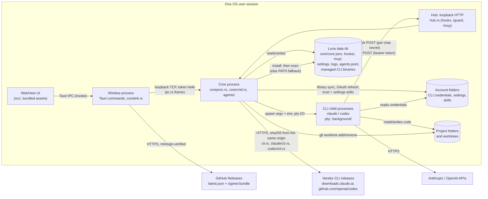

# Luna threat model

Scope: the Luna desktop app as built from this repository (Tauri 2; Rust core
in `src-tauri/src`, React UI in `src/`). Line references are to the tree this
document is committed with; commits are those of the phase 1 security work on
`refactor/phase-1`. Method: data-flow diagram, trust boundaries, STRIDE per
boundary, then the status of every finding and what is accepted.

## 1. System overview

Luna is a single-user desktop app that runs Claude Code and Codex CLI sessions
on the user's behalf. Two OS processes of the same executable cooperate:

- the **window process** hosts the WebView and relays the page's commands;
- the **core process** owns every running session, the hook/MCP listener and
  the state that must outlive a window (`coreproc.rs`).

## 2. Assets

| Asset | Where | Why it matters |
| --- | --- | --- |
| CLI credentials (OAuth tokens, API keys) | account folders, e.g. `.credentials.json` (`claude/oauth.rs`) | account takeover, spend |
| Core token (256 bits, `ipc.rs:171`) | `core/core.json` in the data dir (`coreproc.rs:204`) | full control of the core: spawn any session in any mode |
| Hub run key (256 bits, `hub.rs:380`) and the per-chat secrets derived from it (`hub.rs:115`) | key in core memory only; a chat's secret in its Claude `--settings` file under `hooks/` (`pty/start.rs:30`) or its Codex `-c` hook arguments | forge that chat's hook and guard events |
| Per-session MCP bearer tokens (160 bits, `agents/registry.rs:334`) | the `LUNA_MCP_TOKEN` environment of each tooled session (`codex/launch.rs:243`, `pty/start.rs:84`, `claude/launch.rs:103`); never on disk | act as that session through Luna's tools |
| Source code and git state of the user's projects | project folders, worktrees | integrity, confidentiality |
| Prompts, transcripts, agent history | CLI transcript dirs; `agents.jsonl` (`agentlog.rs`) | may hold pasted secrets |
| Integrity of the Luna binary | install dir, updater | code execution as the user |
| Availability of the PC and sessions | `power/`, `agents/` kill/delete | lost work, forced shutdown |

## 3. Actors

| Actor | Capability assumed | Trusted? |
| --- | --- | --- |
| Local user | drives the UI, owns the OS account | yes |
| Agent session (CLI child) | runs as the user; may be prompt-injected by repository content, web pages, tool output or another session's text | partially: bounded by its CLI's permission mode or sandbox, and with Luna's tools by the trust contract below |
| Other process of the same OS user | can read the user's files and process environments, connect to loopback | no defense intended: same-uid is the OS trust boundary (R3) |
| Other local OS user (multi-user Unix, shared Windows host) | can connect to 127.0.0.1, can read what file modes or ACLs let them | no |
| Web page in a browser on the same machine | can send simple cross-origin requests to 127.0.0.1 | no |
| Network attacker | on-path for HTTPS; can host content agents fetch | no |
| Release-signing key holder | signs updates | yes (single maintainer key, R7) |
| CLI vendors' release infrastructure | publishes the Claude Code and Codex binaries Luna downloads | yes, without independent verification (F10) |

### Trust contract for Luna's tools

Enabling Luna's tools for a session grants it **orchestration authority
bounded by its own privilege**. Escalation happens only through an explicit
user setting. The code meets this contract (F1, F2 fixed), within the limits
in section 6.

- A helper it spawns runs at no more privilege than the caller (Claude Code
  permission mode; Codex sandbox, approval and network) unless the user turns
  on Settings → Helpers → `helpersAboveCaller` (off by default).
- `luna_answer` with `allow`, raw `keys`, or an answer to a list the CLI holds
  its own screen on works only on the caller's own helpers, and only at the
  privilege it would itself need to run the tool unasked.
- Text a CLI reads as a command (`/` slash command, `!` shell mode) goes only
  from a caller at full access into its own helper.
- Reading, waiting on and sending plain text to other sessions stays open
  (R1): that is how sessions hand work to one another.

## 4. Trust boundaries and STRIDE

### B1. WebView page to window process (Tauri IPC)

| STRIDE | Threat | Status |
| --- | --- | --- |
| E, T | Script injected into the page (rendered terminal or transcript text) calls any app command; they take raw `account_path` / `folder` strings and can write account config | mitigated in part: no HTML sinks in `src/` (no `innerHTML` / `dangerouslySetInnerHTML`); xterm.js draws terminal output as text; strict CSP (H3). Script already running in the origin can still invoke every command: F9 |
| E | Plugin permissions broader than needed | mitigated: `capabilities/default.json` grants `core:default`, five window actions, `dialog:allow-open`, `notification:default`, `updater:default`; no `remote` origins, no shell or fs plugin |
| S | A link clicked in a terminal opens a non-web scheme | mitigated: `open_link` allows `http`, `https`, `mailto` only and does not log the URL (`lib.rs:71`) |

### B2. Window process to core process (loopback TCP, `ipc.rs`)

| STRIDE | Threat | Status |
| --- | --- | --- |
| S, E | Any local process connects to the core port and drives it | mitigated: bound to `127.0.0.1` (`coreproc.rs:149`); the first frame must be `hello` with the OS-random token, compared in constant time, else the connection is dropped without a reason (`coreproc.rs:312-321`, H1); dispatch is an explicit allowlist (`corecmd.rs:44`) |
| I | `core.json` readable by another OS user | fixed (F4) |
| D | Connection floods, slow-loris hello, large first frame | fixed (H2): 32 unauthenticated connections at once, hello within 5 s and 4 KiB against one deadline (`coreproc.rs:37-42`); the rest are closed unread |

### B3. Agent sessions to the hub (`hub.rs`, `mcp.rs`)

| STRIDE | Threat | Status |
| --- | --- | --- |
| S | A local process or web page posts forged hook events or MCP calls | mitigated: loopback only (`hub.rs:80`); hook and guard URLs carry their chat's secret (`hub.rs:238`, F7); MCP needs a per-session bearer token, looked up by its SHA-256 (`agents/registry.rs:341`, H1); a browser cannot set `Authorization` cross-origin without a preflight the hub never answers |
| S | One session posts hook or guard events as another chat | fixed (F7) |
| E | Session A acts on session B through MCP | see the authorization matrix (section 5) |
| T | Request smuggling or parser confusion | mitigated (H2): head parsed by `httparse` in its strict default; body framed by `Content-Length` only, digits only, repeats equal; any `Transfer-Encoding` is answered 400 and closed (`hub.rs:297-312`) |
| D | Thread or memory exhaustion | fixed (H2): 64 connections still sending their head (16 KiB, 5 s), then separate lanes of 32 for hooks and the guard and 128 for MCP; bodies 64 KiB (hooks) or 4 MiB within 30 s; 503 past a cap, 413 past a body cap (`hub.rs:42-75`, `admit.rs`). Spawns capped per caller (`agents/spawn/mod.rs:241`) |
| R | Who did what through MCP | every tool call is logged with caller, target and steering arguments, never prompt text (`mcp.rs:419-443`); spawns and exits go to `agents.jsonl` |

### B4. Core to CLI child processes (`pty/`, `background/`)

| STRIDE | Threat | Status |
| --- | --- | --- |
| T, E | Shell or argument injection through spawn parameters | mitigated: children start from an argv vector, never a shell (`pty/spawn.rs:196`); modes, efforts, models and sandboxes are checked against fixed lists, spelled exactly (`agents/privilege.rs:264`); text Luna types is refused if it holds control characters (`agents/privilege.rs:389`) |
| E | A tooled session spawns a helper with more privilege than itself | fixed (F1) |
| E | A config's `auto_review` answers for a person | mitigated: Codex sessions Luna starts without auto-review pin `approvals_reviewer="user"` (`codex/launch.rs:152`, `codex/launch.rs:87`, `background/command.rs:122`) |
| I | A session inherits Luna's or a parent session's identity variables | mitigated: inherited CLI session variables are removed (`pty/spawn.rs:206`, `pty/spawn.rs:506`) |

### B5. Core to account folders and project folders

| STRIDE | Threat | Status |
| --- | --- | --- |
| T | Library sync follows a planted symlink or junction out of the account folder | mitigated: links are refused on read and write (`library/files.rs:28`, `library/files.rs:101-106`, `library/folders.rs:251`); account names reject `.` and `..` (`accounts.rs:49`). Check-then-use remains (R6) |
| T | Worktree removal deletes outside the intended root | fixed (F6) |
| I | OAuth refresh exposes tokens | fixed (F5); errors are logged without token values |

### B6. Window process to update server

| STRIDE | Threat | Status |
| --- | --- | --- |
| T, S | On-path attacker or compromised release host serves a malicious build | mitigated: HTTPS endpoint on GitHub Releases and a minisign public key pinned in the app (`tauri.conf.json:70-76`); Tauri refuses unsigned bundles |
| T | Signing key theft | reduced: the key is a secret of the `release` environment, handed only to runs of the release workflow on a `v*` tag after a reviewer approves, and kept from the package install ([releasing.md](../releasing.md)); a leak is still accepted (R7) |

### B7. Core to vendor CLI releases (managed CLI downloads)

Luna downloads and runs its own copy of each CLI (`cli.rs`): Claude Code from
`downloads.claude.ai` (`claude/cli.rs:54`), Codex from `github.com/openai/codex`
releases (`codex/cli.rs:72`). Unlike Luna's own updater (B6) there is no
signature, only a sha256 from the same origin as the artifact.

| STRIDE | Threat | Status |
| --- | --- | --- |
| T, S | Vendor release origin compromised: binary and checksum replaced together | open (F10) |
| T | Local replacement of the managed binary or its `current` version file | same user: accepted (R3); another OS user: the data dir's mode on Unix, its protected DACL on Windows (F4) |
| T, E | Archive extraction writes outside the version folder | mitigated: Codex entries go through `unpack_in`, which refuses paths that climb out (`codex/cli.rs:102`); Claude Code is a single file renamed after the hash check |
| T, E | Before the first download completes, a session runs the bare name from `PATH` (`cli.rs:142-147`) | accepted: whatever the user installed. Unverified: on Windows the lookup may consider the session's working directory first; needs a test with a planted `claude.exe` |

## 5. MCP authorization matrix

Callers are sessions holding a Luna MCP token. A session without Luna's tools
can call `luna_permission` only, and only as a background helper
(`mcp.rs:454-462`). A helper's helper never gets tools (`agents/spawn/mod.rs:34`); a
caller has at most 8 descendants (`agents/spawn/mod.rs:31`).

| Tool | May target | Check | Tested |
| --- | --- | --- | --- |
| `luna_kill`, `luna_delete` | own descendants | `authorize` (`agents/registry.rs:440`) | yes |
| `luna_send`; `luna_answer` to a question a model asked | any session but itself, the user's chats included; `/`- or `!`-led text only from full access into its own helper, checked again where queued or kept text is typed (`agents/privilege.rs:363`, `agents/privilege.rs:378`, `background/queue.rs:84`) | `authorize_send` (`agents/registry.rs:462`), `command_reach` | yes |
| `luna_answer` with `allow`, `keys`, or on a CLI's own list | own descendants; `allow` only where the caller would run the tool unasked and never from read-only or asking modes; `keys` and CLI lists only from full access (`agents/answer.rs:204`, call sites `agents/answer.rs:306-343`) | `answer_reach` | yes |
| `luna_read`, `luna_wait` | any session but itself | `authorize_view` (`agents/registry.rs:451`) | yes |
| `luna_spawn` | a new helper in any account not on the denylist `agent_blocked_accounts` (empty by default, `agents/spawn/account.rs:12`), in any folder except Luna's data dir and what holds it (`agents/privilege.rs:305`, `agents/spawn/mod.rs:385`), at no more privilege than the caller (`agents/privilege.rs:227`, `agents/spawn/mod.rs:447`) | `cap`, `reaches_luna`, spawn cap | yes |
| `luna_power` | the whole PC (shutdown, restart, sleep; or disarm the user's) | tools only (`power/commands.rs:90`) | no authorization test (R4) |
| `luna_sessions`, `luna_list`, `luna_notify`, `luna_guide` | read-only, or notify the user | tools only | yes |

## 6. Limits of the least-privilege layer

The privilege cap is a policy inside Luna, not an OS boundary. What it does
not cover:

| Limit | Consequence |
| --- | --- |
| Recorded modes approximate effective authority | Luna compares the mode, sandbox, approval and network flag it started a session with (`Privilege`, `agents/privilege.rs:75-147`). It does not evaluate allow rules, skills, hooks, extra writable roots or a Codex config's network settings, so two sessions on the same rung can differ in what they may actually do |
| Helpers may be rooted in any folder except Luna's data dir | a helper is refused only in, inside or above the data dir (`reaches_luna`); the cap limits its mode, not what that folder lets the mode reach (another project, an account folder) |
| Same-user processes can read files and impersonate tokens | anything running as the user, an agent with a shell included, can read `core.json` or another process's environment and act as the UI or as that session. The layer is no OS isolation (R3, F3) |
| A weaker session can still ask a stronger one in plain words | plain text to any session stays open (R1); the stronger session's own mode, and its person, decide what it does with it |
| Screen detection depends on CLI versions | permission dialogs and the lists a CLI holds its screen on are recognized from the terminal (`agents/ask.rs:195`, `agents/ask.rs:204`) as Claude Code 2.1.318+ and Codex 0.167.0 draw them. The answer checks apply to what Luna recognized. A dialog another version draws differently is not recognized: `allow` and answers to it are refused, and only raw `keys` reach it, which need full access whatever is detected |
| Two explicit relaxations | `helpersAboveCaller` (`settings.rs:26`) lifts the cap for spawns, answers and command text; the dev caller (`LUNA_DEV_TOKEN`, `agents/registry.rs:288`, test builds) stands in for the user and is exempt |

## 7. Findings and phase 1 status

Each finding was verified in code. "Fixed" names the mechanism and the commits
on `refactor/phase-1`; "residual" names what is left and why.

| ID | Severity | Finding | Status |
| --- | --- | --- | --- |
| F1 | High | `luna_spawn` let a tooled session start a helper in `bypassPermissions` or `danger-full-access` whatever its own mode | **fixed** (7c2203e, cb5d05a): one privilege scale for both CLIs (`Reach` × network, `agents/privilege.rs:75`); the spawn's mode, the account's default when left out, is resolved, checked for its exact spelling and capped at the caller's on every path before the helper is made, then pinned (`cap`, `settle_mode`, `agents/privilege.rs:227`, `agents/privilege.rs:264`); unknown modes are refused; no helper in or above Luna's data dir, where it could edit the setting that lifts the cap. Residual: section 6 |
| F2 | High | `luna_answer` with `allow` or `keys` reached any session, so a tooled session could approve another chat's permission prompt | **fixed** (7c2203e, cb5d05a, a6fc733, 5f4fef7): `answer_reach` (`agents/answer.rs:204`) limits `allow`, `keys` and CLI lists to the caller's descendants and to what the caller could run unasked; a background helper is checked against the very ask an answer lands on. Related: `/`- and `!`-led text is held to the same reach, also for background helpers and queued text (a489ea4, e379b77, b8ec193) |
| F3 | Medium; High where a sandboxed session can read `core.json` | Claude sessions' MCP tokens were in plain text in `mcp/<chat>.json`, and the core token is in `core.json` | **MCP part fixed** (3d65909): the file holds `Bearer ${LUNA_MCP_TOKEN}`, which Claude Code expands from its environment (verified live on 2.1.319); the token goes in the session's environment, as Codex's `bearer_token_env_var` already did (`codex/launch.rs:243`, `pty/start.rs:84`), and is removed from what nested sessions inherit. **`core.json` part residual**: every same-user process can read it (R3). Whether the CLIs' sandboxes keep a session from reading it and reaching loopback is unverified; it needs an end-to-end test per CLI and sandbox, then keeping `core/` outside session-readable roots or in the CLIs' read deny lists |
| F4 | High where the prerequisites hold | Token files were created with the default mode; on Windows the data dir (often the install folder) inherited its parent's ACL, e.g. Authenticated Users Modify on a second drive, down to `core.json`, `agents.jsonl` and `luna.exe` | **fixed** (983e250, 5872a6b, cf4886a, f1b3f60, b2384b3, 233990a, 6a740b5). Unix: `core/`, `hooks/`, `mcp/` are `0700` (a link or another user's folder is refused), token files `0600` from creation, `O_EXCL` under a random temp name, renamed into place (`secret.rs:48`, `secret.rs:689-709`, `secret.rs:913-938`). Windows: those folders get a protected DACL (user, SYSTEM, Administrators; `secret.rs:157`); the installer protects the install folder before any file goes in (section 7.1); the core verifies the data dir at every start (`coreproc.rs:117`, `paths.rs:213`): the whole folder where it is Luna's alone, else Luna's own entries only (`paths.rs:154`); everything below is reset to inherit, untrusted owners are taken over, links are refused, and the root's DACL is set last; the full walk runs every start, a marker only spares the changing pass, and the installer deletes any marker. A failing walk keeps the Settings check `data-folder-private` red (`checks.rs:639`). Residuals: files written while the folder was open cannot be checked for integrity (no reference; the next update reinstalls Luna's binaries); a copy run from a shared folder keeps that folder open: Luna's files written there after the start are private from creation (a protected DACL given by `CreateFileW`, `secret::create_private`; settings, logs, `agents.jsonl`, `helpers.json`, `chat-ties.json`, notes, attachments, the library with its blobs and backups, the managed CLI's `current`), each replaced through a random temp name, and one written in place (logs, locks) is used only if its handle shows a plain file of one name, owned by the user, Administrators, SYSTEM or TrustedInstaller, that nobody else may open (`secret::open_private`; Unix: `O_NOFOLLOW`, owner and mode by `fstat`); one the user owns but others may open (as an older Luna left it) is made private through the same handle and kept, a handle someone opened before that staying theirs; anything else is moved aside to `<name>.untrusted-<random>` and a new one made; what still takes that folder's ACL until the next start is a folder of Luna's first made after the start and the managed CLI binaries it downloads; ancestor checks catch links, not renames under an ancestor writable by others; sandboxed Codex commands under the new DACL are not yet verified end to end |
| F5 | Low-Medium (Unix) | The OAuth temp file was written before `chmod 0600`, and the fallback kept the old file's permissions | **fixed** (64c06aa): temp file created `0600` (`secret::create_private`, random name, `O_EXCL`); the in-place fallback tightens the open file first or fails (`claude/oauth.rs:194`) |
| F6 | Low (hardening; no exploit chain found) | A folder shaped like a Codex worktree anywhere on disk, with a forged `.git`, could reach `remove_dir_all` | **fixed** (9f04457, 6a94c62): a Codex worktree is removed only under `<accounts root>/openai/<account>/worktrees/<4 hex>/<name>` (`worktree/paths.rs:44`) and only if `git worktree list --porcelain -z` of the folder has it, parsed on NUL (`worktree/paths.rs:65-74`). Residuals: ancestry is checked on the path's text (`remove_dir_all` does not follow links, R6); git's record proves a worktree of the repository, not that Codex made it; worktrees under a moved accounts root are no longer removed |
| F7 | Low-Medium | The hook secret was global, so any session could forge another chat's turn and permission events | **fixed** (4540647, b21dadf): each chat's secret is the first 128 bits of HMAC-SHA256(run key, chat id), checked against the path's chat id in constant time (`hub.rs:115`, `hub.rs:238`). Residual: the Codex guard URL rides in a `-c` argument, visible to other OS users in the Unix process list; it opens only that chat's door |
| F8 | Low; Medium in the fallback deployment | The data dir fell back to a shared, predictable `temp_dir()/luna` | **fixed** (4336990): on Unix the fallback is `temp_dir()/luna-<euid>`, `0700`, used only if a real folder of this uid's, else Luna stops (`paths.rs:66`). Windows keeps `temp_dir()/luna`: its temp folder is the user's own |
| F9 | Hardening gap | Tauri app commands are not scoped (no `AppManifest` in `build.rs`) and take raw paths, which sets the impact of any script in the page | **residual**: needs per-capability command scoping and `account_path` validated against the accounts root; CSP (H3) makes injection harder meanwhile |
| F10 | Medium | Managed CLI binaries are checked only against a sha256 from the same origin (B7) | **residual**: needs vendor signature or provenance verification where published, or checksums pinned per version |
| H1 | — | Tokens and secrets were hashed from time, pid and addresses; compares used `==` | **fixed** (d502edf, d09261c): every token, key and secret from the OS CSPRNG (`secret.rs:15`); hub secret and core token compared with `subtle` (`secret.rs:25`); MCP tokens keyed by SHA-256 |
| H2 | — | Listeners read unauthenticated input with no deadline or cap (`tiny_http`, a thread per connection) | **fixed** (6b8fecc, d09261c): see B2 and B3 |
| H3 | — | `csp: null` | **fixed** (1cb24c4, 3d787a6): see section 7.2 |

### 7.1 Installer (`src-tauri/windows/hooks.nsh`)

The directory page refuses a drive root or a path through a link or junction
(`.onVerifyInstDir`) before the template's `SetOutPath` creates the folder.
The pre-install hook, which the template runs after `SetOutPath` and before any
file is copied or anything installed runs, checks that again, refuses a
non-empty folder that is not a Luna install (`luna.exe` and `uninstall.exe`),
reads the user's SID (`whoami /user`), deletes any `core/private-verified`
marker, and with icacls by SID gives the folder a protected DACL (user,
`S-1-5-18`, `S-1-5-32-544`), makes the user owner, and resets everything in it
to inherit. Any icacls failure stops the installation.

Residuals:

- **Silent mode creates an empty folder through a rejected junction.** A
  silent install never calls `.onVerifyInstDir`; the hook refuses the path, but
  only after `SetOutPath` has made the empty folder at the junction's target.
- **A legacy reinstall runs old code first.** An ordinary reinstall the user
  asks to uninstall first runs the old install's `uninstall.exe`, whose
  pre-uninstall step runs the old `luna.exe --stop-core`, before any hook of
  Luna's sees the folder: Tauri's template has no hook before its reinstall
  page. **Recovery** for an old install folder that may have been open to
  others: delete the folder without running anything in it (not through its
  `uninstall.exe`), then install with a trusted installer.

### 7.2 Content Security Policy (`tauri.conf.json:28-54`)

`default-src 'self'`; `script-src 'self'` (no inline script, no `eval`);
`connect-src ipc: http://ipc.localhost` (the updater is fetched by the Rust
plugin, not the page); `img-src 'self' data:`; `font-src 'self'`;
`object-src 'none'`; `base-uri 'self'`; `form-action 'none'`;
`frame-ancestors 'none'`. Refused loads are logged as `[csp]` warnings
(`src/shared/lib/log.ts`).

Residuals:

- `style-src` allows `'unsafe-inline'`: the pinned xterm.js 5.5.0 has no nonce
  option and its DOM renderer creates `<style>` elements; Tauri's style nonce is
  off (`dangerousDisableAssetCspModification`), since a nonce makes the browser
  ignore `'unsafe-inline'`. Injected CSS can restyle the page but runs no
  script.
- `devCsp` (only for `pnpm tauri dev`) adds `'unsafe-inline'` to `script-src`
  for the Vite React preamble and `ws://localhost:1420` for HMR.
- On Windows the policy is a response header; on Linux (and per source,
  macOS) Tauri injects a `<meta>` tag, where `frame-ancestors` is ignored. Only
  Windows was tested live.

## 8. Accepted risks

- **R1. Broad agent read/send access (by design).** Any tooled session may read
  and wait on every session and send plain text to any other, the user's chats
  included (`agents/registry.rs:451-477`). A prompt-injected session can put text in
  front of a more privileged one; what that session does stays within its own
  mode, and its permission prompts are answered by a person or its own caller
  (F2).
- **R2. Cross-project prompt injection.** Text a session reads is model input;
  Luna relays it verbatim. The receiving CLI's mode is the control, which the
  trust contract keeps a helper from widening.
- **R3. Same-user processes are trusted.** See section 6; for a session
  confined by its CLI sandbox, reaching `core.json` is F3's residual, not
  accepted.
- **R4. Agents may arm a PC shutdown** (`luna_power`), bounded by the quiet
  window and drain logic in `power/`. An orchestration feature.
- **R5. Agent history keeps prompt prefixes and last answers in plain text**
  (`agentlog.rs:17-19`: 300 and 3,000 characters) in the data dir; the same
  exposure as the CLIs' own transcripts.
- **R6. Link checks are check-then-use** (`library/files.rs:101`, `worktree/`): a
  same-user process racing the check could redirect a write. Covered by R3.
- **R7. Single signing key** for updates, no rollback index beyond Tauri's
  version comparison. Accepted for a single-maintainer project.
