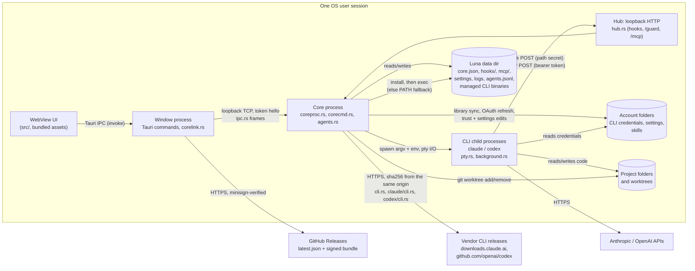

# Luna threat model

Scope: the Luna desktop app as built from this repository (Tauri 2; Rust core
in `src-tauri/src`, React UI in `src/`). Line references are to the tree this
document is committed with. Method: data-flow diagram, trust boundaries, STRIDE
per boundary, then what is mitigated, what is planned and what is accepted.

## 1. System overview

Luna is a single-user desktop app that runs Claude Code and Codex CLI sessions
on the user's behalf. Two OS processes of the same executable cooperate:

- the **window process** hosts the WebView and relays the page's commands;
- the **core process** owns every running session, the hook/MCP listener and
  the state that must outlive a window (`coreproc.rs`).

## 2. Assets

| Asset | Where | Why it matters |
| --- | --- | --- |
| CLI credentials (OAuth access/refresh tokens, API keys) | account folders, e.g. `.credentials.json` (`claude/oauth.rs`) | account takeover, spend |
| Core token | `core.json` in the data dir (`coreproc.rs:186`) | full control of the core: spawn any session with any permission mode |
| Hub secrets (one per chat, derived from the run key) | every Claude session's `--settings` file under `hooks/` (`pty.rs:563`), Codex `-c` hook override (`pty.rs:693`) | forge that chat's hook events and guard posts |
| Per-session MCP bearer tokens | the `LUNA_MCP_TOKEN` env of each tooled session, both CLIs (`pty.rs` `CLAUDE_MCP_TOKEN_ENV`, `codex_mcp_args`); never on disk | act as that session through Luna's MCP tools |
| Source code and git state of the user's projects | project folders, worktrees | integrity, confidentiality |
| Prompts, transcripts, agent history | CLI transcript dirs; `agents.jsonl` (`agentlog.rs:23`) | may hold pasted secrets |
| Integrity of the Luna binary | install dir, updater | code execution as the user |
| Availability of the PC and sessions | `power.rs`, `agents.rs` kill/delete | lost work, forced shutdown |

## 3. Actors

| Actor | Capability assumed | Trusted? |
| --- | --- | --- |
| Local user | drives the UI, owns the OS account | yes |
| Agent session (CLI child) | runs as the user; may be prompt-injected by repository content, web pages, tool output or another session's text | partially: without Luna's tools, bounded by its CLI's permission mode / sandbox; with them, see the trust contract below |
| Other process of the same OS user | can read the user's files and connect to loopback | no defense intended: same-uid is the OS trust boundary |
| Other local OS user (multi-user Unix, shared Windows host) | can connect to 127.0.0.1, can read world-readable files | no |
| Web page in a browser on the same machine | can send simple cross-origin requests to 127.0.0.1 | no |
| Network attacker | on-path for HTTPS to GitHub; can host content agents fetch | no |
| Release-signing key holder | signs updates | yes (single maintainer key) |
| CLI vendors' release infrastructure | publishes the Claude Code and Codex binaries Luna downloads | yes, without independent verification (B7) |

### Trust contract for Luna's tools

**Contract: least privilege by default.** Enabling Luna's tools for a session
grants it orchestration authority bounded by its own privileges:

- a helper it spawns may not be more privileged than the caller (Claude
  permission mode, Codex sandbox and approval) unless a user setting
  explicitly allows it;
- `luna_answer` with `allow` or raw `keys` works only on the caller's own
  helpers (`authorize`), never on the user's chats or another tree's sessions;
- reading, waiting on and sending plain text to other sessions stays open
  (R1): that is how sessions hand work to one another.

**The code does not meet this contract yet.** Today a tooled session can
spawn helpers in any mode or sandbox, including `bypassPermissions` and
`danger-full-access`, and can answer any other session's permission prompt.
Both gaps are F1 and F2, **planned fix (phase 1)**.

## 4. Trust boundaries and STRIDE

### B1. WebView page to window process (Tauri IPC)

| STRIDE | Threat | Status |
| --- | --- | --- |
| E, T | Script injected into the page (rendered terminal or transcript text) calls any of the ~99 app commands, which take raw `account_path` / `folder` strings and can write account config (`account_settings.rs:736`) | mitigated in part: no HTML sinks in `src/` (no `innerHTML` / `dangerouslySetInnerHTML`); terminal output is drawn by xterm.js as text. **CSP is `null`** (`tauri.conf.json:29`); strict CSP is **planned (phase 1)**. CSP narrows the ways script gets injected; script already running in the trusted origin can still invoke every command, so only command scoping limits impact (F9) |
| E | Plugin permissions broader than needed | `capabilities/default.json` grants only `core:default`, five window actions, `dialog:allow-open`, `notification:default`, `updater:default`; no `remote` origins, no shell/fs plugin |
| S | A link clicked in a terminal opens a non-web scheme (`file:`, custom protocol handlers) | mitigated: `open_link` allows `http`, `https`, `mailto` only and does not log the URL (`lib.rs:69-78`) |

### B2. Window process to core process (loopback TCP, `ipc.rs`)

| STRIDE | Threat | Status |
| --- | --- | --- |
| S, E | Any local process connects to the core port and drives it | mitigated: listener bound to `127.0.0.1` (`coreproc.rs:135`); first frame must be `hello` with the token from `core.json`, otherwise the connection is dropped without a reason (`coreproc.rs:296-302`); the dispatch table is an explicit allowlist (`corecmd.rs:44`) |
| S | Token guessable: `mint_token` hashes `RandomState` keys, time and pid (`ipc.rs:167-180`) | partly mitigated (`RandomState` is OS-seeded). OS-random token + constant-time compare **planned (phase 1)**; the compare is `==` today (`coreproc.rs:299`) |
| I | `core.json` readable by another OS user on Unix | fixed (F4): `core/` is `0700` and `core.json` `0600` from its creation (`secret.rs` `private_dir`, `write_private`) |
| D | Unbounded connections, slow-loris hello, 8 MiB frame allocated per connection (`ipc.rs:21`, `ipc.rs:130`) | frame size capped; connection count / hello timeout **planned (phase 1)** |

### B3. Agent sessions to the hub (`hub.rs`, `mcp.rs`)

| STRIDE | Threat | Status |
| --- | --- | --- |
| S | A local process or web page posts forged hook events or MCP calls | mitigated: loopback only (`hub.rs:27`); hooks carry their chat's secret in the path (`hub.rs` `chat_secret`); MCP requires a per-session bearer token mapped to its caller (`hub.rs:110`); a browser cannot set `Authorization` cross-origin without a preflight the hub never answers |
| S | Weak secrets: `mint_secret` and `agents::mint` hash pid, time and a stack address (`hub.rs:173`, `agents.rs:1280`) | OS-random tokens + constant-time compare **planned (phase 1)** |
| S | One session posts hook or guard events as another `chat_id` | fixed (F7): each chat's secret is HMAC-SHA256(run key, chat id), 128 bits of it, checked against the chat id in the path in constant time (`hub.rs` `chat_secret`, `route`). Residual: the Codex guard URL rides in a `-c` argument, which other OS users can read from the process list on Unix; it now opens only that chat's door |
| E | Session A acts on session B through MCP | see the authorization matrix (section 5) |
| D | One thread per request, no connection cap, 4 MiB body reads (`hub.rs:48`, `hub.rs:114`, `hub.rs:159`) | body sizes capped; connection / time limits **planned (phase 1)**; spawns capped per caller (`agents.rs:514`) |
| R | Who did what through MCP | every tool call is logged with caller, target and steering arguments, never prompt text (`mcp.rs:372-445`); spawns and exits go to `agents.jsonl` |

### B4. Core to CLI child processes (`pty.rs`, `background.rs`)

| STRIDE | Threat | Status |
| --- | --- | --- |
| T, E | Shell or argument injection through spawn parameters (model, effort, agent name, folder) | mitigated: children are started with an argv vector, never a shell (`pty.rs:242-244`); Claude modes, efforts and models, Codex sandboxes are checked against fixed lists (`agents.rs:3125-3210`); agent names are filtered (`agents.rs:2832`). The hook command strings embed only Luna-built URLs and a curl path that rejects quotes and spaces (`pty.rs:693-715`) |
| E | A tooled session spawns a helper with more privilege than itself (`bypassPermissions`, `danger-full-access`) | breaks the trust contract today; F1, **planned fix (phase 1)** |
| I | Session inherits Luna's or a parent session's identity variables | mitigated: inherited CLI session variables are removed (`pty.rs:251-256`, `pty.rs:720`) |

### B5. Core to account folders and project folders

| STRIDE | Threat | Status |
| --- | --- | --- |
| T | Library sync follows a planted symlink or junction out of the account folder | mitigated: links are refused on read and write (`library.rs:542`, `library.rs:601-607`, `library.rs:955`); account names reject separators, `.` and `..` (`accounts.rs:42-53`); skill names are `[a-z0-9-]` (`library.rs:290`). Check-then-use remains (TOCTOU, accepted, R6) |
| T | Worktree removal deletes outside the intended root | mitigated: `is_worktree_of` requires a Claude worktree path under the folder, or a Codex one in the `worktrees` folder of an account under the accounts root's Codex folder whose `.git` points back at the folder (`worktree.rs` `codex_made`); a Codex one is removed only if `git worktree list` of the folder has it (`registered`, F6 fixed); `remove_dir_all` does not follow links |
| I | OAuth refresh exposes tokens | mitigated: credentials written through a temp file created `0600` (random name, `O_EXCL`) and renamed; the in-place fallback tightens the file to `0600` first or fails (`claude/oauth.rs` `write`, F5 fixed); errors logged without token values |

### B6. Window process to update server

| STRIDE | Threat | Status |
| --- | --- | --- |
| T, S | On-path attacker or compromised release host serves a malicious build | mitigated: HTTPS endpoint on GitHub Releases and a minisign public key pinned in the app (`tauri.conf.json:46-51`); Tauri refuses unsigned bundles |
| T | Signing key theft | accepted: single maintainer key; see R7 |

### B7. Core to vendor CLI releases (managed CLI downloads)

Luna downloads and runs its own copy of each CLI (`cli.rs`): Claude Code from
`downloads.claude.ai` (`claude/cli.rs:9`, `claude/cli.rs:40-72`), Codex from
`github.com/openai/codex` releases (`codex/cli.rs:71-109`). This is separate
from Luna's own updater (B6): there is no signature, only a sha256 fetched
from the same origin as the artifact.

| STRIDE | Threat | Status |
| --- | --- | --- |
| T, S | Vendor release origin compromised: binary and checksum replaced together | not mitigated: the checksum (`claude/cli.rs:40-51`, `codex/cli.rs:71-81`) only detects transport corruption; HTTPS is the only origin check. Vendor signature or provenance verification would close it |
| T | Local replacement of the managed binary or of the `current` version file in the data dir | same-user: accepted (R3). Another OS user: on Unix the data dir's own mode; on Windows the install folder's protected DACL (F4), in the cases F4 lists |
| T, E | Archive extraction writes outside the version folder | mitigated: Codex tarball entries go through `unpack_in`, which refuses paths that climb out (`codex/cli.rs:95-101`); Claude Code is a single file renamed after the hash check (`claude/cli.rs:56-71`) |
| T, E | Fallback executable selection: before the first download completes, a session runs the bare name from `PATH` (`cli.rs:139-146`) | accepted: whatever the user installed. Inferred, not verified: on Windows the lookup may consider the session's working directory (a project folder) before `PATH`; needs a test with a planted `claude.exe` |

## 5. MCP authorization matrix

Callers are sessions holding a Luna MCP token. A session without Luna's tools
can call `luna_permission` only, and only if it is a background helper
(`mcp.rs:454-462`). Helpers of helpers never get tools (`agents.rs:37`).

| Tool | May target | Check | Tested |
| --- | --- | --- | --- |
| `luna_kill`, `luna_delete` | own descendants only | `authorize` (`agents.rs:2061`) | yes (`agents.rs:8260-8264`, `agents.rs:9454-9490`, `mcp.rs:720`) |
| `luna_send`, `luna_answer` (plain answers) | **any** session but itself, the user's chats included | `authorize_send` (`agents.rs:2083`, call sites `agents.rs:3757`, `agents.rs:4617`) | the check yes (`agents.rs:8265-8268`); that `answer` uses it, no |
| `luna_answer` with `allow` or raw `keys` | contract: own descendants only; today any session (F2, planned fix) | `authorize_send` today, `authorize` planned | no |
| `luna_read`, `luna_wait` | **any** session but itself | `authorize_view` (`agents.rs:2072`) | yes (`agents.rs:8269-8270`, `agents.rs:9490`) |
| `luna_spawn` | new helper, any folder, any account not blocked; contract: no wider mode than the caller's (today any mode, F1, planned fix) | account **denylist** `agent_blocked_accounts`, empty by default, so a newly added account is open to agents at once (`agents.rs:2191-2198`, `settings.rs:23`); spawn cap (`agents.rs:514`) | partly |
| `luna_power` | the whole PC (shutdown, restart, sleep; or disarm the user's) | tools only (`power.rs:715`) | no authorization test |
| `luna_sessions`, `luna_list`, `luna_notify`, `luna_guide` | read-only / notify the user | tools only | yes |

## 6. Residual and accepted risks

- **R1. Broad agent read/send access (by design).** Any tooled session may
  read and wait on every session, and send text to any session other than its
  own, the user's chats included (`agents.rs:2066-2104`). This is how sessions
  hand work to one another, and the tools are opt-in per session. A
  prompt-injected tooled session can therefore put text in front of a session
  that runs with more privilege; what that session then does stays within its
  own mode, and its permission prompts are answered by a person or by its own
  caller only once F2 is fixed. Accepted.
- **R2. Cross-project prompt injection.** Text a session reads (repository
  files, web pages, a helper's answer, `luna_read` of another project's
  session) is model input. Luna relays it verbatim and cannot tell data from
  instructions; the receiving CLI's permission mode is the control, which the
  trust contract keeps a helper from widening. Accepted.
- **R3. Same-user processes are trusted.** The core token lives in a file of
  the user's data dir, the MCP tokens in the sessions' environments; anything
  running as the user, an agent with a shell included, can read `core.json`
  and act as the UI, or read another process's environment where the OS lets
  it and act as that session. Accepted for unsandboxed processes. A session
  confined by its CLI sandbox is not covered by this acceptance: that it can
  still reach `core.json` is the residual of finding F3.
- **R4. Agents may arm a PC shutdown** (`luna_power`), bounded by the quiet
  window and drain logic in `power.rs`. Accepted as an orchestration feature.
- **R5. Agent history keeps prompt prefixes and last answers in plain text**
  (`agentlog.rs:15-19`, 300 and 3000 characters) in the data dir. Accepted;
  same exposure as the CLIs' own transcripts.
- **R6. Link checks are check-then-use** (`library.rs:601`, `worktree.rs:73`): a
  same-user process racing the check could redirect a write. Covered by R3.
- **R7. Single signing key** for updates, no rollback-index beyond Tauri's
  version comparison. Accepted for a single-maintainer project.
- **Planned (phase 1):** OS-random tokens with constant-time comparison (hub
  secret, MCP tokens, core token); connection, size and time limits on the hub
  and core listeners; a strict CSP replacing `csp: null`; the least-privilege
  trust contract (F1, F2).

## 7. Open findings

Each was verified in code unless marked otherwise. F1 and F2 are where the
code falls short of the trust contract.

| ID | Severity | Finding | Proposed fix |
| --- | --- | --- | --- |
| F1 | High; **planned fix (phase 1)** | `luna_spawn` lets a tooled session start a helper in `bypassPermissions` or `danger-full-access` whatever its own mode (background: `agents.rs:3161-3165`, `agents.rs:3201-3208`; visible: `src/features/agents/bridge.ts:86-88`); `settle_role` (`agents.rs:2837`) caps nothing | refuse a helper mode, sandbox or approval wider than the caller's, in both spawn paths, unless a user setting allows escalation; tests for each provider |
| F2 | High; **planned fix (phase 1)** | `luna_answer` with `allow: true` or `keys` reaches any session through `authorize_send` (`agents.rs:4617`), so a tooled session can approve another chat's permission prompt | check `allow` and `keys` with `authorize` (caller's own helpers); plain answers to questions keep `authorize_send`; a test on the `answer` call site |
| F4 | High where the prerequisites hold; **fixed (phase 1)** | `core.json`, `hooks/*.json` and `mcp/*.json` were created with the default mode. Prerequisites: a Unix host with other OS users, umask 022, and every parent of the data dir traversable by them (true of the exe's folder under `/opt` or a `0755` home). Then another user read the core token and got full control of the core over loopback | fixed: the folders holding secrets (`core/`, `hooks/`, `mcp/`) are made `0700`, an existing one tightened if it is a real folder of this user's (a link, or another user's folder, is refused: `secret::claim_private`), and each token file is created `0600` with `O_EXCL` under a random temp name and renamed into place; a failed write removes only a temp file it made itself (`secret.rs` `private_dir`, `create_private`, `write_private`; `coreproc.rs` `write_discovery`, `pty.rs` `claude_settings_file`, `claude_mcp_file`). The data dir itself keeps its mode: it may be the exe's own folder. On Windows, where the data dir is often the install folder and that inherits whatever its parent grants (on the maintainer's machine `E:\Programs` gave Authenticated Users Modify, down to `core\core.json` and `luna.exe`): the same folders get a protected DACL at each use, the user, SYSTEM and Administrators in full by SID and nothing inherited, after refusing a junction or link there and a folder owned by anyone but the user or Administrators (`secret.rs` `acl::claim`). The install folder itself gets a protected DACL from the installer's post-install hook, which runs `luna.exe --protect-install-dir` (the user, SYSTEM and Administrators in full, BUILTIN\Users read and execute), on every install and so on every update (`windows/hooks.nsh`, `paths.rs` `protect_install_from_args`). Residuals: it is applied only to a folder named `Luna` outside Program Files, so a folder picked by hand that holds other programs too keeps its ACL; a copy installed before this fix stays replaceable through its folder until its next update (its token folders are closed at its first start); the rest of the data dir (settings, logs, the WebView profile) stays readable by the machine's users through Users' read |
| F3 | Medium; High where a sandboxed session can read `core.json`; **MCP part fixed (phase 1), `core.json` part residual** | Claude sessions' MCP bearer tokens were written in plain text to `mcp/<chat>.json`, and the core token is in `core.json`. Reading an MCP file let a session act as another (Medium), which also sidesteps the trust contract by borrowing a more privileged caller's identity; a session confined by its sandbox that can read `core.json` and reach loopback gets full core control (High) | MCP tokens fixed: Claude Code expands `${VAR}` in an `--mcp-config` header from its environment (verified live on 2.1.319: a header `Bearer ${LUNA_MCP_TOKEN}` arrived at a loopback listener as the variable's value), so the file now holds that placeholder and the token goes in the session's `LUNA_MCP_TOKEN`, as Codex's `bearer_token_env_var` already did (`pty.rs` `claude_mcp_file`, `CLAUDE_MCP_TOKEN_ENV`; tested in `background.rs`). A session's own token stays visible to its own children (its own identity) and is removed from what nested sessions inherit. Residual: `core.json` (now `0600`, F4) is still readable by every same-user process; whether the CLIs' sandboxes keep a session from reading it and reaching loopback is unverified and needs an end-to-end test per CLI and sandbox mode; next steps are keeping it outside session-readable roots and adding the data dir to the CLIs' read deny lists |
| F5 | Low-Medium (Unix); **fixed (phase 1)** | The OAuth temp file was written before `chmod 0600`, the `chmod` error was ignored, and the fallback `fs::write` kept the old file's permissions | fixed: the temp file is created `0600` in the same call (`secret::create_private`, random name, `O_EXCL`); the in-place fallback sets `0600` on the open file before truncating and fails if it cannot; a failed write removes only a temp file it made itself (`claude/oauth.rs` `write_via`) |
| F7 | Low-Medium; **fixed (phase 1)** | The hook secret was global, not bound to `chat_id`; any session could forge another chat's turn state and permission events, which `luna_wait` and the UI act on | fixed: per-chat secret, the first 128 bits of HMAC-SHA256(run key, chat id) with a 256-bit OS-random run key, verified against the path's chat id with `secret::same` (`hub.rs` `chat_secret`); tested with one chat's secret on another's hook and guard URLs |
| F8 | Low; Medium in the fallback deployment; **fixed (phase 1)** | The data dir fell back to `temp_dir()/luna` when neither the exe's folder nor the local data folder could be used: a shared, predictable path that another user could pre-create and own | fixed: on Unix the fallback is `temp_dir()/luna-<euid>`, created `0700`, and used only if it is a real folder (not a link) owned by this uid; one of the user's own is tightened to `0700`, anything else stops Luna with the reason (`paths.rs` `last_resort_dir`, `secret.rs` `claim_private`). Chosen over refusing outright, which would leave a host with no `HOME` no way to run. Windows keeps `temp_dir()/luna`: its temp folder is the user's own (`LOCALAPPDATA\Temp`) |
| F6 | Low (hardening; exploit chain unproven); **fixed (phase 1)** | `codex_shaped` accepted `…/worktrees/<4 hex>/<name>` anywhere on disk; a folder of that shape with a fabricated `.git` text file pointing at the project passed `is_worktree_of` and could reach `remove_dir_all`. No path was found that hands such a folder to a delete | fixed: what is removed as a Codex worktree must sit at `<accounts root>/openai/<account>/worktrees/<4 hex>/<name>`, where Codex 0.167.0 was seen to put what `--worktree` makes (detached, registered with git), and `git worktree list --porcelain -z` of the folder must have it before git or the by-hand fallback deletes anything, read field by field on NUL so a path with a newline cannot forge a record (`worktree.rs` `codex_made`, `registered`, `listed`). Residuals: the account ancestry is checked on the path's text, so a symlink or junction below the account folder is not seen through (`remove_dir_all` does not follow one, R6); git's record proves the folder is a worktree of the repository, not that Codex made it; and once the accounts root is moved, worktrees left under the old one are no longer removed by Luna. `codex_shaped` alone still serves recognition (which folder a session is in), never deletion. Claude Code's worktrees keep their by-place check: their fallback is for a removal git lost track of halfway |
| F9 | Hardening gap | Tauri app commands are not scoped (no `AppManifest` in `build.rs`) and take raw paths. Not a vulnerability on its own: it sets the impact of any script running in the page, which CSP makes harder to inject but does not contain | scope commands per capability; validate `account_path` against the accounts root |
| F10 | Medium | Managed CLI binaries are checked only against a sha256 from the same origin (B7) | verify vendor signatures or provenance where published; pin known checksums per version |
