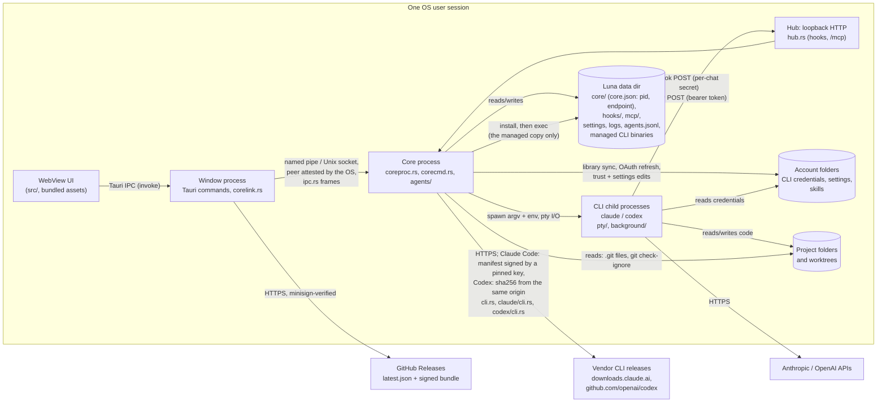

# Luna threat model

Scope: the Luna desktop app as built from this repository (Tauri 2; Rust core
in `src-tauri/src`, React UI in `src/`). Line references are to the tree this
document is committed with; commits are those of the phase 1 security work on
`refactor/phase-1`. Method: data-flow diagram, trust boundaries, STRIDE per
boundary, then the status of every finding and what is accepted.

What Luna answers for, and what it does not
([ADR-0030](../adr/0030-scope-of-0-20.md), amendment of 2026-11-20): Luna is a
runtime for the CLIs that imposes as little of its own as it can, plus the
conveniences around them (the three roles with Luna's tools, the library).
Its own surfaces are in scope: the hub's tokens and who it admits to which
tool, a session's reach over the sessions under it, Luna's files and their
ACLs, the link between the window and the core, the updater and the CLI
downloads. **The CLIs' own security is not**: their permission modes,
sandboxes and network are theirs, and Luna guarantees nothing about them. A
session runs in the mode it asked for, or, where nothing asked, in what its
CLI's own settings say. What was measured of them is kept as observations in
[CLI compatibility](../cli-compatibility.md), not as Luna's claims.

## 1. System overview

Luna is a single-user desktop app that runs Claude Code and Codex CLI sessions
on the user's behalf. Two OS processes of the same executable cooperate:

- the **window process** hosts the WebView and relays the page's commands;
- the **core process** owns every running session, the hook/MCP listener and
  the state that must outlive a window (`coreproc.rs`).

## 2. Assets

| Asset | Where | Why it matters |
| --- | --- | --- |
| CLI credentials (OAuth tokens, API keys) | account folders, e.g. `.credentials.json` (`claude/oauth.rs`) | account takeover, spend |
| Access to the core's endpoint | a named pipe on Windows, a socket in `core/` elsewhere (`endpoint/`), named in `core/core.json`; no credential anywhere, the OS's word on the connecting process is the key ([ADR-0021](../adr/0021-core-endpoint-by-os-identity.md)) | full control of the core: spawn any session in any mode |
| Hub run key (256 bits, `hub.rs:380`) and the per-chat secrets derived from it (`hub.rs:115`) | key in core memory only; a Claude chat's secret in its `--settings` file under `hooks/` (`pty/start.rs:34`); no Codex start carries one, as Luna gives Codex no hook | forge that chat's hook events |
| Per-session MCP bearer tokens (160 bits, `agents/registry.rs:406`) | the `LUNA_MCP_TOKEN` environment of each tooled session (`codex/launch.rs:269`, `pty/start.rs:87`, `claude/launch.rs:103`); never on disk | act as that session through Luna's tools |
| Source code and git state of the user's projects | project folders, worktrees | integrity, confidentiality |
| Prompts, transcripts, agent history | CLI transcript dirs; `agents.jsonl` (`agentlog.rs`) | may hold pasted secrets |
| Integrity of the Luna binary | install dir, updater | code execution as the user |
| Availability of the PC and sessions | `power/`, `agents/` kill/delete | lost work, forced shutdown |

## 3. Actors

| Actor | Capability assumed | Trusted? |
| --- | --- | --- |
| Local user | drives the UI, owns the OS account | yes |
| Agent session (CLI child) | runs as the user; may be prompt-injected by repository content, web pages, tool output or another session's text | partially: whatever its CLI's own mode or sandbox holds (the CLI's, not Luna's), and with Luna's tools by the trust contract below |
| Other process of the same OS user | can read the user's files and process environments, connect to loopback | no defense intended: same-uid is the OS trust boundary (R3) |
| Other local OS user (multi-user Unix, shared Windows host) | can connect to 127.0.0.1, can read what file modes or ACLs let them | no |
| Web page in a browser on the same machine | can send simple cross-origin requests to 127.0.0.1 | no |
| Network attacker | on-path for HTTPS; can host content agents fetch | no |
| Release-signing key holder | signs updates | yes (single maintainer key, R7) |
| CLI vendors' release infrastructure | publishes the Claude Code and Codex binaries Luna downloads | Claude Code: its release key, pinned in Luna, not the bucket that serves it. Codex: yes, without independent verification (F10) |

### Trust contract for Luna's tools

Enabling Luna's tools for a session grants it **orchestration authority over
the sessions under it**: what it spawns, it sends to, answers for, stops and
deletes, and nothing else of Luna's. Luna does not rank the CLIs' modes:
since the 2026-11-20 amendment of
[ADR-0030](../adr/0030-scope-of-0-20.md), a helper may run in any mode its
caller names, and its caller answers any of its prompts. The code meets this
contract within the limits in section 6.

- A helper it spawns runs in the mode the spawn names; where it names none,
  Luna passes none and the helper's CLI runs in what its own settings say
  for that account and folder. No helper is rooted in, inside or above Luna's
  data folder (`agents/admission.rs` `reaches_luna`), whatever its mode: that
  is Luna's own files.
- Every helper runs in the background, in the core. A chat the window runs is
  the person's own and never anyone's descendant (`ensure_*_session` registers
  it with no parent), so no agent interrupts, stops, deletes or approves for
  it, and nothing presses keys in a terminal for an agent.
- A helper the person opens as a chat is handed over to them for good
  (`agents/handover.rs`): from one registry hold on, its former parent can no
  longer send to, read or wait on it as its own, stop or delete it, and is owed
  nothing by it; while it is being opened its parent can neither stop nor
  delete it. With `scope: "all"` it reaches it as any of the person's chats.
  A delete and an opening exclude each other per helper (`background::claim_delete`,
  `promoting`), and no turn starts under either, so a delete that checked
  ownership and idleness removes what it checked, and a removal
  that finds a taken-over chat refuses. A send whose text went in just before a
  handover registers no debt on the person's chat (`owe_from_at`, the handover
  count), and a notice's delivery and the handover of a session it tells of
  exclude each other (notifier `hand_off`), so a notice is either in before
  anything changes hands or not typed. A confirmation said twice hands over
  once. Waits re-check
  their `scope` on every look and before handing anything over, a `wait_many`
  returning a revoked session as `refused` with nothing of it; history stops at
  a link's current owner and at a run the log records as taken over. An opening
  survives a core restart held (`helpers.json`), the window settles it with
  retries, and one never settled goes back to the parent after 15 minutes with
  a notice; until then a pane cannot start a helper's id.
- `luna_session_answer` with `allow`, or an answer to a list the CLI holds its own
  screen on, works only on the caller's own helpers (and theirs), whatever
  mode either runs in.
- Text a CLI reads as a command (`/` slash command, `!` shell mode) goes only
  into the caller's own helpers (and theirs), never into a person's chat or
  another's helper (`agents/admission.rs` `command_reach`).
- Stopping a turn (`luna_session_send` with `interrupt`) works only on the caller's own
  helpers and theirs, of either provider, as kill and delete do (F12).
- A helper, one spawned with tools (a lead) included, reaches only its own
  subtree: every tool refuses it `scope: "all"` and any session not under it,
  its parent and the person's chats among them, and it neither notifies the
  person nor sets the PC's power
  ([ADR-0025](../adr/0025-a-helper-reaches-only-its-own-subtree.md)). An
  injection into a helper stays in its tree.
- From a person's chat, reading and waiting on other sessions, and sending
  plain text to and answering a model's question in the person's other chats,
  stays open (R1), as that is how the person's chats hand work to one another,
  but only when the call says `scope: "all"`; text sent so, an answer
  typed in as a message included, arrives opened `[From session <id> via
  Luna]`, not as the user's own words.
- Text and answers go into a helper only from the sessions above it: its
  parent, a lead between, the chat at the top
  ([ADR-0028](../adr/0028-writes-into-a-helper-come-from-above.md)). Another
  chat, a sibling and that chat's helpers are refused, `scope: "all"` or not,
  and a helper with no chat above it takes no agent's writes; reading and
  waiting stay open. The person, not an agent, moves a helper to another chat:
  a window command (`background_move`), no tool, that refuses a target its
  moved sessions would have no places under, and after which the
  old chat's writes, stops and deletes on them are refused naming the new one.
- A helper reaches out of Luna only as far as its spawn asked: it starts with
  Luna's MCP server alone, without its account's MCP servers and connectors,
  and a Claude Code helper without auto-memory, unless spawned with
  `connectors: true` (F13; how far a Codex helper's run can be kept from its
  servers is section 6's).
- Every argument a tool is called with is checked against its schema before
  it runs: what it does not know or cannot take is refused, never passed over
  (F14).

## 4. Trust boundaries and STRIDE

### B1. WebView page to window process (Tauri IPC)

| STRIDE | Threat | Status |
| --- | --- | --- |
| E, T | Script injected into the page (rendered terminal or transcript text) calls any app command; they take raw `account_path` / `folder` strings and can write account config | mitigated: no HTML sinks in `src/` (no `innerHTML` / `dangerouslySetInnerHTML`); xterm.js draws terminal output as text; strict CSP (H3). A script that runs anyway gets only what the page calls (F9, [ADR-0015](../adr/0015-the-page-gets-only-what-it-calls.md)): build.rs puts every command of `app_handler!` (`lib.rs`) in the application manifest, and `capabilities/default.json` grants each to the `main` window by name, none to another window or a remote origin; account paths of the commands that write account config, use credentials, set trust or may run a CLI on the account (`codex_models`, `codex_defaults`, `claude_models`) are `AccountPath` (`boundary.rs`), and so is `saved_title`'s, read-only but read under the folder named (`OrEmpty<AccountPath>`: an empty path answers no title, reading nothing): a folder directly in a provider's folder under the accounts root, a valid account name, no trailing separator, neither it nor the provider's folder a link, junction or mount point, and resolving (`canonicalize`, handle-based on Windows) to that folder under the resolved root by the very name given, so `name.`, `name `, 8.3 and case spellings are refused. Tests: `lib.rs` `acl` (mock app, Linux check), `boundary.rs`, `pty/probe.rs` `a_saved_title_is_not_looked_for_outside_lunas_accounts`. Residual: what the page does stays open to it, below |
| E | Plugin permissions broader than needed | mitigated: `capabilities/default.json` grants seventeen plugin calls, those the page makes: `core:app:allow-version`, event listen and unlisten, seven window actions (drag, the title-bar double-click, minimize, toggle maximize, is maximized, scale factor, close), `dialog:allow-open`, three notification and three updater calls (`check`, `download`, `install`); no menus, trays, new windows or webviews, paths, no `remote` origins, no shell or fs plugin. Tested: `lib.rs` `acl` |
| E | Script lifts the helpers' privilege cap | **closed by removal** (2026-11-20 amendment of [ADR-0030](../adr/0030-scope-of-0-20.md)): there is no cap and no setting that lifts one; a helper runs in what its spawn names, and what that mode lets through is its CLI's |
| E | What an injected script can still do | **residual**: everything the page itself does, among it: start a session in any folder with any permission mode or sandbox and type into it, which is code execution as the user; delete chats; arm a PC shutdown; edit an account's settings file; change the accounts root, the denylist of helper accounts and the Codex trusted roots; write the library, the system texts' overrides included (what every lead, helper and chat Luna starts is told of its role, ADR-0026), which the page's System texts section edits, compares and moves into the backups. Those commands (`library_check_system`, `library_system_compare`, `library_system_reset`, and `library_read`/`library_write` with `{"system": name}`) take only a system text's name (`library/system.rs` `text_of`), reach only `<library>/system/<name>` and Luna's backups, refuse a link or junction anywhere below the library's folder on the way (`system/`, the override's folder, anything in it) or at `library-backups/` (checked a private folder of this user's, `boundary::private_chain`, before anything moves), check that what is there resolves inside the library (`inside`, on `boundary::walk_down`), refuse anything but plain files and folders in a folder they move (a FIFO there would hold the library's lock) and a save over its kind's cap (8 KB a role's text, 4,000 bytes a note); Back to Luna's moves the folder whole into the backups by a rename (across volumes: renamed aside within its own volume, copied, removed only once the copy has the same files and hashes, else kept aside and named in the window). The library's folder itself may be a link of the person's choosing. Tested by `no_name_but_a_system_text_s_reaches_anywhere`, `a_link_on_the_way_is_neither_read_nor_written_through_nor_taken_out`, `a_link_above_what_is_changed_is_refused`, `a_fifo_in_the_way_is_refused_without_waiting` (Unix), `an_oversized_override_is_not_saved_and_one_too_large_to_edit_not_opened`, `back_to_luna_s_keeps_all_of_the_folder`, `a_reset_across_volumes_loses_no_save_made_while_it_copies`. Residual: across volumes, a write through a handle already open on a file of the override's folder that lands after its copy is checked is lost when the folder is taken out (a same-user program's, as in R6). Read-only commands whose callers may send an empty path and that run nothing (Claude defaults, hooks state) keep plain strings. The controls against getting a script in stay those above |
| S, E, I | A link clicked in a terminal (whose text any program in it prints) opens a non-web scheme, slips an argument to its handler, or leaves a sign-in code in the log | mitigated: `open_link` (`links.rs`) is the page's only way to the system's handler for links (`library_open` hands the file manager a folder of Luna's own, by name): `tauri-plugin-opener` is called as a library and not registered as a plugin, so it has no command of its own. The link is parsed with `tauri::Url` and refused when it does not parse (a bare `example.com`), runs past 8 KB (8192 bytes), carries a control character anywhere (the parser would drop a tab or a newline silently), has a scheme other than `http`, `https` or `mailto`, is a mail link that asks for an attachment (an `attach` or `attachment` field in any case, percent-encoding undone; some mail apps take it from the local disk), or keeps a space or a quote once parsed: the parser percent-encodes neither a mail link's address nor a quote in a web link's host, and on Windows the opener hands the link to `ShellExecuteExW`, which puts it into the handler's command line at `%1` as it is. The handler gets the parsed, normalized form, then, with no space or quote left in it to end its `%1` argument early. The errors, which `call` logs, are fixed texts that hold no part of the link but the scheme of a refused one 32 characters long at most; the opener's own error, which off Windows can quote its command and the link with it, is dropped. Tests: `links.rs` (the allowlist, no part of a refused link in its error, a failed launch, percent-encoding and a quote in a host, control characters and length, mail attachments). Residual: a web link to any site still opens in the browser, as clicked |
| I, D | A page command reads files a project controls: `chat_folder_check` (the new-chat dialog's look at a folder, `pty/folder.rs`) reads the account's `settings.json` and the project's `.claude/settings.json` and `settings.local.json`, and looks (no read) for Claude Code's managed settings and a `.git` above the folder; `luna_session_spawn` and every chat start run the same check | mitigated: the account must be one Luna lists and the folder an absolute plain path (`AccountPath`, `AbsPath`, boundary.rs) before anything is looked at; only a regular file of at most 1 MiB is read, a link followed only to one, opened without waiting on a FIFO (`read_settings`); the dialog's look runs off the window's thread; what goes back is a refusal or a warning, no file content. Tests: `a_settings_file_too_big_to_be_one_is_not_read`, `a_settings_name_that_is_no_file_is_not_waited_on_or_read` (a FIFO with no writer, a link to `/dev/zero`, Unix); a file there but not read (too big, not regular, an error) and a registry look that fails other than "not found" are no proof of no hook, and only warn (`a_settings_file_luna_could_not_read_warns_rather_than_refuses`, `a_registry_look_that_fails_is_no_proof_of_no_policy`). **Residual**: a folder or settings file on a network share that does not answer holds the look with no deadline; off the window's thread, it holds only that dialog's answer (Create waits), that start or that spawn |

### B2. Window process to core process (the core's endpoint, `endpoint/`, `ipc.rs`)

| STRIDE | Threat | Status |
| --- | --- | --- |
| S, E | Any local process opens the core's endpoint and drives it | mitigated ([ADR-0021](../adr/0021-core-endpoint-by-os-identity.md)): no secret; the endpoint lets in only this user's unconfined processes. Windows: a named pipe whose protected DACL names the user and SYSTEM (and Administrators, below), with a medium no-read-up, no-write-up label, remote clients rejected (`endpoint/win.rs` `pipe_sddl`, `Listener::instance`). Unix: a socket in `core/` (`0700`), itself `0600` (`endpoint/unix.rs`). Before anything is read the core reads who connected (`peer/`, `coreproc.rs` `serve`) and refuses, fail closed, another user, and on Windows a token below the core's integrity; the refusal says nothing back and is logged with the pid, image and reason. Dispatch is an explicit allowlist (`corecmd::COMMANDS`). Tests: `peer/mod.rs` `another_user_is_refused_and_an_administrator_may_only_stop_it`, `peer/win.rs` `a_low_integrity_client_cannot_open_the_pipe`, `an_anonymous_client_is_refused` |
| S | A process takes the endpoint's name first, or serves it as well, and a window talks to it | mitigated: a fresh random name per core; on Windows the first instance is made with `FILE_FLAG_FIRST_PIPE_INSTANCE`, so a name already held is refused, and every later instance must read back the first one's DACL and label, so the core never joins a pipe of someone else's (`endpoint/win.rs` `Listener`); on Unix `bind` refuses a name with anything at it. The window checks that the endpoint's server is the pid `core.json` names before it sends a byte (`corelink.rs` `hello`), and opens the pipe at identification level, so a server that is not the core can act as nobody. Codex's Windows sandbox could not make an instance of the name (0.167.0, measured). Tests: `a_squatted_name_is_refused` (both), `an_endpoint_served_by_another_process_hears_nothing`, `names_are_fresh_and_nothing_else_is_opened` (a remote pipe or a path out of `core/` is never opened) |
| E, T | The page has the window pass on a command it does not use (the protocol's `shutdown`, a keystroke command as an answered call) or a path of its own making | mitigated: `core_call` and `core_send` pass on only the 32 commands of `corecmd::COMMANDS`, each on its lane (`corelink.rs` `passes`), and `dispatch` refuses the rest again; every account path argument is an `AccountPath` and every folder path an `AbsPath` (`boundary.rs`: absolute, no `.` or `..` part, no device or verbatim prefix, no stream suffix), checked as the arguments are read, but for `sessions_meta`, which takes a list of chats and holds each entry's account path to the same `AccountPath` check inside the function (`pty/probe.rs`, `AccountPath::try_from`, once a path a call), before anything under it is read: an entry refused answers no meta, nothing under its path read, and does not fail the others. Tests: `corelink.rs`, `corecmd.rs` `bad_paths_are_refused_before_anything_runs`, `the_page_and_the_core_list_the_same_commands`, `pty/probe.rs` `a_chat_on_a_refused_account_is_not_looked_at_and_each_account_is_checked_once` |
| T | The page has the core lift the freeze an update's stop of every session put on the chats' ties (`update_called_off`), so a save writes down what the stopping did: the turns it interrupted recorded as ended, which the next core then does not take up | mitigated: never takes effect while the sessions are still being stopped for the update: said then, it is kept and lifts the freeze only as `stop_all_sessions` returns (`agents/persist.rs` `call_off_update`, `UpdateStopping`); the window's own call comes only after that, as its install fails. Not called off, the freeze lifts by itself `UPDATE_FREEZE_FOR` (10 minutes, monotonic clock) after the stop returned, so whoever calls it (the page, or any same-user peer the endpoint admits) can only bring that lift forward to the stop's return; never the freeze of the core's leaving or of a PC shutdown. Residual: a script that calls it has the first save after the stop returns record the interrupted turns as ended, so a core the install starts does not resume them; that gives it nothing beyond what B1 leaves it already ("What an injected script can still do": everything the page does, `kill_session` and `stop_all_sessions` among it, which end those turns outright). Tests: `pty/control.rs` `an_update_called_off_while_its_sessions_are_stopped_waits_for_the_stop`, `agents/persist.rs` `an_update_called_off_during_its_stop_is_called_off_as_it_returns`, `an_updates_freeze_lifts_by_itself_after_its_bound` |
| I, T | The page's read-only view of a helper (`background_transcript`) names a file to read, or reads without bound | mitigated: the page names only the helper's id; the file is the one the helper's own record leads to (`background/rows.rs:463`, `background::transcript`), and a `file` the page passes back only says whether its cursor still applies. A look returns at most the newest 200 messages, each cut at 20,000 characters (`VIEW_MESSAGES`); the text goes to the page as text, never HTML (`HelperView.tsx`). The person's helper delete is held in the core too: a helper at work, or a worktree with unsaved work, goes only with a yes of its own (`delete_by_user`, `agents/teardown.rs:110`); from a chat's Delete dialog it is refused for a helper that hangs from another chat by then (`of_chat`). Tests: `the_view_of_a_helper_tails_its_conversation_read_only`, `the_persons_delete_spares_a_working_helper_unless_told`, `a_chats_delete_spares_a_helper_moved_to_another_chat_meanwhile` |
| E, T | The page moves a helper, with the helpers under it, to another of the person's chats (`background_move`), or reads where it may go (`background_move_targets`) | mitigated ([ADR-0028](../adr/0028-writes-into-a-helper-come-from-above.md)): the page names a helper id and a chat id, nothing else; no MCP tool reaches it, so no agent moves a helper or adopts one. The core moves only a direct child of one of the person's chats, or a helper with no chat above it, and only to a person's chat with Luna's tools that is not in the helper's own line, never under a lead or a helper; its line must have their places and their spawns under way, counted in the registry hold a spawn counts in, and none of them may end up deeper under it than a spawn could have made it (`spawn::spawnable_at`: tools only as a chat's own helper, nothing below a helper's helper), as a lead left with no chat that spawned a lead would; nothing is moved while one of them is being opened as a chat, deleted or moved (`background::claim_move`). The move takes the notifier's hand-off on each moved session, then whose the helpers are alone (`registry.rs` `ownership_changing`), which every send and answer into anything but a person's chat holds shared from its check to its debt (a helper a spawn has registered and not yet started included), a stop from its check until its turn is marked stopped (`teardown::kill`), and a spawn from its registration to its caller's debt, so none lands on the wrong side of it (a spawn asks again under that hold how deep its helper would sit, `spawn/background.rs` `register_spawned`, so one that passed its check and waited out a move of its caller's line, on the worktree queue say, registers nothing deeper than a spawn made then could) (an agent's delete asks whose it is again under its claim, which a move refuses); a wait that took the old chat's answer as the move came puts no debt back (`owed.rs` `owed_on_for` puts one in only for a caller still above the helper); a save takes every helper's ties in one registry hold (`ties_of_each`), so a core dying then never restores half a line moved; no turn of a moved session starts meanwhile, a turn's end with text queued included (`background::claim_move`, `held_back`), so its next turn starts under the new parent and queued command text is judged against the new owner; a turn claimed before the move whose command is not made yet does not start, and its batch is reserved and judged again after the move (`Run::overtaken`), while one whose command is made is waited for and goes on as begun before the move (`Run::starting`); the helper's spec takes its parent only from the latest change of the registry's (`set_parent`, `parent_changes`), so a chat's going written late cannot leave a moved helper's next turn without its new parent; the note its next turn is given names its parent at that turn, not a chat gone since (`move_note`); the line is looked at again in the registry hold that changes it and moved only if it is the line the holds are on, so a helper spawned under it meanwhile, or one a delete holds, never moves unheld (`reparent.rs` `move_line`); the new chat's debt is made in that same hold, so a chat that goes meanwhile takes it along. Refused, nothing has changed, but for a turn whose launch saw the claim before the refusal (`Run::overtaken`): it has put its batch back, and `go_on` reserves it again and starts it under the same parent once the claim goes, a little late; a turn the claim overtook whose launch has not looked yet starts as claimed. The old chat is owed nothing more by them, and its later writes, stops and deletes are refused naming the new chat (`reparent.rs` `moved_error`), for as long as that chat is above them: once it has gone, or the person has opened the helper as a chat, the old chat is judged as any other (`moved_away`, `handover.rs` `change_hands`). What the move does to who may do what is what the person could do already by deleting the old chat and spawning anew, minus the loss of the helper's work. `background_move_targets` only reads. Tests: `agents/reparent_tests.rs` (`a_move_is_refused_whole_naming_why`: no tools, own line, a lead, places, held back, a grandchild, a chat; `a_move_is_refused_where_its_line_would_go_deeper_than_a_spawn`; `a_move_racing_a_send_leaves_the_old_chat_owed_nothing`, `a_send_into_a_helper_still_being_spawned_holds_off_a_move`, `an_answer_into_a_helper_still_being_spawned_holds_off_a_move` and `a_move_racing_an_answer_leaves_the_old_chat_owed_nothing`, each through the write itself stopped between its check and its debt; `a_move_racing_a_stop_leaves_the_new_chats_turn_alone`; `a_wait_ending_as_the_move_comes_puts_back_no_debt_of_the_old_chats`; `a_move_is_not_told_of_once_its_helper_is_a_chat_or_its_new_chat_is_gone`; `a_refused_move_leaves_a_claimed_turn_not_yet_launched_to_start`; `a_spawn_under_way_as_its_line_moves_goes_no_deeper_than_a_spawn_made_now`; `a_helper_spawned_under_the_line_mid_move_is_held_too_or_nothing_moves`, its helpers registered through a spawn's own `register_spawned`, `a_chat_gone_as_a_helper_moves_to_it_is_owed_nothing_and_named_nowhere`, `a_turn_ending_mid_move_starts_nothing_until_the_move_lets_go`, `a_turn_reserved_before_a_move_starts_after_it_on_what_the_new_chat_allows`, `a_move_waits_for_a_turn_whose_command_is_made`, `a_chats_going_written_after_a_move_of_its_helper_leaves_the_moves_parent`, `a_move_is_told_once_a_turn_answered_its_note_and_only_that_move`, `a_helper_moves_with_its_line_and_its_ties_come_back`). Not unit-tested: the rest of `spawn_background` around `register_spawned` (its helper's CLI must start), and a save racing a move (one registry hold leaves it no gap) |
| I | `core.json` readable by another OS user | fixed (F4); it holds no credential anyway (pid, creation time, protocol, endpoint name; `ipc.rs` `Discovery`, test `discovery_carries_no_credential`) |
| S, E | A CLI session confined by its sandbox opens the core's endpoint and drives it | fixed (F3, ADR-0021). Windows: Codex's unelevated sandbox (0.167.0, `read-only` and `workspace-write`) is refused the pipe's open by its DACL, measured live; were a sandbox's token let through, the core reads the token the pipe was opened with (`ImpersonateNamedPipeClient`, identification level, reverted at once) and refuses it when it is restricted or an AppContainer (`peer/win.rs`; test `a_restricted_client_that_passes_the_dacl_is_refused_by_its_token`). Linux: the core refuses a peer in another user namespace than its own (bubblewrap, Codex's sandbox), with `no_new_privs` set where the core's is not (its seccomp filter, Landlock), or under a stricter seccomp state than the core's (a higher mode, or more filters: a lineage heuristic that catches filters added on top of the core's own chain, as a sandbox Luna launches has, and proves nothing between launch contexts), read from `SO_PEERCRED` and `/proc/<pid>`, with a pidfd (`SO_PEERPIDFD`) holding the pid, any failure to get one refusing but `ENOPROTOOPT` from a kernel before 6.5, where the pid alone is checked and a recycled pid is a residual (`peer/unix.rs`; tests `only_a_kernel_without_the_option_goes_on_without_a_pidfd`, `a_peer_reaped_before_it_is_read_is_refused`, `a_client_with_no_new_privs_is_refused`, `a_client_under_a_stricter_seccomp_than_the_cores_is_refused`, `a_client_in_another_user_namespace_is_refused`). A core started with `no_new_privs` (Flatpak, systemd's NoNewPrivileges, a container) cannot refuse for the bit, which a window started in the same context carries too: it still refuses another namespace or an added seccomp filter, but a client confined by Landlock alone in its own namespace under its seccomp state is let in, since the kernel shows no Landlock domain to procfs or any other process; the core says so once at its start (`peer::note_launch`; test `under_a_core_with_no_new_privs_a_namespace_or_seccomp_still_refuses_and_landlock_alone_does_not`). Live: `live.rs` `the_core_endpoint_refuses_a_sandboxed_codex_and_welcomes_a_plain_process`, `the_core_socket_refuses_a_sandboxed_codex_and_lets_a_plain_process_in`. One exception, for F11: a core run as administrator, which does no work, lets a plain lower-integrity client (not restricted, not an AppContainer) in to send `shutdown` and nothing else, so an ordinary window can stop it; an elevated administrator of another account may do the same (through 0.11 Administrators could read the token and do anything); a sandboxed client is refused there too (`peer/mod.rs` `verdict`, `coreproc.rs` `turned_away`). Residuals: a deputy, below; macOS Seatbelt is not seen at the socket (macOS not tried); on Linux, a client from another launch context with as many seccomp filters as the core or fewer is let in whatever its policy, if its user, user namespace and `no_new_privs` match the core's, and a window from a context with more filters than the core's (an allow-all filter included) is refused (ADR-0021; accepted while Linux is not a released platform) |
| S, E | A deputy: a plain process connects for a confined one | mitigated in part: the endpoint is no TCP port, so a loopback proxy or forwarder that happens to run reaches nothing. Against 0.11.0, measured on Windows with Codex 0.167.0: a client in `codex sandbox` (`read-only`, `workspace-write`) read the token and, through a plain loopback TCP forwarder, was welcomed and answered `info`, while its direct connection was refused. Residual: a relay written to open the pipe or the socket for someone else, run unconfined; COM, WMI and the task scheduler as brokers are untried |
| D | Connection floods, slow-loris hello, large first frame | fixed (H2): 32 connections at once before their hello, hello within 5 s and 4 KiB against one deadline, on the endpoint's own overlapped deadlines on Windows (`coreproc.rs` `STRANGERS`, `HELLO_DEADLINE`, `HELLO_MAX`; `admit.rs` `Deadline`); the rest are closed unread. Tests: `coreproc.rs` `a_silent_or_trickling_stranger_is_let_go_at_the_deadline`, `an_oversized_or_truncated_hello_is_refused`, `admit.rs` `a_trickling_peer_on_the_endpoint_is_cut_off_at_the_deadline` |
| T | A window of Luna 0.11 (protocol 1) meets a 0.12 core, or the reverse | the 0.12 window reads a `core.json` with a token as a protocol-1 core's and uses the token for a hello and, when the core has no session, a shutdown, nothing else; with sessions it shows the mismatch banner (`corelink/v1.rs`; test `a_protocol_1_core_hears_a_hello_and_a_shutdown_and_nothing_else`). A 0.11 window cannot read the new `core.json` and shows the core down until the newer core is stopped |

### B3. Agent sessions to the hub (`hub.rs`, `mcp.rs`)

| STRIDE | Threat | Status |
| --- | --- | --- |
| S | A local process or web page posts forged hook events or MCP calls | mitigated: loopback only (`hub.rs:80`); hook URLs carry their chat's secret (`hub.rs:238`, F7); MCP needs a per-session bearer token, looked up by its SHA-256 (`agents/registry.rs:413`, H1); a browser cannot set `Authorization` cross-origin without a preflight the hub never answers |
| S | One session posts hook events as another chat | fixed (F7) |
| T, D | A hook a session posts with its own secret (a prompt-injected session reads it off its `--settings` file) says its turn is over (`Stop`) while it works, so its lifecycle record reads ended and an armed power-off fires under it | **residual**, bounded: only that session's own record moves (F7); its registry saying busy keeps it active for 60 s against the hook, what its turns started stays seen in its job, and every hook moves the activity stamp, so the quiet window and the countdown must then pass whole with no session active; what a session fakes about itself cuts off only its own work. Every other way a record can be wrong errs active: a state not read is `unknown`, which holds the PC and the rule ([ADR-0031](../adr/0031-one-lifecycle-record-per-session.md)) |
| E | Session A acts on session B through MCP | see the authorization matrix (section 5) |
| E, I | A prompt-injected helper (a lead with tools above all) reaches past its own subtree: types into the person's chats or its parent, reads another line's transcripts, notifies the person or arms a shutdown | fixed ([ADR-0025](../adr/0025-a-helper-reaches-only-its-own-subtree.md)): only a person's chat says `scope: "all"` (`scope_all_in`), a helper is refused every target outside its subtree (`beneath`, `ids_in_reach`), hears in a spawn's `sameFolder` of none past it (`neighbors_in`), and is refused the person's notifications and power (`persons_chat_only`). Tests: `a_helper_reaches_only_its_own_subtree_in_every_tool`, `reaching_past_ones_own_takes_scope_all`, `lineage_and_reach` |
| T, E | A person's chat, prompt-injected or confused, steers another chat's helper: text or an answer lands in a session working under another parent's brief, constraints and account, which that parent neither sees nor hears of | fixed ([ADR-0028](../adr/0028-writes-into-a-helper-come-from-above.md)): `luna_session_send` and `luna_session_answer` into a session that is not a person's chat take the caller to be a strict ancestor of it, checked by one function (`write_reach`, `agents/registry.rs:691`) at the tool's gate (`in_scope`, `agents/registry.rs:621`, for the `send to` and `answer` verbs) and at the write (`authorize_send`, `agents/registry.rs:774`); a target that is a person's chat now is judged as one, whatever it was before; a helper with no chat above it takes no agent's writes; the dev caller keeps its standing for the person. A person's chat refused is told whose the helper is and that the person can move it (a helper's helper: the chat's own helper above it, which takes it along, `movable_root`), and is offered in that helper's row as a chat to move it to (`reparent.rs` `asked_to_move`; a read or a helper refused offers nothing); a helper is told `not_under_you`. The person's move of a helper (B2) is ordered against every write into it: a send or an answer into anything but a person's chat (a helper a spawn has registered and not yet started included) holds whose the helpers are shared from its check (`authorize_send`) to the debt it leaves, a move holds it alone, so a write checked against the old chat leaves its debt before the move closes it, and one after is refused naming the new chat (`WriteRefused::MovedAway`), the old chat's waits without `scope: "all"` ending the same way. Tests: `writes_into_a_helper_go_only_from_above_it`, `reaching_past_ones_own_takes_scope_all`, `another_chats_helper_is_written_into_only_from_above_it` (a model question and a permission, the ask still held), `an_interrupt_stops_only_the_callers_own`, `text_to_a_session_not_the_callers_says_whose_it_is`, `a_refused_write_into_a_helpers_helper_suggests_moving_the_one_above` |
| T, E | A parent (a person's chat or a lead) allows a helper's permission request it could not read: the command cut short with no mark (seen: a Bash command ending `…; do rm -f`, the `rm`'s target gone), padded so the notice's part hides what follows, or made by a native subagent of the helper whose call is in no transcript the parent reads | fixed (#74): `ask.detail` (`luna_session_get`) keeps the input's one field that says what the tool would do (a command, a path, a URL) whole up to 8 KB; past that it is cut on a character's boundary and ends `… [N more characters cut]`, for both CLIs (`Ask::permission`, `agents/ask.rs`). The notice line quotes 200 characters of it, each line's whitespace runs made one space and each line break shown as `⏎`, and marks a longer one `[shortened; luna_session_get's ask.detail has it whole]` or, past 8 KB, `has its first 8 KB, cut there with a mark` (`Ask::line`). `ask.source` names who made the call where Claude Code says so: the hook's `agent_id` / `agent_type` for a terminal, the stream message that made the call (by its `tool_use_id`) for a background helper (`background::events::made_calls`). A Codex terminal's approval is read from every row the dialog draws the command on, not the `$ ` row alone, anchored to the dialog (its option block, the `$ ` row under its heading), and says in the detail where the screen holds only part of the command (`codex_command_on`); it is the person's to answer, not a parent's (`presses_for`). `detailCut` (`luna_session_get`) counts what the 8 KB cap left out, so a whole command that itself ends in the cut's words is told from a cut one. Residual: past 8 KB the parent reads the head and the count only, and should refuse what it cannot read; the detail is one field, not the whole input (an `Edit`'s new text, a `Write`'s content, a `Task`'s prompt are not in it; the guide says so); the notice's collapsing covers whitespace, not invisible characters that are not whitespace (zero-width ones, a braille blank), so padding of those can push the end out of the 200 characters, but the line is marked shortened then and points to the detail; a Codex dialog laid out unlike the fixture's (a reason line between command and options) shows that line as part of the command; a background helper's call whose stream message has not been read yet names no source until it is; a Codex dialog is read as drawn, each row trimmed and wrapped rows apart by line breaks. Tests: `a_numbered_row_of_the_command_is_not_its_end`, `a_stale_dollar_row_above_the_dialog_is_not_the_command`, `a_codex_command_taller_than_the_screen_says_so`, `the_notice_shows_a_line_break_as_one`, `a_cut_detail_says_how_much_in_a_field`, `a_long_command_is_never_shown_cut_without_a_mark`, `multi_byte_text_at_the_cap`, `an_ask_names_who_in_the_session_made_the_call`, `a_codex_command_is_read_whole_off_its_rows`, `a_held_permission_names_the_subagent_that_made_the_call` |
| T, E | A misspelled or mistyped tool argument is passed over and the tool runs on a default that widens it (`read_only` for `readOnly`: a helper that writes) | fixed (F14): `arguments_fit` holds each call to its tool's schema before it runs (`mcp/args.rs:14`) |
| T | Request smuggling or parser confusion | mitigated (H2): head parsed by `httparse` in its strict default; body framed by `Content-Length` only, digits only, repeats equal; any `Transfer-Encoding` is answered 400 and closed (`hub.rs:297-312`) |
| D | Thread or memory exhaustion | fixed (H2): 64 connections still sending their head (16 KiB, 5 s), then separate lanes of 32 for hooks and 128 for MCP; bodies 64 KiB (hooks) or 4 MiB within 30 s; 503 past a cap, 413 past a body cap (`hub.rs:42-75`, `admit.rs`). Helper turns capped per line at the places the person sets (1 to 64, `agents/spawn/mod.rs:30`), checked where each is claimed (`background/places.rs`): a spawn past them is refused, any other turn waits queued for a place; Luna's own notices to a lead pass, so its helpers' answers cannot deadlock it; helpers between turns are not capped, each a registry entry with no CLI process |
| R | Who did what through MCP | every tool call is logged with caller, target and steering arguments, never prompt text (`mcp.rs:419-443`); spawns and exits go to `agents.jsonl` |

### B4. Core to CLI child processes (`pty/`, `background/`)

| STRIDE | Threat | Status |
| --- | --- | --- |
| T, E | Shell or argument injection through spawn parameters | mitigated: children start from an argv vector, never a shell (`pty/spawn.rs:196`); modes and sandboxes are checked against fixed lists, spelled exactly, models and efforts against the account's catalog, and with no catalog an effort is a plain lowercase word, a model passed as its own argument (`agents/spawn/background.rs` `background_spec`); text Luna types is refused if it holds control characters (`agents/admission.rs` `plain_text`) |
| E | A tooled session spawns a helper in a wider mode than its own | out of scope since the 2026-11-20 amendment of [ADR-0030](../adr/0030-scope-of-0-20.md): a helper runs in the mode its spawn names, or with none passed in what its CLI's own settings say; what a mode lets through is the CLI's. F1's cap is closed by removal |
| E | A config's `auto_review` answers for a person | mitigated for helpers: a helper's Codex asks nobody, its approval `never` or `auto-review` (`agents/spawn/background.rs` `background_spec`), and without `auto-review` it pins `approvals_reviewer="user"`, so no config's reviewer model answers for it (`codex/launch.rs` `CODEX_PERSON_REVIEWS`, `background/command.rs` `command_for`). A person's own chat follows its account's and project's `approvals_reviewer` since 0.11.0 ([ADR-0016](../adr/0016-luna-is-a-runtime.md), decision 2): Codex reads a project's `.codex/config.toml` only in a trusted folder, and the reviewer it names is shown in the chat's settings as Codex's own. Accepted as the person's configuration |
| E, I | A helper inherits its account's MCP servers and connectors (claude.ai's Gmail, Slack, CRM tools that send and write; Codex's apps), so a brief or an injected prompt acts in the person's name outside Luna; a Claude Code helper writes the account's auto-memory, which every later session reads | fixed (F13) for Claude Code: `--strict-mcp-config`, `disableClaudeAiConnectors` and `autoMemoryEnabled: false` in its settings file, `CLAUDE_CODE_DISABLE_AUTO_MEMORY=1` in its environment and that file's `env` (`claude/launch.rs:119`, `background/command.rs:68`; every helper starts there); fixed in 0.20 for Codex: apps off, and every server the run's config layers define (Codex's system layer, the account's `config.toml`, each project `.codex/config.toml` from the project root down, found as 0.169.0 finds them: the account's `project_root_markers`, a `.git` folder only with a `HEAD`) off by name, and every plugin on in those layers but the library's off, with `plugins._default` off for the ones no layer names (installed from ChatGPT), each list as one `-c` whose value is a table, so a name with a dot is a quoted key, never split (`codex/config.rs` `helper_mcp`, `codex/launch.rs` `connectors_off`; measured on 0.169.0 with `codex mcp list`: account, project and plugin servers all `enabled: false`, Luna's own on). No start at all (fail closed) when a layer will not read or parse, or a managed layer, which comes above the command line, sets servers, plugins or apps. Tests: `a_helper_has_every_server_and_plugin_of_its_run_off`, `a_helpers_servers_are_read_or_the_reading_fails`, `a_helper_turns_off_its_accounts_and_projects_servers_and_their_plugins`, `golden_headless_codex_helper_turns_off_the_servers_and_plugins_of_its_run`. Residual: section 6. `connectors: true` keeps them. Each is a Boundary item of the start (`helper.luna-mcp-alone`, `helper.no-auto-memory`) |
| E | Luna widens a Codex chat or helper through what it reads of the account's and project's approval and sandbox: an approval it does not know (`untrusted`, a `granular` table, a typo) or a `config.toml` that will not read or parse taken as its stock, `never` with `danger-full-access`, so the start became `--dangerously-bypass-approvals-and-sandbox`; the window's own fallback (the core not answering) was the same bypass | **fixed** (F15): Luna no longer resolves Codex's approval and sandbox. Where nothing is named, a chat or a helper runs in Codex's own from its config (`codex`): no flag, and no value claimed in the dialog, session rows or `luna_session_get` (`codex/defaults.rs` `OWN`). Where any layer Codex might read, trusted or not, will not read or parse or names an approval, a sandbox or a permission profile Luna does not know (`untrusted` among them), the approval and the sandbox are `on-request` and `read-only` (`source: closed`), passed explicitly, a helper's on Windows too; the window's own fallback is the same closed pair. `pty/start.rs` normalizes what the window asks with `launch_mode`, an unknown approval closing both. A config whose `untrusted` Codex surely reads refuses the chat by the key and the file (`refuses_untrusted`), and where a project layer might go over it the chat starts. Tests: `what_luna_can_read_is_codexs_own_and_claims_no_value`, `what_luna_cannot_read_is_closed_both`, `every_project_layer_counts_for_closing_and_trusted_ones_for_the_model`, `a_chat_starts_in_what_luna_runs_or_closed`, `an_untrusted_approval_is_refused_only_where_codex_surely_reads_it`, `a_codex_helper_left_to_its_config_is_codexs_own_or_closed`, `golden_headless_turns_whose_spawn_named_no_mode`, `golden_codex_approval_and_sandbox_pairs`, `golden_codex_chat_on_codexs_own_gets_no_mode_flag`; the window's: `bridge.test.ts` "opens a Codex helper in a mode the window does not know closed". Residual: none of Luna's; what Codex's own config lets through is Codex's (scope) |
| I | The record of what a start applied (`applied.rs`; no window or core command shows it and the registry keeps none since 0.20, the goldens read it) holds a session's token or the hub's secret | mitigated: an item's value names a token by its variable and a hub URL by its purpose, never the value (`applied.rs`, `codex/launch.rs` `LUNA_TOOLS_VALUE`, `claude/launch.rs` `luna_tools_value`); every launch golden checks that no item holds the session's token or a hub URL (`golden.rs` `Redact::applied`). The 0.19 ledger of account writes (`applied-ledger.json`) is removed at the window's start (`applied::drop_0_19_ledger`) |
| E | Codex runs a project's hooks without review: a repository's `.codex/hooks.json` runs commands in every chat and helper | mitigated by there being no bypass: Luna passes no `--dangerously-bypass-hook-trust` in any start (0.20 removed the setting, its IPC and the check that recommended it; `cli/probe.rs` no longer asks for the flag), so Codex asks for the trust of each hook (per account, path and content) as it would started by hand, and a Codex helper, which cannot ask, has its untrusted project hooks dropped by `codex exec` itself, silently (seen on 0.167.0 and 0.169.0, docs/cli-compatibility.md); Luna does not enforce that and a hook already trusted runs (test `a_codex_helper_is_given_no_hook_and_no_hook_trust_bypass`, `golden_codex_chat_has_no_wait_guard_and_no_hook_trust_bypass`) |
| E | Luna writes settings into an account's files for its own features (0.19's recommendations), changing what the CLI does there for every session, Luna's or not | mitigated by there being no such write: what a CLI needs inside Luna (`tui: fullscreen`, `CLAUDE_CODE_NO_FLICKER`, Codex's update check, notifications and copy-on-select) is passed at each start (`claude/launch.rs`, `codex/launch.rs` `TUI_SETTINGS`), never written. What 0.19 wrote stays, an account's files being the user's. The writes that remain are the trust mark of a folder the person ticked, the library's copies (its own ledger) and the settings sync the person asked for |
| I | `luna.log` keeps a hub secret: a helper turn's line gives its CLI's arguments, and a start that passed its chat's hook URL, secret and all, in a `-c` override would put it there | fixed: the line puts the chat's hook URL as `<hook-url>` (`background/run.rs` `args_for_log`, test `the_log_gets_no_hub_secret_and_not_the_role_layers`; a Codex turn's `developer_instructions` goes in as its length); lines written by 0.15.0 and before keep the secrets of their core's run, which a restart of the core retires (the run key lives in its memory only) |
| I | A session inherits Luna's or a parent session's identity variables | mitigated: inherited CLI session variables are removed (`pty/spawn.rs:206`, `pty/spawn.rs:506`) |
| T, E | A session's role layers (ADR-0026) — a role text the person overrides, a library entry, a calling agent's `constraints` — reach the CLI's argument parsing or config, or another session | mitigated: Claude Code gets them as a file, `hooks/<id>/CLAUDE.md`, written owner-only (`secret::write_private`) in the private `hooks/` at every start and turn (`pty/start.rs` `claude_instructions_dir`), a helper's or lead's turn refused where it will not write (`a_claude_turn_whose_role_layers_will_not_write_is_refused`), a chat started without them and saying so; Codex as one argv element, `developer_instructions=` and the value encoded as a TOML string (`toml_edit`, `library/role.rs` `codex_developer_args`; test `codex_gets_the_stack_s_value_first_and_nothing_over_the_cap`), the argument held to 24,576 characters of the command line as Windows gets it, TOML escapes and quoting counted (`command_line_units`), a helper's turn refused over it (`a_codex_turn_whose_role_layers_do_not_fit_is_refused`). Constraints are plain text, capped, and go only to the sessions under the spawn that set them (`constraints_are_plain_text_within_their_caps`); the person's chat carries none, and one taken over passes none on to the helpers it starts (`a_callers_constraints_reach_its_helper_and_the_person_taking_it_over_drops_them`). A Claude Code one taken over is told a chat's layers from its next start; a Codex one is not: `codex resume` keeps the developer message its thread started with, so its role and constraints as a helper stay in that conversation until a compaction. Luna does not claim otherwise: the pane resuming that thread says so (`role.layers-kept`, `agents/handover.rs` `carried_into`; test `a_codex_helper_taken_over_is_said_to_carry_what_it_was_started_with`), and a new chat drops them. Residual, accepted: until then the person's chat keeps its former callers' constraints and the helper role's text (that its task comes from an agent); the person is told, and a new chat is the way out. Rebuilding take-over on a fresh thread is not done. The note after a task is one line without brackets (`check_override`), so it cannot close its own and fake what follows; the readers take off only a note Luna served (`without_note`, `<data>/notes-served.json` written owner-only) |
| D | The model ask's Claude Code (`claude/models.rs` `from_cli`, run by the window on an account) outlives Luna: it is let go behind its answer and given 10 s to exit by itself, since a kill could cut the save of a renewed token (issue #75), so its Job Object is untied (`procs::KillJob::untied`, not ended by Luna's death) and on Unix it leads a process group of its own; a managed hook it starts (safe mode leaves those on) could run on, and the account's `.claude.json` lock and the CLI version's lock go with Luna | mitigated: created suspended and let run only once in its job, taken down and the ask refused if the job cannot be had or it will not resume (`Asked::spawn`, test `a_cli_not_held_in_its_job_never_runs`); stdin closed at the answer or after 20 s, its tree swept 10 s after that (`let_go`: the job ended; on Unix `kill_tree` from the CLI and `killpg`); every way out of the window (the event loop's end, an update's install, Restart Manager) starts no more asks, has one waiting for its answer take its grace at once, and waits up to 12 s for every sweep (`wait_for_asks`; test `luna_s_exit_has_an_unanswered_ask_take_its_grace_now_and_waits_for_its_sweep`), the install's wait refusing asks only while it lasts, so one that the install never follows leaves none refused (`wait_for_asks_before_install`; tests `the_wait_before_an_install_lets_asks_start_again_once_it_returns`, `an_exit_during_the_wait_before_an_install_stays`). Residuals, accepted: an ask started between that wait's end and the install's end of the process is not waited for; a Luna killed outright (a crash, Task Manager) leaves the CLI and its job's members running, the CLI itself leaving once it reads the end of its stdin; on Unix a descendant that made a session of its own and was orphaned before the sweep escapes it, as from any session's cleanup; a shutdown or sign-out does not wait and the OS ends the CLI, which may cut a save as before |
| E | Luna started as administrator (or root) hands its elevated token to the core and so to every CLI | fixed (F11): see below |

### B5. Core to account folders and project folders

| STRIDE | Threat | Status |
| --- | --- | --- |
| T | Library sync follows a planted symlink or junction out of the account folder | mitigated: links are refused on read and write at a copy and below it (`library/files.rs` `read_at`, `read_dir_files`; `library/folders.rs:251`), and above it: every folder between the account's folder (for a Claude Code folder copy, Luna's data folder, so its own `library-folders/` too; for a copy an earlier Luna laid into a listed folder outside every account's and the data folder, that folder, never one inside them, and none, so no removal, for one in a folder no longer listed) and the copy is looked at before the pass backs it up, writes it or takes it out (a copy no longer wanted, as Luna wrote it or changed there: the note stays for a later pass), and before an account's rename moves its Claude Code folder copies (`library-folders/<slug>/<name>`, `library/folders.rs` `move_folder_copies`, which leaves them where they are), a link or junction there refused and named in the place's problem or the log (`library/files.rs` `no_link_between`, `top_of`; tests `library::pass::tests::a_linked_folder_above_a_copy_is_neither_written_nor_emptied`, `library::pass::tests::nothing_is_taken_out_through_a_link_on_the_way`, `library::pass::tests::a_linked_library_folders_is_not_written_through`, `library::reach::tests::a_link_where_the_folder_copies_lie_is_left_alone`, each a symlink on Unix and a junction on Windows). The account folder itself may be the person's link. Account names reject `.` and `..` (`accounts.rs:49`). Check-then-use remains (R6) |
| T | The library's pass writes over or takes out a file that is not Luna's copy, or loses a person's edit of one without a trace | mitigated ([ADR-0030](../adr/0030-scope-of-0-20.md): the library overwrites what Luna manages and leaves foreign files alone): only a destination the ledger names (`<data>/library-state.json`, written owner-only: a copy Luna wrote, one it adopted as byte for byte the library's, the whole folder so, or an account's own instructions the person took in with `library_take_in`) is written over, put back or taken out; anything else where a copy goes is `taken` and left as it is, and a place 0.19 kept as changed there (`disowned`) is never adopted, whatever it comes to hold. In a skill's folder only the files Luna wrote and the library's are looked at (`luna_part`): what a person or a tool adds beside them is never compared, backed up or removed, and the folder goes only if that leaves it empty. A place left out (`library_skip`) loses its note, and so does a copy an earlier Luna laid into a listed folder itself, wherever that folder lies, once changed there: both stay as they are. A note of a place in no account listed now, nor a listed folder, nor `library-folders/`, is kept and nothing there touched. What a change there had made is written to `library-backups/` (owner-only files; refused where that folder is a link or junction, `backups_are_lunas`) before the library's goes over it or it is taken out, a backup that will not write leaving it as it is; each file of Luna's part is looked at again right before its own write, rename or removal, and the copy put back as it was and left for the next pass where one changed meanwhile or a step failed (`write_over`, `take_out`); a link inside a copy is read past, never followed or removed; each is logged with its path and its backup. A write that stops partway notes as Luna's only what is now the library's (`noted_after_failure`). The 30-day sweep takes out only folders of Luna's own slot naming, never a link (`sweep_backups`); 0.19's `library-blobs/` goes only at the first save of 0.19's ledger, a link there as itself (`drop_old_blobs`); a Codex plugin manifest goes only where the ledger notes Luna wrote it, and neither it nor a copy is touched through a link anywhere below the account's folder (`codex_manifests`, `no_link_between`); a skill is deleted from the library only where neither `skills` nor its folder is a link (`library_delete_skill`). (`library/pass.rs` `pass`, `library/files.rs`; tests `library::pass::tests::what_luna_did_not_write_is_left_alone`, `a_copy_changed_or_deleted_there_is_the_librarys_again`, `a_copy_no_longer_wanted_goes_changed_there_or_not`, `a_changed_copy_is_not_written_over_without_its_backup`, `what_others_put_in_a_skill_folder_is_left_alone`, `a_copy_saved_while_the_pass_writes_it_is_left_for_the_next`, `a_refused_rename_leaves_the_copy_as_it_was` (Windows), `a_write_left_partway_notes_only_what_it_wrote`, `a_link_inside_a_copy_is_read_past_and_left`, `an_account_not_listed_keeps_its_notes`, `an_old_copy_changed_in_a_listed_folder_is_left_to_the_folder`, `a_listed_folder_inside_an_account_keeps_a_changed_copy`, `a_folders_changed_copies_are_written_over_and_taken_out`, `a_ledger_with_0_19_s_kept_copies_loads_and_leaves_them_be`, `library::files::tests::backups_are_kept_and_swept_in_luna_s_own_folder_alone`, `the_old_blobs_go_with_0_19_s_ledger_alone`, `library::folders::tests::only_a_manifest_luna_wrote_is_taken_out`, `a_manifest_behind_a_link_is_left_alone`, `library::reach::tests::a_rename_on_0_19_s_ledger_keeps_its_kept_copies_the_persons`, `library::commands::tests::a_skill_is_deleted_only_from_the_librarys_own_folder`). Residual, accepted: an edit of Luna's copy in an account lasts until the next pass (before every session start: Claude Code's `/memory` on the account's `CLAUDE.md` and skill-creator's edits of a laid-out skill are undone so), kept in the backups for 30 days; a file put in the place of Luna's copy while its note stands is written over as Luna's, backed up too; the look again before each file narrows a CLI's save racing the pass to the instant between it and that file's rename, not to none (R6); a file a person adds byte for byte what the library later adds is taken for Luna's; foreign content placed in Luna's own data folder under `library-blobs/` or named as a backup is taken for Luna's; ownership goes by the path, so a different account registered later at an account's old path is managed as that one; the backups have no size cap; a same-user process that can write the ledger can make Luna claim a file (R3) |
| T | Luna deletes a worktree it should not, or one a session or helper is in | **closed by removal** (0.20, [ADR-0030](../adr/0030-scope-of-0-20.md)): Luna creates, inspects and removes no worktree; no chat's delete, helper's delete or sweep touches one, and `luna_session_spawn` and `luna_session_delete` refuse the `worktree` and `dropWorktree` arguments (`mcp/args.rs` `worktree_instead`). What Claude Code makes under `<folder>/.claude/worktrees` and Codex under `<CODEX_HOME>/worktrees` is the user's, 0.19's included. What stays is a read: `checkout::project_of` and `root_of` read a `.git` file and run `git check-ignore` to tell which project a session's folder belongs to (no write, nothing deleted), and a chat's Git worktree box is a flag to the CLI (`--worktree`), for a folder in a git repository only. Was F6 and the sweep's `Hold`/`Look`/`entering` machinery of 0.19 |
| I | OAuth refresh exposes tokens | fixed (F5); errors are logged without token values |
| T, E | The settings sync copies one Codex account's hook trust (`hooks.state`: each reviewed hook's source and hash, 0.169.0) into every other, so hooks nobody there reviewed run there, and drops the account's own | **fixed** (F16): the sync keeps the child's `hooks.state` and never writes the parent's, as it keeps its trusted `projects`; the hooks themselves, taste, still travel; the child's kept tables go under headers of their own whatever form it wrote them in, and the copy is parsed before it is written (`account_settings/sync.rs` `CODEX_KEEP_UNDER`, `headed`; test `a_sync_keeps_each_accounts_own_hook_trust`) |
| T, D | A refused refresh wipes a login that still works: the tokens blanked over a newer one a CLI or a login saved meanwhile, over a refusal that was no verdict on the token, or after the locks went stale mid-exchange and a CLI rotated the token; or a sign-out leaves the file half written | mitigated: Luna blanks `.credentials.json`'s tokens, as Claude Code does, only on a 400 or 401 `invalid_grant` not marked `account_on_hold` (as a string or an object `error`, `claude/oauth.rs` `refusal`), under the CLI's two locks, only if the refusal came back within 30 s of reaching for them (half their 60 s stale window; the exchange's own deadline is 20 s, `SIGN_OUT_WITHIN`, `EXCHANGE_DEADLINE`), and only if the file re-read there still holds the refused token; every other field is kept, and the file is replaced through a private temp file and a rename only, never written in place (`sign_out`): a rename refused leaves the file as it was. Tests: `a_refusal_through_refresh_signs_out_only_while_sure` (the production refusal arm: blanked; a newer token left alone; a refused rename leaves the file and posts the token no more; a late refusal touches nothing), `a_refused_token_still_on_disk_is_blanked_and_nothing_else`, `only_a_bad_grant_is_a_sign_out`. Residual: a writer that ignores the locks between the re-read and the rename is overwritten, as with a renewal |
| T, E | Another OS user who can write an account folder steers its CLI: its config (`settings.json`, `config.toml`), its credentials, its hooks and skills, or Codex's `cap_sid`, which names the capability SIDs its Windows sandbox grants itself on each writable folder and is reused unchecked (0.167.0, [cli-compatibility](../cli-compatibility.md)), so a SID of theirs written there is granted Modify on what the chat's sandbox may write | **precondition, not mitigated by Luna**: the account folders, and the accounts root above them, must be writable by this user alone. They are the CLIs' own, not Luna's data folder: Luna neither makes them private nor checks their ACL, and reads no `cap_sid`. Where another user can write them, they hold that CLI whatever Luna does |

### B6. Window process to update server

| STRIDE | Threat | Status |
| --- | --- | --- |
| T, S | On-path attacker or compromised release host serves a malicious build | mitigated: HTTPS endpoint on GitHub Releases and a minisign public key pinned in the app (`tauri.conf.json:70-76`); Tauri refuses unsigned bundles |
| T | Signing key theft | reduced: the key is a secret of the `release` environment, handed only to the release workflow's sign job on a `v*` tag after a reviewer approves ([releasing.md](../releasing.md)); a leak is still accepted (R7) |
| T, E | A dependency's build code (build script, proc-macro, frontend tooling) reads the signing key during `tauri build` | mitigated (audit finding, High): the build job holds no secret and signs nothing (`build-windows.ps1`); the sign job, on a fresh runner with only the signing files checked out, checks the build's files against its checksums and signs with the Tauri CLI's `signer sign` held to the integrity `pnpm-lock.yaml` pins, in the pinned Node image with no network (`release-sign.ps1`), and checks the signature against the pinned public key before `latest.json` takes it. `release.ps1 -Local` builds an export of the commit, never the checkout that signs, runs nothing the build made on the host (the core fingerprint is the file build.rs writes; artifacts reached through a link are refused) and mounts the key only into the signer's container. Residual: the same build code can still alter this release's installer, which is then signed and attested (one bad release, not a stolen key); locally, the Docker cache volumes every build shares carry what one build plants into the next build, again into an installer, not to the key |
| S, T | A key rotation's bridge release is checked against the wrong public key | mitigated: the signature is checked against the public key the release embeds unless the releaser gives the old one (`UPDATER_TRUSTED_PUBKEY` in the `release` environment, `-TrustedPubkey` locally), never one taken from the build. The environment always defines the variable (`embedded` otherwise), so its value outranks a repository variable a collaborator could create; an empty value stops the sign step. Residual: with the environment's variable deleted, a repository one is used; a wrong key fails closed, stopping the release |

### B7. Core to vendor CLI releases (managed CLI downloads)

Luna downloads and runs its own copy of each CLI (`cli.rs`): Claude Code from
`downloads.claude.ai` (`claude/cli.rs`), Codex from `github.com/openai/codex`
releases (`codex/cli.rs`), both over HTTPS, certificates checked against the
system's trust store (`http.rs`). On Linux a client reads the store once, when
it is made, and is kept until Luna exits: a CA removed from the store is still
trusted for these downloads until the next start.

**What is verified.**

- Claude Code: `manifest.json` against its detached OpenPGP signature
  (`manifest.json.sig`), checked against Anthropic's release key pinned in
  the app (`claude/manifest_sig.rs`: RSA 4096, fingerprint
  `31DD DE24 DDFA B679 F42D 7BD2 BAA9 29FF 1A7E CACE`, as the
  [setup docs](https://code.claude.com/docs/en/setup#verify-the-manifest-signature)
  give it; a test derives the fingerprint from the pinned modulus). Only a v4
  RSA/SHA-512 document signature, one packet, armored as served or binary, is
  accepted. Its hashed subpackets are held to: a creation time is required,
  not before the key's and not ahead of the clock by more than a day; a
  signature or key expiration it gives is honored; an unknown critical one is
  refused. Unhashed subpackets and the digest's two-byte prefix are unsigned
  and skipped unread. The manifest must name the version it was fetched for,
  and that version must not be below the floor (`cli.rs` `floor`, compiled
  into the release per provider). Then the exe's sha256 and size from that
  manifest.
- Codex: the package tarball's sha256 from the release's
  `codex-package_SHA256SUMS`, the same origin as the tarball. Then two passes
  over it through a cap on the decompressed stream (`codex/cli.rs`,
  `unpack_capped`): the first reads the headers raw and refuses a metadata
  record (PAX, GNU long name) past 64 KiB before the tar reader would take it
  into memory, a PAX `size` override, a link, device, pipe or sparse entry,
  and more than `MAX_ENTRIES` entries or `MAX_BYTES` bytes; the second
  unpacks, budgeting each entry's size as the reader writes it, paths that
  climb out refused by `unpack_in`. Each unpacked file is then held to its
  size, and its sha256 as unpacked goes into the install record.
- Both: the version taken is what the unsigned release pointer names
  ([ADR-0030](../adr/0030-scope-of-0-20.md), `cli/choice.rs` `plan`), never
  below the floor compiled into the Luna release (`cli.rs` `floor`, raised
  only by a release), never older than the version current here (no step
  down), never one turned away (rolled back from, or failed by the probe,
  while the pointer names it). Nothing below the floor is installed, made
  current, rolled back to or started: a launch refuses a current version
  below it, with no fall back to PATH (`launch_in`). Before a
  version becomes current, the offline probe runs it (`cli/probe.rs`:
  `--version`, each command's `--help`, Codex's `features list` with Luna's
  overrides) in a scratch home under `staging/`, with the CLI's own variables
  pointed there and the session variables stripped (`pty::clean_env`), never
  in an elevated process (the pass runs in the window, which may be: there
  it holds off, F11), each run bounded to 30 s and 1 MiB of output per
  stream, everything it started ended after (on Windows a kill-on-close Job
  Object of the probe's own, the CLI created suspended and never run outside
  it, every member terminated, windowed ones included; on Unix its own
  process group); one whose answers are wrong is turned away while the
  pointer names it and swept, while one that could not be asked (not run,
  out of time, output unread or past its cap) is not turned away, and is
  asked again. The only ways back to an older version are the canary's
  rollback, in the core, and the person's Roll back (`cli_roll_back`, a
  command of the `main` window), both `cli.rs` `roll_back_by`, to the folder
  the record keeps to go back to, not below the floor, once every file matches the
  sha256 its record kept (a record without one per file is refused).

**The installation protocol** (`cli.rs`, `install_in`; detail in
[providers.md](../architecture/providers.md#cli-binaries)): fetched into
`<root>/staging/`, held to what the source vouched for (`validate`), every
file and the completion record `luna-install.json` flushed to disk, held in
use and renamed into `versions/` under a name no folder has, probed, then
made current in one write of the tree's record, `<root>/state.json`
(`cli/state.rs`), which holds what is current, the one to go back to, the
versions turned away and the canary, every change of it one write (temp
file, flush, rename over the old) under `state.lock`, by the window's pass
and the core's canary and rollback alike. The rename replaces the file
atomically where it is let happen; on Windows a program holding the file
without delete sharing can refuse it (the change fails whole, and is made
again), and Windows cannot flush the folder, so a power cut there may undo
the latest change: no power-loss durability is claimed beyond "the old
record or the new". An install found already in `versions/` is
held to every recorded sha256 before it is taken up. A version runs only with
its completion record intact; a folder without one is run only as the
migration found it current in a tree from before records. Cleanup and the
sweep check every component below the CLI root for a link before deleting
(`link_free_below`), and the sweep takes no folder an in-use lock covers
(`cli/in_use.rs`: a shared lock per running process, and per promotion from
before its rename to its flip, on `in-use/<dir>`, made private and never
through a link, and never removed, so a start waiting through a sweep holds
the same file every later sweep locks) nor one the record names when read
afresh, under its lock, once the sweep holds the folder (a flip may have
named it since the sweep began). The record is written private like the
files it replaced. One lost or not parsing is rebuilt from the versions on
disk whose every file matches its recorded sha256, the newest at or above
the floor current (`cli.rs` `recover_in`); nothing is written where nothing
verifies, and nothing is swept while there is no record. Its marks are lost
with it: a release turned away may be tried once more, under the same probe
and canary. Luna 0.19's files are read into it once and removed; no canary
of then is carried over.

**What an origin compromise gets.** The bucket or its CDN alone: no new code
runs. A replaced exe fails the signed checksum, a replaced manifest the
signature, a signed manifest of another release served under this one's URLs
its version check, and an older signed release pointed to by the unsigned
`latest` the floor, or the version already current. It can withhold updates,
and hold a fresh install at any signed release from the floor up to the
newest (since 0.20 there is no list of checked versions to keep it to).
Anthropic's
release key: everything, as for any user of the official installer. The
`openai/codex` releases (a maintainer account or the release workflow):
binary and checksum replaced together, installed and run (F10).

| STRIDE | Threat | Status |
| --- | --- | --- |
| T, S | Claude Code's bucket or CDN serves a forged exe or manifest | mitigated: the manifest is verified against the pinned release key before its checksum is used (`claude/manifest_sig.rs`), must name the requested version, and must not be below the floor (`cli.rs` `floor`, compiled into the release) |
| T | A release pointer names an older version | mitigated: one below the floor is refused, installed or not; one below the version current here is not taken (no step down); nothing below the floor runs (`cli.rs` `floor`, `launch_in`, `cli/choice.rs` `plan`). Residual: on a fresh install the pointer picks any release from the floor up, as there is no list of checked versions since 0.20 (ADR-0030) |
| T, D | A same-user process writes `state.json`, or makes a new version's first sessions fail, to keep Luna off newer versions | accepted with R3: it can only turn versions away (while the pointer names them) or roll back to the version kept before, never below the floor, never to a folder whose files no longer match their recorded sha256 (`cli.rs` `roll_back_by`, `reverify`); a script in the page calling `cli_roll_back` gets no more than that (one step to the kept version, by the same checks, taking only the provider and the version it rolls back from, which must still be current); a newer release is still taken |
| T, E | A version rolled back to was altered on disk since it ran | mitigated: the rollback holds every file to its recorded sha256 first, and refuses a record without one per file (`cli.rs` `reverify`) |
| D | A new version breaks every session started on it | mitigated: an offline probe before it becomes current (`cli/probe.rs`), a canary over its first sessions (`cli/canary.rs`) that rolls back on its own to the previous version, always kept, and turns the failed one away while the pointer names it (ADR-0030); a trip a core went away before rolling back from is rolled back by the next core before any session (`cli.rs` `finish_rollbacks`). Exits whose failure (a helper's error, a pane's last line) says a sign-in, a usage limit, the network or the API, in the CLI's own words, do not count (`canary::cause_outside`); a spawn that failed is not counted, a signal's death is a failure. Residual: early failures of another cause that is not the version's roll back too, until the pointer names a newer release; the version gone back to then stays even if its own sessions fail |
| T, D | The window's update pass and the core's rollback change the tree at once (a flip over a rollback, a sweep taking the version being probed or rolled back to, a crash between two writes) | mitigated: what changes together is one record (`cli/state.rs`), each change one atomic write under `state.lock`, so a crash leaves the old state or the new one; the rollback re-checks the record in its write and the flip refuses a version turned away since the pass chose it; a version is held in use from before its promotion's rename to its flip, and the sweep judges each folder by the record read afresh under its lock once it holds that folder, so a flip that named the folder after the sweep began is seen; a probe that could not run turns nothing away. Tested: a flip and a rollback cut before and after their write, the sweep's re-read with a hook between its listing and its hold, a rollback target turned away between its hash and its write (`cli.rs` tests). Residual: on Windows a power cut may undo the latest change of the record (the folder cannot be flushed), and a program holding the file can refuse a change, which is then made again later |
| D, E | The sweep deletes a version folder under a running session (Unix: a Codex session's helpers) | mitigated: a shared lock per running process, the sweep only under the exclusive one (`cli/in_use.rs`); a launch whose lock cannot be had is refused, never started unheld (`cli.rs` `launch_in`) |
| E | The update pass, in a window started as administrator, runs a new CLI for its probe elevated | mitigated: `probe` refuses through `elevation::guard`, and an elevated window's pass fetches, probes and marks nothing (`cli.rs` `held_for_elevation`) |
| D | A probed CLI hangs, writes without end, or leaves a process holding its output | mitigated: one deadline over the run and its output, 1 MiB kept per stream, its whole tree ended (`cli/probe.rs` `run_within`; on Windows a mandatory `procs::KillJob`, terminated whole, the CLI created suspended and taken down unrun if it will not resume in it) |
| T | A Luna release raises the floor, and the version current is below it | mitigated: no launch of it, no PATH stand-in, and the next pass takes the pointer's version at or above the floor whatever ran before (`cli.rs` `launch_in`, `pass_in`, `cli/choice.rs`) |
| T, D | Codex's tarball, matching its checksum, unpacks without bound (a gzip bomb, a PAX size override, a huge metadata record) | mitigated: the stream, each metadata record, the entries and their bytes are capped, a PAX size override refused (`codex/cli.rs`, `unpack_capped`) |
| T, S | Codex release origin compromised: binary and checksum replaced together | mostly mitigated on Windows (F10): every program file of the package (`.exe`, `.dll` and the like, or any file opening with `MZ`) must carry a valid Authenticode signature by "OpenAI OpCo, LLC" (a bundled runtime DLL by Microsoft), checked with `WinVerifyTrust` before the version is made current (`cli/authenticode.rs`); the attacker needs the publisher's signing key. Residual: ripgrep's `codex-path/rg.exe` ships unsigned, is the one name excused, and is held only to the checksum beside the package, so whoever controls both the archive and its checksum can swap that one file; no revocation lookup; nothing is checked off Windows |
| T | Local replacement of the managed binary or its `current` version file | same user: accepted (R3); another OS user: the data dir's mode on Unix, its protected DACL on Windows (F4) |
| T, E | Archive extraction writes outside the version folder, or fills the disk | mitigated: Codex entries go through `unpack_in`, which refuses paths that climb out, links are refused, entries and bytes are capped (`codex/cli.rs`, `unpack_capped`); Claude Code is a single file renamed after the hash check |
| T, D | A crash or power cut mid-install leaves a version that runs incomplete | mitigated: only a recorded version runs; files and record are flushed before the rename that publishes them (`cli.rs`, `persist`) |
| T, E | A link or junction planted below the CLI root turns a cleanup into a delete outside it | mitigated: `link_free_below` on every path deleted, `remove_tree` removes a link as itself (`cli.rs`). Check-then-use remains (R6) |
| T, E | Before the first download completes, or with its managed copy damaged, a session runs the bare name from `PATH`, which no signature, checksum, probe or floor has checked, and which a lookup may find in the session's working directory | fixed (0.11.0): only the managed copy `current` names is started (`cli.rs` `launch_in`); nothing installed yet and a damaged copy (`current` unreadable or naming no version directory, files missing from its record, no record in a tree Luna installed) are each refused with what they are, never replaced by the CLI on `PATH`. Tested: `cli.rs` `nothing_installed_or_a_damaged_copy_starts_nothing`. The live suite's test executables take the CLI its script resolves, by its full path (`live_cli`, `#[cfg(test)]` only) |
| T, E | A release that changes only the CLI policy (a floor) keeps the core's fingerprint, so its window attaches to the old core still running (`corelink.rs` `verdict`), which goes on allowing the old minimum | fixed (0.11.0): the fingerprint hashes every file compiled into the core, the policy included (`src/`, where the floors are since 0.20, and `fingerprint.rs` `INPUTS`, run by `build.rs`, which reruns on each). Tested: `fingerprint.rs` `a_policy_only_change_is_a_new_core`, and `every_file_the_core_compiles_in_is_fingerprinted` holds each `include_str!`/`include_bytes!` outside a test to `INPUTS` |

## 5. MCP authorization matrix

Callers are sessions holding a Luna MCP token. A session without Luna's tools
holds one only as a background Claude Code helper, for `luna_permission`
alone (below). Every other call's arguments are held to its tool's schema
first (`arguments_fit`, `mcp/args.rs:14`). A helper's helper never gets tools (`agents/spawn/mod.rs:43`,
`agents/spawn/mod.rs:456`); a line (a person's chat and every session under it) has at most the places
the person sets for helpers at work (a turn claimed or running) and spawns under way, 16 by default, 1 to 64 (`agents/spawn/mod.rs:30`, `background/places.rs`). Only a person's chat (no parent, not
an orphan, not run in the background) or the dev caller reaches past its own subtree
(`persons_chat_in`, `agents/registry.rs:544`; [ADR-0025](../adr/0025-a-helper-reaches-only-its-own-subtree.md)):
a helper's `scope: "all"` is refused in every tool (`scope_all_in`, `agents/registry.rs:585`), and every
other target outside its subtree too (`beneath`, `agents/registry.rs:563`; `ids_in_reach`,
`agents/list.rs:296`). Into a helper only the sessions above it write, `scope: "all"` or not
(`write_reach`, `agents/registry.rs:683`; [ADR-0028](../adr/0028-writes-into-a-helper-come-from-above.md)).
No tool changes whose a helper is: the person's move to another chat is a
window command (B2, `background_move`), after which the former chat's writes,
stops, deletes and calls without `scope: "all"` on the moved sessions are
refused naming the new one.

| Tool | May target | Check | Tested |
| --- | --- | --- | --- |
| `luna_session_stop`, `luna_session_delete` | own descendants, every one a background helper; never one the person is opening as a chat (`promoting`); a helper the person took over refuses its former parent (`taken_over`), and one the person moved to another chat its former chat, naming the new one (`moved_away`); a stop holds whose it is from its check until its turn is marked stopped (`ownership_steady`), so a move waits for it or comes first and it is refused; a delete holds the helper from its first check to its removal and asks whose it is again under that hold (`background::claim_delete`) | `authorize` (`agents/registry.rs:512`) | yes |
| `luna_session_send` | own descendants (from any ancestor: parent, a lead between, the top chat); from a person's chat with `scope: "all"` the user's other chats too, the text opened `[From session <id> via Luna]` (`agents/delivery.rs:287`); never another's helper, a sibling or a helper with no chat above it, `scope: "all"` or not, the dev caller aside ([ADR-0028](../adr/0028-writes-into-a-helper-come-from-above.md)); `interrupt` only own descendants, both providers, and never a chat's terminal (`agents/delivery.rs:313`); `/`- or `!`-led text only into its own helpers, checked again where queued or kept text is typed (`agents/admission.rs` `command_reach`, `command_reach_now`, `background/queue.rs:84`); a helper never past its subtree | `in_scope` (`agents/registry.rs:615`), `authorize_send` (`agents/registry.rs:765`), `write_reach` (`agents/registry.rs:683`), `is_mine`, `command_reach` | yes (`writes_into_a_helper_go_only_from_above_it`, `another_chats_helper_is_written_into_only_from_above_it`) |
| `luna_session_answer` to a question a model asked | own descendants (from any ancestor); from a person's chat with `scope: "all"` the user's other chats too; an answer typed in as a message (a question with no dialog) opened `[From session <id> via Luna]` (`agents/answer.rs`, `answer_message`); never another's helper, a sibling or a helper with no chat above it, its model's question or a permission alike, the dev caller aside (ADR-0028); a helper never past its subtree | `in_scope` (`agents/registry.rs:615`), `authorize_send`, `write_reach` | yes (`another_chats_helper_is_written_into_only_from_above_it`) |
| `luna_session_answer` with `allow`, or on a CLI's own list | own descendants, whatever mode either runs in (`agents/answer.rs` `answer_reach`, call sites in `answer`). A permission in a chat's terminal is never pressed for (`presses_for`) | `answer_reach` | yes |
| `luna_message_list`, `luna_report_get`, `luna_session_wait` | own descendants; from a person's chat with `scope: "all"` any session but itself, a helper never past its subtree; a `wait` holds to its `scope` on every look and before it hands anything over, so one any ancestor has out on a helper the person takes over ends with nothing of it (`wait.rs`, `in_scope`) | `in_scope` (`agents/registry.rs:615`), `authorize_view` (`agents/registry.rs:528`), `beneath` | yes |
| `luna_session_spawn` | a new background helper in any account not on the denylist `agent_blocked_accounts` (empty by default, `agents/spawn/account.rs:12`), in any folder except Luna's data dir and what holds it (`agents/admission.rs` `reaches_luna`, `agents/spawn/mod.rs`), in the mode it names, spelled exactly, or with none passed, its CLI's own settings deciding (`agents/spawn/background.rs` `background_spec`); a Codex one never with an approval that asks a person, as nobody is there to ask. Its `constraints` add to the caller's chain only, plain text within 4 KB a spawn and 16 KB a chain (`agents/spawn/mod.rs` `constraints_for`), and are told to the helper as instructions: no right comes or goes with them (§6) | `reaches_luna`, `background_spec`, spawn cap, `constraints_for` | yes |
| `luna_power_set` | the whole PC (shutdown, restart, sleep; or cancel the user's), from a person's chat only | `persons_chat_only` (`mcp/dispatch.rs:453`), then `power/commands.rs:97` | the gate only (`a_helper_reaches_only_its_own_subtree_in_every_tool`); what a person's chat may arm, R4 |
| `luna_session_list`, `luna_session_get`, `luna_run_list`, `luna_account_list`, `luna_account_get` | from a person's chat, every session's metadata (state, folders, settings, transcript path); from a helper, its own subtree's only (`ids_in_reach`); another's `ask` and `task`, and others' past spawns with their prompts and last replies (`luna_run_list`), only with `scope: "all"` (`agents/list.rs`, `mcp.rs` `runs_in_scope`: a run's lineage goes by each link's owner now while it is known, and stops at a run the log records as taken over by the person) | `scope_all`, `own_or_self`, `ids_in_reach` | yes |
| `luna_notification_send`, `luna_guide_get` | notify the user (from a person's chat only), or read the guide | `persons_chat_only` for the notification; tools only for the guide | yes |
| `luna_permission` | the caller's own held call only (no argument names a session): its CLI's ask before a tool runs, or its `AskUserQuestion`, held for its parent's `luna_session_answer`. Listed and accepted only for a background Claude Code helper, whose CLI calls it (`--permission-prompt-tool`) and hides it from its model (`--disallowedTools`, `background/command.rs`); a Codex helper, a chat and the dev caller are neither offered it nor let call it, which is refused as an unknown tool (`mcp/tools.rs` `tools_for`, `mcp/dispatch.rs` `run`) | `background::asks_through_luna` | yes (`mcp/mod.rs` `only_a_background_claude_code_helper_is_offered_the_permission_handler`) |

## 6. Limits of Luna's own admission

Luna's admission (who reaches which session, what text goes in) is a policy
inside Luna, not an OS boundary, and the CLIs' modes are theirs. What it does not cover:

| Limit | Consequence |
| --- | --- |
| The CLIs' modes are theirs | Luna passes the mode a session asks for, records it, and compares none: it does not weigh allow rules, skills, hooks, extra writable roots or a config's network, and the pane's chip shows the mode picked, not the one the CLI ends up in (a Claude Code chat started in Auto whose CLI falls back to Manual still shows Auto). A mode holds only as the CLI honors it: Claude Code before 2.1.323 could start `--permission-mode auto` (which Luna spawns and inherits, and starts a chat in when the person picks Auto) in a mode that allows more where auto mode was unavailable, and skipped some `lsof` and `rm` prompts; before 2.1.325 some compound Bash commands ran without asking, a Bash allow rule could run another program than the one it names, some deny and ask rules missed certain Bash commands, and zstd-compressed responses were decoded with a security issue (docs/cli-compatibility.md), so Claude Code's floor (`cli.rs` `floor`) is 2.1.325 and nothing older runs (B7) |
| Helpers may be rooted in any folder except Luna's data dir | a helper is refused only in, inside or above the data dir (`reaches_luna`); what that folder lets its mode reach (another project, an account folder) is the mode's, the CLI's |
| Same-user processes can open the core's endpoint and read environments | anything running as the user unconfined, an agent with a shell included (Claude Code's Bash where it runs unasked), can open the core's endpoint as the window does, or read another process's environment and act as that session. The layer is no OS isolation (R3). A process the OS marks confined (a restricted or AppContainer token, a lower integrity, another user namespace, `no_new_privs`) is refused at the endpoint (`peer/`, F3) |
| A weaker session can still ask a stronger one in plain words | plain text from a person's chat to the person's other chats stays open with `scope: "all"` (R1), marked as the caller's, and into a helper from the sessions above it (ADR-0028); a helper's reaches only its own subtree; the stronger session's own mode, and its person, decide what it does with it |
| A Codex helper's servers are off by what Luna reads | Codex 0.169.0 has no switch for every server, and an override naming a server no layer defines fails the run: Luna names the servers of the layers it reads as Codex would (B4). A layer Codex reads that Luna's reading misses keeps its servers on unseen; the cases known: a checkout root Codex finds otherwise (a worktree's `checkout_root`), a cloud-managed config bundle. A plugin is turned off whole, its skills and hooks with its servers, as its servers can be named only from its own manifest, which Luna does not read; `connectors: true` keeps them all (F13) |
| Codex's Windows sandbox, as observed (the CLI's own, not Luna's) | measured on 0.169.0, unelevated (`codex sandbox -P :read-only` / `:workspace` and `codex exec -s …` on a throwaway account, docs/cli-compatibility.md): `read-only` writes nothing; `workspace-write` writes the folder and temp, never `.git`, the account's folder or `HKCU`, child processes held alike; both read whatever the user can. "No network" is proxy variables at `127.0.0.1:9`: raw TCP (to port 22 and 443), ssh, plain http and TLS outside schannel (git with OpenSSL) all connect. So a Codex session there can send what it reads out. Luna makes no claim on it: it is Codex's sandbox, outside this model's scope, kept here as what was seen |
| A library entry's audience, a session's role layers and its constraints are instructions, not containment | an entry for some roles only is kept out of other roles' context (Claude Code `claudeMdExcludes` and `skillOverrides`, Codex `-c skills.config`; `library/audience.rs`) or given per session only, never through an account; one still laid into accounts for the chats says, on Codex, whose it is; a session can still read any of it with its own tools wherever its mode reaches the account or the library folder. "Send, push or post nothing outward unless asked", "install nothing and change nothing machine-wide or in your CLI account's folder unless your task names that change" (the system texts `role-lead`, `role-helper`, ADR-0026) and a spawn's `constraints` are requests to the model, at memory level: what stops it is its mode, sandbox and the CLIs' own prompts. The person may override the role texts (the library's `system/`, B5); a spawn's `constraints` are text from the calling agent, held to plain text and 4 KB / 16 KB (`agents/spawn` `constraints_for`), passed only down its own chain and never removed by a later spawn, and told as able only to narrow the session's other instructions, the stricter applying where they conflict (`library/role.rs` `CONSTRAINTS_HEADING`, test `golden_constraints_narrow_the_other_instructions_and_never_outrank_them`): a lead steered by what it read cannot word its descendants out of the role texts' or the account's rules, though the model may still weigh them as it will; a Codex session's whole `developer_instructions` is held to 24,576 characters of its command line, escaped and quoted (`library/role.rs` `CODEX_ROLE_MAX`) |
| A helper the person opened as a chat | it is the person's chat from then on, started as any of theirs, with its account's servers and connectors; its own helpers stay its, under the person's chat |
| Screen detection depends on CLI versions | only the person's chats have a screen. Their dialogs and the lists a CLI holds its screen on are recognized from the terminal (`agents/ask.rs:195`, `agents/ask.rs:204`) as Claude Code 2.1.318+ (2.1.325, its floor, the oldest run) and Codex 0.167.0 draw them, for `state` and for an agent's answer to a question a model asked; a permission there is never an agent's. A dialog another version draws differently is not recognized, and waits for the person |
| One explicit relaxation | the dev caller (`LUNA_DEV_TOKEN`, `agents/registry.rs:336`, test builds) stands in for the user and is exempt from the subtree rules |

## 7. Findings and phase 1 status

Each finding was verified in code. "Fixed" names the mechanism and the commits
on `refactor/phase-1`; "residual" names what is left and why.

| ID | Severity | Finding | Status |
| --- | --- | --- | --- |
| F1 | High | `luna_session_spawn` let a tooled session start a helper in `bypassPermissions` or `danger-full-access` whatever its own mode | **fixed** (7c2203e, cb5d05a), then **closed by removal** (2026-11-20 amendment of [ADR-0030](../adr/0030-scope-of-0-20.md)): Luna no longer ranks the CLIs' modes or caps a helper at its caller's; the spawn's mode is the one it names, spelled exactly, or none is passed. No helper in or above Luna's data dir (`reaches_luna`) |
| F2 | High | `luna_session_answer` with `allow` or `keys` reached any session, so a tooled session could approve another chat's permission prompt | **fixed** (7c2203e, cb5d05a, a6fc733, 5f4fef7): `answer_reach` (`agents/answer.rs:138`) limits `allow` and CLI lists (and `keys`, removed with visible helpers) to the caller's descendants (since the 2026-11-20 amendment of ADR-0030, whatever mode either runs in); a background helper is checked against the very ask an answer lands on. Related: `/`- and `!`-led text goes only into the caller's own helpers, also for background helpers and queued text (a489ea4, e379b77, b8ec193) |
| F3 | Medium; High where a sandboxed session could read `core.json` | Claude sessions' MCP tokens were in plain text in `mcp/<chat>.json`, and the core token was in `core.json` | **MCP part fixed** (3d65909): the file holds `Bearer ${LUNA_MCP_TOKEN}`, which Claude Code expands from its environment (verified live on 2.1.319); the token goes in the session's environment, as Codex's `bearer_token_env_var` already did (`codex/launch.rs:269`, `pty/start.rs:87`), and is removed from what nested sessions inherit. **Core part fixed** ([ADR-0021](../adr/0021-core-endpoint-by-os-identity.md), superseding [ADR-0014](../adr/0014-core-credential-behind-a-read-deny.md)): there is no core token. `core.json` names the core's pid and endpoint and nothing that lets anyone in; the endpoint (a named pipe on Windows, a socket in `core/` elsewhere) admits this user's processes that the OS marks unconfined, judged before anything is read (B2): on Windows by the token the pipe was opened with (restricted, AppContainer, lower integrity, another user refused) behind a DACL and label that already keep Codex's unelevated sandbox from opening it (measured, 0.167.0, `read-only` and `workspace-write`); on Linux by `SO_PEERCRED` and `/proc` (another user namespace, `no_new_privs` where the core has none). What ADR-0014 rested on, corrected: Codex 0.167.0's Linux sandbox is bubblewrap, its commands in a user namespace of their own with `no_new_privs` set, so a sandboxed peer can be told apart there; ADR-0014 took it for Landlock in the core's namespaces. And the 0.11 Windows peer check, which judged whoever owned the TCP socket, fell to a plain loopback forwarder (measured on 0.11.0: a sandboxed client read the token and was answered through one). The read denies stay as a second wall: Claude Code's file tools and the read-only profiles Luna passes for Codex off Windows (a sandbox the session or its spawn named, or Luna's closed one) are kept out of `core/`; a session left on Codex's own sandbox (`codex`), a permission profile of the person's among it, gets no flag and no deny of Luna's, where the socket is off Windows (`claude/launch.rs` `claude_settings`, `codex/launch.rs` `denies_core`; `live.rs` `codex_sandboxes_reach_the_core_folder_as_the_threat_model_says` still asserts each sandbox's reach of the folder). A Claude Code login session (its folder the account folder) carries the same deny inline, as `--settings {"permissions":{"deny":[…]}}` (`pty/start.rs` `claude_login_settings`), not in a private settings file: it writes no file of Luna's, its id (`login:claude:<name>`) being no name Windows takes; the value is the core folder's path, no secret. A core of 0.11 (protocol 1) is asked through its token for its session count and, idle, to stop, nothing else (`corelink/v1.rs`). Residuals: any unconfined same-user process, Claude Code's Bash among them (R3); a relay written to open the endpoint for a confined process; a sandbox the OS does not mark (macOS Seatbelt, not tried; on Linux, Landlock alone under a core that itself runs with `no_new_privs`, see B2); a 0.11 core until it is replaced. Next step if one of the middle two is found reachable: core-created windows with inherited channels, reusing this admission for their rendezvous |
| F4 | High where the prerequisites hold | Token files were created with the default mode; on Windows the data dir (often the install folder) inherited its parent's ACL, e.g. Authenticated Users Modify on a second drive, down to `core.json`, `agents.jsonl` and `luna.exe` | **fixed** (983e250, 5872a6b, cf4886a, f1b3f60, b2384b3, 233990a, 6a740b5). Unix: `core/`, `hooks/`, `mcp/` are `0700` (a link or another user's folder is refused), token files `0600` from creation, `O_EXCL` under a random temp name, renamed into place (`secret.rs:48`, `secret.rs:689-709`, `secret.rs:913-938`). Windows: those folders get a protected DACL (user, SYSTEM, Administrators; `secret.rs:157`); the installer protects the install folder before any file goes in (section 7.1); the core verifies the data dir at every start (`coreproc.rs:123`, `paths.rs:213`): the whole folder where it is Luna's alone, else Luna's own entries only (`paths.rs:154`); everything below is reset to inherit, untrusted owners are taken over, links are refused, and the root's DACL is set last; below `webview/` what Chromium adds to its own files at every start is left as it is, denies and grants to a named capability (`S-1-15-3-1024-…`) of its network sandbox on an object that otherwise inherits (`secret::sddl_is_chromiums`): such a grant admits only an AppContainer process given that capability, as far as the inherited ACEs let its user in, and only a process with WRITE_DAC there, this user's, could add it; the full walk runs every start, a marker only spares the changing pass, and the installer deletes any marker. A failing walk keeps the Settings check `data-folder-private` red (`checks.rs:639`). Residuals: files written while the folder was open cannot be checked for integrity (no reference; the next update reinstalls Luna's binaries); a copy run from a shared folder keeps that folder open: Luna's files written there after the start are private from creation (a protected DACL given by `CreateFileW`, `secret::create_private`; settings, logs, `agents.jsonl`, `helpers.json`, `chat-ties.json`, notes, attachments, the library with its blobs and backups, the managed CLI's `current`), each replaced through a random temp name, and one written in place (logs, locks) is used only if its handle shows a plain file of one name, owned by the user, Administrators, SYSTEM or TrustedInstaller, that nobody else may open (`secret::open_private`; Unix: `O_NOFOLLOW`, owner and mode by `fstat`); one the user owns but others may open (as an older Luna left it) is made private through the same handle and kept, a handle someone opened before that staying theirs; anything else is moved aside to `<name>.untrusted-<random>` and a new one made; what still takes that folder's ACL until the next start is a folder of Luna's first made after the start and the managed CLI binaries it downloads; ancestor checks catch links, not renames under an ancestor writable by others; the DACL keeps other users out, not Codex's Windows sandbox, whose write-restricted token reads what the user can (0.167.0); `core.json` holds no credential since protocol 2 (F3) |
| F5 | Low-Medium (Unix) | The OAuth temp file was written before `chmod 0600`, and the fallback kept the old file's permissions | **fixed** (64c06aa): temp file created `0600` (`secret::create_private`, random name, `O_EXCL`); the in-place fallback tightens the open file first or fails (`claude/oauth.rs:335`) |
| F6 | Low (hardening; no exploit chain found) | A folder shaped like a Codex worktree anywhere on disk, with a forged `.git`, could reach `remove_dir_all` | **closed** (0.20): the code that removed worktrees is gone ([ADR-0030](../adr/0030-scope-of-0-20.md)); 0.19 had fixed it (9f04457, 6a94c62) by removing a Codex worktree only under `<accounts root>/openai/<account>/worktrees/<4 hex>/<name>` and only if `git worktree list --porcelain -z` had it. Nothing in Luna deletes a worktree now |
| F7 | Low-Medium | The hook secret was global, so any session could forge another chat's turn and permission events | **fixed** (4540647, b21dadf): each chat's secret is the first 128 bits of HMAC-SHA256(run key, chat id), checked against the path's chat id in constant time (`hub.rs:115`, `hub.rs:238`). Residual: none since 0.20, which no longer passes a hook URL to Codex in a `-c` argument |
| F8 | Low; Medium in the fallback deployment | The data dir fell back to a shared, predictable `temp_dir()/luna` | **fixed** (4336990): on Unix the fallback is `temp_dir()/luna-<euid>`, `0700`, used only if a real folder of this uid's, else Luna stops (`paths.rs:66`). Windows keeps `temp_dir()/luna`: its temp folder is the user's own |
| F9 | Hardening gap | Tauri app commands are not scoped (no `AppManifest` in `build.rs`) and take raw paths, which sets the impact of any script in the page | **fixed** ([ADR-0015](../adr/0015-the-page-gets-only-what-it-calls.md)): the application manifest and a capability that grants each command and plugin call the page makes to the `main` window only; the core bridge passes on only `corecmd::COMMANDS`, each on its lane; account and folder paths typed at the boundary (`boundary.rs`). Residual: what the page does stays open to a script in it (B1), code execution through a session among it |
| F10 | Medium | Managed CLI binaries are checked only against a sha256 from the same origin (B7) | **Claude Code part fixed** (3b603be): its manifest is verified against Anthropic's release key pinned in the app (`claude/manifest_sig.rs`), so the exe's checksum is the key holder's. **Codex, on Windows, since 0.20**: each program file of the package is also held to the publisher's Authenticode signature (`cli/authenticode.rs`, B7), Claude Code's exe too; **residual**: `codex-path/rg.exe` is published unsigned and stays checked only against the checksum. **Residual elsewhere**: off Windows Codex is still checked only against `codex-package_SHA256SUMS` from the same release; it publishes Sigstore bundles for its Linux packages only (`*.tar.gz.sigstore`, seen on rust-v0.167.0), none for Windows or macOS, and verifying them would take a Sigstore client and a pinned workflow identity. Claude Code's `latest` pointer is unsigned: an older signed release is refused below the floor (616d138), and below the version current here, but a fresh install can still be held anywhere from the floor up (since 0.20 there is no list of checked versions, ADR-0030), and a release Anthropic pulls back is not followed down until a newer one comes. A new Anthropic key stops Claude Code updates until a Luna release pins it |
| F11 | High | Started as administrator ("Run as administrator", an elevated terminal), the window started the core with its elevated token, and the core every CLI and helper: an agent's tool commands with the whole machine in reach. Root likewise off Windows | **fixed** (`fix/never-elevated`): the privilege boundary is the user's ordinary token, and no CLI crosses above it. An elevated window (`TokenIsElevated`, or integrity High or above) starts the core with the desktop shell's token: this user's and not elevated, checked on the token actually duplicated, then `CreateProcessWithTokenW` suspended until the new process's token reads ordinary (`elevation.rs` `plan`, `spawn_as_shell`); no shell, another user's shell (over-the-shoulder credentials: never started as either user) or an elevated one (no limited token) starts no core. The core and the window check their own token: elevated, the core starts no hub, helper or session and answers only `info` and `shutdown` (`coreproc.rs` `requests`), and `elevation::guard` refuses at every CLI start (`pty/spawn.rs` `spawn`, `background/run.rs` `spawn_turn`, `codex/models.rs` and `claude/models.rs` `from_cli`), whatever asked. A running core whose token reads elevated, or cannot be read at all (fail closed; off Windows its effective uid), is never attached (`corelink.rs` `verdict`, `counts_as_elevated`). The de-elevated core's environment is the user's profile's (`CreateEnvironmentBlock`) plus the window's `LUNA_*` alone. The tests read the OS's answer too: the live suite, run from an elevated terminal, is refused (`live.rs`, `scripts/live-tests.ps1`); a test may add a refusal, never lift one. Unix: euid 0 refused the same way. Residuals: the window itself stays elevated (its WebView, the links and folders it opens, dialogs); de-elevation needs the Secondary Logon service, so where hardening disables it Luna refuses rather than falls back; `CreateProcessWithTokenW` from an elevated window was not exercised live (no elevation without a UAC click), only the decision with a stand-in OS and the token, profile-environment and job reads on a medium-integrity token, so whether the core lands outside the window's job is logged at each such start rather than known; an elevated core of this build lets an ordinary window in below its integrity to stop it and nothing else (B2's peer check, `StopOnly`); one that still cannot be reached (another user's) ends only by an elevated `luna --stop-core`, signing out, or its idle exit ten minutes after its last window |
| F12 | High | `luna_session_send` with `interrupt: true` reached any session: Esc into a person's chat, or for another chat's background helper a kill of its turn that also dismissed the question it waited on | **fixed** (2f8b682): only the caller's descendants, both providers (`agents/delivery.rs:313`), every one a background helper now; refusal tests for another chat's helper and a person's chat |
| F13 | Medium | Helpers inherited every MCP server of their account, claude.ai connectors with send and write tools among them, and a Claude Code helper's auto-memory wrote into every later session of the account | **fixed** (3fd0f76) for Claude Code; for Codex in 0.20, project and plugin servers included: see B4; residual in section 6 |
| F15 | High | Luna read a Codex approval it did not know, or a `config.toml` it could not read, as its stock bypass, and the window fell back to the same when the core did not answer: a start the person or a caller left to the account's defaults could run with no sandbox and no approval (Codex parity audit, 0.20) | **fixed**: closed, `on-request` and `read-only`, passed; otherwise Codex's own from its config, with no flag and no value claimed by Luna; see B4 |
| F16 | Medium | The settings sync copied the parent Codex account's `hooks.state` into every other account, so hooks trusted there ran unreviewed elsewhere (Codex parity audit, 0.20) | **fixed**: see B5 |
| F14 | Medium | Tool arguments were read field by field with defaults: an unknown or mistyped one was passed over, so `read_only` spawned a writing helper and `interrupt: "true"` was no interrupt | **fixed** (d76ab9e): `arguments_fit` |
| H1 | — | Tokens and secrets were hashed from time, pid and addresses; compares used `==` | **fixed** (d502edf, d09261c): every token, key and secret from the OS CSPRNG (`secret.rs:15`); the hub's secrets compared with `subtle` (`secret.rs:25`); MCP tokens keyed by SHA-256; the core has had no token since protocol 2 (F3) |
| H2 | — | Listeners read unauthenticated input with no deadline or cap (`tiny_http`, a thread per connection) | **fixed** (6b8fecc, d09261c): see B2 and B3 |
| H3 | — | `csp: null` | **fixed** (1cb24c4, 3d787a6): see section 7.2 |

### 7.1 Installer (`src-tauri/windows/hooks.nsh`)

The directory page refuses a drive root or a path through a link or junction
(`.onVerifyInstDir`) before the template's `SetOutPath` creates the folder.
The pre-install hook, which the template runs after `SetOutPath` and before any
file is copied or anything installed runs, checks that again, refuses a
non-empty folder that is not a Luna install (`luna.exe` and `uninstall.exe`),
reads the user's SID (`whoami /user`), deletes any `core/private-verified`
marker, and with icacls by SID gives the folder a protected DACL (user,
`S-1-5-18`, `S-1-5-32-544`), makes the user owner, and resets everything in it
to inherit. Any icacls failure stops the installation.

Residuals:

- **Silent mode creates an empty folder through a rejected junction.** A
  silent install never calls `.onVerifyInstDir`; the hook refuses the path, but
  only after `SetOutPath` has made the empty folder at the junction's target.
- **A legacy reinstall runs old code first.** An ordinary reinstall the user
  asks to uninstall first runs the old install's `uninstall.exe`, whose
  pre-uninstall step runs the old `luna.exe --stop-core`, before any hook of
  Luna's sees the folder: Tauri's template has no hook before its reinstall
  page. **Recovery** for an old install folder that may have been open to
  others: delete the folder without running anything in it (not through its
  `uninstall.exe`), then install with a trusted installer.

### 7.2 Content Security Policy (`tauri.conf.json:28-54`)

`default-src 'self'`; `script-src 'self'` (no inline script, no `eval`);
`connect-src ipc: http://ipc.localhost` (the updater is fetched by the Rust
plugin, not the page); `img-src 'self' data:`; `font-src 'self'`;
`object-src 'none'`; `base-uri 'self'`; `form-action 'none'`;
`frame-ancestors 'none'`. Refused loads are logged as `[csp]` warnings
(`src/shared/lib/log.ts`).

Residuals:

- `style-src` allows `'unsafe-inline'`: the pinned xterm.js 6.0.0 (with
  `@xterm/addon-webgl` 0.19.0 and `@xterm/addon-fit` 0.11.0) has no nonce
  option, and its DOM renderer and scrollbar create `<style>` elements;
  Tauri's style nonce is off (`dangerousDisableAssetCspModification`), since a
  nonce makes the browser ignore `'unsafe-inline'`. Injected CSS can restyle
  the page but runs no script.
- `devCsp` (only for `pnpm tauri dev`) adds `'unsafe-inline'` to `script-src`
  for the Vite React preamble and `ws://localhost:1420` for HMR.
- On Windows the policy is a response header; on Linux (and per source,
  macOS) Tauri injects a `<meta>` tag, where `frame-ancestors` is ignored. Only
  Windows was tested live.

## 8. Accepted risks

- **R1. Broad agent read/send access (by design), from a person's chat.** A
  person's chat with Luna's tools may read and wait on every session, and send
  plain text to the person's other chats and answer their model's questions,
  once the call says `scope: "all"` (`agents/registry.rs:506-807`). Into a
  helper it writes only if it is above it: another chat's helper, and one with
  no chat above it, are read and waited on, not written into
  ([ADR-0028](../adr/0028-writes-into-a-helper-come-from-above.md); before it,
  a person's chat could write into any session). A peer chat writing to a
  peer is what stays: the person sees that chat and answers it. A helper may
  not: it reaches only its own subtree, and neither notifies the
  person nor sets the PC's power
  ([ADR-0025](../adr/0025-a-helper-reaches-only-its-own-subtree.md); before
  it, every tooled session had this reach);
  text so sent opens `[From session <id> via Luna]`. A prompt-injected session can put text in
  front of another; what that session does stays within its own mode (its
  CLI's), and its permission prompts are answered by a person or its own
  caller (F2).
- **R2. Cross-project prompt injection.** Text a session reads is model input;
  Luna relays it verbatim. The receiving CLI's mode is the control: the CLI's,
  run as asked, which Luna neither widens nor narrows.
- **R3. Same-user processes are trusted.** See section 6. A session confined
  by its CLI sandbox is not one of them: the core refuses it at its endpoint
  where the OS marks it (F3), and a sandbox the OS does not mark is F3's
  residual, not accepted.
- **R4. Agents may arm a PC shutdown** (`luna_power_set`), bounded by the quiet
  window and drain logic in `power/`: it fires only once no session has been
  active for the whole window and a minute's countdown, a session not known
  counting as active (ADR-0031). The firing turns on the user's own
  `SeShutdownPrivilege` in the core's token and asks for a forced shutdown
  (`SHUTDOWN_FORCE_SELF`, `power/machine.rs`), so a program that will not close
  cannot hold the PC up overnight: unsaved work in the user's other programs goes
  with it, which arming the rule accepts. No more authority than `shutdown /f`
  run by the user, and never another user's session (`SHUTDOWN_FORCE_OTHERS` is
  not asked for). An orchestration feature.
- **R5. Agent history keeps prompt prefixes and last answers in plain text**
  (`agentlog.rs:17-19`: 300 and 3,000 characters) in the data dir; the same
  exposure as the CLIs' own transcripts.
- **R6. Link checks are check-then-use** (`library/files.rs:101`): a
  same-user process racing the check could redirect a write. Covered by R3.
- **R7. Single signing key** for updates, no rollback index beyond Tauri's
  version comparison. Accepted for a single-maintainer project.
- **R8. A Codex helper taken over keeps its start's instructions.** `codex
  resume` keeps the developer message a thread started with, so the person's
  chat goes on with its former role and callers' constraints until Codex
  compacts its context (B4). They are text that only narrows, the pane says
  so (`role.layers-kept`), no helper it starts inherits them, and a new chat
  drops them; a take-over onto a fresh thread would lose the conversation.

## 9. Supply chain

What Luna is built from: the crates in `src-tauri/Cargo.lock`, the npm
packages in `pnpm-lock.yaml`, the toolchain images in `docker/`, the GitHub
Actions in `.github/workflows/`, and the commits themselves. A malicious or
vulnerable one reaches users through the release (B6). The checks below run in
`.github/workflows/security.yml` on every pull request, every push to master and
weekly, and locally through `scripts/supply-chain.ps1`; they need the network,
so the gate (`scripts/gate.ps1`) does not run them.

| Threat | Control | Residual |
| --- | --- | --- |
| A dependency with a published vulnerability | cargo-deny's advisories check against the RustSec database (`src-tauri/deny.toml`); `pnpm audit`, production and dev packages, failing on high and critical, the only check that sees advisories for transitive npm packages (GitHub's dependency graph detects nothing in the two-document `pnpm-lock.yaml` pnpm 12 writes); Dependabot alerts in the Security tab, for the crates (`Cargo.lock`) and, from `package.json`, possibly for the direct npm dependencies it pins exactly. A fix is a commit of the project's own that moves the package; Dependabot's security updates are off and it opens no pull request ([ADR-0029](../adr/0029-dependencies-move-by-hand.md)). An ignore names its reason and an expiry date, past which the check fails | moderate and low npm advisories are reported, not refused; a vulnerability not yet in a database is not seen; between weekly runs, a new advisory surfaces on the next PR, or as a Dependabot alert for a crate or a direct npm dependency; nothing opens a fix on its own, so one waits for a person; the Actions, the images and the tools in them have no advisory check (below) |
| An abandoned or unsound crate | cargo-deny fails on RustSec's unmaintained and unsound advisories anywhere in the tree, not only in direct dependencies | the ones ignored in `deny.toml` (Linux-only, through zbus 5 and gtk-rs 0.18, glib's unsound iterator among them) until their upstreams move; each ignore's reason and expiry are checked |
| A license the project cannot distribute under, or whose terms a release breaks | cargo-deny's license allowlist, derived from the tree, each unusual entry justified in `deny.toml`; the installer and the release carry `THIRD-PARTY-NOTICES.txt` (`scripts/third-party-notices.ps1`) with every shipped crate's and npm package's license texts and source, the standard library's inventory, and what the build tools and the installer add (`third-party-licenses/components.json`); the script fails on a shipped package without its text, the gate on a listed component the tree has moved past | npm licenses are listed, not checked against an allowlist; the shipped set is cargo metadata's and pnpm's view of the tree, which may include a little that the linker or bundler drops |
| A crate from an unexpected registry or a git repository | cargo-deny's sources check: crates.io only; wildcard requirements refused | the npm registry is trusted as configured; lockfile integrity hashes (both trees, `--locked`, `--frozen-lockfile`) hold each version to the bytes first resolved |
| A malicious version of a known package (account takeover, typosquat) | lockfiles pinned, moved only in the project's own commits, by hand and through the whole gate, so no bot account authors a change ([ADR-0029](../adr/0029-dependencies-move-by-hand.md)); versions a few months old preferred for tools; the release's SBOMs record what shipped | not detected by any check here until an advisory names it; build scripts, proc macros and npm install scripts run in the build containers; in a release the build job holds no secret, and the sign job runs only the Tauri CLI's signer with the updater key, held to the integrity `pnpm-lock.yaml` pins (B6) |
| A credential committed to the repository | gitleaks over each pull request's commits and weekly over master's whole history, a finding printed as its rule, file, line and commit only, never the text around it; GitHub secret scanning with push protection | gitleaks' default rules only; a secret already pushed must be rotated, not just removed |
| A flaw in Luna's own code or workflows of a kind CodeQL knows | CodeQL code scanning of the TypeScript, the Rust and the workflows (default query suites), results in the repository's Security tab | build-mode none on a Linux runner: what macros and build scripts generate is seen only as far as extraction resolves it, and the Windows-only modules get no semantic analysis; queries cover known patterns, not Luna's own authorization logic (sections 4-6) |
| A compromised Action or tool | every Action pinned by commit SHA, images by digest, cargo-deny's binary by SHA-256, gitleaks' image by digest; the pins move only in the project's own commits ([ADR-0029](../adr/0029-dependencies-move-by-hand.md)) | the tools themselves are trusted at the pinned version; nothing watches these pins for advisories: GitHub raises Dependabot alerts for an Action pinned by a version, not by a SHA, and none for an image, so the Actions, the base images and the toolchains and tools in them (Node, Rust, pnpm through `packageManager`, cargo-xwin, cargo-deny, gitleaks) move only when the project moves them by hand; `apt-get` in the Dockerfiles installs moving distro packages |
| Dependency code reaching a CI credential | the supply-chain jobs hold only `contents: read`, checkouts keep no credentials; CodeQL's analysis, whose Rust extraction can run the tree's build scripts, holds no write permission, and its results are uploaded by a separate job that runs no project code | the release's build job runs dependency code with no secret; the sign job holds the updater key and runs only the Tauri CLI's signer, pinned by integrity, in the pinned Node image with no network (B6) |

