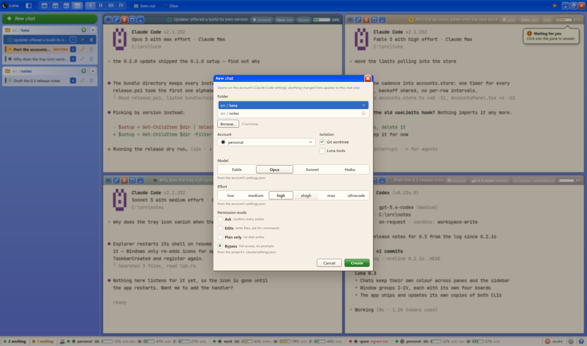

# Chats

## Creating a chat

**New chat** (Ctrl+N) asks for a folder and an account, plus the **Git worktree**
and **Luna tools** checkboxes. They start as Settings has them (worktree on,
tools off) or as kept for the folder: flipping one is for that chat only, and
"keep for this folder" makes it the folder's own start. The folder list is the
folders you launched chats in, adopted orphans into or browsed to.

The account decides which CLI runs, and the rest of the dialog follows.

**Claude Code:** model (a drop-down), effort
(`low/medium/high/xhigh/max/ultracode`) and permission mode. Isolation runs
`claude --worktree` in `<folder>/.claude/worktrees/<name>`, on a
`worktree-<name>` branch. Before Claude Code makes one, Luna fetches origin's
default branch (10 s at most, never asking for a password; off in Settings);
Claude Code branches off it and refetches only once a day itself.

**Codex:**

- Model: a drop-down from Codex's own catalog, in Codex's order: the list it
  caches for the account (`models_cache.json`), another account's when this one
  has never run, or `codex debug models` directly. The model a chat gets with
  nothing changed is marked "· default": the account's `config.toml` model, or
  the first Codex lists. It is always passed as `--model`.
- Reasoning effort as that model takes it (`low … ultra`, each level's
  description as a tooltip), opening on the model's default and following the
  model when another is picked, unless a settings file names a level or one was
  picked by hand.
- Approval policy (`on-request/never/auto-review`) and sandbox mode
  (`read-only/read-only-net/workspace-write/danger-full-access`). `never` +
  `danger-full-access` is passed as `--dangerously-bypass-approvals-and-sandbox`.
  `auto-review` is Codex's `--approve-for-me`: what Codex would ask you goes to
  a reviewer model, which approves or declines so the turn goes on, always in
  `workspace-write`.
- Isolation runs `codex --worktree`: Codex checks the current commit out into
  `<account>/worktrees/<4 hex>/<repo>` on a detached HEAD. A resumed chat goes
  back into that checkout.
- **Hooks unasked** (off in Settings, kept per folder like the boxes above): the
  project's hooks run without Codex's "Hooks need review" prompt
  (`--dangerously-bypass-hook-trust`). Codex asks again for every new worktree,
  account or edited hook; a background helper, which cannot ask, goes without
  them. A helper an agent starts takes the box as its folder would start it.

**Defaults come from the CLI's own files** for that account in that folder.
Claude Code: the account's `settings.json`, the project's
`.claude/settings.json` and `.claude/settings.local.json`, then the machine-wide
managed file. Codex: the account's `config.toml`, then the project's
`.codex/config.toml` (read only for a trusted folder). The line under each
control names the file it came from; changing one says so and offers the way
back. An override belongs to that chat and is never remembered as a default.

**Ctrl+Shift+N** skips the dialog: same folder and account as the chat on
screen, the rest as Settings has it. Either way the new chat lands in a pane you
can see: a free one, or the pane you last worked in when the board is full.

## The pane title bar

Buttons first (recolor, rename, delete, peek, take off the board), then the
name and chips: folder, account, model and effort, permission mode (Claude
Code) or approval and sandbox (Codex; `bypass` and `auto-review` get chips of
their own), the worktree flag, and context used as a meter and a number. A
narrow pane drops chips one by one before the name and buttons. The session
id's first 8 characters sit there too (a click copies them); the full id is in
the row's tooltip.

Every new chat is dealt one of ten colors, worn by its title bar and as a stripe
on its sidebar row.

## Status

- **Working / waiting for you / resting**, read from the CLI's own session
  registry, so it is right whether or not the chat has a pane.
- A chat turning to waiting raises a desktop notification (the window may be in
  the tray), with the system’s sound unless Settings → General → Notifications says not
  to. A click brings the window up with that chat on the peek sheet.
- **Waiting by marker:** a turn that ends asking you something in plain words is
  waiting too, when its last message ends on a line holding the text set in
  Settings → General → Waiting for you (`AWAITING OPERATOR` to begin with). It stays
  waiting until you write to it or clear it with the check on its title bar or
  row; a power-off armed for "when done" does not wait for it.
- Context use is read from the session transcript against the model's real
  window (from the Models API), so it costs nothing and cannot drift.

## Titles

Titles are the CLI's own. Claude Code names a session from its opening exchange
(the title it puts on a terminal tab) and writes it to the transcript; a
`/rename` wins over it. Codex threads use their name from
`session_index.jsonl`. The opening prompt stands in until a title exists. Rename
with the pencil on the row or the title bar; a name you set is never overwritten.

## Input, clipboard and links

- Ctrl+V pastes as in any terminal. With a screenshot on the clipboard it
  presses the CLI's own image-paste key (Alt+V for Claude Code, Ctrl+V for
  Codex).
- Files pasted or dropped into a pane are copied into the app's media store and
  their absolute paths typed into the prompt.
- Ctrl+C over a selection copies it; with nothing selected it interrupts the CLI.
  Selecting alone copies nothing.
- A link opens in your browser, chosen in Settings → Links: a default, and one
  per account or per project folder. Shift+click lists every browser, can
  remember the pick for that chat, and copies the link. Order: the chat's pick,
  its account's, its folder's, the default. A browser is a command line with
  `%1` where the link goes, so a profile is a flag
  (`--profile-directory="Profile 1"` for Chrome, Edge and Brave, `-P name` for
  Firefox). On Windows installed browsers and their profiles are listed
  automatically; elsewhere it is the system's handler and your own.
