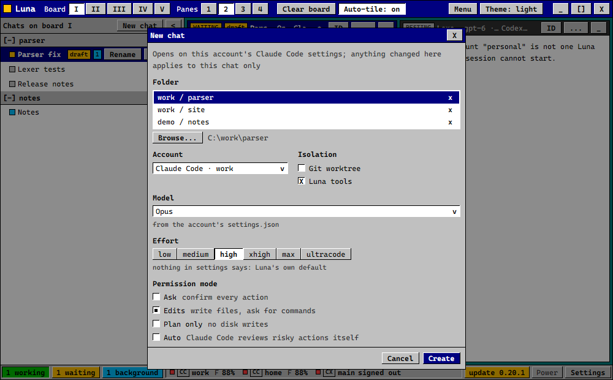

# Chats

## Creating a chat

**New chat** (Ctrl+N) asks for a folder and an account, plus the **Git worktree**
and **Luna tools** checkboxes. They start as Settings has them
(worktree on, tools off) or as kept for the folder: flipping one
is for that chat only, "back to …" undoes the flips, and "keep for this folder"
makes them the folder's own start; kept as Settings has them anyway, the folder
goes back to following Settings. Picking another folder starts the boxes the
way that one does, and a chat made with Ctrl+Shift+N takes that start. The folder list is the folders you launched chats in, adopted orphans
into or browsed to.

The account decides which CLI runs, and the rest of the dialog follows.

A folder a chat could not start in is said under the folder list, and Create
waits until another is picked: one that no longer exists. A chat whose folder
has gone since says so in its pane instead of starting.

**Git worktree** is offered only for a folder in a git repository: both CLIs
make their worktree with git, so outside one the box is not there and the chat
starts in the folder itself. Ticked, it is a flag passed to the CLI
(`claude --worktree`, `codex --worktree`) and nothing more: **Luna does not
create or remove worktrees.** The CLI makes the worktree and leaves it where it
is; deleting the chat leaves it too. To isolate work some other way, create a
worktree yourself with `git worktree add`, open the chat in it as its folder,
and remove it when you are done.

**A folder without git** is a folder like any other. Nothing in Luna needs a
repository: chats, helpers and leads run there on both CLIs, the Git worktree
box is simply not shown, and a chat started without the dialog (Ctrl+Shift+N)
in a folder whose kept start asks for a worktree starts without one instead of
opening the dialog. A Codex helper is started with `--skip-git-repo-check`,
which `codex exec` needs outside a repository (listed under the helper's
applied settings). Codex's trust for such a folder is the folder's own:
trusting a folder trusts it alone, not the folders below it.

These boxes add something to the CLI only when you ask for it:

- **Trust this folder in "<account>"** shows when the account has not trusted
  the folder yet, unticked. Ticked, Luna writes the same mark the CLI's own
  trust prompt writes (`hasTrustDialogAccepted` in `.claude.json`, or
  `trust_level = "trusted"` in `config.toml`), and the chat opens on its prompt.
  Unticked, nothing is written and the CLI asks in the chat itself (Codex then
  asks about its Windows sandbox too). Claude Code cannot ask when it makes a
  worktree, so such a chat needs the box ticked or the worktree off. A chat an
  agent starts never writes trust: a Codex helper is trusted for its own runs
  only.

**Ctrl+Shift+N** opens the dialog instead when the folder is not trusted in the
account, since whether to trust it is yours to say.

**Claude Code:** model, effort and permission mode.

- Model: a drop-down of the models Claude Code offers this account, as its own
  `/model` does: each family's current model first (it runs by its alias,
  such as `opus`, so the chat follows the family to its next version), older
  versions under **More…** (each runs by its full id). Luna reads the list
  from the account's own Claude Code cache, or asks Claude Code for it in the
  background; until either has answered, and for an account that never
  signed in, it lists Fable, Opus, Sonnet and Haiku.
- Effort: the levels the chosen model takes (`low/medium/high/xhigh/max`
  today), plus `ultracode`. A model that takes no effort, such as Haiku 4.5,
  shows none. Claude Code keeps effort per model (what `/effort` sets in a
  chat is saved for that model), so each model opens on its own level, as
  Claude Code would pick it: the one the settings files keep for it, else
  the model's own default, and the line under it names the file and key.
  The account's top-level `effortLevel` counts only for older models, as in
  Claude Code; a project's or a managed one counts for every model. Picking a
  model moves to its level unless you picked one by hand; one that does not
  take the level shown moves it to that model's own default.
- Permission mode, passed as `--permission-mode`: **Ask** (`default`, confirm
  every action), **Edits** (`acceptEdits`), **Plan only** (`plan`), **Auto**
  (`auto`) and **Bypass** (`bypassPermissions`). In Auto Claude Code decides
  for itself, with its own review of risky actions. Where that review cannot
  run at all, it starts in its Manual mode, which asks first; where it cannot
  judge one action later on, it refuses that action ("Auto mode could not
  evaluate this action and is blocking it for safety"). Luna ranks the chat,
  and shows its chip, as Auto either way: a start in Manual lowers neither,
  and its helpers may still run in `auto` (Codex's `auto-review`), which is
  what you granted by picking Auto. A settings file's `defaultMode` of one of
  these opens the dialog on it; its `dontAsk`, or a mode Luna does not know,
  opens it on Ask; no `defaultMode` at all, on Bypass. Create waits until the
  files have answered.

Isolation runs `claude --worktree` (Claude Code 2.1.325's `-w, --worktree
[name]`), which makes `<folder>/.claude/worktrees/<name>` on a
`worktree-<name>` branch. Claude Code branches it off origin's default branch as
last fetched, and fetches itself only once a day: Luna does not fetch first.

**Codex:**

- Model: a drop-down from Codex's own catalog, in Codex's order: the list it
  caches for the account (`models_cache.json`), or `codex debug models`
  directly for an account that has never run; never another account's, since
  what an account may run follows its plan. The model a chat gets with
  nothing changed is marked "· default": the account's `config.toml` model, or
  the first Codex lists. It is always passed as `--model`.
- Reasoning effort as that model takes it (`low … ultra`, each level's
  description as a tooltip), opening on the model's default and following the
  model when another is picked, unless a settings file names a level or one was
  picked by hand.
- Approval policy (`Codex's own/on-request/never/auto-review`) and sandbox
  mode (`Codex's own/read-only/read-only-net/workspace-write/danger-full-access`).
  **Codex's own**, where both open, passes nothing: Codex runs as its own
  `config.toml` says (a granular approval table, a permission profile, its
  own defaults), and Luna does not say what that is. `never` +
  `danger-full-access` is passed as `--dangerously-bypass-approvals-and-sandbox`.
  `auto-review` is Codex's `--approve-for-me` (for a helper, the settings it
  stands for): what Codex would ask you goes to
  a reviewer model, which approves or declines so the turn goes on, always in
  `workspace-write`. A `config.toml` Luna cannot read (one that does not
  parse, or names an approval, sandbox or profile Luna does not know) opens on
  `on-request` with `read-only`, passed, marked "Luna's safe choice";
  `on-failure` is `on-request`. A config saying `approval_policy =
  "untrusted"`, which Codex 0.169 refuses to start on, is named in an error
  and the chat is not started, unless a project's own config may say
  otherwise, when Codex decides.
- What a sandbox holds is Codex's own, not Luna's. Seen on Windows with Codex
  0.169.0: `read-only` writes nothing, `workspace-write` only the folder and
  temp (not `.git`); both read what you can, and their "no network" stops
  only tools that follow proxy variables (see
  [CLI compatibility](../cli-compatibility.md)). Where your account names no
  `windows.sandbox`, Luna passes `unelevated` so Codex can run commands at
  all; one you name is left as it is.
- Isolation runs `codex --worktree` (Codex 0.169.0): Codex checks the current commit out into
  `<account>/worktrees/<4 hex>/<repo>` on a detached HEAD. A resumed chat goes
  back into that checkout.
- Codex's "Hooks need review" prompt is Codex's own: Luna never passes
  `--dangerously-bypass-hook-trust`, so a project's hooks ask for trust as they
  would started by hand, and a background helper, which cannot ask, goes without
  them.

**Defaults come from the CLI's own files** for that account in that folder.
Claude Code: the account's `settings.json`, the project's
`.claude/settings.json` and `.claude/settings.local.json`, then the machine-wide
managed file. Codex: its machine-wide `config.toml`, the account's, then the
project's `.codex/config.toml` (read only for a trusted folder). The line under each
control names the file it came from; changing one says so and offers the way
back. An override belongs to that chat and is never remembered as a default.

**Ctrl+Shift+N** skips the dialog: same folder and account as the chat on
screen, the rest as Settings has it. Either way the new chat lands in a pane you
can see: a free one, or the pane you last worked in when the board is full.

## The pane title bar

Buttons first (the **…** menu, delete, peek, take off the board), then the name, its folder and, if the chat has background helpers, a
pill that sums them up (see [Helpers](agents.md#helpers)). The chat's settings
sit on the right: account, model and effort, permission mode (Claude Code) or
approval and sandbox (Codex; `bypass` and `auto-review` get chips of their
own), the worktree flag, context used as a meter and a number, and the session
id's first 8 characters (a click copies them; the full id is in the row's
tooltip).

A narrow pane gives up, in this order: the secondary chips and the session id,
the other chips and the meter's bar, the words of the helper pill (it keeps
its numbers), then the folder. The name, the pill's counts and the buttons
stay.

The **…** menu holds what a chat needs now and then: **Rename** (or
double-click the name) and **Chat color…**.

Every new chat is dealt one of ten colors, worn by its title bar and as a stripe
on its sidebar row.

## Status
- **Working / waiting for you / resting**, read from what the CLI itself says
  (Claude Code's hooks and session file, Codex's rollout), so it is right
  whether or not the chat has a pane. A chat Luna cannot tell about yet
  reads working. A Codex turn held on an approval dialog reads waiting, as
  Luna's own hooks in that chat say (Codex trusts them without asking you; a
  project's hooks still ask), or as its screen shows where those hooks do not
  run.
- **Background:** the chat's turn is over, but work of its own goes on: a
  subagent, a process its turns started that is still in its job (a
  background shell, a dev server), a scheduled `/loop`, or a helper, or a
  helper's helper, that still owes it an answer. Its dot is a blue ring, where a working chat's is a filled
  green dot, and the status bar counts these chats and names them on hover. A
  chat that is waiting or working reads that instead. It reads background, and
  keeps the PC awake, for as long as that work is there, however long it does
  nothing ([Power](power.md#what-active-means)). When the work ends the dot
  goes back to resting, with no notification.
- A chat turning to waiting raises a desktop notification (the window may be in
  the tray), with the system’s sound unless Settings → General → Notifications says not
  to. A click brings the window up with that chat on the peek sheet.
- Context use is read from the session transcript against the model's real
  window (from the Models API), so it costs nothing and cannot drift.

## Titles

Titles are the CLI's own. Claude Code names a session from its opening exchange
(the title it puts on a terminal tab) and writes it to the transcript; a
`/rename` wins over it. Codex threads use their name from
`session_index.jsonl`. The opening prompt stands in until a title exists. Rename
with the pencil on the row, **Rename** in the pane's **…** menu or a
double-click on its name; a name you set is never overwritten.

## Input, clipboard and links

- Ctrl+V pastes as in any terminal. With a screenshot on the clipboard it
  presses the CLI's own image-paste key (Alt+V for Claude Code, Ctrl+V for
  Codex).
- Files pasted or dropped into a pane are copied into the app's media store and
  their absolute paths typed into the prompt.
- Ctrl+C over a selection copies it; with nothing selected it interrupts the CLI.
  Selecting alone copies nothing.
- Alt with an arrow key sends what Ctrl with it sends: Alt+Left and Alt+Right
  move a word, where the CLI's input takes such a move.
- A link opens in your system's default browser, or a mail link in your mail
  app, without a question. Only web (`http`, `https`) and mail (`mailto`) links
  open, and no mail link that asks to attach a file; any other is ignored.
