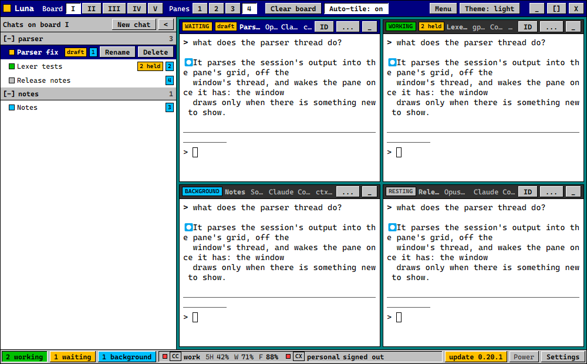

# The window and panes

Luna 0.20 is moving to a native window, which Luna opens from now on. It has
its title bar (Luna's name, the board's controls, the theme button, minimize,
maximize and close; drag it to move the window, double-click it to
maximize), the core banner, the sidebar of chats and the board of panes
(below), in one font, Cascadia Mono, light, dark or as the system is. Like the window this page describes, it has Luna's tray icon
(Open, Restart window, Quit; a click opens the window), closes to the tray
with the core and its sessions running, opens where you left it (on the same
monitor, wherever that monitor is now; on another if it is gone), and is the
one Luna window for its folder: starting Luna again, with `--webview` or
without, brings up the window already running. Start Luna with `--webview`
for the window this page describes, which still has everything else; Luna
opens that one by itself where the native window cannot open (no usable
graphics device).

## The native window's chats and boards

**Your chat list comes along.** The first time the native window starts, it
reads the chat list the 0.19 window kept (from a copy of its storage; the
original is left as it was): the chats, their folders, what sat in each
group's panes, whether the sidebar was pinned, and the new-chat, delete and
notification choices. Chat colors, handoff marks and the splits are not
kept. Groups VI to X are gone: their chats are listed on board V. If the old
list cannot be read, the window starts with an empty list and says so in a
line under the title bar: **Retry** tries again, OK hides the line, and the
next start tries again too, for as long as the list stays empty. Sessions
still running stay in the core. A 0.19 that never kept a chat list (only
its theme, say) has nothing to import, and nothing is said. Once imported,
the native window keeps its own list, in `window\chats.json` in Luna's data
folder, and the 0.19 list is never read again.

**The list is kept safe.** It is the only copy of your chats, so the window
never writes over a list it could not read: if `chats.json` is there but
cannot be read (another program holds it, say), a line says so and nothing
is saved until **Retry** (or the next start) reads it. A list that reads
only in part (one from a newer Luna, or with a chat of a CLI this Luna does
not know) is used for what can be read, and the file as it was is kept
beside it as `chats.kept-<time>.json`; a file that is not a list at all is
put aside as `chats.unreadable-<time>.json`. A line names the file either
way. If a save fails, a line says so and Luna keeps trying until it works.
Luna does not quit while the list is not saved: Quit (from the tray, an
update, or closing the window where there is no tray) waits for the save,
and where it fails the window comes up with a line saying so, **Retry** and
**Quit anyway** (which quits without what was not saved). Signing out or
shutting Windows down does not wait: Luna tries once more and notes it in
its log. The window's size and place have a file of their own
(`window-state.json`), so a resize never touches the list; a file there
that is not a window's place is put aside as
`window-state.unreadable-<time>.json`, not written over, and one that
cannot be read at all is left alone and the window's place not saved that
run.

**Title bar.** Five fixed boards, I to V (the 0.19 window's groups, no more
added or removed), the layouts 1 to 4 (panes), **Clear board** (empties the
board's panes, every chat stays listed), **Auto-tile** (on: a new chat with
no free pane grows the board by one pane, up to four, and taking a chat off
the board shrinks it), and the theme.

**Sidebar.** The chats of the board on screen, by the folder they were
started from; a folder's header folds it away or opens it. A row shows the
chat's status as a colored square (green working, yellow waiting for you,
blue busy in the background, plain resting), a draft left in its composer,
and its pane's number, or, with one pane, its number in the list (what
Ctrl+digit reaches). The selected chat's row has **Rename** and **Delete**.
**<** collapses the sidebar to a strip of status squares, **>** pins it back;
there is no slide-out on hover. **New chat** is at its top.

**Panes.** Each pane's title bar shows the chat's status, a draft, its name,
model and effort, account, how much of its context is used and **ID** (copies
the session id). **...** opens its menu: Rename, Copy session id, Move to
pane N, Swap with pane N and Take off the board; **_** takes the chat off the
board. Nothing is dragged: chats and panes move only through these. A click
on a pane puts the keyboard in it. A pane whose core is being found or
replaced waits and says so; it never fails for it.

**Peek.** A click on a chat that is not on the board opens it full size over
the board, which stays as it was. **To board** seats it (a free pane, a new
one by auto-tile, or else the pane you last worked in), the menu puts it in
a pane of your choice, and **Close** puts the board back. A click on a chat
that is on the board holds its pane up the same way (**Back** puts it
back); with one pane, the click shows the chat in it. A peek opens without
giving its terminal the keyboard, and Esc closes it then. Click in its
terminal, or start typing (what you type goes to the CLI), and Esc is the
CLI's again, to interrupt it or turn a prompt down; Shift+Esc closes the
peek whatever has the keyboard. The peek's top line says which it is now.

**Keys.**

| Keys | Action |
| --- | --- |
| Ctrl+N / Ctrl+Shift+N | new chat / quick chat |
| Ctrl+Shift+1..4 | layout |
| Ctrl+1..4 | the keyboard into that pane; with one pane, that chat of the list |
| Ctrl+Shift+W | the next chat waiting for you |
| Ctrl+Tab | the next board (Ctrl+Shift+Tab is Claude Code's) |
| Esc | close a menu, a rename, or a peek whose terminal you have not clicked or typed in; otherwise it goes to the CLI |
| Shift+Esc | close the peek |

The digits are the keys of the digit row (or the keypad) whatever your
keyboard layout prints on them: on a French keyboard, Ctrl+1 is Ctrl with
the `&` key. A key that means nothing at the moment (Ctrl+3 with two panes,
Esc with nothing up) goes to the CLI as typed. Ctrl+C and Ctrl+V are the
terminal's.

While Luna's core is not running (being restarted, say), every chat's status
reads **no core** rather than what it last did, and Ctrl+Shift+W finds
nothing; it comes back as soon as the core does.

**What changed from 0.19.** Five fixed boards instead of groups you add and
remove; no drag and drop, no splits to drag, no Even out; no Alt glance, no
peek by the mouse's Back button; the sidebar is pinned or collapsed, never
slid out; no chat colors; Esc closes a peek until you click or type in it.
Notifications are the same: a
chat that starts waiting for you, and what Luna's core announces; a click
opens the chat.

## The status bar

The row along the foot of the native window says what Luna is doing and what
needs you, and nothing in it moves: it changes only when something happens.

- **Working, waiting, background**: how many chats are in each state. Each
  fills in its color while it has any. Click **waiting** to go to the next
  chat that waits for you (Ctrl+Shift+W does the same). **Background**
  opens the helpers' list, which comes with the helpers' own window.
- **Accounts**: each account with a dot (red when signed out or when a window
  is at 85% or more), `CC` for Claude Code or `CX` for Codex, its name and,
  for every usage window it has (`5H` the five hours, `W` the week, another
  letter for a model's own limit), a meter, the percent used and how long
  until it resets. The meter is green below 60%, yellow to 85%, then red.
  When the window is too narrow for all of it, the countdowns go first, then
  the meters, then every window but the fullest. The numbers are asked for
  about once a minute (less often after an error or a rate limit), one
  account at a time, so the countdowns are up to a minute old.
- **A new Luna** (`update 0.20.1`): click for the release notes and what the
  update does to your sessions, then **Download and install**. Luna closes to
  install and starts again. If it cannot first write what it holds (the chat
  list, the theme, the window's place) it does not install, and says why:
  **Retry**, **Install anyway** (what could not be written is lost), or
  **Cancel** (sessions stopped for the update resume).
- **A CLI downloading or failing to update** shows `CC download 31%` or
  `CX update failed`; click a failure to try again.
- **Power**: **Power** opens the panel. *Keep the PC awake while sessions
  work* is the switch; *when every session is done* arms a shutdown (or
  restart on Windows, hibernate, sleep) once nothing has run for the quiet
  time you pick, with the option that agents start nothing new meanwhile.
  The chip says `awake · 2` while sessions hold the PC, `shutdown when done`
  while armed and, for the last minute, `shutdown in 42s` with a **Cancel**.
  The tray icon's dot and tooltip say who holds the PC awake.
- **Settings** opens the settings.

Above it, **N orphan sessions** appears only while a session runs that no chat
reaches (a chat lost to a damaged list, say), and **Kill all** ends them after
one more question; their transcripts stay on disk. Esc closes a panel.

## The native window's terminal

Each chat's pane shows its CLI in the native window's terminal and takes its
input. What it does, and how it differs from the WebView window's terminal:

- **Copy:** select with the mouse (drag; a double-click takes a word, a
  triple-click a line). Ctrl+C over a selection copies it and clears it; with
  nothing selected it interrupts the CLI. Ctrl+Shift+C and Ctrl+Insert copy
  too (in the WebView window Ctrl+Shift+C does nothing). Selecting alone
  copies nothing. Hold Shift to select where the CLI takes the mouse.
- **Paste:** Ctrl+V, Ctrl+Shift+V or Shift+Insert (Cmd+V on macOS). Text goes
  in as a paste the CLI can tell from typing, without the control characters
  it may hold (all but tabs and line breaks), so a pasted text never acts as
  keys. What you type while a paste is on its way goes in after it. If the
  clipboard does not answer within 5 seconds the paste is dropped, the
  terminal says `[paste dropped: …]`, and what you typed goes on. While
  the terminal is coming back to a running chat it says
  `Reattaching to the session...` and takes no keys until it has caught up;
  if that takes too long, or output went missing on the way, it starts the
  chat over.
- **Files:** files copied in Explorer and pasted, or dropped on a terminal from
  outside the window, are typed in as their paths, each in quotes, the way
  the CLI attaches them. Unlike the WebView window, nothing is copied into
  Luna's media store first: the paths are the files' own. A path with a
  control character in it (or, on Windows, a `"`) cannot be typed whole, and
  the files are not pasted.
- **Images:** a screenshot or another picture on the clipboard, with no text
  and no file beside it, presses the CLI's own image-paste key (Alt+V for
  Claude Code, Ctrl+V for Codex), which reads the clipboard itself; so does a
  paste of nothing the window can read, as in the WebView window.
- **Scrolling:** the wheel, or Shift+PageUp and Shift+PageDown, go through the
  lines above the screen; typing goes back to the bottom. Where the CLI takes
  the mouse, the wheel is its.
- **Look:** the window's font (Cascadia Mono) and its light or dark theme;
  the cursor never blinks, and is hollow while the terminal does not have the
  keyboard. Box drawing and block characters are drawn as shapes, so frames
  join up at any size.
- **Links are plain text:** nothing in the terminal opens a browser.
- **The core:** while Luna's core is being found or replaced the terminal
  says it is waiting for it, and starts or resumes the chat once it is up;
  so it does when the core closed every chat for a shutdown of the PC that
  you then called off.
- **A flood of output:** if a CLI writes faster than the terminal can show
  for long, the terminal drops the excess rather than eat memory, and says
  `[dropped … of output: the pane fell behind]`.
  When a chat ends, the terminal says `[session exited]`; keys the CLI did not
  take are said there too.

## Look

- A Windows XP shell (xp.css, Luna): the native frame is replaced by Luna's own
  title bar with minimize / maximize / close, and the UI runs on Segoe UI. The
  sidebar is Explorer's task pane; every title bar control comes from one set of
  glyphs, every other button from one family of XP-style icons. Checkboxes,
  radios, fields and scrollbars are XP's, rounded off and themed.
- The interface scales from one variable, `--ui` in `src/styles/tokens.css`, and
  follows Windows' own text-size setting on top of that.
- Light / dark / system themes, toned for reading all day: no pure black or
  white, no blue cast in any surface, surfaces stepped apart by lightness, the
  terminal the deepest of them, ANSI colors softened but at 4.5:1 or better.
  Light is XP's warm beige under blue title bars; dark is neutral graphite.
- Only the pane you are working in wears its full color; the others go pale, as
  XP drew inactive windows. A chat waiting for you wears an orange title bar,
  and over a pane you are not in a balloon says so. Nothing on screen moves:
  states are told by color, shape and words, never by a pulse or a flash, and
  the terminals' cursors hold still unless the program in one asks for a
  blinking cursor. The one thing that blinks is the text cursor of a field
  you are typing in, as Windows draws it. In a Windows contrast theme the
  status dots take the theme's colors: filled for working, the highlight
  color for waiting, a ring for background, gray for idle.
- The chrome does not select as text, so a drag across the sidebar paints
  nothing blue.

## Title bar and sidebar

- The window's title bar carries the board's controls: the sidebar button, the
  four layouts, the window groups, Even out, Clear and the theme.
- A hidden sidebar takes no room: resting the pointer at the window's left edge
  brings it out over the board until the pointer leaves; the title bar's button
  pins it back.

## Panes and the board

- A grid of 1/2/3/4 panes with draggable splits.
- **One click** on a sidebar row shows that chat. With a single pane it becomes
  what that pane shows; with more panes a chat not on the board comes up on the
  peek sheet, so a click never rewrites an arrangement. Dragging seats a chat in a
  particular pane; panes swap by dragging one title bar onto another.
- **Auto-tile** (on by default, Settings → General → Board): a new chat with no free pane
  grows the board by one pane, up to four, and lands there; nothing already on
  the board moves. Taking a chat off the board or deleting it shrinks the board
  by one. Off, a new chat with nowhere to go comes up on the sheet.
- **Peek** is the temporary view: the pane held up on a sheet with the board
  dimmed behind it. The numbered chips in the sheet's bar move between panes. A
  click outside the sheet, a second click on the same row or on the chip of the
  pane that is up, the mouse's Back button, the Return button or Ctrl+0 all go
  back.
- **Alt glance:** holding Alt over a chat in the list brings it up on the sheet;
  letting go puts back what was there (a click keeps it). The glance starts a
  beat after Alt goes down, so a chord with Alt (Alt+digit, Alt+V, Alt+Shift)
  never touches the sheet.
- Terminals outlive the pane that showed them: the last three put down wait off
  screen with their listeners on, so switching back is a refit rather than a
  fresh session handshake and a 2 MB replay of the scrollback.

## Window groups

Beside the layout selector: one to start with, up to ten (I–X). **+** or
Ctrl+Shift+T adds one (Ctrl+T is left to the CLI); **Remove** takes the group on
screen away once no chat is left in it; Ctrl+Tab goes round them (Ctrl+Shift+Tab
is left to the CLI). Each group remembers its own four boards (one per layout)
and their splits. **Clear** empties the group's panes and leaves every chat
alone; **Even out** puts the splits back to half.

## Status bar

Runs the width of the window: how many chats are working, how many waiting (a
click goes to the next one), how many have work going on in the background
(named on hover), every account with every limit window (how full,
and how long until it resets; a click opens the Accounts window), then
Recommendations, power, settings and help. Short of room, each account keeps its
name and its fullest window. There is no clock; the taskbar has one.

## Keyboard and mouse

F1, or **?** in the status bar, lists every shortcut and mouse gesture; the
buttons themselves carry none. Nothing hides behind a double-click: rename,
delete and even out are buttons. Luna claims its shortcuts in the capture phase,
so they work while a terminal has focus; everything else goes to the CLI
untouched. Escape is deliberately left alone: it is how the CLI is interrupted.

| Keys | Action |
| --- | --- |
| Ctrl+N / Ctrl+Shift+N | new chat / new chat without the dialog |
| Ctrl+Shift+1..4 | layout |
| Ctrl+1..4 | move the keyboard into that pane |
| Alt+1..4 | hold that pane up on the sheet; again puts it back |
| Ctrl+0 | back from the sheet |
| Ctrl+Shift+W | next chat waiting for you |
| Ctrl+Shift+B | pin or hide the sidebar |
| Ctrl+Shift+T / Ctrl+Tab | new window group / next group |
| F1 | shortcuts |

The number on a row is what Ctrl+digit reaches: the pane it shows in, or its
place in the list when there is only one pane.
