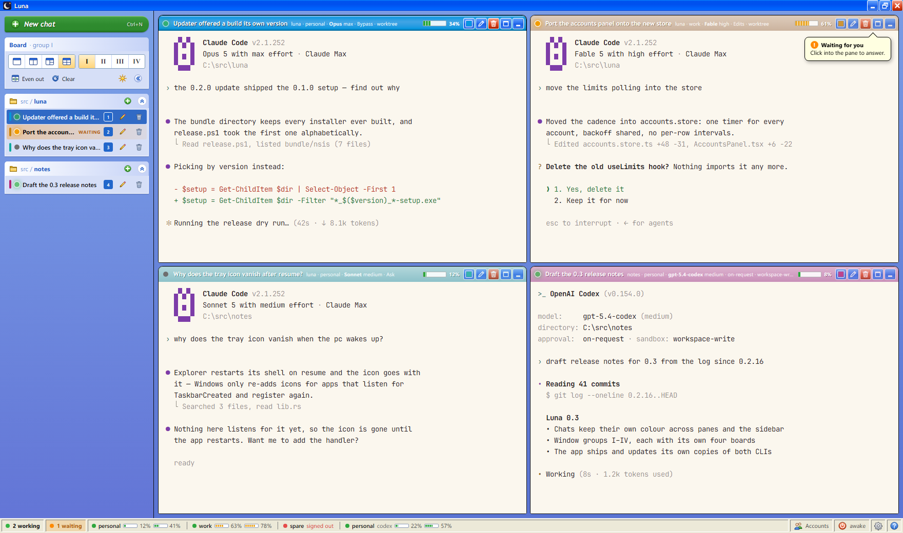
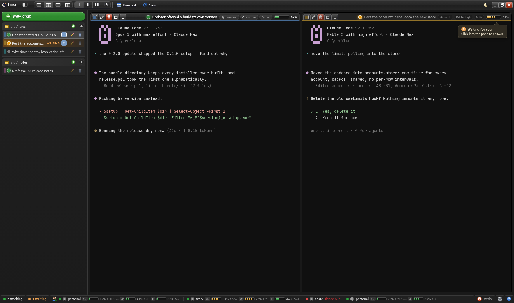

# The window and panes

## Look

- A Windows XP shell (xp.css, Luna): the native frame is replaced by Luna's own
  title bar with minimize / maximize / close, and the UI runs on Segoe UI. The
  sidebar is Explorer's task pane; every title bar control comes from one set of
  glyphs, every other button from one family of XP-style icons. Checkboxes,
  radios, fields and scrollbars are XP's, rounded off and themed.
- The interface scales from one variable, `--ui` in `src/styles/tokens.css`, and
  follows Windows' own text-size setting on top of that.
- Light / dark / system themes, toned for reading all day: no pure black or
  white, no blue cast in any surface, surfaces stepped apart by lightness, the
  terminal the deepest of them, ANSI colors softened but at 4.5:1 or better.
  Light is XP's warm beige under blue title bars; dark is neutral graphite.
- Only the pane you are working in wears its full color; the others go pale, as
  XP drew inactive windows. A chat waiting for you flashes its title bar orange,
  and over a pane you are not in a balloon says so.
- The chrome does not select as text, so a drag across the sidebar paints
  nothing blue.

## Title bar and sidebar

- The window's title bar carries the board's controls: the sidebar button, the
  four layouts, the window groups, Even out, Clear and the theme.
- A hidden sidebar takes no room: resting the pointer at the window's left edge
  slides it out over the board until the pointer leaves; the title bar's button
  pins it back.

## Panes and the board

- A grid of 1/2/3/4 panes with draggable splits.
- **One click** on a sidebar row shows that chat. With a single pane it becomes
  what that pane shows; with more panes a chat not on the board comes up on the
  peek sheet, so a click never rewrites an arrangement. Dragging seats a chat in a
  particular pane; panes swap by dragging one title bar onto another.
- **Auto-tile** (on by default, Settings → Board): a new chat with no free pane
  grows the board by one pane, up to four, and lands there; nothing already on
  the board moves. Taking a chat off the board or deleting it shrinks the board
  by one. Off, a new chat with nowhere to go comes up on the sheet.
- **Peek** is the temporary view: the pane held up on a sheet with the board
  dimmed behind it. The numbered chips in the sheet's bar move between panes. A
  click outside the sheet, a second click on the same row or on the chip of the
  pane that is up, the mouse's Back button, the Return button or Ctrl+0 all go
  back.
- **Alt glance:** holding Alt over a chat in the list brings it up on the sheet;
  letting go puts back what was there (a click keeps it). The glance starts a
  beat after Alt goes down, so a chord with Alt (Alt+digit, Alt+V, Alt+Shift)
  never touches the sheet.
- Terminals outlive the pane that showed them: the last three put down wait off
  screen with their listeners on, so switching back is a refit rather than a
  fresh session handshake and a 2 MB replay of the scrollback.

## Window groups

Beside the layout selector: one to start with, up to ten (I–X). **+** or
Ctrl+Shift+T adds one (Ctrl+T is left to the CLI); **Remove** takes the group on
screen away once no chat is left in it; Ctrl+Tab goes round them (Ctrl+Shift+Tab
is left to the CLI). Each group remembers its own four boards (one per layout)
and their splits. **Clear** empties the group's panes and leaves every chat
alone; **Even out** puts the splits back to half.

## Status bar

Runs the width of the window: how many chats are working, how many waiting (a
click goes to the next one), every account with every limit window (how full,
and how long until it resets; a click opens the Accounts window), then
Recommendations, power, settings and help. Short of room, each account keeps its
name and its fullest window. There is no clock; the taskbar has one.

## Keyboard and mouse

F1, or **?** in the status bar, lists every shortcut and mouse gesture; the
buttons themselves carry none. Nothing hides behind a double-click: rename,
delete and even out are buttons. Luna claims its shortcuts in the capture phase,
so they work while a terminal has focus; everything else goes to the CLI
untouched. Escape is deliberately left alone: it is how the CLI is interrupted.

| Keys | Action |
| --- | --- |
| Ctrl+N / Ctrl+Shift+N | new chat / new chat without the dialog |
| Ctrl+Shift+1..4 | layout |
| Ctrl+1..4 | move the keyboard into that pane |
| Alt+1..4 | hold that pane up on the sheet; again puts it back |
| Ctrl+0 | back from the sheet |
| Ctrl+Shift+W | next chat waiting for you |
| Ctrl+Shift+B | pin or hide the sidebar |
| Ctrl+Shift+T / Ctrl+Tab | new window group / next group |
| F1 | shortcuts |

The number on a row is what Ctrl+digit reaches: the pane it shows in, or its
place in the list when there is only one pane.
