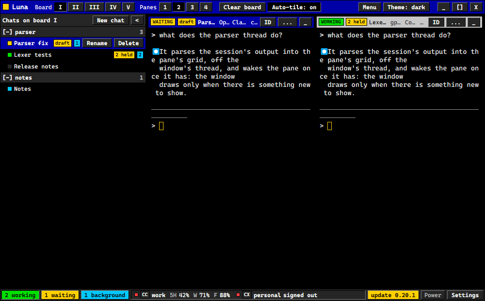

# The window and panes

Luna's native window has a sidebar of chats, a board of terminal panes and a
status bar. The title bar holds the board controls and theme switch. Drag it
to move the window or double-click it to maximize. The window uses Cascadia
Mono and offers light, dark and system themes. Screen readers are unsupported.

**Size.** The window follows the display's scaling (Windows' "Scale" for each
monitor, including a move to a monitor with another), and on Windows its
"Text size" (Settings, Accessibility) as well, as the 0.19 window did. On
top of both, **Window scale** in Settings (80% to 250%, 100% to start)
makes everything in the window bigger or smaller, the terminals included:
Ctrl+= (or Ctrl++) and Ctrl+- step it, Ctrl+0 puts it back to 100%. The
choice is kept with the chat list and applies at once; each terminal
measures its cells again and the CLI is told its new size. A change to
Windows' text size applies the next time the window is brought to the front.
At 100% the window's text is 12 px and the terminal's 14 px, times both. A
window too small for the scale is drawn at the largest one that leaves every
control in reach (as much room as a 683x400 window at 100%), and grows to
the full scale as the window does; Settings says so while it is held back.

Closing the window hides it to the tray while the core and its sessions keep
running. The tray menu offers **Open**, **Restart window** and **Quit**.
Starting Luna again from the same data folder opens its existing window. Luna
remembers the window's placement, including which monitor it was on. If the
window cannot open, for example when no usable graphics device is available,
Luna reports the error and where to find its log. An existing core keeps
running its sessions.

**G-SYNC and other variable refresh.** Luna draws only when something
changes. On a monitor with variable refresh (NVIDIA G-SYNC, AMD FreeSync)
that follows a window's frames, the whole monitor would then slow down to
Luna's pace, its lowest refresh, and everything on it would stutter, most of
all with Luna maximized. So, on Windows with an NVIDIA driver, Luna turns
G-SYNC off for `luna.exe` in NVIDIA's settings as it starts, as NVIDIA does
for browsers and Windows Terminal: one setting, "G-SYNC - Application State"
at Force Off, in the profile NVIDIA uses for `luna.exe` (one named "Luna"),
or in a profile of its own, "Luna (native window)". Uninstalling Luna puts
that setting back as it was. While you type, click or scroll, Luna also keeps
drawing at the monitor's full rate for a second after each input, on any
graphics card.

If NVIDIA's driver does not let Luna change the setting (it may want
administrator rights), Luna says so in a line at the top of the window. Then,
or if the screen still stutters while Luna is open, set it yourself: in the
NVIDIA Control Panel, open **Manage 3D settings**, **Program Settings**, add
`luna.exe` (from the folder Luna is installed in), set **Monitor Technology**
to **Fixed Refresh**, click **Apply**, and restart Luna. Choosing "Enable for
full screen mode" instead of "windowed and full screen mode" under **Set up
G-SYNC** helps too. With another graphics card or driver, turn variable
refresh off for `luna.exe` in its own settings (AMD Software: a profile for
`luna.exe` with FreeSync off), or give the monitor a fixed refresh rate in
Windows' display settings (no "Dynamic" rate).

## Chats and boards

**Your chat list comes along.** The first time the native window starts, it
reads the chat list the 0.19 window kept (from a copy of its storage; the
original is left as it was): the chats, their folders, what sat in each
group's panes, whether the sidebar was pinned, the new-chat and
notification choices, and the theme. Those choices go into Settings (the
theme to the title bar's theme button), unless you already changed them
in this Luna; coming from 0.20.0, whose import ran already, they are taken
at the first start of 0.20.1 the same way, a setting 0.20.0 still had at
its default counting as unchanged. On Windows it reads the list from Luna's data folder
(its `webview` folder), where every 0.6.32 to 0.19 kept it; that is the
folder beside `luna.exe`, or `%LOCALAPPDATA%\luna` where Luna could not
write beside it. A portable copy in a folder it cannot write to therefore
uses `%LOCALAPPDATA%\luna` too: it reads the installed Luna's list and
shares all its other state with it, on purpose. Only if there is none there at all, it reads the one a
Luna last started on 0.6.31 or before left in `%LOCALAPPDATA%\rm.luna`, as
0.19 itself took it for any copy (the test build reads its own,
`rm.luna.test`); then, only for the Luna the installer put in place for you,
`%LOCALAPPDATA%\ai.sprouter.luna`. It moves
or changes none of them. One that is there but cannot be read, or that is
reached through a link or junction, is not passed over for an older one:
the window says so instead. Chat colors, handoff marks, the wait guard, the delete
dialog's worktree box and the splits are not kept. Groups VI to X are gone: their chats are listed on board V. If the old
list cannot be read, the window starts with an empty list and says so in a
line under the title bar: **Retry** tries again, OK hides the line, and the
next start tries again too, for as long as the list stays empty. Chats or
folders it cannot read (a chat with no CLI or account, a folder with no
path) are left out, and a line names how many and where the old list was
copied as it was. A list a Luna before 0.3.0 left, in a format older than
0.19's, is not imported: a line says the chat list from an older Luna could
not be imported, with OK only, as trying again cannot help; OK records that
you have seen the line, and nothing else is written. Sessions
still running stay in the core. A 0.19 that never kept a chat list (only
its theme, say) has no chats to import, and nothing is said; its theme is
still taken. Once imported,
the native window keeps its own list, in `window\chats.json` in Luna's data
folder, and the 0.19 list is never read again.

**The list is kept safe.** It is the only copy of your chats, so the window
never writes over a list it could not read: if `chats.json` is there but
cannot be read (another program holds it, say), a line says so and nothing
is saved until **Retry** (or the next start) reads it. A list that reads
only in part (one from a newer Luna, or with a chat of a CLI this Luna does
not know) is used for what can be read, and the file as it was is kept
beside it as `chats.kept-<time>.json`; a file that is not a list at all is
put aside as `chats.unreadable-<time>.json`. A line names the file either
way. If a save fails, a line says so and Luna keeps trying until it works.
Luna does not quit while the list is not saved: Quit (from the tray, an
update, or closing the window where there is no tray) waits for the save,
and where it fails the window comes up with a line saying so, **Retry** and
**Quit anyway** (which quits without what was not saved). Signing out or
shutting Windows down does not wait: Luna tries once more and notes it in
its log. The window's size and place have a file of their own
(`window-state.json`), so a resize never touches the list; a file there
that is not a window's place is put aside as
`window-state.unreadable-<time>.json`, not written over, and one that
cannot be read at all is left alone and the window's place not saved that
run.

**Title bar.** Five fixed boards, I to V (the 0.19 window's groups, no more
added or removed), the layouts 1 to 4 (panes), **Clear board** (empties the
board's panes, every chat stays listed), **Auto-tile** (on: a new chat with
no free pane grows the board by one pane, up to four, and taking a chat off
the board shrinks it), and the theme. In a window narrower than 980 px the
captions "Board" and "Panes" go and Auto-tile and the theme button say less
(Auto-tile is pressed in while on), so every button stays in reach at the
smallest size. A board's or a layout's button names itself (and the layout's
key) when the pointer rests on it.

**Sidebar.** The chats of the board on screen, by the folder they were
started from; a folder's header folds it away or opens it, and its **+**
button opens the new-chat dialog on that folder. A row shows the
chat's status as a colored square (green working, yellow waiting for you,
blue busy in the background, plain resting), a draft left in its composer,
and its pane's number, or, with one pane, its number in the list (what
Ctrl+digit reaches). The selected chat's row has **Rename** and **Delete**.
Rest the pointer on a row (or a square of the strip) for the chat's full
name and session id, on a folder's header for its path; the tooltip comes
after half a second and holds still. Drag the sidebar's right edge to make
it wider or narrower (220 to 480 px at 100%); the width is kept with the
chat list. **<** collapses the sidebar to a strip of status squares, **>**
pins it back; there is no slide-out on hover. **New chat** is at its top.

**Panes.** Each pane's title bar shows the chat's status, a draft, its
helpers (how many work, are idle and ask, as "2 working · 1 idle · !1 asks";
a click lists them), its name, model and effort, account, how much of its
context is used and **ID** (copies the session id). A chat whose own turn is
over while a helper still works on an answer for it is in the background. **...** opens its menu: Rename, Copy session id, Move to
pane N, Swap with pane N and Take off the board; **_** takes the chat off the
board. Nothing is dragged: chats and panes move only through these. A click
on a pane puts the keyboard in it. A pane whose core is being found or
replaced waits and says so; it never fails for it.

**Peek.** A click on a chat that is not on the board opens it full size over
the board, which stays as it was. **To board** seats it (a free pane, a new
one by auto-tile, or else the pane you last worked in), the menu puts it in
a pane of your choice, and **Close** puts the board back. A click on a chat
that is on the board holds its pane up the same way (**Back** puts it
back), and so does Alt+1 to Alt+4 for the chat in that pane: the same key,
Esc or **Back** puts it back, and another pane's Alt+digit holds that one
up instead; with one pane, the click shows the chat in it. A peek opens without
giving its terminal the keyboard, and Esc closes it then. Click in its
terminal, or start typing (what you type goes to the CLI), and Esc is the
CLI's again, to interrupt it or turn a prompt down; Shift+Esc closes the
peek whatever has the keyboard. The peek's top line says which it is now.

**Keys.**

| Keys | Action |
| --- | --- |
| Ctrl+N / Ctrl+Shift+N | new chat / quick chat |
| Ctrl+Shift+1..4 | layout |
| Ctrl+1..4 | the keyboard into that pane; with one pane, that chat of the list |
| Alt+1..4 | hold the chat in that pane up over the board (the peek); the same key again puts it back |
| Ctrl+Shift+W | the next chat waiting for you |
| Ctrl+Tab | the next board (Ctrl+Shift+Tab is Claude Code's) |
| Esc | close a menu, a rename, or a peek whose terminal you have not clicked or typed in; otherwise it goes to the CLI |
| Shift+Esc | close the peek |
| Ctrl+= or Ctrl++ / Ctrl+- / Ctrl+0 | window scale a step up / a step down / back to 100% (Ctrl+0 by the key, as the digits) |

The digits are the keys of the digit row (or the keypad) whatever your
keyboard layout prints on them: on a French keyboard, Ctrl+1 is Ctrl with
the `&` key. A key that means nothing at the moment (Ctrl+3 with two panes,
Alt+2 with one pane or an empty second pane, Esc with nothing up) goes to
the CLI as typed. Ctrl+C and Ctrl+V are the terminal's. Neither CLI binds
Alt+digit, Ctrl+= or Ctrl+0, and the terminal sends nothing for Ctrl+=,
Ctrl+- or Ctrl+0, so the window takes them wherever the keyboard is.
Claude Code's undo is Ctrl+_ (Ctrl+Shift+-), which goes to it; Ctrl+- is
the window's, as it is Windows Terminal's.

While Luna's core is not running (being restarted, say), every chat's status
reads **no core** rather than what it last did, and Ctrl+Shift+W finds
nothing; it comes back as soon as the core does.

A chat that starts waiting sends a desktop notification if enabled in Settings.
Clicking it opens the chat.

## The status bar

The row along the foot of the native window says what Luna is doing and what
needs you, and nothing in it moves: it changes only when something happens.

- **Working, waiting, background**: how many chats are in each state. Each
  fills in its color while it has any. The counts go by what the core says
  of each session, the same as the power popover: a session whose state is
  not known yet (a shell or other program that is no CLI, with no hooks)
  counts as working, as it keeps the PC awake. Click **waiting** to go to the next
  chat that waits for you (Ctrl+Shift+W does the same). A chat counts as
  background while its own turn is over and a helper of it still works on
  its answer. **Background** opens the list of every chat's helpers.
- **Accounts**: each account with a dot (red when signed out or when a window
  is at 85% or more), `CC` for Claude Code or `CX` for Codex, its name and,
  for every usage window it has (`5H` the five hours, `W` the week, another
  letter for a model's own limit), a meter, the percent used and how long
  until it resets. The meter is green below 60%, yellow to 85%, then red.
  When the window is too narrow for all of it, the countdowns go first, then
  the meters, then every window but the fullest. The numbers are asked for
  about once a minute (less often after an error or a rate limit), one
  account at a time, so the countdowns are up to a minute old.
- **A new Luna** (`update 0.20.1`): click for the release notes and what the
  update does to your sessions, then **Download and install**. Luna closes to
  install and starts again. If it cannot first write what it holds (the chat
  list, the theme, the window's place) it does not install, and says why:
  **Retry**, **Install anyway** (what could not be written is lost), or
  **Cancel** (sessions stopped for the update start again in their panes,
  resumed from their transcripts). Luna holds to what the panel said when you
  clicked, and stops no session it did not count: if its core has changed
  since (it restarted, say), a session started meanwhile (a chat you opened,
  a helper an agent spawned), or the installer turns out to need to stop
  sessions the panel said keep running, nothing is stopped or installed, and
  the panel shows again with what an install would do now; **Retry** and
  **Install anyway** do the same once the core is not the one the sessions
  were stopped, or kept running, in. While Luna's core is not connected the
  panel cannot tell which sessions run: it says so and offers no install
  until it can. From the
  last save until Luna closes for
  the installer, or the update is called off, the chat list takes no
  changes: a notice above the board says so.
- **A CLI downloading or failing to update** shows `CC download 31%` or
  `CX update failed`; click a failure to try again.
- **Power**: **Power** opens the panel. *Keep the PC awake while sessions
  work* is the switch; *when every session is done* arms a shutdown (or
  restart on Windows, hibernate, sleep) once nothing has run for the quiet
  time you pick, with the option that agents start nothing new meanwhile.
  The chip says `awake · 2` while sessions hold the PC, `shutdown when done`
  while armed and, for the last minute, `shutdown in 42s` with a **Cancel**.
  A Cancel that does not reach Luna's core says `cancel failed` with
  **Retry**: until it goes through, the shutdown is still on. While the core
  cannot be reached the chip says `power: no core` and shows no countdown,
  as none is known. The tray icon's dot and tooltip say who holds the PC
  awake.
- **Settings** opens the settings.

Above it, **N orphan sessions** appears only while a session runs that no chat
reaches (a chat lost to a damaged list, say), and **Kill all** ends them after
one more question; their transcripts stay on disk. Only the sessions it asked
about are ended: if they changed meanwhile it asks again, and one a chat has
taken over since is left alone. Esc closes a panel.

## The terminal

Each chat's pane shows its CLI in the native window's terminal and takes its
input.

- **Copy:** select with the mouse (drag; a double-click takes a word, a
  triple-click a line). Ctrl+C over a selection copies it and clears it; with
  nothing selected it interrupts the CLI. Ctrl+Shift+C and Ctrl+Insert also
  copy. Selecting alone copies nothing. Hold Shift to select where the CLI
  takes the mouse.
- **Paste:** Ctrl+V, Ctrl+Shift+V or Shift+Insert (Cmd+V on macOS). Text goes
  in as a paste the CLI can tell from typing, without the control characters
  it may hold (all but tabs and line breaks), so a pasted text never acts as
  keys. What you type while a paste is on its way goes in after it. If the
  clipboard does not answer within 5 seconds the paste is dropped, the
  terminal says `[paste dropped: …]`, and what you typed goes on. While
  the terminal is coming back to a running chat it says
  `Reattaching to the session...` and takes no keys until it has caught up;
  if that takes too long, or output went missing on the way, it starts the
  chat over.
- **Files:** files copied in Explorer and pasted, or dropped on a terminal from
  outside the window, are typed in as their paths, each in quotes, the way
  the CLI attaches them. The paths point to the original files. A path with a
  control character in it (or, on Windows, a `"`) cannot be typed whole, and
  the files are not pasted.
- **Images:** a screenshot or another picture on the clipboard, with no text
  and no file beside it, presses the CLI's own image-paste key (Alt+V for
  Claude Code, Ctrl+V for Codex), which reads the clipboard itself; so does a
  paste when the window can read no clipboard format.
- **Scrolling:** the wheel, or Shift+PageUp and Shift+PageDown, go through the
  lines above the screen; typing goes back to the bottom. Where the CLI takes
  the mouse, the wheel is its.
- **Look:** the window's font (Cascadia Mono), at the window's scale, and its light or dark theme;
  the cursor never blinks, and is hollow while the terminal does not have the
  keyboard. Box drawing and block characters are drawn as shapes, so frames
  join up at any size.
- **Links are plain text:** nothing in the terminal opens a browser.
- **The core:** while Luna's core is being found or replaced the terminal
  says it is waiting for it, and starts or resumes the chat once it is up;
  so it does when the core closed every chat for a shutdown of the PC that
  you then called off.
- **A flood of output:** if a CLI writes faster than the terminal can show
  for long, the terminal drops the excess rather than eat memory, and says
  `[dropped … of output: the pane fell behind]`.
  When a chat ends, the terminal says `[session exited]`; keys the CLI did not
  take are said there too.

